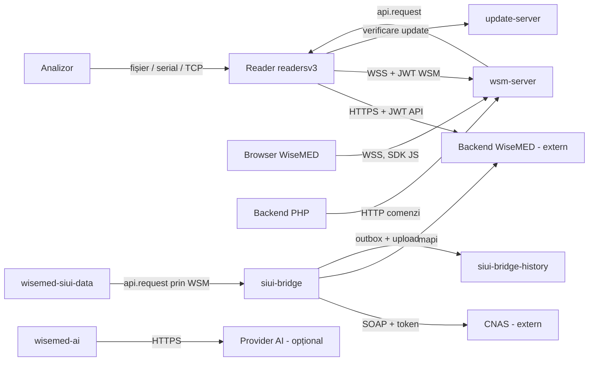

# WiseMED Lab Readers — arhitectura implementată

> **Stare la 2026-11-14:** etapa de înțelegere este documentată pentru commit-ul `d53088e`
> plus modificările locale. Documentul descrie starea existentă, nu propuneri. Acoperirea
> nu este completă: zonele necitite și verificările neexecutate sunt listate în §8 și în
> [gaps-and-contradictions.md](docs/architecture/gaps-and-contradictions.md).

Etichete folosite în toată documentația: `CONFIRMAT DIN COD`, `CONFIRMAT PRIN TEST LOCAL`,
`DOCUMENTAT, NEVERIFICAT`, `INFERENȚĂ`, `NECUNOSCUT` (uneori prescurtate, cu legendă în
antetul fiecărui document).

## 1. Ce este sistemul

Un ecosistem de aplicații Go care leagă analizoare de laborator și utilitare medicale de
WiseMED și de servicii externe (CNAS, provider AI). Are două părți independente:

- **`readersv3/`** — un framework modular și 32 de aplicații compuse din el: 22 de readere
  de analizoare, trei servicii CNAS, WiseMED AI, cinci utilitare și serverul de actualizări.
- **`wsm-server/`** — un hub WebSocket multi-tenant, exclusiv în memorie, prin care
  browserul WiseMED și backendul PHP ajung la aplicațiile din teren.

Backendul WiseMED, serviciile CNAS și aplicația Flutter completă sunt externe. În repo
există doar stratul REST PHP (`apis/`), fără logica de business.

## 2. Module Go

| Modul | Cale | Rol |
|---|---|---|
| `wisemed-labreaders/readersv3` | `readersv3/go.mod` | framework + toate aplicațiile |
| `wisemed-labreaders/serverlast/wsm-server` | `wsm-server/go.mod` | `cmd/wsm-server`, `cmd/wsmctl` |
| `wisemed-labreaders/serverlast/wsm-server/integration` | `wsm-server/integration/go.mod` | test de integrare reader ↔ WSM |
| `wisemed-labreaders` | `go.mod` (rădăcină) | orfan, fără cod |

Comenzile Go se rulează din directorul fiecărui modul.

## 3. Cum este compusă o aplicație

Fiecare `readersv3/apps/<app>/main.go` declară o listă hardcodată de ID-uri de module și
apelează `runner.Run`. Contractele sunt în `readersv3/core/module/types.go`: `Module`
(`ID`, `Init`), `Starter` (`Start`), `Runtime` (config, mux HTTP, meniu, registry de
servicii). Toate ID-urile sunt înregistrate în `readersv3/modules/builtin/register.go`.

Puncte care contrazic intuiția, toate confirmate din cod:

- modulele se inițializează strict în ordinea din listă, fără graf de dependențe;
- `Start` rulează în paralel, iar primul `Start` care se întoarce oprește tot runtime-ul;
- `InitModules` rulează de două ori pe darwin/linux (`readersv3/apps/runner/runner.go:143`
  și `:264`);
- `transport-serial` și `transport-tcpip` nu fac I/O (îl face protocolul), iar `login`,
  `dashboard`, `stats`, `analytes` și `events` sunt doar meniu; logica este în
  `modules/localhttp` și `modules/storage/sqlite`;
- `update-server` nu folosește `runner.Run`.

Detalii: [runtime-and-modules.md](docs/architecture/runtime-and-modules.md),
[application-catalog.md](docs/architecture/application-catalog.md).

## 4. Semantica garanțiilor

| Semnal | Ce confirmă | Ce nu confirmă |
|---|---|---|
| `command_ack` WSM | mesajul a intrat în coada de trimitere | recepția sau execuția |
| HTTP 200 la `POST /api/connections/{id}/commands` | a sosit reply-ul peer-ului | succesul API-ului remote (`response.status`, `response.ok`) |
| HTTP 202 SIUI | jobul e rezervat și pus în coadă | că s-a trimis ceva la CNAS |
| job SIUI `completed` | apelul s-a încheiat | acceptarea de către CNAS (se citește rezultatul) |
| timeout / anulare locală | apelantul a încetat să aștepte | oprirea execuției remote |

WSM nu are coadă persistentă, replay, deduplicare sau livrare garantată. Stările
`unknown` (job SIUI) și `*_execution_unknown` (wrapper HTTP WSM) cer reconciliere manuală;
nu există cod de reconciliere. Retry-ul callbackului și al arhivării SIUI nu reapelează
CNAS. Trimiterea rezultatelor de laborator în buletin nu are coadă, retry sau cheie de
idempotency.

Detalii: [communication-map.md](docs/architecture/communication-map.md),
[data-and-state-machines.md](docs/architecture/data-and-state-machines.md).

## 5. Identitate și autorizare

- `tenant_id`, `sub`, `client_id`, `equipment_id`, `reader_id` și `connection_id` au roluri
  diferite; tenantul vine din cheia JWT verificată, nu din mesaj.
- `api.request` apelează handlerii locali pe același mux; nu este proxy. `api:invoke`
  înseamnă sesiune locală non-admin, `api:admin` admin local.
- `api:admin` nu acordă drepturi clinice în WiseMED AI și nici acces la consola admin WSM.
- JWT-ul WSM, tichetul de control, cookie-ul local, JWT-ul local SIUI, sesiunea CNAS,
  tokenul History și JWT-ul SIUI Data nu sunt interschimbabile.

Detalii și constatările de securitate ale stării existente:
[security-and-identity.md](docs/architecture/security-and-identity.md).

## 6. Documentație detaliată

| Document | Conținut |
|---|---|
| [application-catalog.md](docs/architecture/application-catalog.md) | cele 32 de aplicații + WSM: entrypoint, module, persistență, porturi; zonele auxiliare |
| [runtime-and-modules.md](docs/architecture/runtime-and-modules.md) | lifecycle, registry de module și servicii, configurare |
| [communication-map.md](docs/architecture/communication-map.md) | matricea comunicațiilor și nepotrivirile de interfață |
| [api-catalog.md](docs/architecture/api-catalog.md) | rute, comenzi, cele 63 de operații SIUI, envelope-uri, paritate |
| [security-and-identity.md](docs/architecture/security-and-identity.md) | credențiale, limite de încredere, constatări |
| [data-and-state-machines.md](docs/architecture/data-and-state-machines.md) | date, tranzacții, concurență, diagrame de stare |
| [end-to-end-flows.md](docs/architecture/end-to-end-flows.md) | nouă fluxuri urmărite cap-coadă, cu diagrame |
| [build-deploy-update.md](docs/architecture/build-deploy-update.md) | build, installer, servicii, Docker, CI, actualizări |
| [verification-matrix.md](docs/architecture/verification-matrix.md) | ce s-a rulat, ce a demonstrat, ce nu |
| [gaps-and-contradictions.md](docs/architecture/gaps-and-contradictions.md) | discrepanțe, necunoscute, întrebări |
| [agent-context.md](docs/architecture/agent-context.md) | rezumat compact pentru sesiunile următoare |
| `docs/architecture/_reports/01`–`06` | rapoartele de investigație cu dovezile complete |

## 7. Verificare

Rulat local pe macOS arm64, go1.25.5: build, `vet`, teste și `-race` trec în `readersv3` și
`wsm-server`; testul de integrare WSM trece; Vitest și `vue-tsc` trec pentru `wisemed-ai`.
Două eșecuri preexistente: un test al SDK-ului SIUI (ruta `report/package` lipsește din
catalogul SDK) și `readersv3/docker/test-update.py` pe bash 3.2. Rezultatele complete sunt
în [verification-matrix.md](docs/architecture/verification-matrix.md).

## 8. Limitele acestei etape

- Rapoartele pe subsisteme sunt lectură de cod; numai verificările din §7 au fost executate.
- Nimic nu confirmă hardware real, CNAS real, backendul WiseMED din producție sau instalarea
  pe Windows și Linux.
- Testele care cer PostgreSQL, MySQL, token CNAS, `jsdom`, Playwright și Docker nu au rulat.
- Mai multe efecte cap-coadă sunt deduse din cod și nereproduse: dublul `Init`, ciclul de
  reconectare în `device_key`, evenimentele WiseMED AI refuzate de WSM, rezultatul
  re-recepționat care nu se mai trimite, unitățile de serviciu cu `-headless`.
- Părți citite doar structural: parserele mari, majoritatea handlerilor `localhttp`,
  billing-ul și vocea din WiseMED AI, facturarea SIUI.
