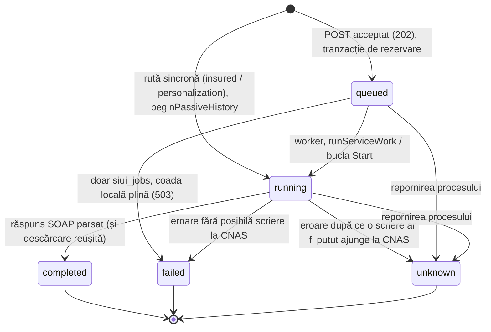
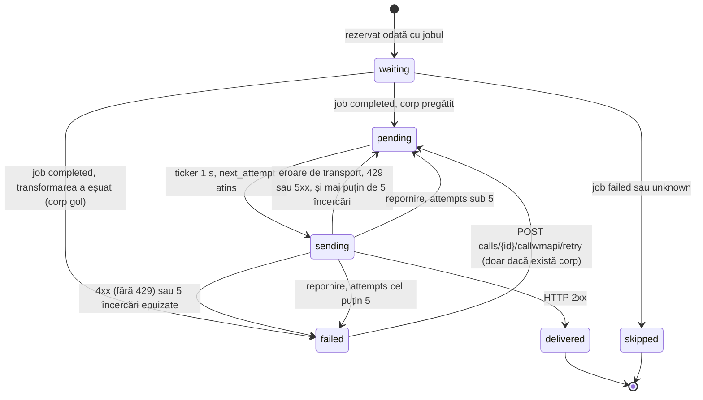
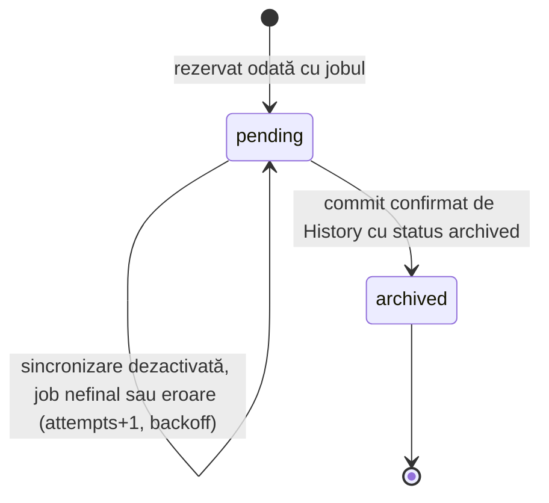

# 04 — Integrarea CNAS (SIUI / SIPE / DocMED) și serviciile de date

Investigație read-only, 2026-11-14. Nu s-a rulat niciun binar, niciun test și nu s-a contactat CNAS sau alt sistem extern.

**Etichete**: `CONFIRMAT DIN COD` (citit în sursă la linia indicată), `CONFIRMAT PRIN TEST LOCAL` (nefolosită: testele NU au fost executate; unde există un test relevant e menționat ca „test existent, neexecutat”), `DOCUMENTAT, NEVERIFICAT`, `INFERENȚĂ`, `NECUNOSCUT`.

**Prescurtări de cale** (relative la rădăcina repo-ului):

| Prefix | Cale |
| --- | --- |
| `S/` | `readersv3/modules/siui/` |
| `H/` | `readersv3/modules/siuihistory/` |
| `D/` | `readersv3/modules/siuidata/` |
| `SH/` | `readersv3/shared/` |
| `LH/` | `readersv3/modules/localhttp/` |
| `WS/` | `readersv3/modules/ws/` |
| `A/` | `readersv3/apps/` |

**Separare implementare ↔ contract extern**: tot ce ține de comportamentul serverelor CNAS (semantica `OSCP_RESPONSE`, HTTP 500 cu SOAP Fault, formatul `[URL, dimensiune]`, stări de asigurat) este cunoscut doar din cod, WSDL/XSD încorporate și documentația locală; nu a fost observat pe viu și este marcat `DOCUMENTAT, NEVERIFICAT` acolo unde contează.

---

## 0. Componente și compunere

| Aplicație | `main.go` — module încărcate | Protocol | Stocare |
| --- | --- | --- | --- |
| `siui-bridge` | `local-http, events, wisemed-api, wisemed-ws, login, help, siui` (`A/siui-bridge/main.go:25`) | `siui` | SQLite `siui-jobs.db` + fișiere |
| `siui-bridge-history` | `… , siui-history` (`A/siui-bridge-history/main.go:25`) | `siui-history` | MySQL (index) + local/S3 (obiecte) |
| `wisemed-siui-data` | `… , siui-data` (`A/wisemed-siui-data/main.go:25`) | `siui-data` | PostgreSQL |

`CONFIRMAT DIN COD`. Clientul WSM se anunță ca `siui-bridge` / `siui-bridge-history` cu rol `service` (`WS/module.go:694-712`, `clientType`, `clientRole`); `wisemed-siui-data` rămâne `reader` (aceeași funcție, ramura implicită).

`old-src/MedicalPAGES.SIUIBridge`: vechiul bridge C# WinForms (`MedicalPAGES.SIUI2.0.csproj`), cu adrese fixe `https://www.siui.ro/...`, `sipe.siui.ro`, `ceas.siui.ro` (`MainForm.cs:48-62`) și ocolirea validării certificatului de server (`MainForm.cs:118-143`, `ServerCertificateBypass`, `CertPolicy`). Nu este referit de niciun fișier Go sau YAML; apare doar în `ARCHITECTURE.md`. Rol: referință istorică pentru secvența „semnează CMS → ZIP → Base64” (`S/openapi.go`, descrierea `report/package`). `CONFIRMAT DIN COD` (absența referințelor: grep) / `INFERENȚĂ` (rolul de referință). `CeasMedicalDataWS` din vechiul bridge nu are echivalent în Go.

---

## 1. Inventarul operațiilor — recalculat

### 1.1 Rezultat

| Sursă | Număr | Dovadă |
| --- | --- | --- |
| `S/assets/operations.json` (SIUI/SIPE/eFactura) | **41** | numărat programatic |
| `S/assets/docmed_operations.json` | **22** | numărat programatic |
| Catalog la rulare = `operations()` | **63** | `S/operations.go:40-45` concatenează cele două fișiere |
| Rute expuse `POST /api/siui/{grup}/{nume}` | **63** | `S/service_jobs.go:164-169` rezolvă exclusiv prin `findOperation` |
| OpenAPI generat | **63** căi de operații | `S/openapi.go:21` iterează `operations()` |
| Operații în cele 9 WSDL încorporate | **73** | numărat din `portType` în `S/assets/wsdl/*.wsdl` |
| Operații doar în WSDL, neexpuse | **10** | diferența, listă mai jos |

Concluzie: **63 este corect**, iar catalogul, dispatcher-ul și OpenAPI nu pot diverge între ele, pentru că toate derivă din aceeași funcție `operations()`. `CONFIRMAT DIN COD`. Nu există duplicate `(grup, nume)`.

Atenție: `catalog.go` NU conține catalogul; conține constante SOAP, parserul XML limitat și parsarea răspunsului de validare PARA. Catalogul este în `operations.go` + JSON.

Distribuție pe serviciu CNAS: `SiuiWS` 11, `SiuiInsuredWS` 3, `SiuiValidateWS` 8 (7 în grupul `clinice` + `validateReport` în `general`), `EPrescriptionWS` 14, `SiuiEInvoiceWS` 5, `DocMedService` 15, `DocStatusChangerService` 3, `DocumentSeries` 2, `MedicalDocumentDownloader` 2.

### 1.2 Operații prezente doar în WSDL — NEEXPUSE

| WSDL | Operații neexpuse |
| --- | --- |
| `SiuiValidateWS.wsdl` (10 în WSDL, 8 expuse) | `validateEnlisted`, `validatePharmacyDrugs` |
| `SiuiWS.wsdl` (19 în WSDL, 11 expuse) | `getDecisions`, `getPartnerInfo`, `getRegisterFeedback`, `getRegisterFeedbackAggregated`, `getSupplierFeedback`, `isPhysicianOnContract`, `registerApplicationInstance`, `sendSupplierData` |

`CONFIRMAT DIN COD` (comparație WSDL ↔ JSON). `A/siui-bridge/docs/API.md:758` documentează ca excluse doar primele două; cele 8 din `SiuiWS` nu sunt menționate nicăieri ca excluse (vezi Contradicții).

### 1.3 Tabel operații expuse (toate asincrone: HTTP 202 + polling)

Rută = `POST /api/siui/<grup>/<operație>`; prin WSS aceeași cale în `api.request`. `M` = `mutating` (cere administrator). `D` = `download` (CNAS întoarce URL + dimensiune, bridge-ul descarcă fișierul).

| # | Operație | Serviciu CNAS | Grup (rută) | Stil SOAP | M | D |
| --- | --- | --- | --- | --- | --- | --- |
| 1 | `getCatalogues` | SiuiWS | general | document | – | D |
| 2 | `getProviderInfo` | SiuiWS | general | document | – | D |
| 3 | `getProviderInfoForPhysician` | SiuiWS | general | document | – | D |
| 4 | `sendReport` | SiuiWS | general | document | M | – |
| 5 | `getReportFeedback` | SiuiWS | general | document | – | D |
| 6 | `getRefund` | SiuiWS | general | document | – | D |
| 7 | `getRefundForPhysician` | SiuiWS | general | document | – | D |
| 8 | `getRefundForInvoice` | SiuiWS | general | document | – | D |
| 9 | `generatePrescriptionSeries` | SiuiWS | general | document | M | D |
| 10 | `getPrescriptionSeriesInfo` | SiuiWS | general | document | – | D |
| 11 | `getPhysicianCatalogues` | SiuiWS | general | document | – | D |
| 12 | `getInsured` | SiuiInsuredWS | general | rpc | – | – |
| 13 | `getInsuredByCID` | SiuiInsuredWS | general | rpc | – | – |
| 14 | `getPersonInfo` | SiuiInsuredWS | general | rpc | – | – |
| 15 | `validateReport` (CLIN/PARA) | SiuiValidateWS | **general** | rpc | M | – |
| 16 | `getPrescription` | SiuiValidateWS | clinice | rpc | – | – |
| 17 | `getClinicReferral` | SiuiValidateWS | clinice | rpc | – | – |
| 18 | `getLabReferral` | SiuiValidateWS | clinice | rpc | – | – |
| 19 | `validatePrescription` | SiuiValidateWS | clinice | rpc | M | – |
| 20 | `validateClinicReferral` | SiuiValidateWS | clinice | rpc | M | – |
| 21 | `validateLabReferral` | SiuiValidateWS | clinice | rpc | M | – |
| 22 | `validateSickLeave` | SiuiValidateWS | clinice | rpc | M | – |
| 23 | `processIssuedPrescription` | EPrescriptionWS | clinice | rpc | M | – |
| 24 | `cancelReleasedPrescription` | EPrescriptionWS | clinice | rpc | M | – |
| 25 | `updateInvoices` | EPrescriptionWS | clinice | rpc | M | – |
| 26 | `getReleasedPrescription` | EPrescriptionWS | clinice | rpc | – | – |
| 27 | `processPrescribedPrescription` | EPrescriptionWS | clinice | rpc | M | – |
| 28 | `getPrescribedPrescription` | EPrescriptionWS | clinice | rpc | – | – |
| 29 | `cancelPrescribedPrescription` | EPrescriptionWS | clinice | rpc | M | – |
| 30 | `downloadNotReportedPrescriptionsReport` | EPrescriptionWS | clinice | rpc | – | – |
| 31 | `getStatusForPrescriptions` | EPrescriptionWS | clinice | rpc | – | – |
| 32 | `getPrescriptionsSeriesNo` | EPrescriptionWS | clinice | rpc | – | – |
| 33 | `getPrescribedPrescriptionsForCid` | EPrescriptionWS | clinice | rpc | – | – |
| 34 | `processHospitalPrescription` | EPrescriptionWS | clinice | rpc | M | – |
| 35 | `cancelReleasedHospitalPrescription` | EPrescriptionWS | clinice | rpc | M | – |
| 36 | `getReleasedHospitalPrescription` | EPrescriptionWS | clinice | rpc | – | – |
| 37 | `sendEInvoice` | SiuiEInvoiceWS | facturare | document | M | – |
| 38 | `getEInvoice` | SiuiEInvoiceWS | facturare | document | – | D |
| 39 | `getEInvoiceId` | SiuiEInvoiceWS | facturare | document | – | – |
| 40 | `getEInvoiceClearingNote` | SiuiEInvoiceWS | facturare | document | – | D |
| 41 | `cancelEInvoice` | SiuiEInvoiceWS | facturare | document | M | – |
| 42–56 | `MedicalLeave`, `MedicalLetter`, `PhysicianElectronicPrescription`, `RecoveryMedicalPlan`, `LaboratoryMFReferral`, `LaboratoryAGReferral`, `LaboratoryCTReferral`, `LaboratorySGReferral`, `PalliativeRecommendation`, `MedicalDeviceRecommendation`, `HomeCareMedicalPlan`, `ClinicalReferral`, `LaboratoryRMNReferral`, `LaboratoryReferral`, `HomeCareRecommendation` | DocMedService (`/loader/ws`) | docmed | docmed (document/literal) | M | – |
| 57 | `ConsumeDocument` | DocStatusChangerService (`/status/ws`) | docmed | docmed | M | – |
| 58 | `UnconsumeDocument` | DocStatusChangerService | docmed | docmed | M | – |
| 59 | `GetDocumentStatus` | DocStatusChangerService | docmed | docmed | – | – |
| 60 | `GenDocumentSeries` | DocumentSeries (`/seq/ws`) | docmed | docmed | M | – |
| 61 | `GetDocumentSeries` | DocumentSeries | docmed | docmed | – | – |
| 62 | `GetMedicalDocumentXml` | MedicalDocumentDownloader (`/download/ws`) | docmed | docmed | – | – |
| 63 | `GetMedicalDocument` | MedicalDocumentDownloader | docmed | docmed | – | – |

Totaluri: **34** `mutating` (16 SIUI/SIPE/eFactura + 18 DocMED), **29** citiri, **12** `download`. `CONFIRMAT DIN COD` (JSON). Notă: `generatePrescriptionSeries` este singura operație simultan `M` și `D`.

### 1.4 Rute care apelează CNAS în afara catalogului (sincrone)

| Rută | Apel CNAS | Sincron | Observație |
| --- | --- | --- | --- |
| `POST /api/siui/validations` | `SiuiValidateWS.validateReport` (doar PARA / `RQ_PARA_SRV`) | **asincron** (tabela veche `siui_jobs`) | dublează #15; `S/module.go:365-411`, `S/client.go:68` |
| `POST /api/siui/insured` (`mode=cnas`) | `SiuiInsuredWS.getInsured` | sincron, 25 s | dublează #12; `S/insured.go:101-158` |
| `POST /api/siui/personalization` | `SiuiWS.getProviderInfo` (fix `PARA`) + GET fișier | sincron, 25 s | dublează #2; `S/passive.go:201-240` |
| `POST /api/siui/ocsp-test`, `POST /api/siui/general/ocsp` | `GET /OCSP/validator` | sincron, 120 s | nu e SOAP |
| `POST /api/siui/dashboard/checks` | `HEAD` pe endpointuri, fără certificat/credențiale | sincron | `S/openapi.go` (descriere), `S/dashboard.go:60` |

---

## 2. API-ul expus de `siui-bridge`

### 2.1 Înregistrare și middleware

- `rt.Handle("/api/siui/", m.authenticate(m.handle))` — `S/module.go:135`.
- `rt.Handle("/api/siui-history-sync/", m.authenticate(m.historyHTTP))` — `S/history_sync.go:60`.
- `rt.Handle("/history-sync-ui", …)` — HTML static, **fără middleware de autentificare** (`S/history_sync.go:61-64`). `CONFIRMAT DIN COD`; pagina nu conține date, dar nu e protejată (`INFERENȚĂ`: shell UI; conținutul `historySyncPage` nu a fost citit).
- `authenticate` (`S/auth.go:27-49`): (1) principal WSS → `guard.RequireSession`; (2) `Authorization: Bearer` → necesită `r.TLS != nil`, apoi `verifyJWT`; (3) altfel cookie de sesiune.
- Identitate în `handle` (`S/module.go:249-277`): `owner = "local:"+subject`; JWT cu `owner` semnat îl suprascrie; principal WSS → `owner = wsm:"<tenant>":"<subject>"`, `admin = p.Admin`. Pentru cereri non-WSS și non-GET se verifică `Origin` = `Host` + schemă (403 `origin rejected`).

### 2.2 Envelope JSON

- Succes: `{"ok":true, ...}`; eroare: `{"ok":false,"error":"<mesaj>"}` — `S/module.go:223-231` (`respond`, `fail`). Antete: `Content-Type: application/json; charset=utf-8`, `Cache-Control: no-store`.
- **Inconsecvență**: rutele `operations*`, `downloads/storage`, `dashboard` și `siui-history-sync/*` răspund cu `"success":true` în loc de `"ok":true` (`S/operations_history.go:220,282`, `S/download_storage.go:175`, `S/history_sync.go:137,156`); `GET siui-history-sync/settings` întoarce obiectul brut, fără envelope (`S/history_sync.go:95-99`). Erorile folosesc însă peste tot `fail` → `{"ok":false,...}`. `CONFIRMAT DIN COD`.
- Corp de cerere: `Content-Type: application/json` obligatoriu, `DisallowUnknownFields`, un singur obiect JSON, limită implicită 2 MiB (`S/module.go:232-248`); `sendReport` 6×10 MiB + 1 MiB, DocMED 64 MiB (`S/service_jobs.go:184-191`).
- Rută necunoscută → **405** `unsupported route or method`, nu 404 (`S/module.go:444-446`).

### 2.3 Rutele `/api/siui/*`

`A` = administrator obligatoriu; `U` = orice identitate autentificată; proprietar = `owner` (administratorul local vede tot doar în `operations*`/`dashboard`).

| Metodă + cale | Handler (fișier:linie) | Auth | Corp / parametri | Coduri |
| --- | --- | --- | --- | --- |
| `POST {general,clinice,facturare,docmed}/{op}` | `serviceHTTP` `S/service_jobs.go:164-348` | U; A dacă `mutating` | `{operation_id, parameters{…}, fields?(doar docmed), callwmapi?}` | 202 creat, 200 duplicat, 400, 403, 404 op. necunoscută, 405, 409, 500, 503 |
| `GET calls/{id}` | `S/service_jobs.go:142-162` | U, doar proprietar | – | 200 `{call}`, 404, 500, 503 |
| `GET calls/{id}/file` | `serviceFileHTTP` `S/service_jobs.go:493-588` | U, proprietar | `offset`, `unzip`, `entry`, `format`, `validateXSD`, `schema`, `docmed_attachment` | 200 fragment base64 ≤256 KiB, 400, 404, 409 (copie locală ștearsă), 422, 500 |
| `POST calls/{id}/callwmapi/retry` | `S/service_jobs.go:123-141` | U, proprietar | – | 202, 404, 409, 500 |
| `GET general/ocsp` | `S/service_jobs.go:82-94` | A | – | 200 `{debug}` |
| `POST general/ocsp` | `S/service_jobs.go:95-115` | A | `{}` | 200 **include tokenul OCSP în clar** (`token`), 400, 403, 409, 502, 503 |
| `POST auth/token` | `tokenHTTP` `S/auth.go:92-109` | sesiune cookie sau WSS; **nu** JWT (403) | `{}` | 200 `{access_token, token_type, expires_in:900}`, 400 fără HTTPS |
| `GET catalog` | `S/module.go:298-302` | U | – | 200 `{operations, insurance_houses, docmed_defaults}` |
| `GET openapi.json` | `S/module.go:303-304` | U | – | 200 document OpenAPI 3.0.3 |
| `GET status` | `S/module.go:311-315` | U | – | 200 `{platform, native_supported, configured, pending, report_types}` |
| `GET settings` / `PUT settings` | `settingsHTTP` `S/module.go:461-639` | A | PUT: `fiscal_code, cas_code, licence?, certificate_store, certificate_thumbprint, base_url, pe_base_url?, einvoice_base_url?, docmed_base_url?, allow_*?` | 200, 400, 403, 405, 409 (operații active), 500 |
| `GET certificates?store=` | `S/module.go:344-364` | A | – | 200, 403, 503 |
| `POST certificates/refresh` | `S/module.go:338-343` | **U (fără admin)** | – | 200, 503 |
| `GET token-pin` / `PUT token-pin` | `tokenPINHTTP` `S/token_pin_http.go:8-58` | A | PUT `{pin, forget, manual}` | 200, 400, 403, 405, 409, 500, 503 |
| `POST ocsp-test` | `ocspHTTP` `S/passive.go:39-57` | U | `{}` | 200, 400, 409, 502, 503 |
| `POST insured` | `insuredHTTP` `S/insured.go:101-158` | U | `{mode:"local"|"cnas", cnp, date}` | 200, 400, 409, 500, 502, 503; antet `X-SIUI-Call-ID` |
| `POST personalization` | `personalizationHTTP` `S/passive.go:201-240` | A | `{start, stop}` (YYYY-MM-DD) | 200 `{file{data_base64…}}`, 400, 403, 409, 500, 502 |
| `POST validations` | `S/module.go:365-411` | U | `{operation_id, xml}` | 202, 200 duplicat, 400, 409, 503 (coadă plină / worker în pornire) |
| `GET validations` | `S/module.go:412-432` | U, proprietar | – | 200 ultimele 50 |
| `GET validations/{id}` | `S/module.go:433-443` | U, proprietar | – | 200, 404, 500 |
| `GET invoice/model` | `invoiceHTTP` `S/invoice.go:280-287` | U | – | 200 |
| `POST invoice/preview` | `S/invoice.go:292-332` | U | model factură | 200, 400, 500 |
| `POST invoice/package` | `S/invoice.go:333-378` | A | model factură | 200, 400, 403, 413, 500, 502, 503 |
| `POST report/package` | `reportPackageHTTP` `S/report.go:45-105` | A | `{filename, report_xml}` | 200, 400, 403, 405, 413, 500, 502, 503 |
| `GET operations` | `listOperations` `S/operations_history.go:222-283` | U (propriile) / A (toate) | `from, to, operation_id, operation, status, offset` | 200 pagină de 100, 400, 500, 503 |
| `GET operations/{id}` | `S/operations_history.go:139-221` | proprietar / A | – | 200 `{call}` cu parametri (previzualizare), rezultat, evenimente; 404, 500 |
| `GET operations/{id}/request?name=&offset=` | `S/operations_history.go:169-193` | proprietar / A | – | 200 binar sau fragment base64; 404, 400 |
| `GET operations/{id}/file` | `S/operations_history.go:148-156` | proprietar / A | ca `calls/{id}/file` | idem |
| `GET operations/{id}/history`, `/history/request`, `/history/{artifact}` | `operationHistoryHTTP` `S/operations_history.go:287-415` | proprietar / A | `offset` opțional | 200, 400, 404, 409 (altă destinație History), 500, 502, 503 |
| `GET dashboard?from=&to=` | `dashboardHTTP` `S/dashboard.go:117-340` | U (propriile) / A | interval ≤31 zile | 200, 400, 405, 500, 503 |
| `POST dashboard/checks` | `dashboardChecksHTTP` `S/dashboard.go:60-116` | A | – | 200, 403, 405, 409 |
| `GET downloads/storage` / `POST downloads/storage` | `downloadStorageHTTP` `S/download_storage.go:65-176` | A | POST `{confirm:true}` | 200, 400, 403, 405, 409, 500, 503 |

`/api/siui-history-sync/*` (toate `A`, `S/history_sync.go:66-182`): `GET settings` (token golit), `PUT settings`, `GET status`, `POST retry`, `POST test`. Coduri: 200, 400, 403, 404, 500, 502, 503.

Toate liniile de mai sus: `CONFIRMAT DIN COD`.

### 2.4 HTTP local vs WSS (`api.request`)

- Adaptorul WSS (`SH/apibridge/bridge.go:51-162`, `Invoke`) NU deschide o conexiune HTTP; apelează direct mux-ul (`WS/module.go:512-534`). Orice cale `/api/*` este deci accesibilă prin WSS, cu excepția `/api/wss/bridge*`, `/api/wss/open`, `/api/wss/debug`, `/api/session/login`, `/api/session/logout` (`bridge.go:63-65`). `CONFIRMAT DIN COD`.
- Condiții: expeditorul trebuie să aibă scope `api:invoke` (`WS/module.go:522-524`); `Admin = scope api:admin` (`WS/module.go:528`). Scope-urile sunt câmpuri `sender_scopes` puse în plic de serverul WSM; bridge-ul le crede fără verificare proprie (`INFERENȚĂ`: încrederea se sprijină pe conexiunea autentificată cu WSM; validarea în `wsm-server` nu a fost auditată aici, vezi doar `wsm-server/internal/server/server.go:437`).
- Răspuns WSS: `{kind:"api.response", status, content_type, headers{Content-Disposition,ETag,Location}, body | body_base64}` (`bridge.go:42-49,138-160`). HTML este refuzat.
- Limite: corp cerere și răspuns ≤ **4 MiB** (`bridge.go:18,85,181`). Timeout 30 s implicit; 130 s pentru `POST /api/siui/general/ocsp`, `/ocsp-test`, `/invoice/package` (`bridge.go:103-105`).
- Consecință (`INFERENȚĂ`): cererile mai mari de 4 MiB (`sendReport` până la 10 MiB XML, DocMED până la 32 MiB) nu pot trece prin WSS, deși ruta le acceptă pe HTTPS local. Descărcările funcționează prin WSS doar fragmentat (`offset`, 256 KiB).
- `POST /api/siui/auth/token` prin WSS emite un JWT local cu `owner` WSM semnat, utilizabil apoi direct pe HTTPS (`S/auth.go:97,107`; test existent, neexecutat: `TestWSMIssuedJWTRetainsTenantIsolation`).

### 2.5 Paritate rute ↔ OpenAPI ↔ `docs/API.md` ↔ wrapper browser ↔ teste

| Element | Cod | OpenAPI (`S/openapi.go`) | `A/siui-bridge/docs/API.md` | `wsm-server/docs/siui-browser-wrapper.md` + SDK `wsm-server/internal/server/sdk/siui-bridge.js` |
| --- | --- | --- | --- | --- |
| 63 operații | da | da (generate) | 41 nominal; DocMED delegat către `DocMED.md` (doar `GetMedicalDocumentXml` apare nominal) | SDK: toate 63 nominal; doc wrapper: 41 + 2 nume DocMED, restul descrise generic |
| Secțiuni detaliate per operație | – | – | 29 titluri `####`; lipsesc secțiuni proprii pentru `generatePrescriptionSeries`, `getPrescriptionSeriesInfo`, `processIssuedPrescription`, `cancelReleasedPrescription`, `updateInvoices`, `getReleasedPrescription`, `getPrescriptionsSeriesNo`, cele 5 eFactura (apar doar în tabele ulterioare) | – |
| `calls/{id}`, `/file`, `/callwmapi/retry` | da | da | da | da (`retryCallWMAPI`, js:293) |
| `validations` (3 rute), `insured`, `personalization`, `ocsp-test` | da | **lipsesc** | menționate ca „rute vechi” (`API.md:756`) | da (`wrapper.md:159-174`) |
| `certificates/refresh` | da | **lipsește** | da | da |
| `GET general/ocsp` | da | doar `post` | – | – |
| `siui-history-sync/*` | da | **lipsesc** | da (`API.md:1207`) | nu apar în lista de căi a wrapperului |
| `operations*`, `dashboard*`, `downloads/storage`, `invoice/*`, `report/package`, `token-pin`, `settings` | da | da | da | SDK: da (js:99-116) |
| Coduri de răspuns | vezi 2.3 | generice; `settings`/`certificates`/`status` declară doar 200/401, fără 403 | – | – |
| `tags` OpenAPI | – | declară `general`, `clinice`, `facturare`; operațiile DocMED folosesc tag `docmed` nedeclarat; titlu „GENERAL / CLINICE / FACTURARE”, versiune `2.1.0` | – | – |
| `PUT settings.required` | `certificate_thumbprint` poate fi gol (`S/module.go:550-551`) | marcat `required` | – | – |

Teste existente (neexecutate) care fixează paritatea: `TestCatalogMatchesBundledWSDL`, `TestEveryRequestedSOAPOperation`, `TestCompletePrescriptionWSDLCoverage`, `TestDocMedAllWSDLContractsAndSchemas` (`S/operations_test.go:83,389`, `S/prescriptions_test.go:16`, `S/docmed_test.go:120`). `A/siui-bridge/tests/` conține doar oracolul Java `docmed-contract-oracle` (vezi §10), nu teste de rute.

---

## 3. Autentificare

| Mecanism | Ce este | Emitere | Verificare | Ce protejează |
| --- | --- | --- | --- | --- |
| Cookie local `wmr_local_session_<hex>` | sesiune de browser a utilitarului | `POST /api/session/login` (modulul `local-http`); nume = `sha256(reader_id)[:6]` (`LH/module.go:2667-2670`); `HttpOnly`, `SameSite=Lax`, `Path=/`, expiră la 12 h (`LH/module.go:1158-1165, 2530`); fără atribut `Secure` în fragmentul citit | token semnat cu `utilitySessionKey` = 32 octeți aleatori **per proces** pentru protocoalele `siui`, `siui-history`, `siui-data` (`LH/module.go:202-203, 2660-2664`) | toate rutele locale; rolul `admin` = `UserType <= 0` (`LH/module.go:563-566`) |
| JWT local SIUI | Bearer pentru clienți direcți HTTPS | `POST /api/siui/auth/token` (`S/auth.go:92-109`), doar cu cookie sau principal WSS; un JWT nu poate emite alt JWT (403) | HS256, cheie `m.jwtKey` 32 octeți aleatori per proces (`S/module.go:118-121`); `verifyJWT` (`S/auth.go:58-91`): `alg=HS256`, `typ=JWT`, `iss=siui-bridge`, `aud=siui-api`, `sub` nevid, `exp>now`, `iat<=now`, `exp-iat<=900`, token ≤8192 octeți | exclusiv handler-ele `/api/siui/` și `/api/siui-history-sync/`; refuzat fără TLS (`S/auth.go:35-38`) |
| Principal WSS | identitate atestată de WSM | plicul `command` cu `sender_subject`, `sender_tenant_id`, `sender_connection_id`, `sender_ip`, `sender_scopes` (`WS/module.go:528`) | `apibridge.PrincipalFrom` cere `Subject` și `TenantID` nevide (`SH/apibridge/bridge.go:30-33`); `currentSession` îl transformă în sesiune efemeră (`LH/module.go:2566-2573`) | aceleași handler-e; izolare prin `owner = wsm:"tenant":"subject"` |
| Sesiunea OCSP CNAS | sesiune către CNAS, nu către bridge | `GET {base_url}/OCSP/validator?username=…` cu certificat client + `Authorization: Basic username:licență`; valoarea vine în antetul de răspuns `OSCP_RESPONSE` (`S/client.go:108-206`) | folosită ca antete `OSCP_RESPONSE` și `SessionID` la SOAP (`S/ocsp_session.go:25-31`); reutilizată ≤150 s, per configurație (`ocspMaxAge`, `ocspConfigKey`, `S/ocsp_session.go:11,24`) | apelurile către CNAS |

Claims JWT local (`apiClaims`, `S/auth.go:16-24`): `sub`, `iss`, `aud`, `exp`, `iat`, `admin` (bool), `owner` (opțional). Nu există scope-uri; singurul rol este `admin`.

De ce nu sunt interschimbabile (`CONFIRMAT DIN COD` pentru partea bridge-ului):
- JWT-ul local e semnat cu o cheie aleatorie din memoria procesului bridge; restartul îl invalidează. Serverul WSM nu are această cheie.
- JWT-ul WSM nu ajunge niciodată la bridge: bridge-ul primește doar câmpuri `sender_*` din plic. Un JWT WSM prezentat ca `Bearer` pe HTTPS local ar eșua la `verifyJWT` (altă cheie, alt `iss`/`aud`).
- Sesiunea OCSP este un secret CNAS; e returnată doar administratorului prin `POST general/ocsp` (`S/service_jobs.go:114`) și nu e persistată (rămâne în `Module.ocspSession`, memorie).
- Cookie-ul este legat de `reader_id` (nume) și de cheia de proces.

Roluri: `admin` necesar pentru operațiile `mutating`, `settings`, `certificates`, `token-pin`, `personalization`, `general/ocsp`, `invoice/package`, `report/package`, `dashboard/checks`, `downloads/storage`, `siui-history-sync/*`. Prin WSS, `admin` = scope `api:admin` (definit în `wsm-server/internal/config/devices.go:63-64`).

---

## 4. Certificat / token, PIN, serializare, OCSP, mTLS, endpointuri CNAS

### 4.1 Unde stă cheia privată

| Platformă | Mecanism | Dovadă |
| --- | --- | --- |
| Windows | certificat din magazinul `MY` (`CurrentUser` / `LocalMachine`) găsit după thumbprint SHA-1; transport WinHTTP cu `WINHTTP_OPTION_CLIENT_CERT_CONTEXT`; fără export de cheie | `S/native_windows.go:51-78, 79-230` |
| Windows cu PIN salvat | semnare prin `windowsPINSigner` + transport Go `tokenHTTP` | `S/native_windows.go:80-86`, `S/token_pin_windows.go:40-42,196,216` |
| macOS 12+ | Security.framework / CryptoTokenKit prin `purego` (fără CGO); `macSigner`; validarea serverului prin `SecTrust` | `S/security_darwin.go:67-100,214,256`, `S/native_darwin.go:63,144-212` |
| Linux amd64/arm64 | **PKCS#11** încărcat dinamic din `modules.siui.pkcs11_module` (`C_Login`, `C_Sign` …) | `S/token_pkcs11_linux.go:60-88,205-225,250-345` |
| alte OS | transport indisponibil | `S/native_other.go:16-24` |

Nu există variantă „certificat din fișier” (PFX/PEM) în modulul `siui`. `CONFIRMAT DIN COD`. Selecția se face prin `certificate_store` + `certificate_thumbprint`, cu profiluri per certificat (`certificate_profiles`, `S/profiles.go:10-65`).

### 4.2 PIN

- Depozit `siui-token-pins.json` lângă baza SQLite (`S/module.go:116`); înregistrare per certificat (`pinIdentity` = SHA-256 din `store:thumbprint:pkcs11_module`, `S/token_pin.go:49-52`).
- Criptare: AES-256-GCM cu cheie de instalare `<fișier>.key` (0600) pe Unix (`S/token_secret_unix.go:15-89`); pe Windows DPAPI (`S/token_secret_windows.go`, necitit în detaliu — `DOCUMENTAT, NEVERIFICAT`).
- O singură încercare automată concurentă per certificat (`active[key]`, `S/token_pin.go:210-223`); suspendare după 3 respingeri explicite (`pinFailureLimit`, `S/token_pin.go:22,248-253`); doar codurile de eroare de credențiale contează ca respingere (`S/token_pin_errors.go:10-17`).
- PIN manual temporar: doar în memorie, 150 s (`S/token_pin.go:130-155`).
- API: `GET/PUT /api/siui/token-pin`, administrator; răspunsul conține doar `configured`, `hint:"<hidden>"`, `blocked`, contoare (`S/token_pin_http.go:17-33`). PIN-ul nu este returnat niciodată. `CONFIRMAT DIN COD`.

### 4.3 Serializarea accesului la token

Nu există un mutex dedicat tokenului. Serializarea rezultă din trei mecanisme (`CONFIRMAT DIN COD`):
1. **O singură gorutină de lucru**: bucla `select` din `Module.Start` (`S/module.go:176-220`) execută pe rând callback-uri, `m.calls` (catalog) și `m.queue` (validări vechi).
2. **Contoare sub `m.mu`**: `m.pending` și `m.checking`. Rutele sincrone (`passiveClient`, `S/passive.go:19-38`) refuză cu 409 dacă `pending > 0` și setează `checking = true`; rutele asincrone refuză cu 409 dacă `checking` (`S/service_jobs.go:298`, `S/module.go:384`). Modificarea setărilor, a PIN-ului și reîncărcarea certificatelor refuză dacă `pending > 0` (`S/module.go:473`, `S/token_pin_http.go:39`, `S/certificates_refresh.go:15`).
3. **Blocaje punctuale**: `ocspSession.mu` ținut pe toată durata autentificării OCSP (`S/client.go:127-128`), `p11Modules` (mutex global PKCS#11, `S/token_pkcs11_linux.go:56,176,206,251`), `pinVault.mu`.

Unicitatea instanței: `flock` exclusiv pe `<database>.lock`, 5 s de așteptare (`S/module.go:143-161`, `S/lock_unix.go:10`).

### 4.4 „OCSP”

Termenul din cod desemnează **autentificarea CNAS de sesiune**, nu verificarea standard OCSP a certificatului. `sessionHeaders` (`S/client.go:108-206`): re-enumeră certificatele (`refreshCertificates`), trimite `GET /OCSP/validator?username=<CUI_CAS>`, cere HTTP 200 și antetul `OSCP_RESPONSE` (ortografie de protocol, ≤8192 octeți, fără CR/LF). Timeout `ocspTimeout = 120 s` pe rutele explicite (`S/client.go:16`); în cadrul unui job consumă din bugetul de 120 s al jobului.

Verificarea de revocare a certificatului **serverului** este treaba platformei: WinHTTP (validare Windows normală, `S/native_windows.go:110-112`), `SecTrust` pe macOS cu excepție opțională `allow_revoked_server_certificate` (`S/security_darwin.go:256,364`). Pe transportul Go (`tokenHTTP`, Linux și Windows cu PIN) nu se face verificare de revocare (`S/token_transport.go:24-45`: verificare standard `crypto/tls`). `CONFIRMAT DIN COD`.

### 4.5 mTLS către CNAS

- TLS 1.2 fix (min = max) pe transporturile Go (`S/token_transport.go:24`, `S/native_darwin.go:162`); WinHTTP: opțiunea 84 = `0x800` (TLS 1.2).
- Suite: toate suitele Go non-TLS1.3 + `TLS_RSA_WITH_AES_128/256_CBC_SHA` (`S/token_transport.go:47-52`).
- Fără redirecturi (`CheckRedirect → ErrUseLastResponse`), `DisableKeepAlives`, proxy din mediu / proxy de sistem pe Windows.
- Excepții configurabile: `allow_invalid_server_certificate_date` (doar expirarea; lanțul și numele rămân verificate, `S/token_transport.go:25-45`, `S/native_windows.go:157-161`) și `allow_revoked_server_certificate` (doar macOS).
- Reîncercare doar la nivel TCP: maximum 3 încercări de `dial`, 10 s fiecare, 500 ms pauză, numai pentru timeout de conectare (`dialCNAS`, `S/dial.go:12-49`). **Nicio reîncercare HTTP/TLS**. Pe WinHTTP nu există nici reîncercarea TCP (timeouts `10000,10000,20000,20000`, `S/native_windows.go:106`).

### 4.6 Endpointuri CNAS consumate (din cod)

| Scop | URL construit | Sursă |
| --- | --- | --- |
| Implicit SIUI | `https://siui.e-pias.ro` | `DefaultBaseURL`, `S/endpoints.go:7` |
| Implicit SIPE | `https://sipe.e-pias.ro` | `DefaultPEBaseURL`, `S/endpoints.go:8` |
| Implicit DocMED | `https://docmed.e-pias.ro` | `DefaultDocMedBaseURL`, `S/endpoints.go:9` |
| Sesiune | `{base_url}/OCSP/validator?username=…` | `S/client.go:109,179` — întotdeauna pe `base_url`, inclusiv pentru SIPE, eFactura și DocMED |
| SOAP clasic | `{origine}/svapntws/services/{Service}` | `S/operations.go:304`; `EPrescriptionWS` → `pe_base_url`; `SiuiEInvoiceWS` → `einvoice_base_url` (implicit `base_url`); restul → `base_url` (`serviceBaseURL`, `S/operations.go:358-372`) |
| DocMED | `{docmed_base_url}` + `/loader/ws`, `/seq/ws`, `/download/ws`, `/status/ws` | `S/endpoints.go:14-26`, `S/docmed.go:172` |
| Descărcări | URL întors de CNAS, rezolvat relativ la originea serviciului; respins dacă schema ≠ https sau gazda diferă | `downloadAddress`, `S/operations.go:333-347` |

Origini acceptate la `PUT settings` (`S/profiles.go:66-96`): `siui.e-pias.ro`, `sipe.e-pias.ro`, `docmed.e-pias.ro` pe 443; `www.siui.ro`, `sipe.siui.ro`, `testsiui.siui.ro`, `testsipe.siui.ro` pe 443/444; plus orice gazdă deja prezentă în configurația locală sau în profiluri. Valorile din `config.install.yaml` coincid cu implicitul din cod (`A/siui-bridge/deployments/config.install.yaml`, secțiunea `siui`).

---

## 5. SOAP

### 5.1 Construcția cererii

- Clasic: `operationEnvelope` (`S/operations.go:139-173`). Stil `rpc`: `<m:op xmlns:m=ns soap:encodingStyle=…>` cu `xsi:type="xsd:<tip>"` pe fiecare parametru; stil `document`: `<op xmlns=ns>` fără tipuri. Ordinea parametrilor = ordinea din catalog. Valorile sunt escapate cu `xml.EscapeText` (XML-ul de raport călătorește ca text escapat). Parametrii `nullable` cu JSON `null` → `xsi:nil="true"` (doar `subUnitCode` la cele două operații de carnete).
- DocMED: `docMedEnvelope` (`S/docmed.go:60-68`) inserează elementul Request brut în `<soap:Body>` (document/literal), după eliminarea declarației `<?xml ?>`.
- Antete: `Content-Type: text/xml; charset=utf-8`, `SOAPAction: ""`, `OSCP_RESPONSE`, `SessionID`, `Authorization: Basic`, `Cache-Control: no-store` (`S/ocsp_session.go:25-31`, `S/client.go:60-63`).

### 5.2 Validare înainte de trimitere

- `validateParameters` (`S/operations.go:54-138`): set exact de parametri, limite (1 MiB; DocMED 32 MiB; `sendReport` separat), `dateTime` (RFC3339 sau fără fus), `boolean`, `int` pe 32 de biți, orice parametru al cărui nume se termină în `xml` trebuie să fie XML bine format. Rulează atât în handler (→ 400) cât și în worker.
- Parser XML defensiv `parseXMLLimit` (`S/catalog.go:47-88`): interzice directive (DTD), adâncime >40, mai mult de o rădăcină, text în afara rădăcinii.
- XSD (`validateSchema`, `S/schema.go:41-119`): schemele încorporate sunt scrise într-un director temporar; pe Windows se pornește `powershell.exe` cu `System.Xml` (DTD interzis, `XmlResolver=null`), pe Unix `xmllint --nonet --noout --schema`. XML-ul ajunge pe stdin; diagnosticul validatorului NU este capturat (poate conține date de pacient, `schema.go:107`).
- Ce cereri sunt validate XSD (`operationSchema`, `S/operations.go:247-270`): `validateReport`, `validatePrescription`, `validateClinicReferral`, `validateLabReferral`, `processPrescribedPrescription`, `processHospitalPrescription`, `getPrescriptionsSeriesNo`, `getPrescribedPrescriptionsForCid`, `validateSickLeave`. Restul operațiilor clasice cu XML (`processIssuedPrescription`, `updateInvoices`, `sendReport`, `sendEInvoice`) **nu** au validare XSD de cerere în acest drum. DocMED: toate cererile (`S/docmed.go:177`, și deja în handler pentru `fields`, `S/service_jobs.go:206`).
- `sendReport`: `reportXML` trebuie să fie Base64 al unui ZIP cu exact un fișier semnat, cu nume `PREFIX_CODE_YYYYMMDD_HHMM.xml` (`validateReportArchive`, `S/report.go:20-44`).

### 5.3 Parsarea răspunsului

- Clasic: `operationValues` (`S/operations.go:177-246`) — verifică `Envelope`/`Body` în namespace SOAP 1.1, tratează `Fault` (`faultcode`, `faultstring`), cere `<op>Response` în namespace-ul operației, rezolvă doar referințe Axis locale `href="#id"` (adâncime ≤8, referințele externe sunt respinse), aplatizează în `[]string`. Rezultatul ajunge în `call.result.values`.
- **Răspunsurile clasice NU sunt validate XSD și NU sunt interpretate la execuție** (excepție: `getInsured`/`getInsuredByCID`, îmbogățite cu `result.insured` sau `result.parse_error`, `S/insured_response.go:72-87`; și `getEInvoiceId`, unde ultimul element nevid este tratat ca eroare, `S/operations.go:323-330`). Schema de răspuns e doar atașată ca `file.validation_schema` pentru procesarea ulterioară a fișierului (`resultFileSchema`, `S/file_processing.go:173-209`). `CONFIRMAT DIN COD`.
- Ruta veche `/validations` face mai mult: validează XSD răspunsul și verifică `AppID`-urile (`S/client.go:101-105`, `parseResult` `S/catalog.go:204-237`).
- DocMED: `docMedSOAPResult` (`S/docmed.go:89-122`) cere exact un copil în `Body`, re-emite elementul cu namespace-urile moștenite, validează XSD răspunsul, apoi `docMedRejection` (`S/docmed.go:137-149`): la `DocumentSeries` doar `alertLevel="E"` blochează; la celelalte servicii orice `<error>` blochează.

### 5.4 Descărcări

`downloadServiceFile` (`S/service_jobs.go:448-492`): dimensiunea declarată 1…64 MiB; URL pe aceeași origine HTTPS; `GET` cu antetele de sesiune (fără `SOAPAction`/`Content-Type`); cod 200; scriere în `siui-downloads/<YYYY>/<MM>/<YYYY-MM-DD>/<call id>` (0600); metadate în `result.file`. Servire: `calls/{id}/file`, fragmente de 256 KiB, cu procesare opțională (dezarhivare, XSD, XML→JSON; limită 64 MiB, `S/file_processing.go:84`).

### 5.5 Erori CNAS vs erori de transport

| Situație | Unde | Rezultat pentru job |
| --- | --- | --- |
| Validare locală / XSD eșuată | înainte de orice conexiune | `failed`, `submitted=false` |
| Eșec OCSP (inclusiv timeout) | `S/operations.go:285-288` | `failed` |
| Eșec TCP `dial` dovedit (`*net.OpError`, `Op=="dial"`) | `connectionFailedBeforeSend`, `S/client.go:259-262` | `failed` chiar și la scriere |
| Orice altă eroare de transport după începerea cererii | `S/operations.go:305-312` | scriere → `unknown`; citire → `failed` |
| HTTP ≠ 200/500 | `S/operations.go:313-315` | scriere → `unknown`; citire → `failed` |
| SOAP Fault (de regulă HTTP 500) | `S/operations.go:189-193` | scriere → `unknown`; citire → `failed` |
| Răspuns SOAP neparsabil | `S/operations.go:316-319` | scriere → `unknown` |
| Eroare de business CNAS în XML-ul întors (clasic) | neinterpretată | **`completed`** — clientul trebuie să citească `values` |
| Eroare de business DocMED (`<errors>`) | `S/docmed.go:246-248` | `failed` (cu `result.docmed.messages` și fișierul XML păstrat) |
| SOAP Fault DocMED | `S/docmed.go:222-232`, `S/docmed_fault.go` | scriere → `unknown` + `result.docmed.fault` + `SOAPFault.xml` (secretele redactate); citire → `failed` |
| Descărcare eșuată după SOAP reușit | `S/service_jobs.go:382-389` | scriere → `unknown` (ex. `generatePrescriptionSeries`), citire → `failed` |

Particularitate Windows (`INFERENȚĂ` din cod): pe drumul WinHTTP erorile sunt `fmt.Errorf("Windows CNAS %s failed")` (`S/native_windows.go:41-43`), nu `*net.OpError`. Deci un eșec de conectare pe Windows nu este recunoscut ca „înainte de trimitere”, iar o scriere eșuată la conectare ajunge `unknown`, nu `failed`. Mesajele de eroare primesc adresa și portul țintă (`connectionError`, `S/client.go:225-255`); licența și tokenul OCSP sunt înlocuite cu `[redacted]` (`S/operations.go:289-299`).

---

## 6. Joburi persistente

### 6.1 Tabele (SQLite, `siui-jobs.db`)

| Tabel | Rol | Chei / unicitate | DDL |
| --- | --- | --- | --- |
| `siui_calls` | execuțiile din catalog + apelurile sincrone | `id` PK; `UNIQUE(owner, operation_id)` | `S/service_jobs.go:48` |
| `siui_jobs` | validările vechi (`/validations`) | `id` PK; `UNIQUE(owner, operation_id)` | `S/jobs.go:47` |
| `siui_history_outbox` | coada de arhivare + **parametrii cererii** | `call_id` PK | `S/history_sync.go:50` |
| `siui_wm_callbacks` | livrarea către WiseMED | `call_id` PK | `S/callback.go:63-68` |
| `siui_operation_events` | jurnal de tranziții de stare | `seq` autoincrement; index `(call_id, seq)` | `S/operations_history.go:23-24` |
| `siui_operation_sources` | sursa atestată (transport, subiect, IP, conexiune, tenant) | `call_id` PK | `S/operations_history.go:25` |
| view `siui_history_calls_local` | `siui_calls UNION ALL siui_jobs` | – | `S/history_sync.go:50` |
| triggere `<tabel>_audit_insert/update` | scriu în `siui_operation_events` în aceeași tranzacție | – | `S/operations_history.go:29-32` |

Nu există coloane `started_at`/`updated_at` în `siui_calls`; momentele sunt în outbox (`started_at`, `completed_at`) și în evenimente. `siui_calls.created_at` are precizie de secundă (RFC3339), `siui_jobs.created_at` nanosecunde.

### 6.2 Identificatori

| Identificator | Cine îl generează | Unde trăiește | Rol |
| --- | --- | --- | --- |
| `id` (ID job / `call.id`) | bridge: 16 octeți aleatori, hex (32 caractere) — `S/service_jobs.go:302-307`, `S/jobs.go:76-80` | PK în `siui_calls`/`siui_jobs`; `call_id` în outbox, callback, evenimente, History | polling, fișiere, arhivă, cheie de idempotency a callbackului (`siui-<id>`) |
| `operation_id` | **clientul**; tipar `^[A-Za-z0-9][A-Za-z0-9_.:-]{0,127}$` (`S/jobs.go:17`) | `UNIQUE(owner, operation_id)` | cheia de deduplicare. La rutele sincrone bridge-ul pune `operation_id = id` (`S/history_sync.go:547`) |
| `digest` | bridge | coloana `digest` | detectează refolosirea unui `operation_id` cu alt conținut |
| `request_id` / `correlation_id` | clientul WSS / serverul WSM | doar plicul WSS (`WS/module.go:69-70`); răspunsul pune `correlation_id = request_id` (`WS/module.go:550`) | potrivește răspunsul cu comanda pe socket. **Nu sunt persistate și nu participă la deduplicare** (`grep` fără rezultate în `siui`, `siuihistory`, `siuidata`, `shared`) |
| `requestId` din SDK | SDK-ul browser (`siui-ui-<n>`, js:397) | doar în pagină | indicator UI |
| `X-SIUI-Call-ID` | bridge, antet de răspuns la `insured`/`personalization` | – | leagă apelul sincron de jurnal |
| `token_id` OCSP | `sha256(token)[:6]` hex (`S/client.go:133-134`) | `result.ocsp`, log | diagnostic; nu e tokenul |

### 6.3 Rezervare, digest, deduplicare, HTTP 202

Secvența din `serviceHTTP` (`S/service_jobs.go:164-348`), toată sub `m.mu` de la linia 257:
1. validare parametri, `operation_id`, `callwmapi` (→ 400); destinația WiseMED trebuie configurată dacă există callback (→ 409/503);
2. `digest = sha256(JSON{Operation, Parameters, Config})`; cu callback: `sha256(JSON{Request, Callback, Destination})` (`:261-274`). `Config` este întreaga structură `settings` (utilizator, licență, thumbprint, origini, profiluri, calea bazei); doar hash-ul e stocat;
3. `SELECT id,digest … WHERE owner=? AND operation_id=?`: existent cu același digest → **200** `{duplicate:true, call}`; digest diferit → **409**. Căutarea se face **înaintea** verificării de configurare/ocupare, deci un duplicat primește 200 și când tokenul e ocupat;
4. lipsă configurare → 409; `m.checking` sau canal plin (20) → 409 `CNAS token or queue busy` (nimic rezervat);
5. tranzacție: `INSERT siui_calls(status='queued')` + sursa + `INSERT siui_history_outbox(parameters, source_ip)` + opțional `INSERT siui_wm_callbacks` → `COMMIT`;
6. `m.pending++`, trimitere pe canalul `m.calls`, răspuns **202**.

Semnificația lui **202**: cererea a fost validată local, rezervată durabil în SQLite și pusă în coada din memorie. **Nu** s-a trimis nimic către CNAS. `CONFIRMAT DIN COD`.

Consecințe ale digestului legat de configurație (`INFERENȚĂ` din cod): după orice schimbare a setărilor CNAS (inclusiv licența sau un profil), repetarea aceluiași `operation_id` cu aceiași parametri dă 409, nu 200. JSON `null` și șirul vid produc digesturi diferite.

Validările vechi: `digest = sha256(xml)` fără configurație; `INSERT … ON CONFLICT(owner,operation_id) DO NOTHING` (`S/jobs.go:70-117`).

### 6.4 Mașina de stări a jobului



| Tranziție | Declanșator | Cod |
| --- | --- | --- |
| → `queued` | handler HTTP/WSS | `S/service_jobs.go:314`, `S/jobs.go:87` |
| `queued → running` | gorutina de lucru | `S/service_jobs.go:352`, `S/module.go:188` |
| `running → completed/failed/unknown` | gorutina de lucru, într-o tranzacție cu `completed_at` din outbox și starea callbackului | `S/service_jobs.go:390-438`, `S/module.go:200-211` |
| `queued/running → unknown` | **deschiderea bazei la pornire** | `S/service_jobs.go:48` (`siui_calls`), `S/jobs.go:49` (`siui_jobs`) |
| → `running` direct, apoi `completed`/`failed` | rutele sincrone | `S/history_sync.go:518-585` |

Regula `failed` vs `unknown`: `status = "failed"; if submitted { status = "unknown" }` (`S/service_jobs.go:390-395`), unde `submitted = op.Mutating` după `backend.Do`, resetat la `false` doar pentru eșec `dial` dovedit și pentru respingerea de business DocMED. Stările terminale nu mai au tranziții; nu există cod care să scoată un job din `unknown`.

`execution_unknown`: **șirul nu există** în modulele `siui`, `siuihistory`, `siuidata` sau `shared` (grep). Singura stare de acest fel este `unknown`. Dacă termenul apare în altă componentă (ex. SDK sau WiseMED), nu a fost găsit în zona investigată — `NECUNOSCUT`.

### 6.5 Interpretarea lui `completed`

`completed` înseamnă: sesiune CNAS obținută, HTTP 200, plic SOAP valid, element de răspuns corect, (dacă e cazul) fișier descărcat. **Nu** înseamnă acceptare medicală sau administrativă.
- Operații clasice: rezultatul CNAS este în `result.values` (XML sau valori scalare) și trebuie interpretat de apelant. `CONFIRMAT DIN COD` (§5.3); la fel spune `A/siui-bridge/docs/API.md:79`.
- `getInsured`/`getInsuredByCID`: `completed` poate veni cu `result.parse_error`; atunci callbackul către WiseMED eșuează la pregătire (`S/callback.go:245-247`).
- DocMED: `completed` implică și XSD de răspuns valid și absența mesajelor blocante; `result.docmed.validated`, `messages`, `data`.
- `failed` la DocMED poate conține un răspuns CNAS complet și valid (respingere de business) în `result.docmed` și în fișier (`S/service_jobs.go:406-409`).

### 6.6 `unknown` și reconcilierea

- Cauze: (a) eroare după ce o scriere ar fi putut pleca; (b) repornire cu job `queued`/`running` — inclusiv joburi care nu plecaseră încă și inclusiv citiri (abordare conservatoare).
- **Reconcilierea automată nu există.** Nu există cod care să interogheze CNAS pentru un job `unknown`. Mesajul persistat cere reconciliere manuală („reconcile with CNAS before submitting again”). `CONFIRMAT DIN COD`.
- Repetarea aceluiași `operation_id` întoarce jobul `unknown` existent (200, `duplicate:true`), fără retrimitere. Pentru o nouă încercare apelantul trebuie să aleagă conștient un `operation_id` nou. Teste existente, neexecutate: `TestServiceRestartNeverReplaysPendingCalls`, `TestNoRetryAfterAmbiguousWrite`, `TestJobIdempotencyAndRestart`.
- Singura verificare prealabilă automată: `ConsumeDocument`/`UnconsumeDocument` citesc `GetDocumentStatus` înainte de scriere (§10).

### 6.7 Timeout și anulare

- Buget per job: 120 s catalog (`S/service_jobs.go:356`), 90 s validări vechi (`S/module.go:196`), 25 s `insured`/`personalization`, 120 s OCSP explicit.
- Transport: `dial` 10 s ×3, handshake TLS 60 s, antete de răspuns 90 s; client macOS 120 s total; WinHTTP 10/10/20/20 s (rezolvare/conectare/trimitere/primire).
- **Nu există nicio rută de anulare a unui job** (niciun `DELETE`/`cancel` în `handle`). Abandonarea așteptării în SDK/browser nu atinge jobul (`wrapper.md`, `aimemory`: „abandons only local waiting”).
- La expirarea contextului se închide conexiunea locală (WinHTTP: `context.AfterFunc(ctx, closeRequest)`, `S/native_windows.go:144-145`). **Asta nu oprește procesarea la CNAS**: dacă cererea a plecat, serverul o poate aplica; de aceea scrierile ajung `unknown`. `CONFIRMAT DIN COD` (clasificarea) / `INFERENȚĂ` (comportamentul serverului CNAS).
- Rutele sincrone folosesc `r.Context()`: deconectarea clientului (sau timeoutul WSS de 30 s față de bugetul de 25 s) întrerupe apelul; rândul din `siui_calls` devine `failed`, niciodată `unknown` (`finishPassiveHistory`, `S/history_sync.go:559-585`) — acceptabil, fiind citiri.

### 6.8 Recuperare după restart

La `openJobs` (`S/jobs.go:33-60` → `initializeServiceJobs` → `initializeHistory` → `initializeCallbacks`):
1. `siui_jobs` și `siui_calls`: `queued`/`running` → `unknown`;
2. outbox: `completed_at` completat pentru apelurile deja finale;
3. callback: `sending` → `pending` (sau `failed` dacă `attempts >= 5`) cu mesajul „Delivery interrupted; confirmation unknown”; `waiting` → `skipped` pentru apeluri `failed`/`unknown`;
4. coada din memorie (canalele) se pierde; nimic nu este reexecutat.

Puncte fragile (`INFERENȚĂ` din cod, neverificate prin test):
- dacă `UPDATE … status='running'` eșuează, `runServiceWork` iese și jobul rămâne `queued` până la următoarea repornire (`S/service_jobs.go:352-354`);
- dacă tranzacția finală eșuează, se scrie doar un log și jobul rămâne `running` până la repornire, când devine `unknown` chiar dacă CNAS a răspuns (`S/service_jobs.go:439-441`).

### 6.9 Fișiere asociate, retenție, ștergere

| Artefact | Loc | Ștergere |
| --- | --- | --- |
| Fișier descărcat / răspuns DocMED | `siui-downloads/YYYY/MM/YYYY-MM-DD/<id>` | doar manual: `POST downloads/storage {confirm:true}` (admin), și numai dacă arhivarea e `archived`, apelul e final, nu există callback nelivrat și SHA-256 coincide cu manifestul (`S/download_storage.go:48-64,128-143`) |
| Staging arhivare | `siui-history-outbox/<id>/` | șters după `archived` (`S/history_sync.go:306-308`) |
| Rânduri SQLite (apeluri, parametri, rezultate, evenimente) | `siui-jobs.db` | **niciodată**: nu există `DELETE FROM` în modulul `siui` (grep) |
| Depozit PIN, chei | `siui-token-pins.json(.key)`, `<db>.wm-callback.key` | la cerere (`forget`) |

După ștergerea copiei locale, `calls/{id}/file` servește originalul din History prin proxy, dar refuză procesarea (409) (`S/service_jobs.go:518-541`). Parametrii cererii (inclusiv XML și CNP) rămân în `siui_history_outbox.parameters` pe termen nedefinit.

---

## 7. Callback către WiseMED (`callwmapi`)

### 7.1 Specificație și payload

Câmp opțional în corpul oricărei operații din catalog (`S/callback.go:30-37`):

```json
{"apipath":"/pacient/{cnp_pacient}","method":"POST|PUT",
 "transform_path":[{"from_field":"…","to_field":"…"}],
 "body":{"camp_fix":1,"transform_result":[{"from_field":"…","to_field":"…","type":"string|integer|number|boolean"}]},
 "file":{"unzip":true,"entry":"…","validateXSD":true},
 "lt":"<token de login WiseMED, opțional>"}
```

- `apipath`: cale relativă, tipar `^/[A-Za-z0-9_/{}/-]+$`; fiecare `{x}` trebuie acoperit de `transform_path` (`validate`, `S/callback.go:104-142`). Valorile de cale vin din **parametrii cererii** (alias `cnp` ← `pid`) și sunt respinse dacă conțin `/ \ % ? #` (`S/callback.go:178-202`). Calea finală e calculată la acceptare.
- Corpul livrat = câmpurile fixe din `body` + câmpurile calculate din rezultat (`transform_result`), cu căi cu punct și indici numerici; aliasuri pentru `insured.*` (`S/callback.go:244-279`). Cu `file`, bridge-ul procesează fișierul descărcat (dezarhivare, XSD, XML→JSON) și îl expune ca `file_json` (`prepareBody`, `S/callback.go:370-418`).
- Corpul este calculat **o singură dată**, la finalul jobului, și salvat în `siui_wm_callbacks.body` în aceeași tranzacție cu rezultatul (`S/service_jobs.go:410-434`).

### 7.2 Livrare, autentificare, persistență

- Transport: serviciul `wisemed-api` (`callbackSender`, `S/callback.go:280-287`) → `SendCallback` (`readersv3/modules/wisemedapi/callback.go:30-74`): `POST|PUT {baza WiseMED}{path}`, `Authorization: Bearer <JWT creat din setările wisemed-api>`, `Content-Type: application/json`, **`Idempotency-Key: siui-<call id>`**, fără redirecturi; corpul răspunsului e ignorat (se citește ≤64 KiB).
- `lt` (dacă există) înlocuiește `login_token` doar pentru acel job; `login_token`/`login_user_id` din setări sunt eliminate explicit (`callback.go:52-57`). Specificația care conține `lt` este stocată criptat (`sealed-v1:`, AES-GCM / DPAPI, legată de `call id`, `S/callback.go:338-366`).
- Destinația este fixată la acceptare (`destination`); dacă configurația WiseMED se schimbă, livrarea eșuează cu „destination changed” (`wisemedapi/callback.go:32-35`).
- Autorizarea efectivă a scrierii este a API-ului WiseMED — `DOCUMENTAT, NEVERIFICAT` (descrierea din `S/openapi.go`, `wmCallbackSchema`).

### 7.3 Mașina de stări a livrării



- Coadă: o livrare pe secundă, în **aceeași gorutină** cu execuțiile CNAS (`S/module.go:180-181`); timeout 30 s (`S/callback.go:314`). O instanță WiseMED lentă întârzie deci joburile CNAS cu până la 30 s per tick (`INFERENȚĂ`).
- Backoff: `30 s × 2^attempts` (30, 60, 120, 240 s), maximum 5 încercări automate (`S/callback.go:326-331`).
- Reîncercare manuală: resetează `attempts=0`, doar pentru `failed` cu `body != ''` (`S/service_jobs.go:129`); altfel 409.

### 7.4 Reîncercarea callbackului repetă apelul CNAS?

**Nu.** `CONFIRMAT DIN COD`:
- `deliverCallback` citește doar `siui_wm_callbacks` și trimite corpul deja salvat; nu atinge `m.calls`, `client` sau `backend` (`S/callback.go:288-335`);
- ruta de retry face un singur `UPDATE` pe `siui_wm_callbacks` și răspunde „CNAS will not be called again” (`S/service_jobs.go:129-139`);
- livrarea se creează doar pentru joburi `completed`; pentru `failed`/`unknown` starea este `skipped`.

Riscul rămas este **dublarea livrării către WiseMED** (ex. răspuns pierdut, repornire în `sending`), nu a apelului CNAS. Protecția este `Idempotency-Key` stabil; dacă API-ul WiseMED îl respectă este `NECUNOSCUT` (partea PHP nu e în acest repo). Teste existente, neexecutate: `TestWMCallbackQueueAndIdempotency`, `TestWMDeliveryRestartAndStableID`.

---

## 8. Bridge → History

### 8.1 Partea bridge-ului (outbox)

- Rândul din `siui_history_outbox` se creează în aceeași tranzacție cu jobul (catalog, validări vechi, rute sincrone). Conține parametrii compleți ai cererii.
- Worker separat: gorutina `historyWorker`, tick la 2 s, un apel pe tick (`S/history_sync.go:237-248`). Rulează doar dacă `siui-history-sync.enabled` (`:255-257`).
- Selecție: `status='pending' AND completed_at<>'' AND` job final, `next_attempt` atins, în ordinea `created_at` (`:260`).
- Pași (`syncHistory`, `:249-309`): `GET /api/history/identity` → verificare `destination = sha256({URL, tenant, bridge})` (dacă destinația s-a schimbat după începerea livrării, se refuză) → `prepareHistory` construiește manifestul → `uploadHistory` → `status='archived'`.

Manifest (`history.Record`, `SH/history/protocol.go:27-39`): `call_id, operation_id, operation, owner, source_ip, created_at, started_at, completed_at, status, details, artifacts[]`; maximum 8 artefacte, fiecare cu `name, filename, content_type, size, sha256`. Artefacte (`prepareHistory`, `S/history_sync.go:324-454`):
- `record-gzip` → `record.json.gz`: `{parameters, result, error, source, events}`;
- `request-*`: fișierele XML/ZIP trimise (`history.RequestFiles`);
- `download`: fișierul descărcat de la CNAS, dacă există.

Upload fragmentat (`uploadHistory`, `:467-515`): `POST /api/history/calls` (manifest → `Progress{status, offsets}`) → pentru fiecare artefact `PUT /api/history/calls/{id}/files/{name}?offset=N` în bucăți de 256 KiB (`history.ChunkSize`), reluând de la offsetul raportat de server → `POST /api/history/calls/{id}/commit`. Bridge-ul consideră arhivarea confirmată **doar** dacă răspunsul la commit are `success` și `status == "archived"` (`:508-513`).

Stări outbox: `pending` → `archived`. Nu există stare terminală de eșec: la eroare se incrementează `attempts`, se scrie `error` și `next_attempt = now + retry_seconds × 2^min(attempts,7)`, plafonat la 1 h (`historyFailure`, `:310-323`); `POST siui-history-sync/retry` golește `next_attempt`.



**Reîncercarea arhivării repetă apelul CNAS? Nu.** `syncHistory` citește doar SQLite și fișiere locale și vorbește doar cu History; nu folosește `client`/`backend`. `CONFIRMAT DIN COD`. Test existent, neexecutat: `TestHistoryOutageRestartAndResumption`.

Client HTTP către History (`historyClient`, `:183-205`): HTTPS obligatoriu, TLS ≥1.2, CA suplimentară opțională (`ca_file`), fără redirecturi, timeout 5 min, `Authorization: Bearer <token bridge>`.

### 8.2 `siui-bridge-history`: API

Prefix `/api/history/` (`H/module.go:79`), prin `debugAuthenticate` → `authenticate` (`H/debug.go:67`, `H/module.go:111-163`). Envelope: `{"success":true,…}` / `{"success":false,"error":…}` (`H/module.go:97-104`).

| Metodă + cale | Cine | Rol | Cod |
| --- | --- | --- | --- |
| `GET identity` | bridge sau admin | `{tenant, bridge}` | `H/module.go:256-259` |
| `POST calls` | bridge (admin doar cu `?bridge=`) | primește manifestul; `INSERT IGNORE`; digest diferit → 409 | `H/calls.go:72-112` |
| `PUT calls/{id}/files/{name}?offset=` | bridge | scrie fragmentul în staging; offset ≠ dimensiunea curentă → 409 | `H/calls.go:358-394` |
| `POST calls/{id}/commit` | bridge | verifică dimensiune + SHA-256 pentru fiecare artefact, mută în depozit, indexează, scrie `manifest.json`, marchează `archived` | `H/calls.go:282-336` |
| `GET calls` | bridge (doar ale lui) / admin | listă filtrată: `from, to, time_field, operation, operation_id, call_id, status, operation_status, pid, cid, bridge, offset` | `H/calls.go:113-203` |
| `GET calls/{id}` | idem | manifest + detalii + progres | `H/calls.go:268-281` |
| `GET calls/{id}/request` | idem | previzualizarea parametrilor din `record-gzip` | `H/calls.go:236-267` |
| `GET calls/{id}/files/{name}?offset=&format=json` | idem | fragment de 256 KiB, binar sau base64 | `H/calls.go:395-426` |
| `GET/PUT settings`, `GET/POST/DELETE keys`, `POST test-storage`, `POST test-db`, `GET dashboard`, `GET debug/requests` | admin | administrare | `H/module.go:233-378` |

Plus `/history-ui` (HTML static, fără middleware, `H/module.go:80-83`).

### 8.3 Autentificare bridge ↔ History

- Cheia se generează cu `POST /api/history/keys {bridge}`: 32 octeți aleatori hex, întorși **o singură dată**; în configurație se păstrează doar `sha256(token)` împreună cu `tenant` și `bridge` (`H/module.go:326-349`).
- Verificare: `Authorization: Bearer` → `sha256` → comparație în timp constant cu `bridge_keys[].hash` (`H/module.go:127-143`). Tokenul determină `(tenant, bridge)`; bridge-ul nu își poate alege identitatea.
- Administratori: sesiune locală cu `admin`; principal WSS acceptat doar dacă `TenantID` = tenantul configurat (`H/module.go:148-162`).
- Transport bridge → History: HTTPS direct, nu prin WSM. Accesul administrativ prin WSS este posibil (adaptorul are timeout special de 310 s pentru `…/commit`, `SH/apibridge/bridge.go:106-108`).

### 8.4 Index MySQL și stocare

| Tabel | Coloane | Chei | DDL |
| --- | --- | --- | --- |
| `siui_history_calls` | `tenant, bridge, call_id, operation_id, operation, created_at, received_at, status, digest, record (LONGTEXT)` | PK `(tenant, bridge, call_id)`; index `(tenant, operation, created_at)`, `(tenant, operation_id)` | `H/module.go:214` |
| `siui_history_details` | `tenant, bridge, call_id, pid, cid, details, parse_error` | PK `(tenant, bridge, call_id)`; index `(tenant, pid)`, `(tenant, cid)` | `H/module.go:219` |
| `siui_history_storage` | `tenant, bridge, call_id, location` | PK `(tenant, bridge, call_id)` | `H/module.go:224` |

Schema se creează la prima conexiune (`CREATE TABLE IF NOT EXISTS`), fără versiuni de migrare. `status` în MySQL: `pending` → `archived`. `siui_history_details` indexează CNP/CID în clar pentru `getInsured`/`getInsuredByCID` (`H/details.go:19-35`) — dată sensibilă.

Stocare obiecte (`H/storage.go`): `local` (`base_path`, scriere atomică prin fișier temporar + `rename`) sau `s3` (client `minio-go`, `s3_endpoint` implicit `s3.amazonaws.com`, credențiale statice). Cheia obiectului: `<tenant>/<YYYY>/<MM>/<DD>/<bridge>/<call_id>/<artefact>` (`H/calls.go:50-53`). Staging local: `<staging_path>/<tenant>/<bridge>/<call_id>/<artefact>`, șters după commit. Locația efectivă este memorată per apel (`saveLocation`, `H/location.go:22`) pentru ca schimbarea ulterioară a stocării să nu rupă citirea.

---

## 9. `wisemed-siui-data`

### 9.1 Ce ține

- **Nomenclatoare** (publice): tipuri `CLIN`, `PARA`, `PHM` (medicamente), `PHYS` (medici); plus CIM-10.
- **Personalizări** (confidențiale, per furnizor/CUI): tabele separate `siui_client_*` („Confidential provider data never enters public catalogue tables”, `D/clients_schema.go:3`).

### 9.2 Schema PostgreSQL și migrări

Migrări liniare, versiunea curentă **5** (`latestSchemaVersion`, `D/postgres.go:126`), aplicate într-o singură tranzacție sub `pg_advisory_xact_lock(1936288117,0)`; migrările deja aplicate nu se reiau; o schemă mai nouă decât aplicația este refuzată (`ensurePostgresSchema`, `D/postgres.go:145-179`). Versiunea se ține în `siui_data_schema_version`.

| Versiune | Constantă | Conținut |
| --- | --- | --- |
| 1 | `schema` (`D/postgres.go:16-56`) | `pg_trgm`; `siui_data_imports`, `siui_data_active`, `siui_data_records`, `siui_data_services`, `siui_data_schema_version` |
| 2 | `drugSchema` (`D/drugs_schema.go`) | tip `PHM`; funcția `siui_data_drug_fold`; `siui_data_drugs`, `siui_data_drug_terms` |
| 3 | `physicianSchema` (`D/physicians_schema.go`) | tip `PHYS`; coloana `source`; `siui_data_physicians`, `siui_data_physician_relations` |
| 4 | `clientSchema` (`D/clients_schema.go`) | `siui_client_snapshots`, `siui_client_contracts`, `siui_client_employees`, `siui_client_specialties` |
| 5 | `cim10Schema` (`D/cim10.go:16-30`) + `backfillCim10` | `siui_data_cim10` |

Constrângeri notabile: `siui_data_active.catalogue_type` PK (o singură versiune activă per tip); `siui_data_records` PK `(import_id, ordinal)` + index unic parțial pe entități active; `siui_client_snapshots UNIQUE(cui, category, provider_code, effective_at)`; ștergere în cascadă de la `siui_data_imports`. Pool `pgx`, `statement_timeout = 30 s`, 4…500 conexiuni (implicit 20).

### 9.3 Importuri, versiuni, activare

Surse (`siui_data_imports.source_kind`): `upload` (HTTP), `local` (director urmărit, `watchLocal`, `D/local_import.go:62`), `wsm` (prin bridge).

Stări import: `queued` (upload/local) sau `downloading` (wsm) → `parsing` (`D/upload.go:296`) → `ready` | `failed` | `unchanged` (`D/bridge_sync.go:415-418`). Activarea este în aceeași tranzacție cu `ready`: `INSERT INTO siui_data_active … ON CONFLICT(catalogue_type) DO UPDATE` (`D/upload.go:428-431`). Deci un import reușit devine automat versiunea activă; nu există activare manuală separată în codul citit.

Concurență: `pg_try_advisory_lock(1936288117, cheie)` per tip (`CLIN`=1, `PARA`=2, `PHM`=3, `PHYS`=4; `5` pentru personalizări); maximum 2 lucrări simultane în proces (`m.running >= 2` → 409, `D/bridge_sync.go:147-151`). Recuperare: importurile rămase `queued/parsing/downloading` devin `failed` doar dacă blocajul consultativ poate fi obținut, adică instanța proprietară a murit (`D/postgres.go:88-117`).

Ștergere: `DELETE /api/siui-data/imports/{id}` (admin), doar pentru `ready/failed/unchanged` care nu sunt active (`D/query.go:80-93`).

### 9.4 Achiziția prin bridge via WSM

`POST /api/siui-data/bridge/sync {partnerCategory, connection_id?}` (admin) → 202 `{importId, statusUrl}` (`D/bridge_sync.go:65-222`). Lucrarea de fundal (`syncBridge`, `:280-413`):

| Pas | Mesaj WSS | Detaliu |
| --- | --- | --- |
| 1 | plic `list_connections` | filtrează `client_type == "siui-bridge"` (`:44-63`) |
| 2 | `command api.request` → `POST /api/siui/general/getCatalogues` cu `{partnerCategory, start}`; pentru `PHYS`: `POST /api/siui/general/getPhysicianCatalogues` cu `{}` | `operation_id = "siui-data-<importId>"` (`:283-288`) |
| 3 | `GET /api/siui/calls/{id}` la 1 s | până la stare terminală; orice altceva decât `completed` → eroare |
| 4 | `GET /api/siui/calls/{id}/file?offset=N` | verifică strict continuitatea offseturilor și `eof`; calculează SHA-256 |

Fiecare schimb are timeout 35 s (`callBridge`, `:224-247`); lucrarea totală `import_timeout_minutes` (implicit 120). Decizia „mai nou” se ia din `issueDate` al XML-ului sau din numele fișierului, nu din parametrul `start` (`:371-411`). Identitatea WSM a `siui-data` are nevoie de `connections:read`, `route:command`, `api:invoke` (mesajul de la `:88`; scope-urile sunt definite în `wsm-server/internal/config/devices.go`). Ambele operații sunt citiri, deci nu cer `api:admin`.

**Personalizările NU se aduc prin bridge**: se încarcă manual, multipart, prin `POST /siui-data-clients/import` (`D/clients_http.go:56,73-250`). `CONFIRMAT DIN COD`.

### 9.5 API expus

Envelope: `{"success":true,"data":…}`, liste `{"success":true,"rows":[…],"totalCount":N,…}`, erori `{"success":false,"error":…}` (`D/module.go:184-203`).

| Cale (prefix `/api/siui-data/`) | Metodă | Acces | Cod |
| --- | --- | --- | --- |
| `auth/token` | POST | doar browser local admin, HTTPS | `D/clients_auth.go:95-141` |
| `targeted_services/{cui}`, `targeted-simple-services/{cui}` | GET/HEAD | JWT de CUI (doar CUI-ul propriu), JWT global admin sau admin local | `D/clients_targeted.go` |
| `settings` | GET/PUT | admin | `D/settings.go:59-135` |
| `bridge/connections` | GET | autentificat | `D/bridge_sync.go:67-102` |
| `bridge/sync` | POST | admin | `D/bridge_sync.go:103-222` |
| `categories` | GET | autentificat | `D/categories.go` |
| `upload`, `import` (și `/upload` la rădăcină) | POST | admin, HTTPS direct | `D/upload.go:25-250` |
| `versions`, `status`, `imports/{id}` | GET (și DELETE la `imports/{id}`) | autentificat (DELETE: admin) | `D/query.go:33-110`, `D/versions.go` |
| `catalogues`, `services`, `simple-services`, `services/{cod}`, `records/{tip}` | GET/HEAD | autentificat | `D/query.go:254-540` |
| `drugs`, `simple-drugs`, `drugs/{cod}`, `drug-compensations`, `drug-relations`, `drug-catalogues`, `drug-records/{tip}` | GET/HEAD | autentificat | `D/query.go:229-253`, `D/drugs_query.go` |
| `physicians`, `simple-physicians`, `physicians/{…}`, `physician-catalogues`, `physician-records/{tip}` | GET/HEAD | autentificat | `D/query.go:214-228`, `D/physicians_query.go` |
| `cim10`, `cim10/tree` | GET/HEAD | autentificat | `D/query.go:210-213`, `D/cim10.go` |
| `debug` | GET | autentificat | `D/module.go:275-276` |

Rute interne (`/siui-data-clients`, `/data`, `/import`, `/keys`, `/token`): doar sesiune de browser local cu admin; nici Bearer, nici principal WSS nu sunt acceptate (`internalBrowser`, `D/clients_auth.go:84-93`); cererile non-GET cer HTTPS, antetul `X-SIUI-Internal: 1` și `Origin` corect (`D/clients_http.go:25-40`).

### 9.6 Autentificare

- Cookie de sesiune local sau principal WSS (prin `guard.SessionIdentity`, `D/module.go:246-254`).
- JWT propriu, **diferit de cel al bridge-ului**: HS256, `iss=wisemed-siui-data`, `aud=siui-data-api`, `exp`/`iat` obligatorii, durată ≤15 min, doar pe HTTPS (`D/module.go:219-240`). Cheia globală vine din variabila de mediu indicată de `jwt_secret_env` (implicit `WISEMED_SIUI_DATA_JWT_SECRET`, minimum 32 octeți) sau, în lipsă, e aleatorie per proces (`D/module.go:80-91`).
- Chei per client: `client_jwt_secrets[cui]`, selectate prin antetul `kid = <cui>`; tokenul trebuie să aibă `cui == kid`, `admin=false` și e limitat la `GET/HEAD` pe serviciile țintite ale propriului CUI (`D/clients_auth.go:51-79`, `D/module.go:231-237`). Cheile client trebuie să difere de cheia globală.

### 9.7 Configurare inițială și migrarea configurației

- `A/runner/siui_data_setup.go`: asistentul interactiv cere atât PostgreSQL, cât și identitatea de echipament WiseMED/WSM; rulează dacă lipsesc baza/utilizatorul PostgreSQL, câmpurile `wisemed-api`, `echipament_id` sau configurația WSS (`needsSIUIDataBootstrap`, `:27-43`). La eroare ulterioară de WSM, progresul deja obținut se salvează (`A/runner/runner.go:79-84`).
- `readersv3/core/config/siui_data_migration.go`: redenumește vechea ortografie `siu-data` → `siui-data` (protocol, `EnabledModules`, secțiunea de modul), cu `mergeMissing` ca să nu piardă credențiale; rulează înainte de fuziunea cu valorile implicite ale installerului.

---

## 10. DocMED

- **22 de operații** din patru WSDL (§1.3, rândurile 42–63), pe rute `POST /api/siui/docmed/<NumeExact>`; origine separată `docmed_base_url`, dar aceeași sesiune OCSP pe `base_url`, același certificat și aceleași credențiale (`S/docmed.go:171-172,204`).
- Două forme de cerere: `{operation_id, parameters:{requestXml}}` (XML complet) sau `{operation_id, fields:{…}}` (bridge-ul construiește XML-ul). Nu ambele (`S/service_jobs.go:196-211`).
- **Formulare**: `S/assets/docmed_forms.json` (12 133 de linii) este generat de `readersv3/scripts/generate-docmed-forms.py` din XSD-urile încorporate (`S/assets/schemas/docmed`), cu etichete românești (`LABELS`), enumerări și limite. `buildDocMedRequest` (`S/docmed_forms.go:197`) emite XML în ordinea schemei și validează câmpuri obligatorii/necunoscute, tipuri, enum-uri; apoi XSD (`S/service_jobs.go:206`). Modelul apare în `GET catalog` (`form`, `request_example`) și în OpenAPI (`docMedFormJSONSchema`, `S/docmed_forms.go:303`).
- **Verificare prealabilă**: `ConsumeDocument` cere `GetDocumentStatus == FINALIZED`, `UnconsumeDocument` cere `CONSUMED`; altfel jobul eșuează fără scriere (`S/docmed.go:181-203`).
- **Mesaje**: la `DocumentSeries` doar `alertLevel="E"` blochează; la celelalte servicii orice mesaj blochează (`S/docmed.go:137-149`).
- **Rezultat**: XML-ul complet se păstrează ca fișier; polling-ul primește un sumar (`response_element`, `attributes`, `messages` ≤100, `validated`, `data` dacă ≤64 KiB fără binare); `GetMedicalDocument` expune atașamentul ZIP la `calls/{id}/file?docmed_attachment=true` (`S/docmed.go:268-326`).
- **SOAP Fault**: păstrat tipat (`code, reason, actor, detail, detail_xml, http_status, write_may_have_been_applied`) și ca `SOAPFault.xml`; licența, sesiunea și `Authorization` sunt redactate; nu se scrie în logurile operaționale (`S/docmed_fault.go`).
- **Abatere față de XSD-urile oficiale**: copiile încorporate ale `GetDocumentStatusRequest`, `ConsumeDocumentRequest`, `UnconsumeDocumentRequest` elimină ramura `fpidType`, nedefinită în arhiva CNAS — `DOCUMENTAT, NEVERIFICAT` (`aimemory/wisemed-labreaders.md:628`; fișierele XSD nu au fost comparate aici).
- **Nota `documentType` null** (`docs/cnas-docmed-documenttype-null-2026-11-03.md`): `GenDocumentSeries` cu `documentType="PE"` a primit în producție HTTP 500, SOAP Fault `SOAP-ENV:Server` cu `NullPointerException` pe `getDocumentType()`. Cererea trece XSD-ul publicat; un oracol independent Java/JAXB (`A/siui-bridge/tests/docmed-contract-oracle`, `ContractCheck.java`, `verify.py`) deserializează corect `PE`. Concluzia notei: discrepanță pe partea CNAS, cauză exactă neconfirmată. Totul este `DOCUMENTAT, NEVERIFICAT` (nu a fost reprodus aici). Urmarea în cod: scrierea rămâne `unknown`, fără reîncercare; există testul de regresie `TestDocMedPESeriesMatchesPublishedNamespaceContract` (neexecutat).

---

## 11. Baza de date a bridge-ului, concurență

- **SQLite** prin `modernc.org/sqlite` (Go pur), fișier `modules.siui.database` (implicit `./siui-jobs.db`), creat 0600, director 0700; `SetMaxOpenConns(1)`; `PRAGMA busy_timeout=5000` (`S/jobs.go:33-60`). Nu se setează WAL sau `foreign_keys` în codul citit. Schema se creează idempotent la pornire, fără tabel de versiuni; nu există chei străine între tabele (legătura e prin `call_id`).
- **Proprietate**: toate tabelele `siui_*` din acest fișier aparțin exclusiv modulului `siui`. Baza `reader.db_name` (`siui-bridge.db`) este a infrastructurii comune a runner-ului, separată.
- **Tranzacții**: rezervarea (job + sursă + outbox + callback), finalizarea (stare + `completed_at` + stare callback), apelurile sincrone (început/sfârșit), inserarea validărilor vechi. Evenimentele de audit sunt scrise de triggere, deci atomice cu schimbarea de stare.
- **Unicitate**: `UNIQUE(owner, operation_id)` pe ambele tabele de joburi; PK pe `call_id` în outbox/callback/surse.
- Cu o singură conexiune, orice interogare lungă (ex. dashboard) serializează și scrierile workerului (`INFERENȚĂ`).

Gorutine și blocaje (`CONFIRMAT DIN COD`):

| Element | Rol | Cod |
| --- | --- | --- |
| Gorutina `Start` | singurul executor CNAS + livrarea callbackurilor | `S/module.go:176-220` |
| Gorutina `historyWorker` | arhivare, tick 2 s | `S/module.go:169-172` |
| Canale `m.calls` (20), `m.queue` (20) | cozi în memorie; pline → 409 (catalog) / 503 + job `failed` (validări vechi) | `S/module.go:122,129` |
| `m.mu` | configurație, `pending`, `checking`; ținut pe toată rezervarea | `S/module.go:43` |
| `m.history.mu` | setările History | `S/history_sync.go:45` |
| `ocspSession.mu` | o singură autentificare CNAS simultan; dashboard-ul folosește `TryLock` | `S/ocsp_session.go:35` |
| `downloadStorageMu` (RWMutex global) | cititorii de fișiere vs curățare/migrare (`TryLock` → 409) | `S/download_storage.go:16,90` |
| `m.dashboardMu` | verificări de conectivitate, maximum 4 paralele, cache 60 s | `S/dashboard.go` |
| `pinVault.mu`, `p11Modules` | PIN și PKCS#11 | §4 |
| Blocaj de fișier `<db>.lock` | o singură instanță per bază | `S/module.go:143-161` |

Backpressure: capacitatea totală este 20 + 20 de joburi în așteptare; nu există persistență a cozii (doar a stării), nici limitare per apelant. Rutele sincrone sunt respinse cât timp există orice job în curs.

---

## 12. Matrice de comunicații

| # | Sursă → destinație | Transport | Endpoint / comandă | Autentificare | Autorizare | Payload | Răspuns | Persistență | Timeout | Retry / idempotency | Erori |
| --- | --- | --- | --- | --- | --- | --- | --- | --- | --- | --- | --- |
| 1 | Bridge → CNAS (sesiune) | HTTPS, TLS 1.2, mTLS cu certificatul de pe token | `GET {base_url}/OCSP/validator?username=` | certificat client + `Basic CUI_CAS:licență` | CNAS | – | antet `OSCP_RESPONSE` | doar în memorie, ≤150 s | 120 s (rute explicite) sau restul bugetului jobului | fără retry HTTP; 3 încercări TCP | → job `failed`; 502 pe rutele sincrone |
| 2 | Bridge → CNAS (SOAP SIUI/SIPE/eFactura) | idem | `POST {origine}/svapntws/services/{Service}` | antete `OSCP_RESPONSE`, `SessionID`, `Basic` + mTLS | CNAS | plic SOAP 1.1 rpc/document | plic SOAP; 200 sau 500+Fault | `siui_calls.result`, outbox | 120 s / job | **fără retry**; idempotency doar locală (`operation_id`) | `failed` / `unknown` (§5.5) |
| 3 | Bridge → CNAS (DocMED) | idem | `POST {docmed_base_url}/{loader,seq,download,status}/ws` | idem (sesiunea de pe `base_url`) | CNAS | Request document/literal | Response / Fault | fișier + sumar | 120 s | fără retry; verificare prealabilă la Consume/Unconsume | business → `failed`; Fault la scriere → `unknown` |
| 4 | Bridge → CNAS (fișiere) | idem | `GET <URL întors de CNAS>` pe aceeași origine | antetele de sesiune | CNAS | – | binar ≤64 MiB | `siui-downloads/…` | în bugetul jobului | fără retry | URL extern respins; `failed`/`unknown` |
| 5 | Bridge → WiseMED | HTTP(S) prin `wisemed-api` | `POST|PUT {baza}{apipath}` | `Bearer` JWT creat din setările `wisemed-api` (+ `lt` opțional) | API-ul WiseMED | JSON pregătit și salvat | doar codul HTTP | `siui_wm_callbacks` | 30 s | ≤5 încercări automate, backoff 30·2^n s; `Idempotency-Key: siui-<id>`; retry manual | `failed` / `skipped`; nu atinge CNAS |
| 6 | Bridge → History | HTTPS direct, TLS ≥1.2 | `GET identity`, `POST calls`, `PUT calls/{id}/files/{name}?offset=`, `POST calls/{id}/commit` | `Bearer` token de bridge (hash în config History) | tokenul fixează `(tenant, bridge)` | manifest JSON + fragmente 256 KiB | `Progress{status, offsets}` | outbox (bridge); MySQL + local/S3 (History) | 5 min / cerere | nelimitat, backoff ≤1 h; reluare de la offset; `INSERT IGNORE` + digest | rămâne `pending` cu `error` |
| 7 | Bridge → History (citire) | idem | `GET calls/{id}`, `/request`, `/files/{name}` | idem | apel deja autorizat local (proprietar/admin) | – | JSON / fragment | – | 5 min | – | 409, 502, 503 |
| 8 | SIUI Data → Bridge | WSS prin WSM | `list_connections`; `command api.request` → `POST /api/siui/general/getCatalogues` sau `getPhysicianCatalogues`, `GET /api/siui/calls/{id}`, `GET …/file?offset=` | identitatea WSM a `siui-data` | scope `connections:read`, `route:command`, `api:invoke` | `{operation_id:"siui-data-<uuid>", parameters}` | `{status, body}` | `siui_data_imports`; pe bridge `siui_calls` cu owner `wsm:…` | 35 s / schimb; 120 min / lucrare | `operation_id` stabil per import; polling la 1 s; fără retry al apelului | import `failed` |
| 9 | SIUI Data ↔ PostgreSQL | TCP, `pgx`, `sslmode` configurabil | SQL | utilizator/parolă din config | drepturi DB (necesar `pg_trgm`) | – | – | tabelele `siui_data_*`, `siui_client_*` | conectare 5 s; `statement_timeout` 30 s | blocaje consultative per tip; recuperare la pornire | 503 |
| 10 | Browser → Bridge (local) | HTTPS `127.0.0.1:19112` | `/api/siui/*` | cookie de sesiune sau `Bearer` JWT local | `admin` pentru scrieri și setări; proprietar pentru citiri | JSON | `{ok,…}` | SQLite | sincron per rută | `operation_id` | 400/401/403/404/405/409/5xx |
| 11 | Browser / PHP → Bridge (remote) | WSS prin WSM, `api.request` | aceleași căi | JWT WSM validat de WSM; bridge-ul vede doar `sender_*` | `api:invoke`; `api:admin` = admin; izolare pe tenant + subiect | `{method, path, body}` ≤4 MiB | `{kind:"api.response", status, body}` ≤4 MiB | SQLite (owner `wsm:"tenant":"subject"`) | 30 s (130 s pentru 3 rute) | `operation_id`; `request_id`/`correlation_id` doar pentru potrivirea răspunsului | eroare de adaptor sau cod HTTP în `status` |
| 12 | Client → SIUI Data | HTTPS local sau WSS | `/api/siui-data/*` | cookie, JWT `wisemed-siui-data` (global sau per CUI), principal WSS | admin pentru import/setări; JWT de CUI doar pe serviciile proprii | query string / multipart | `{success,…}` | PostgreSQL | 30 s pe interogare | – | 400/401/403/409/503 |
| 13 | Admin → History | HTTPS local sau WSS | `/api/history/*` | cookie admin sau principal WSS cu tenant identic | admin | – | `{success,…}` | MySQL + obiecte | 5 min | – | 403/409/502/503 |

Liniile 1–9, 10, 12, 13: `CONFIRMAT DIN COD` pe partea din acest repo. Linia 11: partea de validare a JWT-ului în WSM și apelantul PHP sunt `DOCUMENTAT, NEVERIFICAT` / `NECUNOSCUT`.

---

## Contradicții cod ↔ documentație / memorie

| # | Afirmație | Unde | Ce face codul |
| --- | --- | --- | --- |
| 1 | „XML-ul cererii … nu sunt păstrate în istoric” | `A/siui-bridge/docs/API.md:91`, `A/siui-bridge/docs/protocol.md:123` | Parametrii compleți (inclusiv XML, CNP) sunt scriși în `siui_history_outbox.parameters` și serviți prin `operations/{id}/request` (`S/service_jobs.go:323-324`, `S/jobs.go:96-97`, `S/operations_history.go:162-193`). Aceeași documentație descrie mai jos arhivarea cererii — contradicție internă. |
| 2 | „25 secunde pentru testul OCSP” | `API.md:87`, `protocol.md:162` | `ocspTimeout = 120 s` pentru `ocsp-test` și `general/ocsp` (`S/client.go:16`, `S/passive.go:50`); 25 s rămâne doar pentru `insured`/`personalization`. |
| 3 | „Operațiile obțin automat o sesiune OCSP proaspătă” / „Fiecare operație reală obține propria sesiune OCSP” / „o sesiune OCSP nouă” | `API.md:46`, `protocol.md:145`, `A/siui-bridge/README.md:83`, `aimemory:455` | Sesiunea este reutilizată până la 150 s pentru aceeași configurație (`S/client.go:126-139`). Secțiunea ulterioară din `API.md` (§ „Reutilizare OCSP”) descrie corect. |
| 4 | „Real CNAS operations require Windows or macOS” | mesajul 503 din `S/service_jobs.go:254`; `aimemory:478` („Linux remains local/simulated-only”) | `nativeSupported` include Linux (`S/module.go:132`) și există transport PKCS#11 (`S/token_pkcs11_linux.go`). Mesajul și nota de memorie sunt depășite; README-ul (`:70,138`) e corect. |
| 5 | Excluse „conform cerinței: validateEnlisted, validatePharmacyDrugs” | `API.md:758`, `aimemory:567` | Mai sunt 8 operații `SiuiWS` în WSDL, neexpuse și nemenționate (§1.2). |
| 6 | „Cele 63 de operații … (general, clinice, facturare)” | `API.md:990` | 63 include și grupul `docmed`; paranteza omite 22 de operații. Similar OpenAPI: `tags` și titlu fără `docmed` (`S/openapi.go`, ultima linie a `openAPIDocument`). |
| 7 | OpenAPI ca „referință completă” | `aimemory:474` | Lipsesc rutele `validations*`, `insured`, `personalization`, `ocsp-test`, `certificates/refresh`, `GET general/ocsp`, `siui-history-sync/*`; codurile 403 lipsesc la rutele de administrare; `certificate_thumbprint` e marcat obligatoriu deși poate fi gol (§2.5). |
| 8 | Envelope `{"ok":…}` | `API.md` (contract comun) | Rutele `operations*`, `dashboard`, `downloads/storage`, `siui-history-sync/*` folosesc `"success"` (§2.2). |
| 9 | Scopul aplicației: „PIAS paraclinical 72h validation … not all PIAS services” | `aimemory:441`, comentariul de pachet `S/catalog.go:1`, `analyzer_name: WiseMED CNAS Validation Utility` | Modulul expune 63 de operații pe 9 servicii. Text istoric rămas. |
| 10 | Stările `unknown`/`execution_unknown` | enunțul investigației | În cod există doar `unknown`; `execution_unknown` nu apare în zona analizată. |
| 11 | „reconcilierea” | `API.md:81`, mesajele persistate | Nu există cod de reconciliere; este integral o sarcină a operatorului/apelantului (§6.6). |
| 12 | Wrapper: „Cele 63 de operații CNAS” | `wsm-server/docs/siui-browser-wrapper.md:182` | Documentul numește explicit 41 + 2 operații DocMED; SDK-ul le are pe toate 63. Nu e o eroare funcțională, doar acoperire documentară incompletă. |

Fără contradicție (verificat): numărul 63 = 41 + 22 (`DocMED.md:38`, `docs/cnas-endpoints-2026-10.md`); originile implicite `siui.e-pias.ro` / `sipe.e-pias.ro` / `docmed.e-pias.ro`; durata JWT 900 s și claims; „retry-ul callbackului nu reapelează CNAS”; „la restart lucrările neterminate devin `unknown`”.

---

## Necunoscute / zone neinvestigate

1. **Niciun test executat.** Toate referințele la teste sunt „test existent, neexecutat”; eticheta `CONFIRMAT PRIN TEST LOCAL` nu a fost folosită.
2. **Comportamentul real al CNAS**: semantica și durata reală a sesiunii `OSCP_RESPONSE`, dacă CNAS deduplică scrieri repetate, coduri de eroare, disponibilitatea portului 444 — `NECUNOSCUT`; totul vine din WSDL/XSD și documentație.
3. **Serverul WSM** (`wsm-server/internal/server`): validarea JWT-ului WSM, cum se populează `sender_scopes`/`sender_tenant_id`, izolarea pe tenant la rutare — neauditat; bridge-ul le acceptă ca atare.
4. **Partea WiseMED (PHP)**: dacă respectă `Idempotency-Key`, ce permisiuni aplică la callback, cum consumă SDK-ul — nu e în repo.
5. **Drumul Windows**: `token_pin_windows.go`, `token_secret_windows.go` (DPAPI), `invoice_sign_windows.go`, `tls_diagnostics_windows.go` citite doar la nivel de index; clasificarea `failed`/`unknown` pe WinHTTP este inferență din cod (§5.5).
6. **macOS**: `security_darwin.go` (validare `SecTrust`, excepția de revocare) citit doar parțial.
7. **Facturare** (`invoice.go`, `invoice_cms.go`) și **`report.go`**: doar rutele și codurile; construcția XML/CMS/DataMatrix neanalizată.
8. **`docmed_forms.go`** (construcția XML din `fields`) și conținutul `docmed_forms.json`: doar semnăturile; corectitudinea față de XSD neverificată. Abaterea `fpidType` din XSD-urile încorporate nu a fost comparată fișier cu fișier.
9. **`dashboard.go`**, `file_processing.go` (dezarhivare, XML→JSON): citite parțial.
10. **`siuidata`**: `upload.go` (parsarea și `runImport` în detaliu), `clients_import.go`, `catalog.go`, `filters.go`, `drugs_*`, `physicians_*`, `cim10.go`, `local_import.go` (dincolo de buclă) — doar rute, stări și schemă; semantica interogărilor neanalizată.
11. **`siuihistory`**: `dashboard.go`, `details.go` (parsarea asiguratului), `location.go`, `filenames.go` — citite parțial.
12. **UI** (HTML/JS din `LH/ui`, paginile încorporate `historySyncPage`, `settingsPage`, `clients.html` etc.) — necitit; în special nu s-a verificat ce expun paginile HTML servite fără middleware (`/history-sync-ui`, `/history-ui`).
13. **Cookie-ul de sesiune**: atributul `Secure` și conținutul tokenului semnat (`encodeSessionToken`) nu au fost verificate complet.
14. **`docs/CNAS`** (PDF-uri, WSDL/XSD oficiale) — nedeschise; s-a folosit doar sinteza din `docs/cnas-endpoints-2026-10.md`.
15. **Configurația de runtime reală** (`output/*/deployments/config.yaml`) și bazele de date — intenționat necitite (pot conține secrete și date reale).
16. **Docker/EC2** (`readersv3/docker`, scripturile `make-*-docker.sh`) — în afara ariei.
