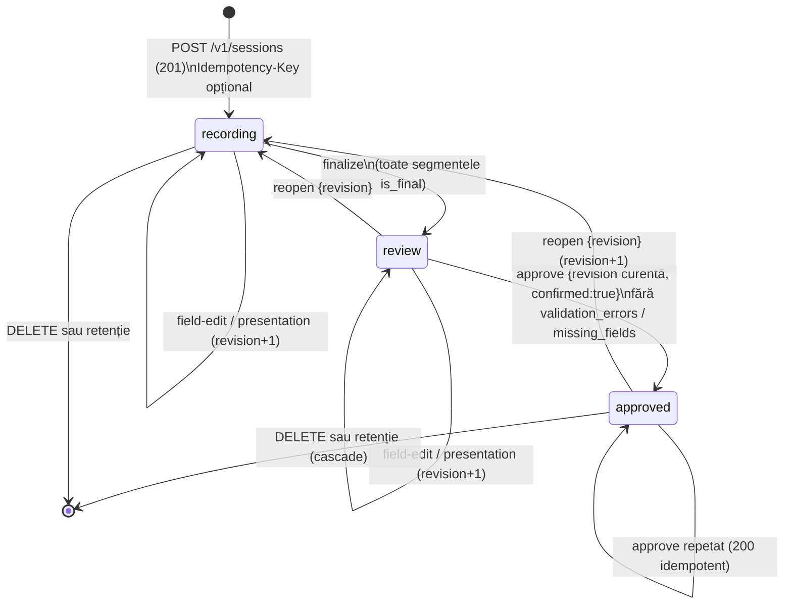
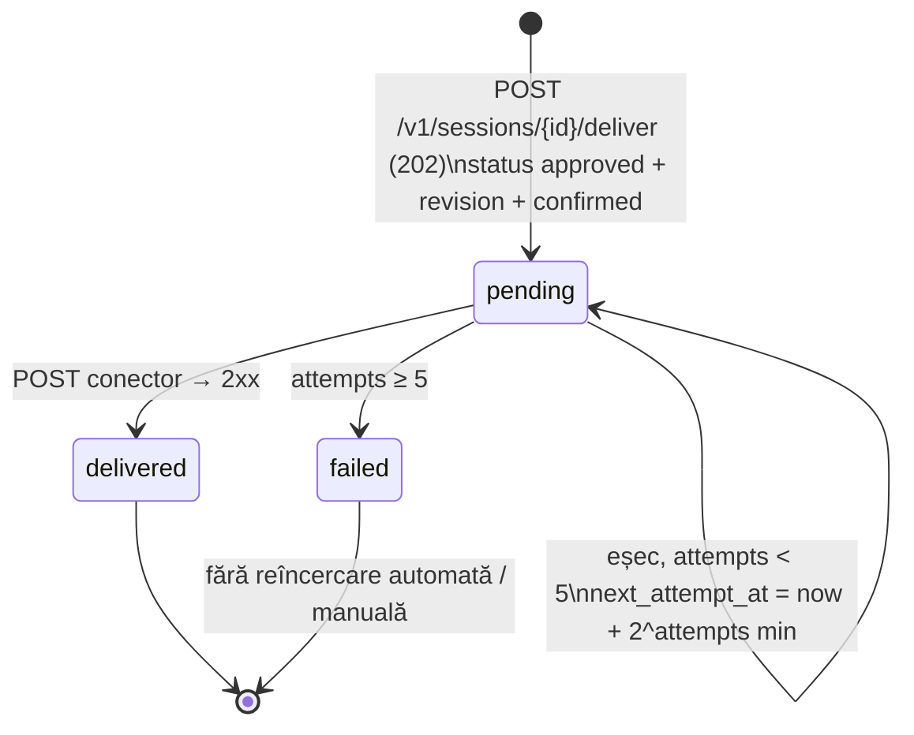
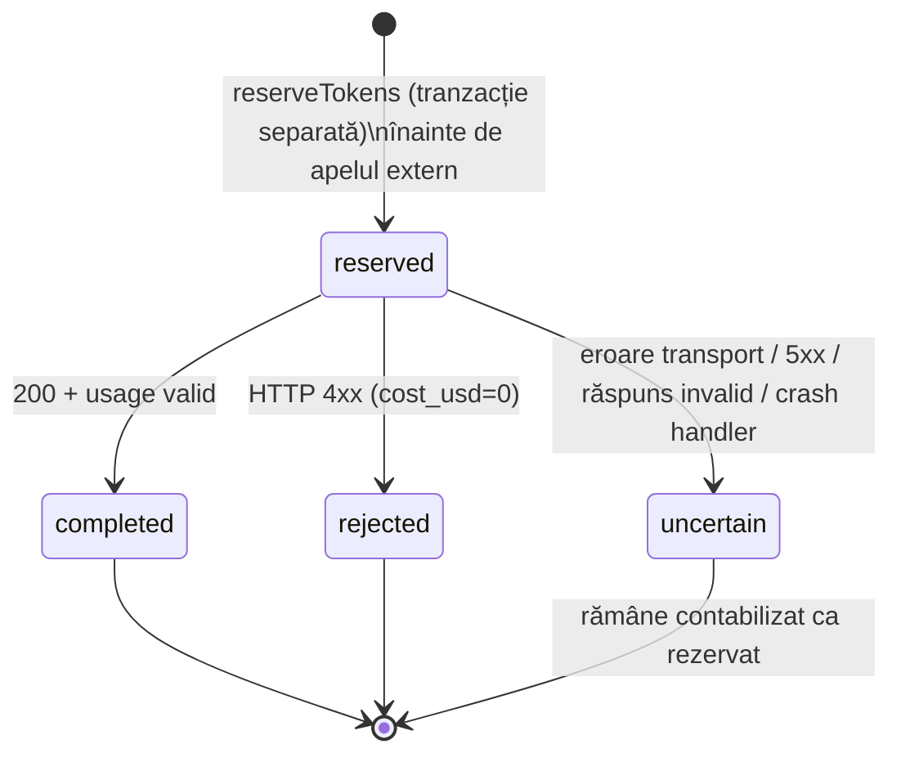
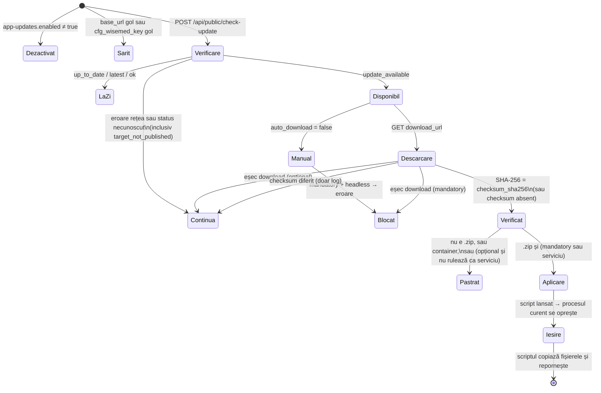

# 05 — Utilitare și WiseMED AI (`readersv3/`)

Investigație read-only, 2026-11-14. Căile sunt relative la `readersv3/` dacă nu se specifică altfel.
Etichete: **[COD]** = CONFIRMAT DIN COD · **[TEST]** = CONFIRMAT PRIN TEST LOCAL · **[DOC]** = DOCUMENTAT, NEVERIFICAT · **[INF]** = INFERENȚĂ · **[NEC]** = NECUNOSCUT.

Notă de metodă: nu am rulat niciun test, binar sau serviciu (restricție de sarcină). Nicio afirmație nu poartă eticheta [TEST]; unde un test din repo acoperă comportamentul, îl citez ca dovadă de intenție, cu eticheta [COD] (testul există, nu l-am executat).

---

## 0. Sumar transversal

| Aplicație | Entrypoint | Module activate | Port implicit (`config.install.yaml`) | Persistență | Runner / update la pornire |
|---|---|---|---|---|---|
| wisemed-ai | `apps/wisemed-ai/main.go:25-26` | local-http, events, wisemed-api, wisemed-ws, login, help, wisemed-ai (+ `runner-startup-updates`) | 127.0.0.1:19120 | PostgreSQL (`wai_*`), fișiere cheie, fișiere audio/model pe disc | da, în fundal (`BackgroundStartupUpdates`) |
| html-print-formatter | `apps/html-print-formatter/main.go:25-26` | local-http, events, wisemed-api, wisemed-ws, login, help, html-print-formatter | 127.0.0.1:19113 | niciuna (doar memorie) | da, sincron |
| barcodeprinter | `apps/barcodeprinter/main.go:25-26` | …, barcode-printer | 127.0.0.1:8010 | SQLite `barcodeprinter-log.db` | da, sincron |
| signing-pad-utility | `apps/signing-pad-utility/main.go:25-26` | …, signing-pad | 0.0.0.0:19110 | SQLite istoric + PNG în `./signatures` | da, dar **fără secțiune `app-updates`** în șablon |
| esignature-server | `apps/esignature-server/main.go:25-26` | …, signing-pad (același modul) | 127.0.0.1:19111 (TLS) | SQLite `esignature-log.db` | da, sincron |
| anaf-docsmart | `apps/anaf-docsmart/main.go:27-36` | local-http, wisemed-api, wisemed-ws, login, help, transport-file, protocol-anaf-docsmart | 127.0.0.1:18120 | doar fișiere (inbox/work/outbox/processed/failed) | da, sincron |
| update-server | `apps/update-server/main.go:57` | wisemed-api, login, help, app-update-server | 0.0.0.0:19090 | SQLite `app-update-server.db` + `./files` | **nu** folosește `runner` → fără self-update |

Envelope JSON — **nu** este uniform [COD]:

| Aplicație | Succes | Eroare |
|---|---|---|
| wisemed-ai | obiectul/array-ul direct, fără wrapper (`respond`, `modules/wisemedai/module.go:138`) | `{"error":"<cod_snake>"}` (`fail`, `module.go:145`); la 402 se adaugă `subscription`/`account_url` |
| html-print-formatter | `/render*`: `text/html` brut; `/pdf`: `application/pdf` brut; `/api/...`: `{"ok":true,"html":…,"request_id":…}` | `{"ok":false,"error":{"code","message"},"request_id"}` (`module.go:192-198`) |
| barcodeprinter | `{"success":true,…}` | `{"success":false,"error":"text"}` |
| signingpad (nou) | `{"id","action","ok":true,…}` | `{"id","ok":false,"message"}` sau text simplu `http.Error` |
| signingpad (legacy WS) | `{"success":true,"forevent":<cererea>,"data":{…}}` | `{"success":false,"forevent":…,"data":{},"error":"…"}` (`legacy.go:25-30`) |
| anaf-docsmart | `{"ok":true,…}` | `{"ok":false,"error":"text"}` |
| update-server admin | `{"ok":true,…}` | `{"ok":false,"error":"text"}` |
| update-server public | `appupdates.CheckResponse` | `{"ok":false,"message":"text"}` (cheia e `message`, nu `error`) |
| bridge WSS | `{"kind":"api.response","status","content_type","headers","body"|"body_base64"}` (`shared/apibridge/bridge.go:42-49`) | eroare de bridge → `{"ok":false,"error":{"message"}}` (`modules/ws/module.go:545`) |

Bridge WSS `api.request` [COD] `shared/apibridge/bridge.go:51-161`, `modules/ws/module.go:512-535`:
- cere scope `api:invoke`; `api:admin` setează doar `Principal.Admin`;
- acceptă numai căi `/api/…` sau exact `/barcode/print`; body ≤ 4 MiB (`MaxBody`), răspuns ≤ 4 MiB; răspunsurile `text/html` sunt refuzate;
- timeout 30 s implicit; 610 s pentru `/api/html-print-formatter/{render,pdf}`;
- `boundedRecorder` nu implementează `http.Flusher` → SSE nu poate trece prin WSS.

---

## 1. WiseMED AI (`apps/wisemed-ai` + `modules/wisemedai`)

### 1.1 Entrypoint, config, porturi

- `main.go:25-26`: `runner.Run(..., RunOptions{SkipBootstrap:true, BackgroundStartupUpdates:true, …})` [COD].
- Setări `Settings` + valori implicite: `modules/wisemedai/config.go:10-49`. `provider` ∈ {`mock`,`openai`} (implicit `mock`), `model` implicit `gpt-4.1-mini`, `monthly_budget_usd` 10, `retention_days` 30. `WISEMED_AI_DATABASE_URL` suprascrie `database_url` (`config.go:39`) [COD].
- Fără `database_url` modulul pornește, dar orice `/v1/*` răspunde 503 `database_not_configured` (`auth.go:174`); `/ready/ai` → 503 (`module.go:93-101`) [COD].
- Rute montate (`module.go:76-102`): `/v1/`, aliasul `/api/wisemed-ai/v1/` (rescrie calea și apelează același `serve`), `/ai/` (Vue embed din `modules/wisemedai/web/dist`), `/ai/voice`, `/health/ai`, `/ready/ai`.
- Timeouturi server HTTP: Read 15 s, Write 65 s, Idle 60 s, header 32 KiB (`module.go:103-108`); timeout per cerere 55 s (`config.go:51`, aplicat în `auth.go:178`) [COD].
- Docker: `apps/wisemed-ai/docker/compose.yaml` — `pgvector/pgvector:pg16` + app, `cap_drop: ALL`, bind implicit 127.0.0.1:19120; `entrypoint.sh` rescrie adresa pe `0.0.0.0:19120` doar la prima creare a `config.yaml` [COD].
- Tools: `tools/catalog` (dump JSON al `wisemedai.Catalog()`), `tools/import-postgres` (import între baze; neanalizat în detaliu) [COD/NEC].

### 1.2 Identități, autentificare, izolare

`principal` = {User, Tenant, Role, InstanceAdmin, UserType} (`auth.go:19-27`). Trei surse [COD]:

| Sursă | Mecanism | Dovadă |
|---|---|---|
| Standalone | `POST /v1/auth/login` email+parolă bcrypt → token opac 64 hex, stocat doar ca SHA-256 în `wai_auth_sessions`, TTL 8 h; cookie `wai_session` (HttpOnly, SameSite=Strict) **și** token în body | `auth.go:66-160` |
| WiseMED login | `{"wisemed":true}` → `wisemedapi.Login` server-to-server; tokenul WiseMED **nu** devine bearer AI; utilizatorul trebuie să existe deja ca `wai_memberships.external_subject = "wisemed:<UserID>"` în tenantul cerut | `auth.go:108-127` |
| WSM (bridge) | doar dacă `wsm_identity_enabled`; `apibridge.Principal{TenantID,Subject}` → căutare `wai_memberships.tenant_id::text = TenantID AND external_subject = Subject` | `auth.go:50-53` |

Concluzii de autorizare:
- **`api:admin` nu acordă drepturi clinice** [COD]. `Principal.Admin` este populat din scope (`modules/ws/module.go:528`), dar `modules/wisemedai` nu îl citește niciodată: `grep '\.Admin\b' modules/wisemedai/*.go` → 0 rezultate; singurele utilizări `PrincipalFrom` sunt `auth.go:50` și `events.go:13`. Rolul vine exclusiv din `wai_memberships.role` (`admin`/`doctor`/`viewer`, CHECK în `migrations/001_core.sql`) și `wai_users.instance_admin`.
- Headerele HTTP nu pot falsifica identitatea: test `integration_test.go:262-270` (X-Tenant-ID/X-User-ID → 401) și izolare tenant pe bridge `integration_test.go:281-290` [COD, test neexecutat].
- Fără mapare explicită `external_subject`, un principal WSM valid primește 401 `authentication_required`.
- Izolare date: fiecare interogare clinică filtrează `tenant_id` **și** `user_id` (`loadSession`, `sessions.go:30`). Un `admin` de organizație nu poate citi/modifica sesiunile altui medic prin `/v1/sessions`; are doar istoric read-only prin `/v1/admin/sessions` (auditat `session.admin.read`, `admin_sessions.go:118-151`). `instance_admin` vede acolo toate organizațiile (`$2::boolean OR s.tenant_id=…`, `admin_sessions.go:126`) [COD].
- `viewer`: orice metodă ≠ GET → 403 `doctor_required` (`auth.go:242-245`).
- Suspendare comercială: non-instance-admin cu abonament suspendat primește 402 pe tot ce nu e `billing/*` (`auth.go:231-241`).
- CSRF: `sameOrigin` (`auth.go:161-167`) — `Origin` trebuie să coincidă cu `Host`; fără `Origin` se acceptă dacă `Sec-Fetch-Site ≠ cross-site` (clienți non-browser trec).
- Rate limit login: 15 încercări / 10 min / IP, în memorie (`auth.go:71-91`) — se pierde la restart.
- Criptare la nivel de câmp: AES-256-GCM cu AAD = scope (`tenant:session[:chunk]`), cheie în fișier local (`crypto.go:46-79`). Pierderea fișierului cheie = date clinice irecuperabile [INF].

### 1.3 Model de date PostgreSQL

Migrări: `modules/wisemedai/migrations/001…017`, aplicate într-o singură tranzacție sub `pg_advisory_xact_lock(7741921103)`, evidență în `wai_schema_migrations` (`store.go:18-51`). Bootstrap admin sub lock `…104`, parolă generată în fișier (`store.go:52-92`) [COD].

| Zonă | Tabele | Constrângeri relevante |
|---|---|---|
| Identitate | `wai_organizations`, `wai_users` (email UNIQUE, `instance_admin`), `wai_memberships` (UNIQUE(tenant,user), UNIQUE(tenant,external_subject), role CHECK, `disabled`), `wai_auth_sessions` (PK `token_hash`, FK compus → memberships ON DELETE CASCADE), `wai_pairing_tokens` | 001, 005 |
| Șabloane | `wai_templates` (+`owner_id`), `wai_template_versions` (UNIQUE(template,version)), `wai_template_fields`, `wai_template_rules`, `wai_template_contexts` (criptat), `wai_seed_catalog`, `wai_specialties`, `wai_specialty_packs`, `wai_user_specialties` | 001, 004, 007, 010 |
| Sesiune | `wai_sessions` (status CHECK `recording`/`review`/`approved`, `revision`, `context` bytea, `result` bytea) | FK compus (tenant,user), (tenant,template_version) |
| Segmente | `wai_session_chunks` (PK(session,id), UNIQUE(session,sequence), `revision ≥ 1`, `is_final`, `text` bytea, `digest`, `target_field`) | 001, 015 |
| Draft / revizii | `wai_session_revisions` (UNIQUE(session,revision), payload criptat), `wai_extracted_facts` | nu există tabel „draft” separat: draftul = `wai_sessions.result` + istoricul reviziilor |
| Aprobare | `wai_approvals` (UNIQUE(session,revision), `user_id`), `wai_clinical_results` (UNIQUE(session,revision), UNIQUE(tenant,id)) | toate ON DELETE CASCADE față de sesiune |
| Outbox | `wai_outbox_delivery` (status text fără CHECK, `attempts`, `next_attempt_at`, `last_error`, UNIQUE(result_id,connector_id)), `wai_integration_configs`, `wai_connector_mappings` (payload criptat) | FK → clinical_results ON DELETE CASCADE |
| Buget / cost | `wai_usage_records` (tokeni in/out/cached, `cost_usd numeric(14,8)`, status CHECK `reserved`/`completed`/`uncertain`/`rejected`, `reserved_tokens`, `billing_period_id`, `encrypted_prompt/output`) | 001, 006, 007, 009, 012 |
| Comercial | `wai_billing_plans`, `wai_billing_plan_versions`, `wai_plan_assignments`, `wai_subscriptions`, `wai_billing_periods`, `wai_billing_invoices`, `wai_billing_payments`, `wai_template_addons` | 007, 008, 011 |
| Memorie | `wai_memory_preferences/examples/feedback` (+ `embedding vector(1536)` doar dacă extensia există, 003) | |
| Voce | `wai_speech_vocabularies/terms/term_observations/feedback/consent/consent_events/contributions/upload_parts/dataset_entries/grammars`, `wai_speech_model_versions/blobs/jobs`, `wai_browser_speech`, `wai_browser_speech_events` | 013, 014, 016, 017 |
| Audit | `wai_audit_events` | scris în aceeași tranzacție cu mutația (`audit`, `store.go:93`) |

Trigger: `wai_clear_session_prompts` șterge prompturile criptate la ștergerea sesiunii (012).

Tranzacții [COD]:
- Orice acțiune pe `/v1/sessions/{id}/…` deschide o tranzacție și ia `SELECT … FOR UPDATE` pe sesiune (`sessions.go:130-136`, `:30`).
- Apelul OpenAI se face **în interiorul** acestei tranzacții, sub `pg_advisory_xact_lock(hashtext(tenant))` (`extract.go:202`) → toate apelurile AI ale unei organizații sunt serializate pe durata apelului extern (până la 45 s).
- Contabilitatea de consum folosește o **conexiune separată** (`pgx.ConnectConfig`, `extract.go:228`) și tranzacție proprie (`reserveTokens`, `entitlements.go:236-305`), ca un rollback clinic să nu șteargă consumul facturabil.

### 1.4 Flux clinic și stări

Reguli segmente (`sessions.go:231-343`) [COD]:
- validare: `id` UUID, `sequence` 1..10000, `revision ≥ 1`, text ≤ 16000 octeți, nevid, `timestamp` obligatoriu → altfel 400 `invalid_chunk`;
- limite sesiune: ≤ 500 segmente, ≤ 100000 octeți text total → 413 `session_limit`;
- idempotency pe (`id`,`revision`): aceeași revizie + conținut identic → 200 `{"accepted":true,"duplicate":true}`; aceeași revizie + conținut diferit → 409 `chunk_revision_conflict`; revizie mai mică → 200 `{"accepted":false,"reason":"stale_revision"}`; revizie mai mare → înlocuire (UPSERT `ON CONFLICT(session_id,id)`);
- `sequence` nu se poate schimba (409 `sequence_immutable`) și nu poate fi reutilizată de alt segment (409 `sequence_conflict`);
- `target_field` restrânge extragerea la un singur câmp și șterge override-ul manual al acelui câmp;
- sesiune ne-`recording` → 409 `session_locked`.

Draft = `Result` (`extract.go:44-59`): `structured_data`, `canonical_data`, `rendered_html`, `evidence[]`, `missing_fields`, `validation_errors`, `field_issues`, `warnings`, `revision`, `status`. Fiecare mutație scrie `wai_sessions.result`, un rând `wai_session_revisions` și unul `wai_extracted_facts` (`saveResult`, `sessions.go:72-94`).

Aprobare (`sessions.go:434-487`): cere `confirmed:true` și `revision == s.Revision` (409 `explicit_current_revision_required`), status `review` (409 `finalize_required`), fără erori de validare (422 `field_validation_failed`) și fără câmpuri obligatorii lipsă (422 `required_fields_missing`). Într-o singură tranzacție: INSERT `wai_clinical_results`, INSERT `wai_approvals`, UPDATE sesiune, audit `result.approve`.

Livrare către conectori:

- `deliver` (`connectors.go:36-79`): INSERT `ON CONFLICT(result_id,connector_id) DO NOTHING` → o singură livrare per (rezultat aprobat, conector).
- `dispatchOutbox` (`connectors.go:80-133`): la fiecare tick de 10 s, **un singur rând** (`FOR UPDATE OF o SKIP LOCKED LIMIT 1`); POST JSON către `payload.url` cu `Authorization: Bearer <token conector>` și `Idempotency-Key: <delivery id>`.
- Conector valid = `https`, fără query/fragment/userinfo, host în `connector_allowed_hosts`, token nevid (`validateConnector`, `connectors.go:16-35`). Lista este goală implicit → nicio livrare posibilă până la configurare.
- Body: `Result` complet sau, dacă există `mapping_id`, `{session_id, schema_version, template_version, approved_revision, mapped_data}` (`mappings.go:9-40`).
- Coduri eroare stocate: `invalid_configuration`, `connector_http_error`, `connector_transport_error`.
- Recuperare după restart: starea e în DB; rândurile `pending` sunt reluate la următorul tick [COD]. Nu există endpoint de re-trimitere pentru `failed` [COD: `outbox.go` are doar GET].

Evenimente:
- **SSE** `GET /v1/sessions/{id}/events` (`sessions.go:596-626`): polling DB la 1 s, emite `event: progress` cu `id: <session>:<revision>:<status>` și `data: {session_id, revision, status, result_url}`; respectă `Last-Event-ID`. Conexiunea este tăiată de timeoutul de 55 s al cererii → clientul trebuie să reconecteze. Nu conține date clinice. Prin WSS → 400 `sse_not_supported_on_transport`.
- **Eveniment WSM** (`events.go:12-31`): doar pentru cereri venite prin bridge cu `ConnectionID`; `PublishEventToConnection` cu `event: wisemed-ai.{start|progress|result}`, fără PHI. Nu este broadcast.

### 1.5 Provider AI

| Aspect | Valoare | Dovadă |
|---|---|---|
| Mod `mock` | extragere locală deterministă (`mockExtract`), fără rețea; implicit | `extract.go:64-144`, `:146` |
| Extragere | `POST https://api.openai.com/v1/chat/completions`, `model = cfg.Model`, `store:false`, `max_completion_tokens:4096`, `response_format: json_schema strict` | `extract.go:217-222` |
| Transcriere | `POST https://api.openai.com/v1/audio/transcriptions`, model fix `gpt-transcribe`, multipart, prompt cu vocabularul șablonului | `transcription.go:20`, `:68`, `:91` |
| Operații AI | `transcript_extract`, `field_interpretation`, `audio_transcription`, propuneri de șablon | `sessions.go:318`, `field_review.go:163`, `transcription.go:103`, `proposals.go` |
| Timeout | `http.Client{Timeout:45s}`, fără urmărire de redirect; plafonat și de contextul de 55 s | `module.go:49` |
| Retry | **inexistent** — niciun retry către OpenAI | `extract.go:262-275` |
| Audio acceptat | WAV PCM16 mono canonic, ≤ 700000 octeți, ≤ 8 s, 8–192 kHz | `transcription.go:23-40` |
| Cheie | env `OPENAI_API_KEY` sau fișier; poate fi scrisă prin `PUT /v1/settings` (fișier 0600) | `settings.go:10-16`, `:67-72` |

Buget și contabilitate:

- Două plafoane independente [COD]: (1) buget lunar USD per organizație — `sum(cost_usd)` luna curentă + estimare > `monthly_budget_usd` → `monthly_budget_exceeded` (`extract.go:205-221`); (2) alocare de tokeni per utilizator/plan/perioadă, cu depășire pe credit (`entitlements.go:259-298`) → `ai_token_allowance_exceeded`, `credit_reservation_exceeds_available`, `subscription_payment_overdue`.
- Rezervarea este estimată în **octeți de request**, nu tokeni (`int64(len(body)+4096)`, `extract.go:245`) [COD].
- Un proces oprit între rezervare și răspuns lasă rândul `reserved` permanent (handlerul `defer` nu rulează la kill); nu am găsit un job de reconciliere pentru `reserved` vechi [COD pentru absența din `Start`/`retain`; INF asupra efectului: bugetul rămâne consumat].
- Prompturile și răspunsurile sunt stocate criptat în `wai_usage_records` și golite după `retention_days` (`store.go:104`).

### 1.6 Mod standalone

[COD] Aplicația funcționează fără WiseMED și fără WSM: `wisemed_login_enabled:false`, `wsm_identity_enabled:false`, `wisemed_ws.enabled:false` în șablon; `GET /v1/auth/providers` → `{"standalone":true,"wisemed":false}`; contextul sesiunii poartă `source:"standalone"` (`sessions.go:576`); `briefing` răspunde static „Nu există istoric HIS autorizat atașat” (`sessions.go:195-197`). Singura dependență dură este PostgreSQL. Verificarea de update cere totuși `cfg_wisemed_key` (vezi §7).

### 1.7 API (HTTP local; aceleași rute prin WSS sub `/api/wisemed-ai/v1/…`)

Auth: A = public; S = sesiune (cookie sau `Authorization: Bearer`), orice rol; D = S + rol ≠ viewer pentru metode ≠ GET; OA = rol `admin` (organizație); IA = `instance_admin`; G = grant `Authorization: Browser <token>`.

| Metodă + rută | Handler | Auth | Body / parametri | Răspuns / coduri | Efecte |
|---|---|---|---|---|---|
| GET `/health/ai`, `/ready/ai` | `module.go:89-101` | A | — | 200 / 503 `database_unavailable` | — |
| GET `/v1/auth/providers` | `auth.go:182` | A | — | 200 | — |
| POST `/v1/auth/login` | `login` | A | `email,password,tenant_id?,wisemed?` | 200 `{token,profile,expires_in}`; 400, 401, 429, 503 | INSERT auth session + audit |
| POST `/v1/auth/logout` | `auth.go:199` | S | — | 200 | DELETE auth session |
| GET/PUT `/v1/profile` | `profile` (`admin.go:13`) | S | nume/parolă | 200; 403 `current_password_required` | — |
| GET/PUT `/v1/profile/speech-consent` | `speechConsent` | S | consimțământ | 200 | evenimente consimțământ |
| GET/POST `/v1/sessions` | `sessions`, `createSession` | S / D | `template_version, patient_ref ≤128, work_context?`; header `Idempotency-Key ≤128` | 201 (nou) / 200 (replay); 400, 404, 409 `idempotency_conflict`/`session_conflict`, 402 | INSERT sesiune; eveniment WSM `start` |
| GET/DELETE `/v1/sessions/{id}` | `sessions.go:149-167` | S / D | — | 200; 404 | DELETE cascade (inclusiv rezultate aprobate și outbox) |
| GET `/v1/sessions/{id}/result` | | S | — | 200; 409 `result_unavailable` | — |
| GET `/v1/sessions/{id}/events` | `eventStream` | S | `Last-Event-ID` | SSE; 400 pe WSS | — |
| POST `…/transcript-chunks`, `…/audio-transcript-chunks` | `sessions.go:231` | D | `Chunk` | 200 `{accepted, patch_revision, result}`; 400, 409, 413, 422, 402, 502 | UPSERT chunk, AI, revizie nouă |
| POST `…/audio-transcription` | `sessions.go:198` | D | `{"audio":"<base64 WAV>"}` | 200 `{text}`; 400 `invalid_audio`, 409, 502, 503 `audio_transcription_not_configured` | apel OpenAI, usage; **nu** comite tranzacția sesiunii |
| POST `…/field-edit`, `…/field-options` | `sessionField` | D | `revision, field, value?` | 200; 400, 409 | override manual / sugestii AI |
| POST `…/presentation` | `sessionPresentation` | D | `revision, …` | 200; 400, 409 | revizie nouă fără AI |
| POST `…/finalize` | `sessions.go:344` | D | `{}` | 200 `Result`; 409 `transcript_required`/`final_chunks_required` | status `review` |
| POST `…/reopen` | `sessions.go:408` | D | `{revision}` | 200; 409 `current_review_required` | status `recording` |
| POST `…/approve` | `sessions.go:434` | D | `{revision, confirmed}` | 200; 409, 422 | rezultat clinic + aprobare |
| POST `…/deliver` | `deliver` | D | `{connector_id, revision, confirmed}` | 202 `{delivery_id,status}`; 400, 404, 409 | rând outbox |
| POST `…/briefing` | `sessions.go:195` | D | — | 200 mesaj static | — |
| POST `…/pairing` | `sessions.go:488` | D | — | 201 `{token, qr_png, expires_in:120}` | token 2 min |
| POST `/v1/pairing/redeem` | `redeem` | D | `{token}` | 200 `{session_id}`; 410 | consum unic (DELETE … RETURNING) |
| GET `/v1/templates[/{id}]`, POST `/v1/templates` | `templates` (`templates.go:289`) | S / D | `Template` + `addon_confirmation?` | 200; 402/403/409 comerciale | versiune nouă |
| POST `/v1/templates/proposals` | `proposals` | D | text raport | 200 | AI / local |
| GET `/v1/templates/{id}/speech-adaptation`; POST `…/sections/{sid}/speech-terms`, `…/speech-feedback` | `speechAdaptation` | S / D (editor) | termeni / feedback | 200; 403 `template_editor_required`, 404 | vocabular |
| `/v1/community/speech-contributions…` (GET, POST, DELETE, `/export`, `/{id}/audio` GET+PUT `?offset=`, `/finalize`, `/review`) | `communitySpeech` | S; POST/PUT cer ≠ viewer; review/export OA | fragmente audio ≤ 256 KiB | 200; 409 `unexpected_offset` | fișiere pe disc, retenție 7 zile |
| `/v1/speech-models` GET; `/manage` GET; POST; `/blobs/{sha256}` GET, PUT `?offset=`; `/{id}/{ver}/{mirror|check-update|publish}` POST | `speechModels` | S pentru catalog/blob GET; IA pentru rest | fragmente ≤ 8 MiB | 200; 409 `model_offset_conflict` cu `uploaded` | joburi mirror |
| POST `/v1/browser-speech` | `createBrowserSpeech` | D | `session_id?, template_version, section_id, target_field` | 200 `{token, path:"/ai/voice#…", expires_in:7200}` | grant legat de sesiunea de login |
| GET/POST `/v1/browser-speech/bridge` | `browserSpeechBridge` | G | GET `?after=`; POST `{action,state,event_id,ordinal,text,timestamp}` | 200; 401, 413 | evenimente criptate |
| GET `/ai/voice` | `browserSpeechPage` | A (pagină cu CSP nonce) | — | HTML | — |
| `/v1/memory/{preferences,examples,feedback}` GET/POST/DELETE; POST `/v1/memory/search`; POST `/v1/memory/examples/{id}/embedding` | `resources`, `memorySearch`, `memoryEmbedding` | S / D (proprii) | `{name,payload,confirmed}` | 200; 400, 409 | — |
| `/v1/integrations`, `/v1/connector-mappings` GET/POST/DELETE | `resources` (`admin.go:305`) | OA | idem; secretele sunt redactate la citire (`redact`) | 200; 400 `connector_host_not_allowlisted` etc. | — |
| GET `/v1/outbox`, `/v1/audit` | `outbox`, `auditHTTP` | OA | — | 200 (max 100 / 250) | — |
| GET/POST/PUT `/v1/users` | `users` (`admin.go:74`) | OA (+IA pentru super-admin) | `email,name,role,external_subject,…` | 200; 403 | mapare identitate WSM/WiseMED |
| GET/PUT `/v1/organizations` | `resources` / `organization` | S / OA | `{name}` | 200 | — |
| GET `/v1/specialties`, `/v1/specialty-packs`, `/v1/dashboard`, `/v1/usage` | `resources`, `dashboard`, `usage` | S | — | 200 | — |
| GET/PUT `/v1/settings` | `settings`, `saveSettings` | IA (`admin.go:230`) | provider, model, buget, prețuri, retenție, `openai_key` | 200 `{restart_required:true}` | rescrie `config.yaml` + fișier cheie |
| GET/PUT `/v1/runtime-settings`; POST `/v1/updates/check`; POST `/v1/wsm/reconnect` | `runtimeSettings` | IA | secțiuni whitelisted (`runtime_settings.go:14-19`) | 200; 400, 502, 503 | rescrie `config.yaml`; `app_id` forțat `wisemed-ai` |
| `/v1/billing/*` (status, account, plans, assignments, subscriptions, invoices, payments, settle, specialties, statistics, usage, usage/prompt, users, users/role, users/password) ; DELETE `/v1/billing/template-addons/{id}` | `billing` (`plans.go:76-125`) | S pentru proprii; IA pentru administrare | variabil | 200; 402/403/409 | — |
| GET `/v1/admin/sessions[/{id}]` | `adminSessions` | OA sau IA | `user, status, offset, limit` | 200 `{items,total,read_only:true}` | audit la citire |

Limite: body JSON ≤ 1 MiB, câmpuri necunoscute respinse (`decode`, `auth.go:33-47`); excepții: fragmente model 8 MiB, audio comunitate 256 KiB. Prin WSS se adaugă plafonul de 4 MiB și timeoutul de 30 s — mai mic decât cele 45 s ale apelului OpenAI → o extragere lentă poate eșua doar pe transportul WSS [INF din cele două constante].

### 1.8 Concurență și recuperare

| Element | Detaliu | Dovadă |
|---|---|---|
| Buclă `Start` | ticker 10 s: `go modelMirrorWorker` (protejat de `modelWorkMu.TryLock`), `subscriptionWorker` (≥ 1 min), `dispatchOutbox`, `retain` când minutul curent este 0 | `module.go:111-136` |
| `retain` | rulează de până la 6 ori în minutul 0 al fiecărei ore (condiție pe minut, tick la 10 s); șterge sesiunile cu `updated_at` mai vechi de `retention_days` **indiferent de status**, deci și rezultatele aprobate și livrările aferente (cascade) | `store.go:97-108` |
| Joburi model | `queued`→`running`→`ready`/`failed`; `running` mai vechi de 35 min reintră în coadă; fișiere adresate prin conținut | `speech_models.go:657-700` |
| Mutexuri | `mu` (scriere config), `loginMu` (rate limit), `modelWorkMu` | `module.go:23-34` |
| Pool DB | `MaxConns = 10`; fiecare apel AI consumă încă o conexiune în afara poolului | `module.go:58`, `extract.go:228` |
| Lock-uri DB | rând sesiune `FOR UPDATE`; advisory lock per organizație (AI), per cheie de idempotency, per utilizator (billing) | `sessions.go:30`, `:550`, `extract.go:202` |
| Restart | sesiunile de login, grant-urile, outbox-ul și joburile sunt în DB și supraviețuiesc; se pierd contorul de rate limit și cache-ul `compiled` | |

### 1.9 Formatare WYSIWYG și vocabular

- Editor: TipTap în `apps/wisemed-ai/web/src/TemplateEditor.vue`, bara `DocumentToolbar.vue`, extensia `documentFormatting.ts` (aliniere `left|center|right|justify` pe paragraf/heading) [COD].
- Sanitizare server: `sanitizeHTML` (`modules/wisemedai/templates.go:86-148`) — whitelist de taguri; păstrează doar `style="text-align: …"` pe `p/h1/h2/h3`, `colspan/rowspan` 1..100, `start` pe `ol`; elimină `script/style/iframe/svg/object`. Teste: `template_formatting_test.go` [COD, neexecutat].
- Randare document: `renderDocument` (`templates.go:470`), compunere secțiuni/variante `presentation.go:136`.
- Vocabular tiroidă: `catalog_thyroid.go` (șablon ecografie), `catalog_thyroid_vocabulary.go` (`thyroidFieldTerms`, `thyroidStructureTerms`, `configureThyroidContext`); îmbinare cu termenii salvați `speech_vocabulary.go` (max 64 termeni activi per secțiune, buget de caractere); test `thyroid_vocabulary_test.go` [COD].
- Catalog general: `catalog.go`, `catalog_model.go`, `catalog_echo.go`; fixture `apps/wisemed-ai/docs/fixtures/specialty-templates.json` (52 șabloane, verificat de `contract_test.go`).

### 1.10 Paritate rute ↔ OpenAPI ↔ Vue ↔ Flutter ↔ teste

`docs/openapi.json`: OpenAPI 3.1.0, `info.version` 1.3.0, 74 de căi. `contract_test.go` verifică doar existența a 9 căi și fixture-ul de catalog — **nu** paritatea completă [COD].

| # | Nepotrivire | Cod | OpenAPI | Vue | Flutter (în repo) | Teste Go |
|---|---|---|---|---|---|---|
| 1 | `POST /v1/sessions/{id}/audio-transcription` | da (`sessions.go:198`) | lipsă | nu | nu | nu |
| 2 | `POST /v1/sessions/{id}/audio-transcript-chunks` (alias) | da (`sessions.go:231`) | lipsă | nu | nu | da (1 fișier) |
| 3 | `PUT /v1/billing/users/password` | da (`plans.go:113`) | lipsă | da | nu | da |
| 4 | `GET /v1/billing/usage/prompt` | da (`plans.go:117`) | lipsă | da | nu | da |
| 5 | `DELETE /v1/billing/template-addons/{id}` | da (`auth.go:255`) | lipsă | da | nu | da |
| 6 | `GET /v1/templates/{id}` (filtru pe sufix) | da (`templates.go:319`) | lipsă | nu | nu | — |
| 7 | `/health/ai`, `/ready/ai` | da | lipsă | nu | nu | nu |
| 8 | Coduri de răspuns | 402, 405, 410, 413, 500, 502 folosite efectiv | fiecare operație listează doar 200/201/202, 400, 401, 403, 404, 409, 422, 429, 503 | — | — | — |
| 9 | `Idempotency-Key` la creare sesiune | suportat | documentat | **netrimis** de UI | trimis (obligatoriu) | da |
| 10 | `work_context` la creare sesiune | suportat | documentat | netrimis | netrimis | da |
| 11 | Clientul Dart | — | — | — | acoperă doar: login/logout, sesiune, chunk, field-edit/options, reopen, finalize, result, approve, pairing/redeem, events; **fără** deliver, presentation, audio, browser-speech, templates | `clients/flutter/test/client_test.dart` (58 linii) |
| 12 | Timeout client Dart 60 s vs SSE tăiat la 55 s | — | — | — | compatibil; reconectarea e responsabilitatea apelantului (comentariu în `events`) | — |

Teste existente (neexecutate): 50+ funcții `Test*` în `modules/wisemedai/*_test.go` (cele `TestPostgres*` cer o bază reală), 10 fișiere Playwright în `web/tests/`, 3 fișiere Vitest.

---

## 2. HTML Print Formatter (`apps/html-print-formatter` + `modules/htmlprintformatter`)

- Config (`config.go:23-83`): `jwt_keys` (map kid→secret ≥ 32 octeți), `jwt_signing_key_id`, `chrome_path`/`CHROME_PATH`, `max_concurrent_renders` 2 (1–64), `max_body_bytes` 4 MiB (max 64 MiB), `default_render_timeout_ms` 120000 (max 600000). `PORT` din env suprascrie portul listenerului comun (`module.go:38-50`) [COD].
- Fără persistență. Server HTTP: Read 30 s, Write 660 s.

| Metodă + rută | Auth | Body | Răspuns |
|---|---|---|---|
| POST `/render`, `/render/html`, `/render/url` | JWT HS256 | `html` **xor** `html_link`, `base_url?`, `timeout_ms?`, `viewport_width/height?`, `wait_for_print_ready?` | `text/html` (DOM serializat) + `X-Request-ID` |
| POST `/pdf` | JWT | idem | `application/pdf`, `Content-Disposition: attachment` |
| POST `/api/html-print-formatter/render` | JWT **sau** principal WSS | idem | `{"ok":true,"html","request_id"}` |
| POST `/api/html-print-formatter/pdf` | JWT sau WSS | idem | `{"ok":true,"html","pdf_base64","filename","request_id"}` |
| POST `/api/html-print-formatter/token` | sesiune local-http, same-origin | `{}` | `{"ok":true,"token","expires_in":300}` |
| GET `/health`, `/api/html-print-formatter/health` | public | — | 200/503 `{"ok","service"}` |

- JWT (`auth.go:18-46`): un singur header `Authorization`, `alg=HS256`, `kid` cunoscut, `iss`=`aud`=`html-print-formatter`, `sub`, `iat`, `exp` obligatorii. Fără chei configurate → 503 `auth_not_configured`.
- **Orice** principal WSS autentic trece fără JWT (`auth.go:19-21`); nu se verifică `Admin` sau tenant [COD].
- Coduri: 400 `invalid_json`/`invalid_request`, 401, 405, 408 `render_canceled`, 413 `body_too_large`, 415, 422 `page_error`, 502 `render_failed`/`source_load_failed`, 503 `browser_unavailable`, 504 `render_timeout`.
- Chromium: un proces persistent prin `chromedp` (`renderer.go:40-87`), pornire ≤ 30 s, sandbox păstrat (`no-sandbox:false`). Fiecare cerere = `BrowserContext` incognito propriu + tab, distrus la final. HTML-ul inline e servit de un mini-server pe `127.0.0.1:0` sub cale UUID. `html_link` este încărcat direct de Chromium — nu am găsit restricție pe adrese interne [COD; INF: suprafață SSRF limitată de JWT].
- Concurență: semafor `sem` (cap `MaxConcurrent`); așteptarea în coadă consumă din timeoutul cererii; `requests` WaitGroup pentru oprire ordonată. La cădere Chromium → `/health` 503 și nu există repornire automată a browserului [COD: `Healthy`, mesaj „restart the service”].
- Limite WSS: 4 MiB body/răspuns (PDF în base64 +33 %), timeout 610 s. `docs/API.md` descrie aceleași limite — consistent cu codul [COD].
- `examples/`: colecție Postman + `pdf.php` (client de exemplu).

---

## 3. Barcode Printer (`apps/barcodeprinter` + `modules/barcodeprinter`)

- Config: `modules.barcode-printer` (profiluri pe endpoint, `log_db_path`), port implicit 127.0.0.1:8010, `app_id` de update `barcodeprinter-v3`.
- Persistență: SQLite, tabel `barcode_print_jobs` (id, created_at, client_ip, file_id, patient_name, bc_type, labels_count, printer_name, status, error_text) (`module.go:519-548`).

| Metodă + rută | Handler | Auth | Parametri | Răspuns |
|---|---|---|---|---|
| GET/POST `/barcode/print` | `handleLegacyPrint` | **niciuna** (doar CORS) | form/query; `no`/`copies`, `othercfg_sel_printer`/`bc_selprinter`, … | 200 `{"success":true}` / 400 |
| GET/POST `/barcode/print/posta-romana` | `handleLegacyPostaRomanaPrint` | niciuna | form/query | idem |
| POST `/api/barcode/print`, `/api/barcode/print/posta-romana` | `handlePrintJSON`, `handlePostaRomanaPrintJSON` | niciuna | JSON | idem |
| POST `/api/barcode/test-print` | `handleTestPrint` | niciuna | JSON | idem |
| GET `/api/barcode/printers` | `handlePrinters` | niciuna | — | `{"success":true,"printers":[…]}` |
| GET/PUT `/api/barcode/settings` | `handleSettingsAPI` | niciuna | map setări | setări; PUT rescrie `config.yaml` și poate schimba adresa/TLS listenerului |
| GET `/api/barcode/jobs`, `/api/barcode/stats/daily` | `handleJobs`, `handleDailyStats` | niciuna | interval date, `limit` | listă |
| WS `barcode.print` / `barcode/print` / `print_barcode`; `barcode.printers` / `barcode/list_printers` | `HandleWSAction` (`module.go:100-122`) | scope-urile WSM ale dispatcherului | payload plat | `{"printed":true}` / `{"printers":[…]}` |

- [COD] Handlerele sunt înregistrate doar cu `withCORS` (`module.go:71-82`), iar `local-http` servește mux-ul brut (`modules/localhttp/module.go:323`). Câmpurile `auth_username`/`auth_password` există doar în formularul UI (`ui/index.html:65-66`) și nu sunt citite de niciun handler Go. Inclusiv `PUT /api/barcode/settings` este neautentificat.
- Imprimare: generare ZPL (`zpl.go`), trimitere RAW. Unix: `lp` → `lpr` → `lpr` legacy, listare cu `lpstat -a` (`printer_unix.go`); Windows: spooler nativ (`printer_windows.go`). Copiile sunt trimise secvențial, sincron în handler; fără coadă, fără retry; eșec la copia k → eroare, copiile anterioare rămân tipărite.
- ZPL-ul complet (inclusiv numele pacientului) este scris în log în clar și în base64 (`logPrintPayload`, `module.go:509-517`) [COD].
- `/barcode/print` este singura cale non-`/api/` acceptată de bridge (`bridge.go:59`).

---

## 4. Semnătură: `signing-pad-utility`, `esignature-server`, `modules/signingpad`

Ambele aplicații încarcă **același** modul `signing-pad`; diferă doar configurarea [COD]:

| | signing-pad-utility | esignature-server |
|---|---|---|
| Cale hardware | helper extern `java -jar ./java-helper/signing-pad-helper.jar` (stdin/stdout JSON) | nativ: `STPadLib.dll` Signotec prin syscall, doar Windows |
| Stare | `apps/signing-pad-utility/java/src/.../HelperMain.java:48` răspunde „SDK bridge not implemented yet” → **stub** | implementat (`native_windows.go`, `legacy_windows.go`); pe alte OS → eroare explicită (`native_other.go`) |
| Target | — | `windows-386` (`build-windows.sh`), DLL pe 32 biți |
| Rute suplimentare | `/api/signing-pad/health`, `/api/signing-pad/capture` (doar dacă `helper_command` e setat, `module.go:117-120`) | — |
| Update | fără `app-updates` în șablon | `app_id: esignature-server` |

`apps/esignature-server/bin/eSignature` este un executabil Mach-O arm64 necomis (apare ca untracked în git) — artefact local de build, nu sursă [COD via `file`].

API modul (`module.go:86-120`):

| Rută / comandă | Auth | Contract |
|---|---|---|
| WS `/ws` | doar verificare `Origin` (`originAllowed`, `websocket.go:28-54`); `Origin` absent = permis | Protocol nou: `{"id","action"}` cu `health|devices|start|retry|confirm|cancel` → `{"id","action","ok",…}`; `confirm` întoarce `imageBase64` PNG. Protocol legacy (primul mesaj are `cmd`): `init`, `signpatient` (`sig_type`, `pacient_id`, `nume_pacient ≤ 512`), apoi `retry|activity|confirm|cancel|disconnect` → `{success, forevent, data:{id:1, sigbase64, sigenc}}` |
| WS `/ws/demo` | sesiune local-http (în mod `shared_http`) | idem |
| POST `/api/esignature/command` | doar `Origin` | `{"id","action","session_id"}` → 200 / 409 `{"ok":false,"message"}` / 400 |
| GET/POST/PUT `/api/esignature/settings` | sesiune | `manufacturer=signotec`, `pad_type=omega`, `model ≤128`, timeout 1–600 s, `device_index` 0–31 |
| GET `/api/esignature/jobs`, `/api/esignature/stats/daily` | sesiune | istoric |
| WSM `esignature.{health,devices,start,retry,confirm,cancel}` | dispatcher WSM | `session_id` 16–128 caractere pentru start/retry/confirm/cancel (`remote.go:29-81`) |
| POST `/api/signing-pad/capture` | doar CORS (`*` implicit) | `request_id, patient_id, file_id, sample_code, specimen_code, message, device_*` → răspunsul helperului + PNG salvat în `storage_dir/<file>__<sample>__<specimen>/signature-<ts>.png` |

- Limite: mesaje WS ≤ 4096 octeți, body HTTP ≤ 4096 octeți; termen absolut al sesiunii = `session_timeout_seconds` (implicit 180 s, max 600 s).
- Concurență [COD]: un singur pad la un moment dat — `deviceMu.TryLock()` (`session.go:36`) → „pad is busy in another session”; fiecare sesiune rulează pe un thread OS blocat (`runtime.LockOSThread`); sesiuni remote: goroutine dedicată per `session_id`, canal nebufferizat, maxim 32 simultan; la oprire `stopping` închide tot. Nimic nu supraviețuiește restartului (sesiunile sunt în memorie).
- Persistență: SQLite `signature_jobs` (id, created_at, action, ok, message) — fără imagine, fără identitatea pacientului (`history.go:26`).
- `sigenc`: format compatibil `GetSigString()` Topaz, reconstruit din punctele Signotec (`sigstring.go`); oracol C# în `apps/esignature-server/tests/sigstring-oracle`, test de compatibilitate JS `tests/wisemed-client.test.cjs` cu `docs/wisemed-client.js` [COD, neexecutat].
- Contract extern: SDK Signotec (`docs/signotec` din rădăcina repo: `WebSocketPadServer/STPadLib.dll`, `STPadServer.exe`, documentație PDF, drivere HID/WinUSB). Directorul conține și `server.pem`/`serverkey.pem` ale furnizorului (nu le-am deschis).
- `old-src/WiseMEDeSIGNATURE` (rădăcina repo): aplicația C# originală (tray + `Server/WMeSignatureWebSocketService.cs`) al cărei protocol WebSocket legacy este emulat de `legacy.go`. `old-src/WiseMEDeCARDManager`: aplicația C# de card de sănătate (`WMCEASCard*.cs`, `Server/WMeCardWebSocketService.cs`); nu are echivalent în modulele analizate aici — doar referință istorică [COD pentru structură; INF pentru rol].

---

## 5. ANAF DocSMART (`apps/anaf-docsmart` + `modules/protocols/anafdocsmart`)

- Nu există nicio comunicare de rețea cu ANAF [COD]: modulul doar completează local un PDF XFA (formular `f1102`) dintr-un XML.
- API: `GET /api/protocol/meta` → `{"ok":true,"protocol":"anaf-docsmart"}`; `GET /api/docsmart/parsed-files` → `{"ok":true,"files":[…]}` cu metadate XML (an, lună, instituție, sumă control, totaluri, primele 5 conturi, cale completă pe disc). Ambele fără autentificare la nivel de modul (`module.go:51-54`) [COD].
- Flux (`module.go:58-189`): polling `inbox/*.xml` la `poll_seconds` (5) → validare XML → copie șablon PDF (`template_file` sau primul din `templates_dir`) + XML în `work/<nume>-<timestamp>/` → `importXFAToPDF` → `outbox/<nume>.filled.pdf` → XML mutat în `processed/` sau `failed/`.
- Integrare externă: **Adobe Acrobat pe macOS** — scrie un script JavaScript în `~/Library/Application Support/Adobe/Acrobat/DC/JavaScripts/`, repornește Acrobat, deschide PDF-ul, execută meniul prin `osascript`, așteaptă fișierul 30 s (`acrobat_darwin.go:15-43`). Pe Linux și Windows funcția întoarce eroare (`xfa_linux.go`, `acrobat_other.go`) → orice XML ajunge în `failed/` [COD].
- Concurență: o singură goroutine, procesare strict secvențială. Recuperare: fișierele rămase în `inbox` sunt reluate la pornire; nu există stare „în lucru”, deci un crash în mijlocul procesării duce la reprocesare (PDF duplicat cu sufix `-01`) [INF din `uniquePath`].
- `apps/anaf-docsmart/internal/docsmart/` și directoarele `inbox/outbox/work/processed/failed` din sursă sunt goale. `assets/Df1102X35.xml` este un exemplu.
- `DocSMART/` din rădăcina repo: prototip anterior — `cmd/docsmart-importer/` și `internal/` sunt goale, există doar directoare de lucru cu rulări din 2026-08-20 (`work/Df1102X35-…/{import.xml,template.pdf}`); `cmd/` este untracked. Nu este referit din `readersv3` [COD].

---

## 6. Update Server (`apps/update-server` + `modules/appupdateserver`)

- Nu folosește `runner`; pornește direct runtime-ul cu 4 module; listener propriu în `Start` (`module.go:165-227`), cu TLS opțional auto-generat.
- Persistență: SQLite (WAL, o conexiune) — tabele `applications` (app_id UNIQUE, display_name, description, active) și `app_versions` (version, channel, target_os, target_arch, mandatory, download_url, file_name, file_path, checksum_sha256, file_size, installer_*, release_notes, uploaded_by, active) (`module.go:866-940`). Artefacte în `files_dir/<app_id>/<version>/…`.
- Sesiuni admin și tokenuri de download: **doar în memorie** (`sessions`, `downloadTokens`) → se pierd la restart.

| Metodă + rută | Auth | Contract |
|---|---|---|
| POST `/api/session/login` | login WiseMED + `user_type` ∈ `allowed_user_types` (implicit șablon „1,9,10”) | cookie `wmr_update_server_session`, 12 h, SameSite=Lax |
| GET `/api/session`, `/api/update-server/meta` | public | stare |
| POST `/api/session/logout` | sesiune | |
| GET/PUT `/api/update-server/settings` | sesiune | `files_dir, public_base_url, allowed_user_types, verbose_level, cfg_wisemed_*` |
| GET/POST `/api/update-server/apps`; PUT/DELETE `/apps/{id}` | sesiune | `application` |
| GET/POST `/apps/{id}/versions` | sesiune | POST multipart (≤ 512 MiB în memorie/temp): `version, channel, target_os, target_arch, mandatory, release_notes, download_url?, package?` |
| POST `/apps/{id}/make-release` | sesiune | `{channel,target_os,target_arch,mandatory,release_notes}` → build din sursă |
| GET/PUT/DELETE `/versions/{id}` | sesiune | |
| GET `/package-download/{id}`, `/installer-download/{id}`; POST `/download-link/{id}` | sesiune | fișier / link cu token |
| POST `/api/public/check-update` | JWT HS256, scope `check` | `CheckRequest` → `CheckResponse` |
| GET `/api/public/download/{versionId}?token=…[&artifact=installer]` | token de unică folosință, 15 min | fișier (`ServeContent`) sau 307 către `download_url` extern |

`makeRelease` (`module.go:1322-1446`) [COD]: localizează rădăcina `readersv3` pe disc, mapează `app_id` → aplicația sursă prin `modules.app-updates.app_id` din `apps/*/deployments/config.install.yaml` (`discoverManagedReader`, `:1630`), calculează versiunea următoare (bump patch), rulează `go run -a ./tools/releasectl release --json --app … --target … --version … [--app-updates-base-url …]`, copiază ZIP-ul (și installerul NSIS pentru Windows) în `files_dir`, salvează versiunea. Consecință: serverul de update trebuie să aibă sursele și toolchain-ul Go instalate.

---

## 7. Protocolul client ↔ update-server

Client: `shared/appupdates/appupdates.go`; orchestrare: `apps/runner/updates.go`, `update_apply.go`, `background_updates.go`; UI: `modules/localhttp/module.go:243-244, 2741-2900`.

| Pas | Detaliu | Dovadă |
|---|---|---|
| Identificare | `app_id` = `modules.app-updates.app_id` sau `reader.id`; `channel`; `current_version` = `appmeta.CurrentVersion()`; `os`/`arch` = `runtime.GOOS/GOARCH` | `updates.go:39-45` |
| Autentificare | JWT HS256 semnat cu **`cfg_wisemed_key`** (cheia WiseMED API partajată), claims `app_id`, `scopes:["check","download"]`, `exp` +10 min | `appupdates.go:84-89`; verificare `module.go:2120-2141` |
| Verificare | serverul alege cea mai mare versiune activă potrivită pe canal/OS/arch (câmp gol sau `*`/`any`/`all` = wildcard) | `pickBestVersion`, `module.go:2232-2250` |
| Manifest | nu există fișier manifest separat; „manifestul” este `CheckResponse` {status, latest_version, mandatory, download_url, checksum_sha256, file_name, release_notes, version_record_id} | `appupdates.go:38-51` |
| Descărcare | GET cu token în query; scriere în `download_dir/<nume>.part` apoi rename; SHA-256 calculat în flux; timeout client 30 min | `appupdates.go:130-197` |
| Integritate | comparație SHA-256 **numai dacă** serverul a trimis checksum | `updates.go:142` |
| Semnătură | **nu există** semnătură criptografică a artefactului; checksumul vine pe același canal ca fișierul | [COD: nicio verificare în `appupdates.go`/`update_apply.go`] |
| Payload | ZIP cu binarul + `deployments/` (include `config.install.yaml`, exclude `config.yaml`, `.db`, loguri, `updates/`, `inbox/outbox/processed/failed`) | `tools/releasectl/main.go:1211-1262`, `:1413-1446` |
| Aplicare Windows | script PowerShell: așteaptă ieșirea PID-ului curent, `Copy-Item -Recurse -Force` peste directorul aplicației, apoi `sc.exe start <serviciu>` sau relansare directă | `update_apply.go:96-160` |
| Aplicare Unix | `sleep 1; cp -R stage/* app/; chmod +x; nohup exe -config …` | `update_apply.go:162-181` |
| Merge config | la pornirea noii versiuni `config.Ensure` adaugă în `config.yaml` doar cheile **lipsă** din `config.install.yaml`; valorile existente nu sunt suprascrise | `core/config/install.go:19-69`, `mergeMissing :152-170` |
| Oprire proces | `checkForUpdates` întoarce `errUpdateStarted`; sincron → `Run` iese; în fundal → modulul `runner-startup-updates` întoarce `nil`, ceea ce oprește tot runtime-ul | `runner.go:117-120`, `background_updates.go:41-44`, `core/runtime/runtime.go:141-148` |
| Rollback | **inexistent**: fără backup al binarului vechi, fără verificare post-update | [COD] |
| Frecvență | o singură verificare, la pornire; în rest doar afișare de stare la cerere (`GET /api/app-update/status`, cache 30 s) — nu descarcă și nu aplică | `updates.go:22`, `module.go:2796-2893` |
| Container | `WISEMED_CONTAINER=1` → niciodată aplicare in-place | `updates.go:157` |

Observații de risc [COD, cu INF unde e marcat]:
1. `app_id` din JWT nu este comparat cu `app_id` din body (`req.AppID = firstNonEmpty(req.AppID, claims.AppID)`, `module.go:706`): orice deținător al cheii partajate poate interoga orice aplicație.
2. `handlePublicDownload` nu verifică JWT-ul, doar tokenul din URL; tokenul este consumat la prima utilizare → descărcarea nu poate fi reluată după întrerupere; tokenurile se pierd la restartul serverului.
3. Fiecare `check-update` cu rezultat `update_available` emite un token nou; `GET /api/app-update/status` din local-http este neautentificat (`module.go:243`) și declanșează astfel de verificări.
4. Script Unix: așteaptă fix 1 s (nu ieșirea procesului), copiază și `apply-update.sh` în directorul aplicației și repornește cu `nohup` chiar dacă aplicația rulează ca serviciu — spre deosebire de ramura Windows, care folosește `sc.exe` [COD]; efectul sub systemd/launchd (posibilă instanță dublă) este [INF].
5. Update neobligatoriu pe o instalare care nu rulează ca serviciu: fișierul este doar descărcat, niciodată aplicat automat (`autoApply`, `updates.go:157`).
6. `base_url` implicit în toate șabloanele este `http://127.0.0.1:19090`; `releasectl release --app-updates-base-url` îl rescrie la împachetare (`main.go:621-652`). Transportul poate fi HTTP simplu.
7. Extragerea ZIP validează path traversal (`update_apply.go:61-64`).

Publicarea unui release:
- `tools/releasectl` comenzi: `sync-app`, `sync`, `list-apps`, `build`, `build-all`, `package`, `package-update`, `release`, `package-all` (`main.go:106-150`).
- `release` produce `dist/updates/<app>-<versiune>-<target>.zip`, opțional installer Windows (NSIS, sărit dacă lipsește `makensis`) și `dist/releases/<app>/<target>/<versiune>.json`. **Nu** încarcă nimic pe server [COD].
- Publicarea efectivă: (a) `POST /apps/{id}/make-release` din UI-ul serverului (build pe server), sau (b) upload manual multipart la `POST /apps/{id}/versions`, sau (c) versiune cu `download_url` extern.

### Conformitate cu cerința din `AGENTS.md` („every utility must expose and configure the shared app-updates mechanism”)

Din 32 de aplicații în `apps/` (fără `runner`), 30 au `modules.app-updates` cu `enabled: true` în șablon. Excepții găsite [COD]:

| Aplicație | Abatere | Efect |
|---|---|---|
| `signing-pad-utility` | `deployments/config.install.yaml` nu are secțiunea `app-updates` | `checkForUpdates` vede `enabled` fals → „verificare update server: dezactivata”; secțiunea apare doar dacă rulează bootstrap-ul interactiv (`bootstrap.go:172-196`), cu `app_id` = `reader.id` |
| `update-server` | nu folosește `runner`, fără `app-updates` | fără self-update; neclar dacă cerința îl vizează [NEC] |
| `wisemed-ai` | conform, dar „check” din UI-ul propriu (`POST /v1/updates/check`) doar raportează; aplicarea rămâne la pornire | — |
| toate | cheia de autentificare la update este `wisemed-api.cfg_wisemed_key`; fără ea verificarea este sărită în tăcere (doar mesaj de consolă) | o instalare standalone (ex. WiseMED AI fără WiseMED) nu primește update-uri |

---

## 8. Matrice de comunicații

| # | Sursă → Destinație | Transport | Endpoint / comandă | Autentificare | Autorizare | Payload → Răspuns | Persistență | Timeout | Retry / idempotency | Erori |
|---|---|---|---|---|---|---|---|---|---|---|
| 1 | Vue UI → wisemed-ai | HTTP local | `/v1/*` | cookie `wai_session` | rol `wai_memberships` + instance_admin | JSON → JSON brut | PostgreSQL | 55 s cerere | UI fără retry, fără Idempotency-Key | `{"error":cod}` |
| 2 | Client mobil/Dart → wisemed-ai | HTTP | `/v1/*` | `Bearer` opac | idem | idem | idem | 60 s client | `Idempotency-Key` la sesiune; segment idempotent pe (id, revision) | idem |
| 3 | Client → wisemed-ai | HTTP SSE | `GET /v1/sessions/{id}/events` | cookie / Bearer | proprietarul sesiunii | — → `event: progress` | — | tăiat la 55 s | reconectare cu `Last-Event-ID` | 400 pe WSS |
| 4 | Client WSM → wisemed-ai | WSS `api.request` | `/api/wisemed-ai/v1/*` | JWT WSM + `api:invoke` | mapare `external_subject`; `api:admin` ignorat | `apibridge.Request` → `Response` | idem | 30 s | fără | eroare bridge / status HTTP în body |
| 5 | wisemed-ai → client WSM | WSS eveniment | `wisemed-ai.{start,progress,result}` | conexiunea dispozitivului | doar `ConnectionID` inițiator | id sesiune, revizie, status | — | — | best-effort, fără retry | doar log |
| 6 | wisemed-ai → OpenAI | HTTPS | `/v1/chat/completions` | Bearer cheie API | buget lunar + alocare tokeni | JSON schema strict → JSON | `wai_usage_records` | 45 s | fără retry; rezervare înainte de apel | `openai_http_<n>`, `openai_refused_or_truncated` → 502 |
| 7 | wisemed-ai → OpenAI | HTTPS multipart | `/v1/audio/transcriptions` | idem | idem | WAV ≤ 8 s → `{text}` | idem | 45 s | fără | `audio_transcription_failed` → 502 |
| 8 | wisemed-ai → conector HIS | HTTPS | URL allowlisted | Bearer token conector | allowlist host | `Result` sau `mapped_data` → 2xx | `wai_outbox_delivery` | 30 s (ctx tick) | max 5 încercări, backoff 2^n min; header `Idempotency-Key` = id livrare | `connector_http_error`, `connector_transport_error`, `invalid_configuration` |
| 9 | wisemed-ai → WiseMED API | HTTPS | login (prin `wisemedapi`) | credențiale utilizator | mapare `wisemed:<id>` | — | — | cel al clientului wisemedapi [NEC] | fără | 401 / 503 |
| 10 | wisemed-ai → surse modele vocale | HTTPS | URL din manifest | — | blocare ținte private (`speech_models.go:471-491`) | fișiere | disc + `wai_speech_model_blobs` | 30 min | job reluat după 35 min | `failed` + `error_code` |
| 11 | Client → html-print-formatter | HTTP | `/render`, `/pdf` | JWT HS256 (kid) | — | JSON → HTML / PDF | — | `timeout_ms` ≤ 600 s | fără | JSON `{ok:false,error:{code}}` |
| 12 | Client WSM → html-print-formatter | WSS `api.request` | `/api/html-print-formatter/{render,pdf}` | JWT WSM + `api:invoke` | orice principal | JSON → JSON (+base64) | — | 610 s | fără | limită 4 MiB |
| 13 | html-print-formatter → Chromium | CDP local | proces copil | — | — | — | — | pornire 30 s | fără repornire | 503 |
| 14 | Chromium → resurse web | HTTP(S) | `html_link`, sub-resurse | — | — | — | — | în `timeout_ms` | — | `source_load_failed` |
| 15 | WiseMED web → barcodeprinter | HTTP local / WSS | `/barcode/print`, `/api/barcode/*`, `barcode.print` | niciuna (HTTP) / WSM | — | form/JSON → `{success}` | SQLite jurnal | — | fără | 400 text |
| 16 | barcodeprinter → imprimantă | spooler OS | `lp`/`lpr` / Win spooler | — | — | ZPL RAW | — | — | fallback între comenzi | eroare propagată |
| 17 | WiseMED web → esignature | WS local (TLS) | `/ws` | Origin | — | protocol nou / legacy | SQLite istoric | 180 s sesiune | `retry` explicit | `{ok:false}` / `{success:false}` |
| 18 | Client WSM → esignature | WSS acțiune | `esignature.*` | WSM | — | `session_id` + acțiune | idem | idem | — | eroare text |
| 19 | esignature → pad Signotec | DLL nativ USB | `STPadLib.dll` | — | — | — | — | — | — | cod eroare DLL |
| 20 | signing-pad-utility → helper Java | proces, stdin/stdout | `java -jar …` | — | — | JSON → JSON | PNG pe disc | contextul cererii | fără | 502 `helper_error` |
| 21 | Sistem extern → anaf-docsmart | fișiere | `inbox/*.xml` | — | — | XML f1102 → PDF în `outbox` | fișiere | polling 5 s | reluare la pornire | mutare în `failed/` |
| 22 | anaf-docsmart → Adobe Acrobat | AppleScript + JS | `osascript` | — | — | — | — | 30 s | fără | eroare → `failed/` |
| 23 | Orice aplicație → update-server | HTTP(S) | `POST /api/public/check-update` | JWT HS256 (`cfg_wisemed_key`) | scope `check` | `CheckRequest` → `CheckResponse` | — | 30 min (client) | fără; doar la pornire | non-blocant (excepție: mandatory) |
| 24 | Orice aplicație → update-server | HTTP(S) | `GET /api/public/download/{id}?token=` | token unic 15 min | — | fișier | `download_dir` | 30 min | fără reluare | 401 token |
| 25 | Admin → update-server | HTTP | `/api/update-server/*` | cookie după login WiseMED | `allowed_user_types` | JSON / multipart | SQLite + fișiere | — | — | `{ok:false,error}` |
| 26 | update-server → WiseMED API | HTTPS | login | credențiale admin | — | — | — | [NEC] | — | 401 |
| 27 | update-server → toolchain Go | proces | `go run ./tools/releasectl release` | — | — | JSON pe stdout | `dist/`, `files_dir` | [NEC] | un retry (log „dupa retry”, `module.go:1775-1813`) | eroare text |

---

## 9. Contradicții cod ↔ documentație / memorie

1. `docs/WisemedAI.md:15` (rădăcină): „STT este pe telefon în MVP; serverul primește text incremental”. Codul are și transcriere pe server prin OpenAI (`sessions.go:198`, `transcription.go`), nedocumentată în OpenAPI.
2. `docs/openapi.json` omite 5 rute de API implementate și folosite de UI (§1.10 #1–5) și nu declară codurile 402/410/413/502 returnate efectiv; `info.description` afirmă un contract complet.
3. `aimemory/wisemed-labreaders.md:661` afirmă pentru WiseMED AI „standard runner/service/updates”. Parțial adevărat: verificarea rulează în fundal, cere cheia WiseMED API și nu aplică update-uri opționale decât ca serviciu (§7).
4. `readersv3/AGENTS.md` cere `app-updates` configurat pentru orice utilitar; `signing-pad-utility` nu are secțiunea în șablon.
5. `apps/esignature-server/README.md:157` trimite la `docs/WiseMEDeSIGNATURE`; sursa C# se află în `old-src/WiseMEDeSIGNATURE` (rădăcina repo).
6. `apps/anaf-docsmart/README.md` spune „se autentifică cu login WiseMED”; endpointurile proprii ale modulului (`/api/docsmart/parsed-files`) nu cer sesiune. README-ul nu menționează că generarea PDF funcționează exclusiv pe macOS cu Acrobat.
7. Formularul UI barcodeprinter afișează „Auth user/pass” (`ui/index.html:65-66`), dar nicio rută de imprimare nu verifică credențiale.
8. `signing-pad-utility`: șablonul configurează helper Java și `sdk_mode: pure-tcpip`, dar helperul livrat este un stub („SDK bridge not implemented yet”).
9. Șablonul `update-server` setează `allowed_user_types: "1,9,10"`, iar valoarea implicită din cod când cheia lipsește este `-1` (`module.go:2110`) — comportament diferit între o instalare din șablon și una cu configurare minimă.

## 10. Necunoscute / zone neinvestigate

- **Niciun test rulat** (Go, Vitest, Playwright, Dart, C#, Node). Toate afirmațiile despre teste descriu doar existența lor.
- WiseMED AI: nu am citit integral `plans.go`, `subscriptions.go`, `billing_users.go`, `template_addons.go` (reguli de facturare, perioade de grație), `speech_community.go` (deidentificare audio, export dataset), `speech_adaptation.go`, `speech_models.go` (validare manifest), `context_compiler.go`, `memory.go`, `proposals.go`, `catalog*.go`; corpul prompturilor nu a fost analizat. Tabelul de rute pentru aceste zone provine din dispatch și din verificările de metodă/rol, nu din citirea completă a handlerelor.
- Schemele din `openapi.json` (câmp cu câmp) nu au fost comparate cu structurile Go; paritatea verificată este la nivel de cale + metodă + coduri.
- Frontend Vue: am extras doar apelurile `api()`/`fetch`/`EventSource`; logica de UI (reconectare SSE, tratarea 402) nu a fost analizată. `App.vue` apelează SSE prin `EventSource`, deci numai cu cookie.
- Aplicația Flutter completă este în afara repo-ului (`aimemory` indică `/Users/raduichim/work/flutter/wisemed-ai`); în repo există doar clientul Dart subțire.
- `tools/import-postgres`, `docker/Dockerfile*`, `build-windows-release.sh`, documentele `apps/wisemed-ai/docs/*.md` (MONETIZATION, VALIDATION, WORK_STATUS etc.) — necitite.
- Reconcilierea rândurilor `wai_usage_records` rămase `reserved` după un crash: nu am găsit cod; nu am căutat exhaustiv în fișierele de billing.
- `modules/wisemedapi` (timeouturi și protocolul de login WiseMED) și `modules/ws` (handshake, rutare) — în afara scopului; folosite doar ca dependențe.
- html-print-formatter: restul `renderer.go` (după linia ~340: `waitSignal`, `settleAndSerialize`, opțiuni PDF) și `docker/ubuntu` — necitite.
- barcodeprinter: `zpl.go` (layouturi), `printer_windows.go` (API spooler) — doar semnături.
- signingpad: `native_windows.go`/`legacy_windows.go` (apeluri DLL) — doar semnături; comportamentul hardware real neverificat.
- update-server: `tls_support.go`, UI (`ui/app.js`), `repairWindowsManagedArtifacts`, `deleteApplication/deleteVersion` (ștergere fișiere), `docker/ubuntu/entrypoint.sh` — necitite. Dacă `persistSettings` validează `files_dir`/`public_base_url` — [NEC].
- Comportamentul scriptului de update Unix sub systemd/launchd (instanță dublă) — inferență, neverificat.
- `local-http`: am verificat doar că mux-ul nu are middleware global de autentificare și rutele `app-update`; restul modulului aparține altui raport.
