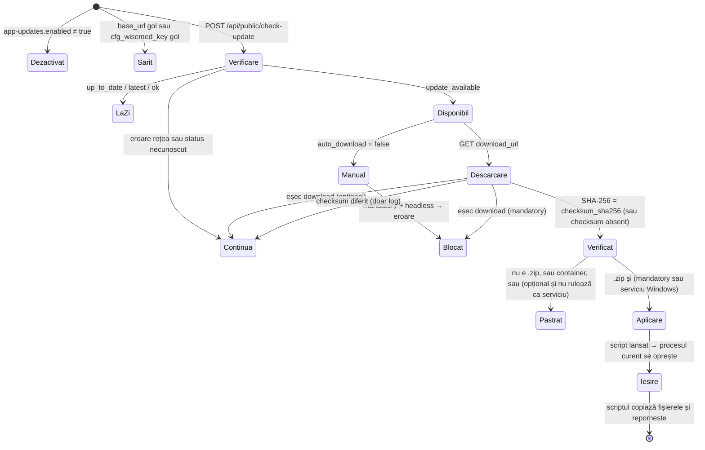

# Build, distribuție, instalare și actualizare

| | |
|---|---|
| **Scop** | Descrie, per familie de livrabile (readere, utilitare, servicii Docker, WSM), cum se construiesc, cum primesc versiunea, cum se împachetează și se instalează ca serviciu, cum se observă în exploatare și cum funcționează protocolul de actualizare client ↔ `update-server`. |
| **Data** | 2026-11-14 (commit de bază `d53088e`; host de verificare macOS darwin/arm64, `go1.25.5`) |
| **Surse** | `_reports/06-qa-build-ops.md` partea A (principală) și B.1–B.2; `_reports/05-utilities-ai.md §6–§7` (update-server, protocol); `_reports/01-runtime-and-apps.md §1.4, §4, §6` |
| **Limite** | **Niciun build, installer, pachet, imagine Docker sau update nu a fost construit, instalat ori aplicat.** Tot ce ține de `releasectl`, NSIS, `.deb/.rpm/.pkg/.dmg`, systemd/launchd/SCM, `docker/update.sh` și `update-wsm.sh` este citit din cod. Au rulat doar `go build/vet/test` nativ pe darwin/arm64 și testele Node/Vitest/Python enumerate în `_reports/06` B.1. Configurațiile reale din `output/` și de pe EC2 nu au fost citite. |

Etichete: **CDC** = `CONFIRMAT DIN COD` · **CTL** = `CONFIRMAT PRIN TEST LOCAL` (numai rulările din `_reports/06-qa-build-ops.md` B.1) · **DN** = `DOCUMENTAT, NEVERIFICAT` · **INF** = `INFERENȚĂ` · **NEC** = `NECUNOSCUT`. Căile fără prefix din §2–§3 și §6–§7 sunt relative la `readersv3/`; `main.go` fără altă precizare înseamnă `readersv3/tools/releasectl/main.go`.

Documente înrudite: [application-catalog.md](application-catalog.md), [runtime-and-modules.md](runtime-and-modules.md), [security-and-identity.md](security-and-identity.md), [verification-matrix.md](verification-matrix.md), [gaps-and-contradictions.md](gaps-and-contradictions.md), [agent-context.md](agent-context.md).

---

## 1. Harta generală

| Familie | Sursă | Unealtă de build | Artefact | Canal de livrare |
|---|---|---|---|---|
| Readere de analizoare + utilitare desktop (32 de `apps/*/main.go`) | `readersv3/apps/*` | `readersv3/tools/releasectl` (Go) | `dist/<target>/<app>/runtime`, `dist/updates/*.zip`, `dist/installers/*-Setup.exe`, `release/<app>/<target>/*.{tar.gz,deb,rpm,pkg,dmg}` | installer nativ + `update-server` (secțiunea `app-updates`) |
| Servicii Docker SIUI (`siui-bridge`, `siui-bridge-history`, `wisemed-siui-data`) | `readersv3/apps/*` + `readersv3/docker/` | `readersv3/docker/build.sh` (prin `make-*-docker.sh` din rădăcină) | `~/dockers/<app>-YYYYMMDD-HHMMSS.tar.gz` + `update-<app>.sh` | repository privat de arhive Docker, updater standalone pe EC2 |
| Alte imagini Docker (`wisemed-ai`, `html-print-formatter`, `update-server`) | `readersv3/apps/<app>/docker/` | `docker compose` | imagine locală | compose pe host |
| WSM Server | `wsm-server/` | `build.sh`, `build-docker.sh`, `Dockerfile` | `dist/` (binare + deployments + docs + control), `wisemed-wsm-<versiune>.tar.gz` | systemd sau Docker + `update-wsm.sh` |

CDC (`_reports/06` A.0).

**Ce este confirmat prin rulare** — CTL (`_reports/06` B.1): `go build ./...` și `go vet ./...` trec nativ în `readersv3/` (101 pachete, inclusiv cele 32 de aplicații) și în `wsm-server/`; `tools/releasectl` și `tools/docker-runtime` au teste care trec. **Nu** este confirmat: cross-compilarea pentru Windows/Linux, build-ul prin `releasectl`, fișierele `*_windows.go`/`*_linux.go`, niciun installer sau pachet. `python3 readersv3/docker/test-update.py` **eșuează** pe macOS (toate cele 8 teste; cauza în §4.3) — CTL pentru eșec.

---

## 2. Readere și utilitare (`readersv3`)

### 2.1 Puncte de intrare — CDC

- `readersv3/Makefile:11-27`: ținte `build`, `installer`, `update`, `release`, `build-all`, `package-all`; toate deleagă la `go run ./tools/releasectl …` cu `APP`, `TARGET` (implicit GOOS-GOARCH al hostului) și `VERSION` opțional. Cache-ul Go e forțat în `/tmp/wisemed-releasectl-go{cache,modcache}` (`Makefile:5`).
- Wrapper-e generate: `build-all-platforms.{sh,ps1}`, `package-all-platforms.{sh,ps1}`, `sync-release-scripts.{sh,ps1}`; `build-all-targets-macos.sh` și `package-all-targets-macos.sh` refuză să ruleze în afara macOS.
- Per aplicație: `apps/<app>/build/{build-all,build-linux,build-macos,build-windows}.*` + `linux/` (unit systemd, `install.sh`, `uninstall.sh`, `build-installer.sh`), `macos/` (plist, install/uninstall), `windows/` (`.nsi`, `.wxs`, `.bundle.wxs`, `.winsw.xml`, `install.ps1`, `uninstall.ps1`). Sunt **generate** de `releasectl sync` (`main.go:154-195`, `:984-1015`).
- **Comenzi `releasectl`** (`main.go:106-150`): `sync-app`, `sync`, `list-apps`, `build`, `build-all`, `package`, `package-update`, `release`, `package-all` — CDC, verificat direct în `switch`-ul din `main.go` (`_reports/06` A.1 enumeră doar 7; lista completă de 9 este cea din `_reports/05 §7`).

### 2.2 Platforme și compilare — CDC

- **Ținte** (`main.go:82-90`): `windows-386`, `windows-amd64`, `windows-arm64`, `linux-amd64`, `linux-arm64`, `darwin-amd64`, `darwin-arm64`.
- **Excepție**: `esignature-server` se construiește **numai** pentru `windows-386` (DLL Signotec x86), iar celelalte aplicații nu se construiesc pentru `windows-386` (`main.go:243-252`, `:444-446`). DLL-ul este copiat din `docs/signotec/WebSocketPadServer/STPadLib.dll` (`main.go:523-527`).
- `package-all` împachetează doar țintele sistemului gazdă: Windows → trei ținte Windows, Linux → `linux-amd64/arm64`, macOS → `darwin-amd64/arm64` (`main.go:395-405`).
- **Compilare** (`main.go:476-515`): `go build -a -trimpath -buildvcs=false -mod=readonly`, `GOWORK=off`, `SOURCE_DATE_EPOCH` = data ultimului commit; prima încercare fără `CGO_ENABLED` explicit, la eșec reîncearcă cu `CGO_ENABLED=1`. Înainte de fiecare build, `dist/<target>/<app>/runtime` este șters complet (`main.go:464-467`).
- **Inventarul de aplicații al `releasectl`**: `readersv3/build/apps.json` listează 28 de aplicații din 32 (lipsesc `siui-bridge`, `siui-bridge-history`, `wisemed-ai`, `wisemed-siui-data`); `zonci-xl1000i-reader` este în manifest, dar nu are director `apps/…/build`. Fișierul e urmărit în git deși `.gitignore` îl exclude — CDC. Semnificația omisiunii (cele patru se livrează prin Docker): INF.

### 2.3 Embed versiune — CDC

- **Variabile**: `shared/appmeta/appmeta.go:5-10` — `Version` (implicit `0.0.0-dev`), `Commit`, `BuildTime`, `VersionMarker`. `CurrentVersion()` elimină prefixul `v`. Configul nu conține versiunea.
- **Injectare**: `-ldflags "-s -w -buildid= -X …appmeta.Version/Commit/BuildTime/VersionMarker"` (`main.go:552-564`).
- **Sursa versiunii**: `--version` → env `VERSION` → `git describe --tags --always --match 'v*'` → `0.1.0` (`main.go:1786-1795`). Normalizare: prefixul `v` eliminat; `-`, `_`, `+`, `/` devin `.` (`main.go:1808-1820`).
- **Recitire din binar**: după build, versiunea este extrasă din executabil prin markerul `WISEMED_APP_VERSION=` (`main.go:566-586`), deci numele pachetelor reflectă ce este efectiv în binar.
- **Afișare**: toate aplicațiile acceptă `-version` (ex. `apps/generic-test-reader/main.go:19-24`).
- **Docker SIUI**: se injectează **numai** `appmeta.Version` (`docker/Dockerfile:17`, timestamp UTC); `Commit`, `BuildTime`, `VersionMarker` rămân implicite.
- **WSM** nu folosește `appmeta`: `-X main.buildVersion=<timestamp UTC>` (§5).

### 2.4 Layout `dist/` și `release/` — CDC (+ observat pe disc)

| Cale | Conținut | Referință |
|---|---|---|
| `dist/<target>/<app>/runtime/` | binar + `deployments/` filtrat + `manifest.json` | `main.go:531-546` |
| `dist/updates/<app>-<versiune>-<target>.zip` | pachetul de update (fără `manifest.json`), SHA-256 logat; pe disc 62 de arhive | `main.go:1225-1260` |
| `dist/installers/<slug>-<versiune>[-arch]-Setup.exe` | installer NSIS; pe disc 43 de fișiere | `main.go:653-700`, `:1101-1114` |
| `dist/releases/<app>/<target>/<versiune>.json` | metadate de release | `main.go:609` |
| `release/<app>/<target>/` | pachete Linux (`.tar.gz`, `.deb`, `.rpm`) și macOS (`.pkg`, `.dmg`) | `main.go:705`, `:743`, `:782`, `:815`, `:846` |
| `dist/wss-preview/<timestamp>/` | preview-uri izolate (`scripts/build-wss-preview.sh`; refuză o destinație existentă) | `scripts/build-wss-preview.sh:8-11` |

**Filtrul `deployments`** (`main.go:1413-1446`): exclude `config.yaml`, `.db/.sqlite*`, `.log`, `.zip`, `.pid`, `.bak`, `.tmp` și directoarele `logs/`, `cache/`, `updates/`, `processed/`, `failed/`, `outbox/`, `inbox/`. În pachet ajung doar `config.install.yaml` și asset-urile statice (ex. `help/`). Aceasta este baza regulii „update-ul nu atinge configul și datele operatorului”.

Deși `.gitignore` exclude `readersv3/dist/` și `readersv3/release/`, în git sunt urmărite `readersv3/dist/linux-amd64/barcodeprinter/**` (inclusiv un `.db` și un `config.yaml`) și `readersv3/release/barcodeprinter/linux-amd64/barcodeprinter-1.2.3-amd64.tar.gz` — CDC (`_reports/06` A.4).

### 2.5 Installer Windows (NSIS) — CDC

- Script comun `installer/windows/installer.nsi` (85 de linii), apelat de `scripts/build-installer.sh`, care face un self-test `makensis`, copiază binarul + `deployments/`, șterge explicit `config.yaml`, `*.db*`, `*.log` din payload (`scripts/build-installer.sh:75-95`) și generează un wrapper `.nsi`.
- Cere admin (`installer.nsi:1`); instalează în `$PROGRAMFILES64\<DisplayName>` (`$PROGRAMFILES` pentru 386, `:37-41`); scrie cheile de registry pentru Uninstall (`:54-58`); creează scurtături în Start Menu și pe Desktop (`:60-62`); oferă pornirea aplicației la final (`:81-85`).
- **Nu instalează un serviciu Windows.** Serviciul se obține doar prin `-installservice` (§3.1).
- Uninstall-ul șterge numai binarul, `config.install.yaml` și `help/`; `config.yaml`, bazele de date și logurile rămân pe disc (`:67-79`).
- Dacă `makensis` lipsește, `release` continuă fără installer (`main.go:597-603`). `apps/wisemed-ai/docker/build-windows-release.sh` rulează `makensis` dintr-un container Debian.
- Fișierele `.wxs`, `.bundle.wxs` și `.winsw.xml` sunt generate, dar **neconsumate**: codul folosește numai NSIS, iar `ensureWinSW` (`main.go:1380-1410`) nu e apelată de nicăieri (`_reports/06` contradicția 7).

### 2.6 Pachete Linux — CDC (`main.go:704-779`)

Rootfs `/opt/<app>/` + unit `/etc/systemd/system/<serviceName>.service`; întotdeauna `.tar.gz`; `.deb`/`.rpm` prin `fpm` dacă există, altfel `dpkg-deb`/`rpmbuild`. Post-install: `systemctl daemon-reload`, `enable`, `restart` (`main.go:2353-2360`). Pentru `wisemed-ai` și `html-print-formatter` se creează un cont de sistem dedicat; restul rulează ca `root` (`main.go:1543-1558`, `:2312`).

### 2.7 Pachete macOS — CDC (`main.go:781-851`)

Payload în `/usr/local/<app>/`; LaunchDaemon `/Library/LaunchDaemons/<bundleId>.plist` (`RunAtLoad`, `KeepAlive`, log în `/var/log/<app>.log`, `main.go:2369-2391`); `.pkg` prin `pkgbuild` + `productbuild`, `.dmg` prin `hdiutil`. **Nu există semnare sau notarizare** (nicio referință la `codesign`/`notarytool`).

### 2.8 Publicarea unui release — CDC

`releasectl release` produce ZIP-ul de update, opțional installerul NSIS și JSON-ul de metadate, dar **nu încarcă nimic** pe server. Publicarea se face pe una din trei căi (`_reports/05 §6–§7`):

| Cale | Mecanism |
|---|---|
| (a) build pe server | `POST /api/update-server/apps/{id}/make-release` — serverul mapează `app_id` → aplicația sursă prin `modules.app-updates.app_id` din `apps/*/deployments/config.install.yaml`, face bump de patch, rulează `go run -a ./tools/releasectl release --json …`, copiază ZIP-ul (și installerul) în `files_dir` (`modules/appupdateserver/module.go:1322-1446`, `:1630`). Cere **sursele și toolchain-ul Go pe server** |
| (b) upload manual | `POST /apps/{id}/versions` multipart (≤ 512 MiB) |
| (c) referință externă | versiune cu `download_url` extern (descărcarea răspunde 307) |

`releasectl release --app-updates-base-url` rescrie `base_url` din șablon la împachetare (`main.go:621-652`); altfel rămâne `http://127.0.0.1:19090`.

---

## 3. Instalare ca serviciu per OS

Există **două surse distincte** de definiții de serviciu pentru aceeași aplicație. Nu sunt echivalente și pot instala servicii cu nume diferite pentru același binar (`_reports/06` contradicția 9).

### 3.1 Sursa A — `-installservice` (generat de aplicație la rulare) — CDC

Numele serviciului: `wisemed-<token>`, unde tokenul vine din `reader.id` → `analyzer_code` → `label` din configurație (`apps/runner/service_common.go:32-41`; excepție: `wisemed-ai`). `-installservice` instalează și iese fără a porni module (`apps/runner/runner.go:113-115`).

| OS | Ce face | Referință |
|---|---|---|
| **Linux** | scrie `/etc/systemd/system/<serviciu>.service`: `Type=simple`, `ExecStart=<bin> -config <cfg>` — **fără `-headless`** —, `Restart=on-failure`, `RestartSec=5`, ieșire în journal; apoi `systemctl daemon-reload` și `enable --now`. Pentru `html-print-formatter` și `wisemed-ai` creează utilizator de sistem și schimbă proprietarul directorului | `apps/runner/service_linux.go:14-78` (corpul unitului la `:20-36`, reverificat direct) |
| **macOS** | scrie `/Library/LaunchDaemons/eu.wisemed.readersv3.<token>.plist` (`KeepAlive`), apoi `launchctl bootout/bootstrap/enable/kickstart` | `apps/runner/service_darwin.go:15-67` |
| **Windows** | `sc.exe create/config` cu `start= auto`; `sc.exe failure` (restart la 60/120/300 s, reset 86400 s); `sc.exe start`. Procesul detectează rularea ca serviciu prin `svc.IsWindowsService()` și intră în `svc.Run`, tratând `Stop`/`Shutdown` | `apps/runner/service_windows.go:16-52`, `:66-79`, `:85-115` |

Linux/macOS nu au manager de serviciu în proces (`service_unix.go:10-12`); oprirea se face prin `SIGTERM`/`SIGINT` (`runner.go:149`). `currentRunsAsService()` este real doar pe Windows (`service_detect_windows.go`; `service_detect_other.go` întoarce fals) — relevant pentru auto-aplicarea update-urilor (§6.4). Particularitățile serviciului Windows (folosește prima instanță runtime, fără restart din UI) sunt în [runtime-and-modules.md §1.2](runtime-and-modules.md#12-dublul-init). `apps/runner/service_*.go` nu are teste (`_reports/06` B.3).

### 3.2 Sursa B — unitățile împachetate de `releasectl` — CDC pentru conținut

Fișierele generate în `apps/<app>/build/` și incluse în pachetele `.deb/.rpm/.pkg` folosesc `serviceName` derivat din **id-ul aplicației** și bundle id cu puncte (ex. `eu.wisemed.readersv3.generic.test.reader`), nu din `reader.id`.

| Fișier | Linie de comandă | Tip |
|---|---|---|
| `apps/generic-test-reader/build/linux/generic-test-reader.service:10` | `ExecStart=/opt/generic-test-reader/generic-test-reader -config deployments/config.yaml -headless` | `Type=simple`, `User=root`, `Restart=on-failure` |
| `apps/generic-test-reader/build/macos/eu.wisemed.readersv3.generic.test.reader.plist:12` | `… -headless` | `RunAtLoad`, `KeepAlive` |
| `apps/generic-test-reader/build/windows/generic-test-reader.winsw.xml:7` | `-config deployments\config.yaml -headless` | WinSW (neconsumat, §2.5) |

Conținutul a fost reverificat direct. Argumentul `-headless` este adăugat de `releasectl` (`main.go:1772`).

**Efectul `-headless` sub un manager de servicii — INF, netestat.** În modul `-headless`, procesul părinte lansează un copil detașat cu `-headless-child` și **iese cu succes** (`apps/runner/runner.go:125-138`, `headless_unix.go:18-54`). Dedus din cod:

- sub systemd cu `Type=simple`, ieșirea procesului principal marchează serviciul ca oprit și, cu `KillMode` implicit, copilul ar fi terminat; `Restart=on-failure` nu repornește după cod 0;
- sub launchd, `KeepAlive` ar relansa părintele la nesfârșit.

Dacă pachetele `.deb/.rpm/.pkg` țin efectiv serviciul pornit: **NEC** — niciun pachet nu a fost construit sau instalat. Sursa A nu are această problemă, pentru că nu adaugă `-headless`.

### 3.3 Mod headless fără serviciu — CDC

`-headless` pornește copilul într-o sesiune nouă (`Setsid` pe Unix, `DETACHED_PROCESS` pe Windows), așteaptă confirmarea pornirii (max 1 min) prin fișierul indicat de env `WISEMED_HEADLESS_STARTUP_FILE`, scrie `<reader>.pid` lângă configurație, afișează PID-ul și iese (`runner.go:125-138`, `headless_unix.go:18-54`, `headless_windows.go:23`, `headless_startup.go:16-36`). Fără serviciu nu există repornire automată; fișierul PID rămâne dacă procesul e ucis brutal.

---

## 4. Servicii Docker

### 4.1 SIUI (`siui-bridge`, `siui-bridge-history`, `wisemed-siui-data`) — build — CDC

- `make-siui-bridge-docker.sh`, `make-siui-bridge-history-docker.sh`, `make-wisemed-siui-data-docker.sh` (rădăcină) → `readersv3/docker/build.sh <app>`.
- `docker/build.sh:5-24`: acceptă doar cele trei aplicații; versiune = timestamp UTC `YYYYMMDD-HHMMSS`; platformă implicită `linux/amd64` (`SIUI_DOCKER_PLATFORM`); export în `~/dockers` (`SIUI_DOCKER_OUTPUT_DIR`); refuză suprascrierea unei arhive existente; export atomic (`mktemp` + `mv`).
- Înainte de build apelează `scripts/prepare-docker-output.sh`, care **scrie în `readersv3/output/<app>/`** (`update-<app>.sh` și `docker/config.install.yaml`).
- `docker/Dockerfile`: build nativ pe `$BUILDPLATFORM` cu `golang:1.26.8`, cross-compile `CGO_ENABLED=0` (`:1-21`); runtime `debian:bookworm-slim` cu `ca-certificates`, `tzdata`, `libxml2-utils`, `opensc`, `libpcsclite1` (`:24-30`); utilizator `65532:65532` (`:40`); `ENV WISEMED_CONTAINER=1` (`:33`); label `eu.wisemed.app` (`:34`).
- Contextul de build este o listă albă (`docker/Dockerfile.dockerignore`): `core`, `modules`, `shared`, `apps/runner`, `main.go` + `config.install.yaml` + `help/` ale celor trei aplicații și `tools/docker-runtime`.

### 4.2 SIUI — rulare și configurație — CDC

- `docker/update.sh:122-125`, `:160-161`: `--network host`, `--read-only`, `--cap-drop ALL`, `--security-opt no-new-privileges:true`, tmpfs `/tmp`, `--restart unless-stopped`, rotație log Docker (`max-size=10m`, `max-file=3`).
- Două bind mount-uri: `<root>/deployments → /data/deployments`, `<root>/data → /data/data`; `root` implicit `/opt/<app>`.
- Host networking este intenționat: `127.0.0.1` din configurație rămâne hostul EC2 (baze de date, WSM, Bridge → History). `docker-runtime` refuză o adresă `local_http` care nu e loopback numeric (`tools/docker-runtime/main.go:44-48`).
- **Păstrarea configurației**: `docker/entrypoint.sh:5-12` rescrie la fiecare pornire doar `config.install.yaml` (cu căile de date mutate în `../data/…`) și `help/`; `config.yaml` al operatorului nu e atins; runtime-ul completează doar cheile lipsă (`config.Ensure`).
- Opțional: `<root>/docker.env` și `<root>/docker.args` (numai `--mount=`, `--device=`, `--group-add=`; orice altceva oprește scriptul, `update.sh:127-137`).
- **Health**: `HEALTHCHECK` la 5 s rulează `docker-runtime health` (`Dockerfile:41-42`): `GET /api/session` pe loopback (HTTPS cu CA-ul local persistent dacă `local_http.tls`), verifică protocolul și versiunea (`tools/docker-runtime/main.go:55-92`). Nu verifică baza de date, S3 sau CNAS.
- **Update aplicativ în container**: `WISEMED_CONTAINER=1` dezactivează aplicarea in-place a update-urilor din `update-server` (`apps/runner/updates.go:157`); imaginea se înlocuiește doar prin updaterul de mai jos.

### 4.3 SIUI — updater standalone (`docker/update.sh`, generat per aplicație prin înlocuirea `@APP@`) — CDC

- Nu are nevoie de checkout-ul surselor; cere `git ssh ssh-agent ssh-add ssh-keygen docker flock python3 gzip` (`:17-19`).
- Pași: `flock` (`:22-23`) → clonare superficială a repository-ului de arhive cu cheia dedicată, `IdentitiesOnly=yes`, `BatchMode=yes` (`:78-81`) → selecția arhivei tracked, cu refuz la duplicate și symlink-uri (`:82-97`) → `gzip -t`, `docker load`, verificarea arhitecturii, a labelului `eu.wisemed.app` și a versiunii binarului (`:100-107`) → `docker-runtime check-config` **înainte** de oprirea containerului vechi (`:149-150`) → redenumire + oprire container vechi (`:155-157`) → pornire container nou → așteptare `healthy` (implicit 120 s).
- **Rollback automat la eșec**: șterge containerul nou, redenumește și repornește pe cel vechi (`:45-63`). La succes, containerul vechi rămâne oprit ca `<app>-backup-…`. Datele și migrările de schemă **nu** sunt restaurate (`:170`).
- `--setup` rulează wizardul interactiv (`-reconfigure`) și refuză dacă există un container pornit (`:112-114`, `:138-143`).
- **Stare de verificare**: `python3 readersv3/docker/test-update.py` eșuează integral pe macOS — CTL (`_reports/06` B.1 rândul 17, E2). Cauza: `update.sh:78` conține `$sshkey…` cu caracterul U+2026 lipit de numele variabilei; `/bin/bash` 3.2.57 îl tratează ca parte din nume și raportează variabilă nedefinită sub `set -u`, iar scriptul a ieșit totuși cu cod 0. Comportamentul pe bash ≥ 4 / Linux (ținta reală): NEC.

### 4.4 Alte imagini — CDC

| Aplicație | Build | Runtime | Observații |
|---|---|---|---|
| `wisemed-ai` (`apps/wisemed-ai/docker/`) | trei etape: Node 22 (frontend), `golang:1.24-bookworm`, `debian:bookworm-slim` | utilizator `wisemed-ai` (UID 10001); healthcheck `curl /ready/ai`; `compose.yaml` adaugă `pgvector/pgvector:pg16`, publică implicit pe `127.0.0.1:19120`, `cap_drop: [ALL]` | `make-wisemed-ai-docker.sh` rulează implicit `docker compose up -d --build`; entrypoint-ul creează `config.yaml` doar dacă lipsește și schimbă adresa la `0.0.0.0:19120` (`entrypoint.sh:4-7`) |
| `html-print-formatter` (`apps/html-print-formatter/docker/ubuntu/`) | `golang:1.25-bookworm` | `ubuntu:24.04`, UID 10001, `tini`, port 19113, healthcheck la 30 s | — |
| `update-server` (`apps/update-server/docker/ubuntu/`) | Go 1.24.0 instalat în imagine | `ubuntu:24.04`, port 19090 | `restart` este comentat în compose |

Versiunile de Go sunt neuniforme: `go.mod` declară `go 1.24.0`, Dockerfile-urile folosesc `golang:1.26.8` (SIUI, WSM), `1.24-bookworm`, `1.25-bookworm`, Go 1.24.0 instalat manual; CI folosește versiunea din `go.mod` (`_reports/06` contradicția 13).

---

## 5. WSM Server

### 5.1 Build — CDC

- `wsm-server/build.sh`: `go build -trimpath -ldflags "-X main.buildVersion=<timestamp UTC>"` pentru `cmd/wsm-server` și `cmd/wsmctl`; copiază `deployments/*`, `README.md`, `docs/*.md`, exemple și **șase** asset-uri de control UI din `readersv3/modules/localhttp/ui/` în `dist/` (sau `WSM_OUTPUT_DIR`). Platforma se alege prin `GOOS`/`GOARCH` din mediu.
- `wsm-server/Dockerfile`: `golang:1.26.8` → imagine `scratch` cu `ca-certificates.crt`, `wsm-server`, `wsmctl`, `control/`; utilizator `65532:65532`; expune 8443 și 8090; `CMD -config /etc/wsm-server/config.yaml`. Copiază **patru** asset-uri de control (`Dockerfile:16`).
- `wsm-server/build-docker.sh` + `make-wsm-docker.sh`: imagine `wisemed-wsm:<timestamp>`, export `wisemed-wsm-<timestamp>.tar.gz`, platformă implicită `linux/amd64`. În `make-wsm-docker.sh` linia 7 face `exec`, deci liniile 8–12 (`git add/commit/push`) sunt cod mort.
- `wsm-server/prepare-local.sh`: pregătește `wsm-server/output/` (generează o cheie locală cu `openssl rand` dacă lipsește, copiază `config.yaml` doar dacă lipsește, recopiază asset-urile de control).
- **Versiune**: `main.buildVersion` (implicit `dev`), afișată cu `--version` și în log la pornire (`cmd/wsm-server/main.go:18`, `:27-33`, `:42`).
- **Divergență build ↔ Docker** — CDC pentru fișiere, INF pentru efect: `Dockerfile:16` și `Dockerfile.dockerignore:14-17` copiază 4 asset-uri (`index.html`, `app.js`, `styles.css`, `wss-remote.js`), `build.sh:15` și `prepare-local.sh:18` copiază 6 (în plus `docmed-forms.js`, `siui-invoice.js`). `app.js:1-2` importă static cele două fișiere, iar serverul întoarce 404 pentru un fișier absent (`internal/server/control.go:116-124`) → în imaginea Docker consola `/control` probabil nu se încarcă (neverificat într-un container).

### 5.2 Instalare ca serviciu — CDC pentru unit, DN pentru pași

`wsm-server/deployments/wsm-server.service`: utilizator `wsm-server`, `ExecReload=kill -HUP`, `Restart=on-failure`, hardening (`NoNewPrivileges`, `ProtectSystem=strict`, `ProtectHome`, `PrivateTmp`, `RestrictAddressFamilies`), `StateDirectory=wsm-server`, `LimitNOFILE=16384`. Pașii manuali sunt în `wsm-server/docs/operations.md:68-76` (DN). Nu există installer sau pachet `.deb`/`.rpm` pentru WSM. Pe Windows nu există SIGHUP (`docs/operations.md:237`).

### 5.3 Docker + update (`update-wsm.sh`) — CDC

- Rulare: `--read-only`, `--cap-drop ALL`, `no-new-privileges`, `-p 127.0.0.1:<port>:8090`, `deployments` montat read-only în `/etc/wsm-server`, `state` montat inscriptibil în `/var/lib/wsm-server` (`:128-134`). **Nu** folosește host networking (spre deosebire de serviciile SIUI).
- Fluxul de selecție, verificare, `-check-config` înainte de oprire, redenumire, health și rollback este același ca la updaterul SIUI (`:86-143`). Health: `curl http://127.0.0.1:<port>/healthz` trebuie să întoarcă `status=ok`, `service=wsm-server` (`:68-77`).
- Nginx: `deployments/nginx-wsm.conf` (TLS 1.2/1.3, HSTS, `access_log off`, `proxy_read_timeout 310s`, păstrează `Host` cu port).
- Scriptul pornește `ssh-agent`, face `ssh-add` și rulează `sudo chown/chmod` pe `deployments` și `state` în liniile `13-24`, **înainte** de `set -Eeuo pipefail` (`:27`) și de validarea argumentelor (`:30-33`); agentul nu este oprit. `docs/docker-update.md:7-10` descrie alt comportament. Din acest motiv `wsm-server/scripts/test-update-wsm.py` nu a fost rulat (`_reports/06` contradicția 4).

---

## 6. Protocolul de actualizare client ↔ update-server

Client: `shared/appupdates/appupdates.go`. Orchestrare: `apps/runner/updates.go`, `update_apply.go`, `background_updates.go`. Server: `modules/appupdateserver`. UI: `modules/localhttp/module.go:243-244, 2741-2900`. Toate afirmațiile din această secțiune: CDC, dacă nu se precizează altfel. **Nimic din acest protocol nu a fost exercitat prin rulare**: `shared/appupdates` și `update_apply.go` nu au teste (`_reports/06` B.3).

### 6.1 Cine participă

- 30 din 32 de aplicații au `modules.app-updates` cu `enabled: true` în șablon. Excepții: `signing-pad-utility` (șablon fără secțiune → verificarea e dezactivată până la rularea wizardului, `apps/runner/bootstrap.go:172-196`) și `update-server` (nu folosește `runner`, fără self-update).
- Verificarea are loc **o singură dată, la pornire**: sincron (`runner.go:116-124`) sau în fundal prin modulul `runner-startup-updates` (`wisemed-ai`, `wisemed-siui-data`). `GET /api/app-update/status` din UI (cache 30 s) doar afișează starea, nu descarcă și nu aplică (`modules/localhttp/module.go:2796-2893`).
- La `-headless`, verificarea rulează de două ori (părinte + copil).

### 6.2 Diagrama de stări



### 6.3 Pași

| Pas | Detaliu | Referință |
|---|---|---|
| **Identificare** | `app_id` = `modules.app-updates.app_id` sau, în lipsă, `reader.id`; `channel`; `current_version` = `appmeta.CurrentVersion()`; `os`/`arch` = `runtime.GOOS/GOARCH` | `apps/runner/updates.go:39-45` |
| **Autentificare** | JWT HS256 semnat cu **`cfg_wisemed_key`** (cheia WiseMED API partajată, din `wisemed-api`); claims `app_id`, `scopes:["check","download"]`, `exp` +10 min. Fără cheie, verificarea este sărită (doar mesaj de consolă) | `shared/appupdates/appupdates.go:84-89`; verificare în `modules/appupdateserver/module.go:2120-2141` |
| **Verificare** | `POST /api/public/check-update` (scope `check`); serverul alege cea mai mare versiune activă potrivită pe canal/OS/arch (câmp gol sau `*`/`any`/`all` = wildcard) | `pickBestVersion`, `module.go:2232-2250` |
| **„Manifest”** | nu există fișier manifest separat; rolul îl are `CheckResponse` {`status`, `latest_version`, `mandatory`, `download_url`, `checksum_sha256`, `file_name`, `release_notes`, `version_record_id`} | `appupdates.go:38-51` |
| **Descărcare** | `GET /api/public/download/{versionId}?token=…` cu token de unică folosință, valabil 15 min; scriere în `download_dir/<nume>.part` apoi rename; SHA-256 calculat în flux; timeout client 30 min | `appupdates.go:130-197` |
| **Integritate** | comparație SHA-256 **numai dacă** serverul a trimis `checksum_sha256`; un răspuns fără checksum este acceptat fără verificare. La nepotrivire update-ul nu se aplică: opțional → continuă cu avertisment; obligatoriu → continuă cu avertisment, iar în headless întoarce eroare | `apps/runner/updates.go:142-150` |
| **Semnătură** | **nu există** semnătură criptografică a artefactului; checksumul vine pe același canal și de la același server ca fișierul | absență în `appupdates.go` / `update_apply.go` |
| **Payload** | ZIP cu binarul + `deployments/` filtrat (include `config.install.yaml`; exclude `config.yaml`, `.db`, loguri, `updates/`, `inbox/outbox/processed/failed`). Extragerea validează path traversal | `tools/releasectl/main.go:1211-1262`, `:1413-1446`; `apps/runner/update_apply.go:61-64` |
| **Oprirea procesului** | `checkForUpdates` întoarce `errUpdateStarted`: sincron → `Run` iese curat; în fundal → `runner-startup-updates` întoarce `nil` din `Start`, ceea ce oprește tot runtime-ul | `runner.go:117-120`, `background_updates.go:41-44`, `core/runtime/runtime.go:141-148` |
| **Aplicare Windows** | script PowerShell detașat: așteaptă ieșirea PID-ului curent, `Copy-Item -Recurse -Force` peste directorul aplicației, apoi `sc.exe start <serviciu>` sau relansare directă | `update_apply.go:96-160` |
| **Aplicare Unix** | script `/bin/sh`: `sleep 1; cp -R stage/* app/; chmod +x; nohup exe -config …` | `update_apply.go:162-181` |
| **Alte tipuri de fișier** | un `.exe` (installer) nu este auto-aplicat ca arhivă; se lansează ca installer | `update_apply.go:17-44` |
| **Merge config** | la pornirea noii versiuni, `config.Ensure` adaugă în `config.yaml` doar cheile **lipsă** din noul `config.install.yaml`; valorile existente nu sunt suprascrise; listele nu sunt îmbinate | `core/config/install.go:19-69`, `mergeMissing :152-170` |
| **Rollback** | **inexistent**: fără backup al binarului vechi, fără verificare post-update; scriptul doar copiază peste | `update_apply.go:138-146`, `:171` |

### 6.4 Condiția de auto-aplicare

`apps/runner/updates.go:157` (reverificat direct):

```go
autoApply := os.Getenv("WISEMED_CONTAINER") != "1" && isArchiveUpdate(filePath) && (resp.Mandatory || currentRunsAsService())
```

Consecințe — CDC:

- în container (`WISEMED_CONTAINER=1`) nu se aplică niciodată in-place;
- un update **neobligatoriu** se aplică automat doar dacă procesul rulează ca serviciu; `currentRunsAsService()` este real numai pe Windows, deci pe Linux/macOS un update opțional este doar descărcat, chiar și sub systemd/launchd;
- un update **obligatoriu** se aplică indiferent de modul de rulare.

### 6.5 Observații de risc

| # | Observație | Etichetă |
|---|---|---|
| 1 | `app_id` din JWT nu este comparat cu `app_id` din body (`req.AppID = firstNonEmpty(req.AppID, claims.AppID)`, `modules/appupdateserver/module.go:706`): orice deținător al cheii partajate poate interoga orice aplicație | CDC |
| 2 | `handlePublicDownload` nu verifică JWT-ul, doar tokenul din URL; tokenul e consumat la prima utilizare → descărcarea nu poate fi reluată; tokenurile sunt în memorie și se pierd la restartul serverului | CDC |
| 3 | fiecare `check-update` cu `update_available` emite un token nou; `GET /api/app-update/status` din `local-http` este neautentificat (`modules/localhttp/module.go:243`) și declanșează astfel de verificări | CDC |
| 4 | scriptul Unix așteaptă fix 1 s (nu ieșirea procesului), copiază și `apply-update.sh` în directorul aplicației și repornește cu `nohup` chiar dacă aplicația rulează ca serviciu (ramura Windows folosește `sc.exe`) | CDC; efectul sub systemd/launchd (posibilă instanță dublă) INF |
| 5 | `base_url` implicit `http://127.0.0.1:19090`; transportul poate fi HTTP simplu, iar integritatea depinde doar de checksumul opțional de pe același canal | CDC |
| 6 | cheia de autentificare a update-ului este cheia WiseMED API partajată; o instalare standalone (ex. WiseMED AI fără WiseMED) nu primește update-uri | CDC |
| 7 | șablonul `update-server` setează `allowed_user_types: "1,9,10"`, iar implicitul din cod când cheia lipsește este `-1` (`module.go:2110`) | CDC |

Formularea „verificarea semnăturii HMAC” din `_reports/06` B.3 se referă la JWT-ul HS256 al cererii, nu la o semnătură a artefactului; `_reports/05 §7` și `_reports/06` A.1 concordă că artefactul nu este semnat.

---

## 7. Observabilitate și loguri

### 7.1 Readere și utilitare — CDC

- **Log zilnic** `<reader-id>-YYYYMMDD.log` în directorul configului (`apps/runner/logging.go:18-35`), cu microsecunde; `-showlog` dublează în consolă (`MultiWriter`), cu `[ERROR]` colorat pe terminal interactiv (`:37-44`, `:198-215`). `update-server` scrie doar pe stdout.
- **Arhivare**: la pornire, logurile săptămânilor încheiate sunt arhivate în `<reader>-<de la>-<până la>.zip` și fișierele sursă sunt șterse (`logging.go:82-131`).
- **Fără rotație în timpul rulării**: numele fișierului se stabilește o dată, la pornire (`logging.go:30-32`). Un proces care rulează mai multe zile continuă să scrie în fișierul zilei de pornire — INF (neverificat prin rulare îndelungată).
- **Niveluri**: nu există `log_level`; se folosesc prefixe textuale (`[ERROR]`) și `logging.verbose_level` 1..5 pentru volumul de trace al protocoalelor. Atenție: ASTM scrie o linie de log per octet primit chiar la nivel 1 (`modules/protocols/astm/module.go:589`), iar `barcodeprinter` scrie ZPL-ul complet, cu numele pacientului (`modules/barcodeprinter/module.go:509-517`).
- **Health**: `GET /healthz` → `{"ok":true,"reader":…}` (`core/runtime/runtime.go:50`, `:151-156`) — verifică doar că procesul răspunde. Alte endpointuri: `/api/status` (cu sesiune), `/health` (`htmlprintformatter`, `signingpad`), `/health/ai` și `/ready/ai` (`wisemedai`), `/api/modules`.
- **Diagnostic**: `shared/commtrace`, `shared/debugreplay`, `shared/analyzeractivity` (fără teste); trace WSS în memorie (ultimele 200 de mesaje).
- **Sub serviciu**: systemd → journal (ambele surse de unit); LaunchDaemon-ul împachetat → `/var/log/<app>.log`; în plus fișierul zilnic de mai sus.
- **Docker SIUI**: log Docker cu rotație `max-size=10m`, `max-file=3`; `HEALTHCHECK` la 5 s (§4.2).

### 7.2 WSM — CDC

- Loguri la stderr/journal **și** în fișiere zilnice UTC `wsm-YYYY-MM-DD.log` (`wsm-server/internal/logstore/store.go:52`, `cmd/wsm-server/main.go:67-73`); director implicit `logs/` lângă registrul de chei sau `../logs` față de configurație (`internal/config/config.go:202-209`). Fără retenție automată. (`docs/migration.md:23` spune doar „stderr/journald” — depășit.)
- `GET /healthz` → `{"status":"ok","service":"wsm-server"}` (`internal/server/server.go:164-165`); nu verifică upstreamurile.
- `-check-config` validează schema strictă, secretele și fișierele TLS (`cmd/wsm-server/main.go:29`). Dacă `deployments/config.http.yaml` (cu `allow_insecure_http: false`, fără bloc `tls`) trece validarea: NEC.
- Reload prin SIGHUP pe Unix (`cmd/wsm-server/reload_unix.go:17-18`); deconectarea tuturor socketurilor la reload: DN.
- Contoare de conexiuni cu scope `connections:read`, resetate la restart: DN (`docs/operations.md:266-268`).

---

## 8. CI

Un singur workflow: `.github/workflows/readersv3-release.yml`, generat de `releasectl sync` (`main.go:189-192`) — CDC.

| Job | Ce face | Referință |
|---|---|---|
| declanșare | `workflow_dispatch` (cu `version` opțional) și push de tag `v*.*.*` | `:3-12` |
| `sync` | rulează `releasectl sync` și cere arbore curat (`git diff --exit-code`) | `:18-30` |
| `package` | matrice `ubuntu-24.04`, `windows-2022`, `macos-14`; instalează `fpm`/`rpm` pe Linux, `wixtoolset` + `nsis` pe Windows; rulează `releasectl package-all`; urcă `readersv3/release` ca artefact | `:32-73` |
| `release` | pe tag, publică artefactele ca GitHub Release | `:75-86` |

Constatări:

- workflow-ul **nu rulează** `go test`, `go vet`, teste Node sau Python; nu există niciun workflow pentru `wsm-server` — CDC;
- artefactul urcat este `readersv3/release`, dar installerele Windows sunt scrise în `dist/installers/` (`main.go:665`), iar `package-all` nu produce `dist/updates` → pe runnerul Windows artefactul ar fi gol — INF;
- jobul `sync` ar eșua pe starea curentă, pentru că `build/apps.json` este în urmă — INF (`sync` nu a fost rulat);
- matricea omite `windows-386` (necesar pentru `esignature-server`), iar `wixtoolset` e instalat fără a fi folosit — CDC;
- dacă workflow-ul a rulat vreodată cu succes: NEC.

---

## 9. Artefacte și material sensibil urmărite în git

CDC (`git ls-files`; detalii și mărimi în `_reports/06-qa-build-ops.md` A.4): binare `wsm-server/output/bin/WSM_Server`, `Last_ServerWS` și cinci backup-uri `WSM_Server.backup-*`; binare și backup-uri în `output/wsm-browser-sdk/bin/`; `readersv3/zonci-xl1000i-reader.exe`; arhive și installere în `readersv3/output/update-server/deployments/files/**` plus `app-update-server.db`; `docs/signotec/**` (inclusiv un fișier de cheie privată al furnizorului); `readersv3/apps/signing-pad-utility/java/signing-pad-helper.jar`; 15 fișiere `config.yaml` de runtime. Conținutul fișierelor de configurare și de chei nu a fost inspectat sau copiat; dacă includ secrete reale: NEC. Vezi [security-and-identity.md](security-and-identity.md) și [gaps-and-contradictions.md](gaps-and-contradictions.md).

---

## 10. Divergențe între rapoarte și lacune

| Subiect | Constatare | Rezoluție |
|---|---|---|
| Lista comenzilor `releasectl` | `_reports/06` A.1: 7 comenzi (`main.go:117-150`); `_reports/05 §7`: 9 comenzi (`main.go:106-150`) | verificat în cod: 9 (`sync-app` și `list-apps` există) |
| Unități de serviciu Linux | `_reports/01 §1.4` și `_reports/06` A.1 descriu unitul din `-installservice`; `_reports/06` contradicția 10 descrie unitățile împachetate | două surse distincte (§3.1 fără `-headless`, §3.2 cu `-headless`); efectul celei de-a doua rămâne INF |
| Liniile ramurii headless | `_reports/01`: `runner.go:125-138`; `_reports/06`: `:126-139` | diferență de o linie la capete; aceeași ramură |
| „Semnătură HMAC” la update | `_reports/06` B.3 vs `_reports/05 §7` | HMAC = JWT-ul cererii; artefactul nu e semnat (§6.5) |
| Auto-aplicare „ca serviciu” | `_reports/06` A.1 nu precizează OS-ul | `currentRunsAsService()` e real doar pe Windows (`_reports/01 §1.4`, verificat: `service_detect_other.go`) |

Lacune (NEC), toate din lipsa rulării: dacă installerele NSIS, pachetele `.deb/.rpm/.pkg/.dmg` și update-urile `.zip` se instalează și pornesc corect; comportamentul serviciilor împachetate cu `-headless`; comportamentul serviciului Windows la update automat; `docker/update.sh` și `update-wsm.sh` pe Linux / bash ≥ 4; starea reală a containerelor și a repository-ului de arhive de pe EC2; URL-ul de producție al `update-server`; dacă imaginea Docker WSM din producție are consola `/control` funcțională; `update-server/docker/ubuntu/entrypoint.sh`, `tls_support.go` și ștergerea de versiuni (necitite de rapoarte).
