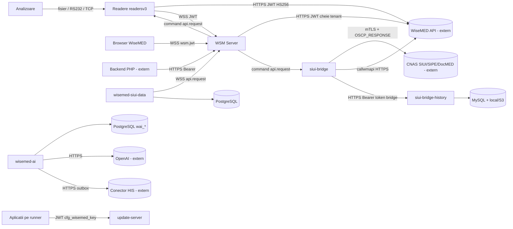

# Harta comunicațiilor

| | |
|---|---|
| **Scop** | Matricea unificată a tuturor legăturilor de comunicație din repository: cine vorbește cu cine, pe ce transport, cu ce autentificare/autorizare, ce se persistă, ce timeout și ce semantică de retry există. Descrie starea **existentă** în cod, nu propuneri. |
| **Data** | 2026-11-14 (checkout `main`, HEAD `d53088e`) |
| **Surse** | Rapoartele de investigație `_reports/01-runtime-and-apps.md` … `_reports/06-qa-build-ops.md`, plus verificări punctuale de interfață făcute direct în cod (doar citire) pentru acest document — marcate „verificat aici”. |
| **Limite** | Niciun binar/serviciu nu a fost pornit pentru acest document. Backendul WiseMED (logica de business), CNAS, aplicația Flutter completă și endpointul de token WSM din WiseMED sunt **externe** repo-ului; `apis/` conține doar stratul REST PHP (`apiv2`, `mp-api`). Exemplele PHP/JS din `wsm-server/examples` nu sunt dovadă de implementare în producție. Configurațiile reale (`output/*/deployments/config.yaml`) nu au fost citite; valorile sunt cele implicite din cod/șabloane. Nu sunt reproduse secrete. |

Documente înrudite: [end-to-end-flows.md](end-to-end-flows.md) · [api-catalog.md](api-catalog.md) · [security-and-identity.md](security-and-identity.md) · [data-and-state-machines.md](data-and-state-machines.md) · [runtime-and-modules.md](runtime-and-modules.md) · [application-catalog.md](application-catalog.md) · [build-deploy-update.md](build-deploy-update.md) · [verification-matrix.md](verification-matrix.md) · [gaps-and-contradictions.md](gaps-and-contradictions.md) · [agent-context.md](agent-context.md)

## 0. Convenții

**Etichete** (pe fiecare rând sau grup de rânduri):

| Prescurtare | Etichetă | Sens |
|---|---|---|
| `[COD]` | `CONFIRMAT DIN COD` | citit în sursă la `fișier:linie` |
| `[TEST]` | `CONFIRMAT PRIN TEST LOCAL` | acoperit de o suită rulată efectiv în `_reports/06-qa-build-ops.md §B.1` (rândul e citat). Toate suitele folosesc backend-uri simulate; confirmarea este la nivel de pachet trecut, nu de sistem real |
| `[DOC]` | `DOCUMENTAT, NEVERIFICAT` | apare doar în documentație / WSDL / comentarii |
| `[INF]` | `INFERENȚĂ` | dedus din mai multe fapte de cod, neobservat la rulare |
| `[NEC]` | `NECUNOSCUT` | în afara repo-ului sau neinvestigat |

**Prefixe de cale**: `R/` = `readersv3/` · `W/` = `wsm-server/internal/server/` · `WC/` = `wsm-server/internal/config/` · `S/` = `readersv3/modules/siui/` · `H/` = `readersv3/modules/siuihistory/` · `D/` = `readersv3/modules/siuidata/` · `AI/` = `readersv3/modules/wisemedai/`.

**Ce confirmă fiecare „succes”** (a nu se confunda):

| Semnal | Confirmă | NU confirmă | Dovadă |
|---|---|---|---|
| ACK ASTM (octet `ACK`) | recepția cadrului de către reader | checksum valid, persistență în SQLite | `R/modules/protocols/astm/module.go:601-604` vs `:649-651` `[COD]` |
| WSM `command_ack` (`delivery:"queued"`, `recipients:n`) | intrarea mesajului în coada de trimitere a `n` conexiuni | scrierea pe socket, recepția, execuția | `W/server.go:561-563`, `W/hub.go:195-217` `[COD]` |
| HTTP 200 la `POST /api/connections/{id}/commands` | a sosit un `reply` autentic de la peer-ul selectat | succesul API-ului remote (`response.status` poate fi 4xx/5xx, `response.ok` poate fi `false`) | `W/http_commands.go:147-156` `[COD]` |
| `*_execution_unknown` (`timeout_`, `client_disconnected_`, `request_interrupted_`) + `executionUnknown` din `WSMHttpClient.php` | wrapperul HTTP WSM nu știe dacă peer-ul a executat comanda | — | `W/http_commands.go:173-190` `[COD]` |
| HTTP 202 la `POST /api/siui/{grup}/{op}` | job validat local, rezervat durabil în SQLite, pus în coada din memorie | orice trimitere către CNAS | `S/service_jobs.go:257-348` `[COD]` |
| Job SIUI `completed` | sesiune CNAS, HTTP 200, plic SOAP valid, (opțional) fișier descărcat | acceptarea medicală/administrativă de către CNAS (rezultatul e în `result.values`) | `_reports/04-cnas-siui.md §6.5` `[COD]` |
| Job SIUI `unknown` | o scriere ar fi putut ajunge la CNAS, sau procesul a repornit cu jobul neterminat | — | `S/service_jobs.go:390-395`, `:48` `[COD]` |
| `wisemed_send_status = sent` | `PATCH` a primit HTTP 2xx | conținutul răspunsului (`results[].success` nu e citit de reader) | `R/modules/protocols/fileimportbase/module.go:669-677` `[COD]` |

`unknown` (stare de job SIUI) și `*_execution_unknown` (coduri ale wrapperului HTTP WSM) sunt **concepte distincte**. Ambele cer reconciliere de către apelant/operator; niciuna nu are cod de reconciliere automată. `[COD]`

## 1. Vedere de ansamblu

Toate aplicațiile `readersv3` expun API-ul local pe același `http.ServeMux`; accesul remote trece prin `api.request` pe același mux (§6). `[COD]` `R/core/runtime/runtime.go:77-95`, `R/shared/apibridge/bridge.go:51-162`

---

## 2. Analizor ↔ reader

Niciun canal de analizor nu are autentificare, TLS, allow-list IP sau limită de conexiuni. Modulele `transport-serial`/`transport-tcpip` sunt stuburi; I/O-ul real este în fiecare modul de protocol. `[COD]` `R/modules/transports/serial/module.go:14-18`, `tcpip/module.go:14-18`. Niciun test nu acoperă hardware real (`_reports/06 §B.3`). Detalii per protocol: `_reports/03-laboratory.md §1–§2`.

| # | Sursă → destinație | Transport | Endpoint / comandă | Autentificare | Autorizare | Payload | Răspuns | Persistență | Timeout | Retry / idempotency | Erori |
|---|---|---|---|---|---|---|---|---|---|---|---|
| A1 | Software analizor → reader (`fileimportbase`: Seegene, CFX96, BEOSL, Analytik Jena, Anatolia, Biosan, GammaVision, TriCarb, Shimadzu Generic; copii proprii: Cary60, Shimadzu TOC-L) | fișier în `import_dir` | fișier care corespunde `pattern` | niciuna (drepturi OS) | niciuna | CSV / TXT / XLS / XLSX | `os.Rename` în `processed_dir` sau `failed_dir` | `orders`, `order_analyses`, `order_analysis_results`, `qc_*`, `analytes` (netranzacțional pe fișier) | poll `poll_seconds` (2 s) + scanare la pornire | fără verificare „fișier stabil”; fără dedup; fișier rămas în inbox = reimport la fiecare tick | `failed_dir` + log; rândurile deja scrise rămân. `[COD]` `R/modules/protocols/fileimportbase/module.go:188-256,290-307` |
| A2 | Analizor → reader (ASTM generic: Autolumo S900, Gemini, Yumizen H500, Lifotronic H8, Maglumi X3) | TCP, reader server (implicit) sau client | `ENQ` / cadre `STX…ETX` / `EOT` | niciuna | niciuna | înregistrări `H,P,O,R,L` | `ACK` per `ENQ` și per cadru, **necondiționat** (checksum doar pentru trace; reader nu emite `NAK`) | ca A1; ACK trimis **înaintea** persistenței | citire ≤100 ms; lot închis la `EOT` sau la liniște | reader nu cere retransmisie; fiecare retransmitere a analizorului = rânduri noi | `LastError` + log; eroare DB invizibilă analizorului. `[COD]` `R/modules/protocols/astm/module.go:563-654,1297-1320` |
| A3 | Analizor ↔ reader (ASTM host query) | TCP | `Q\|1\|^ID` + `EOT` → reader `ENQ`, așteaptă `ACK`, trimite `H,P,O,L`, `EOT` | niciuna | niciuna | ID probă | comandă cu coduri `^^^cod`; fără comandă găsită → `H`+`L` gol | comandă `scheduled` + analize cu `wisemed_sm_id/fsm_id` dacă vine din WiseMED | lookup 20 s WSS + 20 s HTTP; **fără timeout pe ACK-ul analizorului** | la `NAK` răspunsul e abandonat; fără retransmisie | răspuns gol. `[COD]` `astm/module.go:549-562,643-682,955-1084` |
| A4 | Pentra 400 ↔ reader | RS-232 (`go.bug.st/serial`) | ASTM rezultate + host query, `O` per cod de specimen | niciuna | niciuna | idem A2/A3 | `ACK` necondiționat; comenzi cu checksum + CRLF | ca A1 + `analyzer_send_status` | citire 500 ms; lookup WiseMED **sincron în bucla serială** (≤40 s) | redeschidere port la 3 s; fără retransmisie | audit `horiba_*`. `[COD]` `R/modules/protocols/horibaabxpentra400/module.go:95-121,137-216,307-333` |
| A5 | miniVIDAS → reader | RS-232 | `ENQ` / text + `ETX` / `EOT`, câmpuri `ci,rt,rn,ql,qn,td,tt` | niciuna | niciuna | rezultat unic | `ACK` necondiționat | ca A1 | 500 ms | redeschidere 3 s | „packet rejected” în log. `[COD]` `R/modules/protocols/biomerieuxminividas/module.go:71-136,170-284` |
| A6 | LAURA → reader | RS-232 sau TCP (server/client) | raport text `STX…ETX` | niciuna | niciuna | panou fix 10 analite | **niciun răspuns** | `RecordImportedPanel` — singurul import atomic (un `tx`, `panel_id`) | 500 ms serial; dial 5 s | buclă externă 3 s; panou repetat = `panel_id` nou | raport incomplet/corupt respins integral. `[COD]` `R/modules/protocols/erbamannheimlaura/module.go:142-245`, `R/modules/storage/sqlite/panels.go:16-101` |
| A7 | Zonci XL1000i ↔ reader | TCP server sau RS-232 | cadre `STX cmd id … ETX`: `1` query → `2` comandă, `3` rezultate, `4` QC | niciuna | niciuna | text cu separator configurabil | doar la `1` | `orders…`; **cadrul `4` (QC) e doar logat** | 500 ms serial; fără deadline TCP | — | log + audit. `[COD]` `R/modules/protocols/zoncixl1000i/module.go:94-128,193-404` |
| A8 | LD-560 → reader | TCP server/client | `<TRANSMIT>…` sau HL7 v2 (MLLP / raw CR) | niciuna | niciuna | HbA1c, opțional imagine | **niciun ACK HL7** | `orders…`, `qc_*`, fișier imagine | dial 10 s; fără deadline de citire | reconectare 5 s / 2 s | log; conexiunea continuă. `[COD]` `R/modules/protocols/labnovationld560/module.go:88-250`, `parser.go:216-230` |
| A9 | Sistem extern → `anaf-docsmart` (non-laborator) | fișier `inbox/*.xml` | XML ANAF f1102 | niciuna | niciuna | XML | PDF în `outbox/`, XML în `processed/` / `failed/` | doar fișiere | poll 5 s; Acrobat 30 s | reluare la pornire | generare doar pe macOS cu Adobe Acrobat; altfel `failed/`. `[COD]` `R/modules/protocols/anafdocsmart/module.go:58-189`, `acrobat_darwin.go:15-43` |

Neimplementate: `protocol-generic-file`, `protocol-ir-biotyper` (stuburi); ASTM generic pe serial (intră în „idle”). `[COD]` `genericfile/module.go:13-22`, `astm/module.go:177-181`

---

## 3. Reader / utilitar ↔ WiseMED API

Client: `R/modules/wisemedapi`. JWT HS256 **per cerere**, semnat cu `cfg_wisemed_key` (secret simetric partajat), `exp = +5 min`, `caller_id = "WM-Lab-Reader"`, opțional `lt` + `login_user_id`; client HTTP cu timeout total 20 s; **fără retry/backoff** la niciun apel. `[COD]` `R/modules/wisemedapi/module.go:1138-1159,1262-1271,1465-1493`. Autorizarea pe server (ce echipament poate citi ce fișă, blocarea rezultatelor validate) este în obiecte externe — `[NEC]`.

| # | Sursă → destinație | Transport | Endpoint | Autentificare | Autorizare | Payload | Răspuns | Persistență | Timeout | Retry / idempotency | Erori |
|---|---|---|---|---|---|---|---|---|---|---|---|
| B1 | Reader (wizard CLI / UI) → WiseMED | HTTPS (sau HTTP „legacy”) | `GET /administrative/medicalunits`, `GET /administrative/wmanalyzertypes` | JWT | PHP local: fără login | — | PHP local: `{success, rows}`; vezi **N2** | nimic | 20 s | idempotent, fără retry | 502 către UI. `[COD]` `module.go:281-285,1107-1115`; `apis/wisemed-api/apiv2/implementation/administrative.php:94,366` |
| B2 | Reader → WiseMED (înregistrare) | idem | `PUT /administrative/analyzer` | JWT | server `[NEC]` | echipament + catalog analite (`analize:[{pe_tag,…}]`) | `echipament_id` (>0 obligatoriu), `api_key_echipament`,… | `config.yaml` | 20 s | o dată per proces (`initializeMu`), din nou la fiecare login și la schimbări de catalog; upsert după `echipament_id` | doar log; blochează conexiunea WSS (§4). `[COD]` `module.go:332-400,733-790` |
| B3 | Reader → WiseMED (login operator) | idem | `PUT /administrative/login` | JWT + `{username, password, medical_unit_id, device_id, device_name}` | server | credențiale | `login_token`/`token`/`lt`, `user_id`, `user_type` | `login_token`, `login_user_id` scrise în `config.yaml`; sesiune locală 12 h | 20 s | fără; fără rate limit local | 401 către UI. `[COD]` `module.go:312-327,1516-1545`; `R/modules/localhttp/module.go:1106-1170` |
| B4 | Reader → WiseMED (worklist / potrivire) | întâi WSS `wisemed.fetch_file_for_analyzer` (§4 C7), apoi HTTPS `GET /fileforanalyzer/{file_id}/{equipment_id}/?XDEBUG_TRIGGER=debug` | — | identitatea WSS / JWT (+`lt`) | PHP local: `tryLoginWithToken('')` + `set_admin_override(true)`; producție `[NEC]` | — | `o_file_id, o_file_date, o_patient_*, o_tests:[{t_tag, t_sm_id, t_fsm_id,…}]` | `orders.meta_json.sync_*` (inclusiv răspunsul complet, cu date de pacient), `order_analyses.wisemed_*` | 20 s + 20 s | `result-sync` la 5 min pentru comenzile zilei cu flag < 4; idempotent | `sync_status=lookup_error` (fără eroare Go). `[COD]` `module.go:402-423,525-541`; `R/modules/resultsync/module.go:373-443`; `apis/…/analyzers.php:2-131` |
| B5 | Reader → WiseMED (rezultate în buletin) | HTTPS | `PATCH /file/services/results/{file_id}?XDEBUG_TRIGGER=debug` | JWT (+`lt` al operatorului la trimiterea manuală) | server `[NEC]` | form: `[reagent_set_name]`, `srv[i][fsmid\|result\|interpretation\|conclusion]`; valoarea = `raw_value` | JSON **nevalidat** de reader; PHP local: `{success, results:[{fsmid, success, error}]}` sau HTTP 406 la eroare | flaguri `wisemed_send_*` în `order_analyses.flags_json` / `orders.meta_json` | 20 s | **fără retry, fără cheie de idempotency**; un PATCH per comandă cu toate analizele eligibile; retrimiterea suprascrie după `fsmid` | 502 către UI / „warning” în log; oprire la prima eroare. `[COD]` `module.go:565-599`; `fileimportbase/module.go:590-695`; `apis/…/file_services.php:249-307` |
| B6 | Reader BEOSL → WiseMED | HTTPS | `PATCH /file/services/dosimetry/?XDEBUG_TRIGGER=debug` | JWT | server `[NEC]` | `dos[i][serial\|hp_10\|hp_007]` | `{success, results}` | nimic local | 20 s | fără | „after-import warning”. `[COD]` `module.go:543-563`; `R/modules/protocols/beoslcsv/module.go:66-98` |
| B7 | Reader → WiseMED (token WSS, mod `token_endpoint`) | HTTPS | `POST <token_path configurat>` | JWT | server `[NEC]` | `{reader_id, client_id, equipment_id, role, client_type}` | `{token}`; doar 200; fără redirect; ≤16 KiB | memorie | ctx sesiune | la fiecare încercare de conectare (30 s) | „token request rejected”. Vezi **N1**. `[COD]` `R/modules/wisemedapi/wss.go:15-51` |
| B8 | SIUI Bridge → WiseMED (`callwmapi`) | HTTP(S) | `POST\|PUT {baza}{apipath}` | JWT din setările `wisemed-api` (+`lt` per job) | API WiseMED `[NEC]` | JSON pregătit la finalul jobului | doar codul HTTP | `siui_wm_callbacks` | 30 s | ≤5 încercări, backoff `30 s × 2^n`; `Idempotency-Key: siui-<call id>` | vezi §9. `[COD]` `R/modules/wisemedapi/callback.go:30-74` |
| B9 | `wisemed-ai`, `update-server`, WSM admin → WiseMED (login) | HTTPS | `PUT /administrative/login` | credențiale utilizator; WSM: JWT cu cheia API a tenantului | AI: mapare `wisemed:<UserID>`; update-server: `allowed_user_types`; WSM admin: `user_type == -1` | credențiale | token / profil | AI: `wai_auth_sessions`; update-server și WSM: sesiune în memorie | 20 s (wisemedapi) / 8 s (WSM admin) | fără | 401. `[COD]` `AI/auth.go:108-127`, `W/admin.go:247-304`, `R/modules/appupdateserver` (`_reports/05 §6`) |

Sensul invers (WiseMED → reader) nu folosește HTTP: comenzile vin prin conexiunea WSS inițiată de reader (§4–§6). Nu există webhook-uri primite de reader. `[COD]` `_reports/03 §11.2`. Rute PHP existente dar **neconsumate** de reader: `PUT /fileforanalyzer/results/`, `PUT /file/mplabresults`. `[COD]` `apis/…/analyzers.php:137`, `files.php:266`

---

## 4. Reader / utilitar ↔ WSM

Client: `R/modules/ws/module.go` (inclus în 31 de aplicații). Server: `W/server.go`. Hub **exclusiv în memorie**, fără coadă persistentă, replay, deduplicare sau livrare garantată. `[COD]` `W/hub.go:43-56`. Roundtrip reader ↔ WSM cu TLS pe loopback (apel API, tichet, reconectare după ~30 s): `[TEST]` `_reports/06 §B.1` rând 10.

| # | Sursă → destinație | Transport | Endpoint / comandă | Autentificare | Autorizare | Payload | Răspuns | Persistență | Timeout | Retry / idempotency | Erori |
|---|---|---|---|---|---|---|---|---|---|---|---|
| C1 | Reader → WSM (conectare) | WSS, TLS ≥1.2, subprotocol `wsm.v1` | `GET /ws` | `Authorization: Bearer <JWT HS256>`; sursa tokenului după `auth_mode`: `device_key` (auto-semnat, `exp=now+5min`), `token_file`, `token_endpoint` (B7) | `kid` → cheie → tenant; `iss`, `aud`, `exp`/`iat` obligatorii, durată ≤ `max_token_ttl_seconds`; `role ∈ Key.Roles`; `scopes ⊆ Key.Scopes`; legături `subject`/`equipment_id`/`reader_id`; limite de conexiuni | — | upgrade | memorie | handshake 10 s (reader) / 5 s (server) | pauză **fixă 30 s** după orice sfârșit de sesiune, fără backoff/jitter; `Reconnect()` manual imediat | 401 `{error:"wsm_<cod>"}`, 403 origin, 503 limită. `[COD]` `R/modules/ws/module.go:255-461,717-761`; `W/auth.go:65-163` |
| C2 | Reader → WSM | WSS | `hello` (primul mesaj) | — | `client_type == role` (sau `siui-bridge`/`siui-bridge-history` pentru `service`), `client_id`, `reader_id`, `equipment_id` egale cu claims; unicitate `(tenant, reader_id)` și `(tenant, equipment_id)` — **conexiunea nouă pierde** | `{client_type, client_id, reader_id, equipment_id}` | `hello_ack {connection_id, tenant_id, equipment_id, client_type, client_id, reader_id, subject, expires_at}`; readerul verifică `equipment_id` | memorie | 10 s de ambele părți | — | close 1008 („hello required”, „hello identity denied”, „reader identity already connected”). `[COD]` `W/server.go:271-349`, `W/auth.go:168-173`, `R/modules/ws/module.go:394-410` |
| C3 | WSM → toți din tenant | WSS | `presence {event: connected\|disconnected, …}` | — | filtrat pe tenant | identitatea conexiunii | — | fără istoric | — | — | nu se emite `disconnected` la ieșirea prin `authEpoch`/expirare la mesaj/rată. `[COD]` `W/server.go:298,311-313,340,378-380` |
| C4 | Reader ↔ WSM (keepalive) | WSS | control frame Ping/Pong; JSON `ping` → `pong {server_time}` | — | — | — | — | — | reader: Ping 15 s, read deadline 60 s; server: Ping 25 s, `read_timeout` 60 s prelungit **doar de Pong** | — | închidere `read_timeout`. `[COD]` `R/modules/ws/module.go:463`, `W/server.go:274-280,532-534` |
| C5 | WSM → reader (lease) | WSS | închiderea socketului la `exp` al JWT | — | — | — | — | — | `time.AfterFunc(time.Until(exp))` + verificare la fiecare mesaj | readerul nu reînnoiește tokenul pe conexiunea existentă | sesiune încheiată → `failPending()` „WSS disconnected”. `[COD]` `W/server.go:265,311`; `R/modules/ws/module.go:617-626` |
| C6 | Browser / service / reader → reader | WSS prin WSM | `command` cu `payload.command`: `api.request` (§6); dispatcher: `reader.status`, `ws.status`, `device.ping`, `ws.reconnect`, `debug.message`, `barcode.*`, `esignature.*` | JWT expeditor | WSM: `route:command` (+`api:invoke` pentru `api.request`); expeditor cu rol `reader`: doar 1:1 și doar `api.request` sau cele 3 de diagnostic (+`devices:debug`). **Dispatcherul din reader nu verifică scope-uri** | `{command, args}` + câmpuri `sender_*` ștampilate de WSM | `command_ack` (coadă), apoi `reply` cu `correlation_id = request_id`, `target = {mode:"connection", sender_connection_id}` | conform handlerului | execuție **serială**, coadă 16 comenzi; coadă de trimitere 128 | fără retry, fără dedup pe `request_id` | „unknown action”; coadă plină → sesiune închisă; reply fără destinatar = pierdut. `[COD]` `R/modules/ws/module.go:428-455,506-563,627-645`; `W/server.go:387-528` |
| C7 | Reader → WSM → WiseMED | WSS → HTTPS | `command mode:"server"`: `wisemed.fetch_file_for_analyzer {file_id, equipment_id}` → `GET /fileforanalyzer/{f}/{e}/`; `wisemed.ensure_equipment_online {reader}` → `PUT /administrative/analyzer` (**cod mort** în reader: niciun apelant) | JWT reader; WSM → WiseMED: JWT HS256 cu cheia API a tenantului, `caller_id="WSM-Server"`, 5 min, **fără `lt`** | scope `wisemed:proxy`; upstream fix din `cfg.Tenants[tenant]` | vezi stânga | `reply` = JSON WiseMED (≤4 MiB); fără `command_ack` | — | 20 s (reader) / 20 s (client HTTP WSM); blochează bucla de citire a conexiunii | fără retry la WSM; readerul cade pe HTTP direct (B4) | `error code=command_failed` („WiseMED HTTP n”). Vezi **N3**. `[COD]` `R/modules/wisemedapi/module.go:508-541`; `W/wisemed.go:55-153`; `W/server.go:358-373` |
| C8 | Reader → WSM | WSS | `list_connections`; `command mode:"server"` `equipment.list` / `equipment.status` / `server.status` | JWT | `connections:read` / `server:status` | — | `connections` / `reply` | — | apelant | — | `forbidden`. `[COD]` `W/server.go:418-436`, `W/hub.go:98-112` |
| C9 | Reader → abonați | WSS | `event` pe topic `results:<reader_id>` / `logs:<reader_id>` | JWT | `route:event`; pentru rol `reader` doar aceste două topicuri | liber | `command_ack` | — | — | fără | **neemis de niciun cod din `readersv3`** (WSM îl autorizează, nimeni nu îl produce). `[COD]` `W/server.go:475`; `_reports/02 §6` |
| C10 | `wisemed-ai` → conexiunea inițiatoare | WSS | `event` cu `target.mode="connection"`, `event:"wisemed-ai.{start\|progress\|result}"` | JWT aplicație (rol `reader`) | **refuzat de WSM** pentru rolul `reader` (doar topicurile de la C9) — vezi **N4** | id sesiune, revizie, status, `result_path` (fără PHI) | `error forbidden` | — | — | best-effort, doar log | `[COD]` pe fiecare parte: `AI/events.go:12-31`, `R/modules/ws/events.go:8-13`, `R/modules/ws/module.go:707-712`, `W/server.go:475`; comportament cap-coadă neverificat la runtime |
| C11 | Operator → proces WSM | semnal | `SIGHUP` (doar Unix) | acces OS | — | — | reload config; **toate** socketurile închise, sesiuni admin șterse, `authEpoch++` | — | — | — | „reload rejected; previous configuration retained”. `[COD]` `W/server.go:50-77`, `wsm-server/cmd/wsm-server/reload_unix.go:16-36` |

**Ciclul din modul `device_key`** `[INF]` din trei fapte `[COD]`: readerul își semnează JWT cu `exp = now+5min` (`R/modules/ws/module.go:754`); WSM închide socketul la `exp` (`W/server.go:265`); reconectarea are pauză fixă 30 s (`R/modules/ws/module.go:319`). Rezultă deconectare la ~5 min urmată de ~30 s offline, cu pierderea comenzilor în curs. `reconnect_delay_ms` și `heartbeat_ms` din config sunt scrise dar necitite. `[COD]` `_reports/02 §6`

**La restartul WSM** se pierd toate conexiunile, abonamentele, prezența, tichetele, sesiunile admin și mesajele din cozi; persistă doar config-ul, registrul `device_keys_file` și logurile. `[COD]` `_reports/02 §12`

---

## 5. Browser WiseMED ↔ WSM

Emiterea JWT-ului de browser are loc în backendul WiseMED — **extern** `[NEC]`; `wsm-server/examples/browser/wsm-token.php` și `token-endpoint.php` sunt exemple, nu dovadă de implementare. Formatul din exemplu este acceptat de WSM: `[TEST]` `_reports/06 §B.1` rând 7 (`W/browser_sdk_test.go:104`).

| # | Sursă → destinație | Transport | Endpoint / comandă | Autentificare | Autorizare | Payload | Răspuns | Persistență | Timeout | Retry / idempotency | Erori |
|---|---|---|---|---|---|---|---|---|---|---|---|
| D1 | Browser → WSM (SDK) | HTTPS | `GET /sdk/wsm.js`, `/sdk/siui-bridge.js` | public | `Access-Control-Allow-Origin: *` | — | JS embed | — | — | — | `[COD]` `W/browser_sdk.go:11` |
| D2 | Browser → WSM | WSS | `GET /ws`, subprotocoale `wsm.v1` + `wsm.jwt.<JWT>`; apoi `hello {client_type:"browser", client_id}` | JWT cu `role=browser` (SDK-ul refuză alt rol) | `Origin ∈ tenants.<id>.allowed_origins` (potrivire exactă, doar `https`); scope-uri | — | `hello_ack` | memorie | SDK `connectTimeout` 10 s | SDK `reconnectDelay` 30 s; reconectarea **nu retrimite** cereri; `tokenProvider` sau `onTokenRequired` | 401/403/503. `[COD]` `W/sdk/wsm.js:62,96-102`, `W/auth.go:174-177` |
| D3 | Browser → WSM (discovery) | WSS | `list_connections`; `serverCommand("equipment.list"\|"equipment.status")` | JWT | `connections:read` | — | `connections` (inclusiv `remote_ip`, `subject`, `topics`, `queue_depth`) | — | 35 s | — | `[COD]` `W/hub.go:15-29,98-112` |
| D4 | Browser → reader / bridge (invocare remote) | WSS prin WSM | `command(connectionId, …)` / `callAPI` — mereu `mode:"connection"` | JWT | `route:command` + `api:invoke`; `api:admin` ⇒ admin local în destinatar | `args {method, path, body\|body_base64, content_type}` | `command_ack`, apoi `reply` de la **exact acel peer**; `recipients:0` → `no_recipient`; `payload.ok===false` → `operation_failed`; `callAPI` aruncă `http_error` la status non-2xx | conform handlerului | SDK `timeout` 35 s; max 256 cereri în așteptare | fără retry; mesaj explicit „execution may have occurred. Do not automatically replay”; fără mesaj de anulare în protocol | reply ulterior ignorat. `[COD]` `W/sdk/wsm.js:117-145`; SDK cu transport simulat: `[TEST]` `_reports/06 §B.1` rând 13 (cu eșecul E1, vezi **N6**) |
| D5 | Browser / reader → WSM (tichet de control) | WSS | `command mode:"server" control.ticket {equipment_id}` | JWT | `api:invoke` + `route:command`; echipament online; sesiunile de control nu pot delega | `{equipment_id}` | `reply {ticket, equipment_id, expires_at}` | memorie: ≤1 min, o singură utilizare, max 1024, invalid la schimbarea `authEpoch` | — | fără | `command_failed`. `[COD]` `W/control.go:24-78` |
| D6 | Fereastră `/control/` → WSM | HTTPS static + WSS | `GET /control/…` (6 fișiere allowlist din `control_ui_dir`); `GET /ws` cu `wsm.ticket.<ticket>` | tichet unic | `Origin` exact `https://<Host>`; sesiune `role=browser`, `client_id="control"`, scope-uri `api:invoke`, `route:command` (+`api:admin` doar dacă părintele îl are), `exp = min(now+5min, exp părinte)` | — | `hello_ack` | — | lease ≤5 min | re-tichet prin opener la 30 s | 401 „invalid control ticket”. `[COD]` `W/control.go:24-126` |
| D7 | Fereastră `/control/` → reader | WSS prin WSM | doar `ping` și `command api.request` cu `mode:"equipment"` == echipamentul tichetului | sesiunea de tichet | `W/server.go:389-391` | `fetch` către `/api/…` și `/barcode/print` interceptat de `wss-remote.js` → `api.request` | ca §6 | — | 35 s (610 s render) | fără replay | `forbidden`. `[COD]` `R/modules/localhttp/ui/wss-remote.js:77,96-132`; tichet: `[TEST]` rând 7 (`W/server_test.go:547`) și rând 10 |
| D8 | Admin → WSM (consolă) | HTTPS | `/admin/api/*` | cookie `wsm_admin` (`HttpOnly; SameSite=Strict; Secure`) + `X-CSRF-Token`; login validat la WiseMED (`user_type == -1`) | sesiune legată de un singur tenant; `Host`+`Origin` configurate | JSON ≤8 KiB | JSON | registru `security.device_keys_file` (scriere atomică, secrete în clar) | login upstream 8 s; sesiune 900 s | rate limit login 10/5 min/IP | 401/403/409/429/500. `[COD]` `W/admin.go:96-311,455-459`; `GET /admin/api/tenants` este **fără sesiune** (`W/admin.go:125-138`) |

Izolare: rutarea filtrează întâi `c.TenantID == sender.TenantID`; în interiorul unui tenant **nu există ACL** per utilizator/echipament (în afara tichetelor și a restricțiilor rolului `reader`). `[COD]` `W/hub.go:152-160`; `[TEST]` rând 7 (`W/hub_test.go:14`). `authEpoch` este global: o modificare admin într-un tenant încheie conexiunile altor tenanturi la următorul lor mesaj. `[COD]` `W/admin_access.go:347-363`, `W/server.go:311-314`

---

## 6. Backend PHP ↔ HTTP WSM ↔ client WSS

Clientul de referință este `wsm-server/examples/php/WSMHttpClient.php` (exemplu; integrarea reală din WiseMED este externă `[NEC]`). Contractul server: `[COD]` `W/http_commands.go:17-193`; `[TEST]` `_reports/06 §B.1` rând 7 (`W/http_commands_test.go:68`, `W/php_http_client_test.go:18`).

| # | Sursă → destinație | Transport | Endpoint / comandă | Autentificare | Autorizare | Payload | Răspuns | Persistență | Timeout | Retry / idempotency | Erori |
|---|---|---|---|---|---|---|---|---|---|---|---|
| E1 | PHP → WSM (discovery) | HTTPS | `GET /api/connections[?client_type=]` (alias `/api/debug/state`); `GET /api/equipment/{id}` | `Authorization: Bearer <JWT>` | `connections:read`; Origin (absent ⇒ permis) | — | `{tenant_id, connections, count, stats}` (snapshot, sortat după `connected_at`) | — | PHP `connectTimeout` 5 s | GET retrimis ≤ `connectAttempts` pe erori cURL 6/7/28/52/55/56 | 401/403. `[COD]` `W/server.go:174`, `W/equipment.go:21`, `WSMHttpClient.php:128-168` |
| E2 | PHP → WSM (comandă) | HTTPS | `POST /api/connections/{id}/commands` | Bearer JWT cu rol `service` sau `browser` | Origin; apoi `authorizeMessage` ca pentru un mesaj WSS | `{command, args, timeout_ms}`; câmpuri necunoscute → 400; ≤ `max_message_bytes` | 200 `{request_id, connection_id, response}` | — | `timeout_ms` implicit 135 000, 1..300 000, plafonat la `exp`; write deadline `+5 s` | **POST niciodată retrimis** | 400 `invalid_json`/`invalid_command_or_timeout`, 401, 403, 413, 404/503 `client_unavailable`, 503 `connection_limit`/`registration_failed`/`request_interrupted_execution_unknown`, 502 `client_disconnected_execution_unknown`, 504 `timeout_execution_unknown`. `[COD]` `W/http_commands.go:62-193` |
| E3 | WSM (participant temporar) → peer | intern + WSS | `hub.NewConnection(nil, tenant, queue)` cu `ClientType = claims.Role`; `command` către conexiunea `{id}` înghețată înainte de dispatch | — | peer în același tenant, altfel 404 | `request_id` = ID-ul conexiunii temporare (128 biți aleatori) | acceptat doar `type=="reply"` cu `correlation_id == request_id` **și** `connection_id == {id}` | participantul e numărat în limite și vizibil în listări pe durata apelului; nu emite `presence` | ca E2 | — | ACK cu `recipients:0` → 503. `[COD]` `W/http_commands.go:73-156` |
| E4 | Apelant HTTP renunță | — | închiderea cererii | — | — | — | handlerul iese **fără** a anula execuția remote; reply-ul ajunge la o conexiune inexistentă | — | — | — | rezultat pierdut. `[COD]` `W/http_commands.go:186-190` |

Diferență de semantică între clienți: `WSMHttpClient::callAPI` **nu** aruncă pe status remote non-2xx; `WSMServer.callAPI` (JS) aruncă `http_error`. `[COD]` `_reports/02 §9`

---

## 7. WSM ↔ adaptorul API (`api.request` → `shared/apibridge` → același mux)

| Aspect | Comportament | Dovadă |
|---|---|---|
| Natura | **nu este proxy**: `apibridge.Invoke` construiește un `http.Request` și apelează `handler.ServeHTTP(recorder, req)` pe `rt.Mux()` — același `*http.ServeMux` servit de `local-http`. Nicio conexiune de rețea | `R/shared/apibridge/bridge.go:51-162`, `R/modules/ws/module.go:512-533` `[COD]`; `[TEST]` `_reports/06 §B.1` rând 3 (pachetul `shared/apibridge` are teste: `bridge_test.go:15`) |
| Căi acceptate | relative, doar `/api/…` sau exact `/barcode/print`; fără `//`, `\`, NUL, `/../`, `/./`. Excluse: `/api/wss/bridge*`, `/api/wss/open`, `/api/wss/debug`, `/api/session/login`, `/api/session/logout` | `bridge.go:55-65` `[COD]` |
| Metode | GET, POST, PUT, PATCH, DELETE, HEAD | `bridge.go:66-71` `[COD]` |
| Cerere | `body` (JSON brut) xor `body_base64` + `content_type`; ≤4 MiB decodat | `bridge.go:18,72-87` `[COD]` |
| Răspuns | `{kind:"api.response", status, content_type, headers{Content-Disposition, ETag, Location}, body \| body_base64}`; ≤4 MiB; `text/html` refuzat; fără streaming/SSE (`boundedRecorder` nu e `http.Flusher`) | `bridge.go:138-186` `[COD]` |
| Identitate | `Principal{Subject, TenantID, ConnectionID, SourceIP, Admin}` din `sender_subject`, `sender_tenant_id`, `sender_connection_id`, `sender_ip`, `sender_scopes` — **ștampilate de WSM**, suprascriind orice valoare a clientului | `W/server.go:548-565`; `R/modules/ws/module.go:517-528` `[COD]`; `[TEST]` rând 7 (`W/server_test.go:570`) |
| Autorizare în destinatar | readerul cere `api:invoke` în `sender_scopes`; `currentSession` tratează principalul ca sesiune autentificată: `ID="wss:<conn>"`, `Username=sub`, `UserType = 0` dacă `api:admin`, altfel `1`. Fără token de login WiseMED asociat (`sessionAuth{}` gol). Readerul **nu** verifică `sender_tenant_id` (unele module da: `H/module.go:157`) | `R/modules/localhttp/module.go:2566-2599` `[COD]` |
| Timeout intern | 30 s implicit; 610 s `POST /api/html-print-formatter/{render,pdf}`; 130 s `POST /api/siui/general/ocsp`, `/api/siui/ocsp-test`, `/api/siui/invoice/package`; 310 s `POST /api/history/calls/*/commit`. Contextul derivă din sesiunea WSS (deconectarea îl anulează); un handler sincron care ignoră contextul nu e întrerupt | `bridge.go:95-126` `[COD]` |
| Corelare | apelantul pune `request_id`; WSM îl copiază în `command_ack`; destinatarul răspunde cu `reply.correlation_id = request_id`. `request_id` nu e persistat și nu participă la nicio deduplicare | `R/modules/ws/module.go:550,605`; `_reports/04 §6.2` `[COD]` |

Excepții în module: `wisemed-ai` ignoră `Principal.Admin` (rolul vine doar din `wai_memberships`, cere mapare `external_subject`); `html-print-formatter` acceptă **orice** principal WSS fără JWT propriu; rutele interne `siui-data` (`/siui-data-clients` etc.) refuză principalul WSS. `[COD]` `AI/auth.go:50-53`, `R/modules/htmlprintformatter/auth.go:19-21`, `D/clients_auth.go:84-93`

---

## 8. SIUI Bridge ↔ CNAS

„OCSP” în cod = **autentificarea de sesiune CNAS**, nu verificarea standard OCSP a certificatului. Cheia privată rămâne pe token (Windows: magazin `MY` + WinHTTP; macOS: Security.framework; Linux: PKCS#11); nu există variantă PFX/PEM. Comportamentul real al CNAS este `[DOC]`/`[NEC]` — nimic nu a fost observat pe viu. Detalii: `_reports/04-cnas-siui.md §4–§5`.

| # | Sursă → destinație | Transport | Endpoint / comandă | Autentificare | Autorizare | Payload | Răspuns | Persistență | Timeout | Retry / idempotency | Erori |
|---|---|---|---|---|---|---|---|---|---|---|---|
| F1 | Bridge → CNAS (sesiune) | HTTPS, TLS 1.2 fix, mTLS cu certificatul de pe token | `GET {base_url}/OCSP/validator?username=…` — mereu pe `base_url`, inclusiv pentru SIPE/eFactura/DocMED | certificat client + `Authorization: Basic` (utilizator : licență) | CNAS | — | HTTP 200 + antet `OSCP_RESPONSE` (≤8192 octeți) | doar memorie; reutilizată ≤150 s per configurație | 120 s (rute explicite) sau restul bugetului jobului | fără retry HTTP/TLS; ≤3 `dial` TCP (10 s, pauză 500 ms) — nu pe WinHTTP | job `failed`; 502 pe rutele sincrone. `[COD]` `S/client.go:108-206`, `S/ocsp_session.go:11-31`, `S/dial.go:12-49` |
| F2 | Bridge → CNAS (SOAP SIUI/SIPE/eFactura; 41 operații) | idem | `POST {origine}/svapntws/services/{Service}` | antete `OSCP_RESPONSE`, `SessionID`, `Basic` + mTLS | CNAS | plic SOAP 1.1 rpc/document; `SOAPAction: ""` | plic SOAP; 200 sau 500 + Fault; răspunsul clasic **nu** e validat XSD și nu e interpretat (excepții `getInsured*`, `getEInvoiceId`) | `siui_calls.result`, outbox | 120 s per job | **fără retry**; idempotency doar locală (`operation_id`) | `failed` / `unknown` — vezi tabelul de mai jos. `[COD]` `S/operations.go:139-246,304-330` |
| F3 | Bridge → CNAS (DocMED; 22 operații) | idem | `POST {docmed_base_url}/{loader,seq,download,status}/ws` | idem (sesiunea de pe `base_url`) | CNAS | element Request document/literal, validat XSD | Response validat XSD / Fault | fișier + sumar `result.docmed` | 120 s | fără retry; `ConsumeDocument`/`UnconsumeDocument` citesc întâi `GetDocumentStatus` | respingere de business → `failed`; Fault la scriere → `unknown`. `[COD]` `S/docmed.go:60-248` |
| F4 | Bridge → CNAS (descărcări) | idem | `GET <URL întors de CNAS>` — doar `https` și aceeași gazdă | antetele de sesiune | CNAS | — | binar 1…64 MiB | `siui-downloads/YYYY/MM/YYYY-MM-DD/<call id>` (0600) | în bugetul jobului | fără | URL extern respins; scriere → `unknown`, citire → `failed`. `[COD]` `S/service_jobs.go:448-492`, `S/operations.go:333-347` |
| F5 | Bridge (local) | proces | validare XSD: `xmllint --nonet` (Unix) / `powershell.exe` + `System.Xml` (Windows), XML pe stdin | — | — | — | cod de ieșire (diagnosticul nu e capturat) | director temporar | — | — | 400 în handler / `failed` în worker. `[COD]` `S/schema.go:41-119` |

Clasificarea erorilor (`status = "failed"; if submitted { status = "unknown" }`): `[COD]` `S/service_jobs.go:390-395`

| Situație | Job de scriere (`mutating`) | Job de citire |
|---|---|---|
| validare locală / XSD, eșec sesiune, eșec `dial` dovedit | `failed` | `failed` |
| eroare de transport după începerea cererii, HTTP ≠ 200/500, SOAP Fault, răspuns neparsabil, descărcare eșuată după SOAP reușit | `unknown` | `failed` |
| eroare de business în XML-ul clasic | **`completed`** | `completed` |
| eroare de business DocMED (`<errors>`) | `failed` | `failed` |
| repornirea procesului cu job `queued`/`running` | `unknown` | `unknown` |

Pe drumul WinHTTP erorile nu sunt `*net.OpError`, deci un eșec de conectare la o scriere ajunge `unknown`, nu `failed`. `[INF]` `S/native_windows.go:41-43`, `S/client.go:259-262`. Clasificarea și lipsa retry-ului: `[TEST]` `_reports/06 §B.1` rând 3 (pachetul `modules/siui` a trecut cu backend CNAS simulat; 2 teste cu token/TLS real au fost sărite).

---

## 9. SIUI Bridge → WiseMED (`callwmapi`) și → History

| # | Sursă → destinație | Transport | Endpoint / comandă | Autentificare | Autorizare | Payload | Răspuns | Persistență | Timeout | Retry / idempotency | Erori |
|---|---|---|---|---|---|---|---|---|---|---|---|
| G1 | Bridge → WiseMED | HTTP(S) prin serviciul `wisemed-api` | `POST\|PUT {baza WiseMED}{apipath}`; cale fixată la acceptarea jobului din `transform_path` | `Bearer` JWT din setările `wisemed-api`; `lt` per job (stocat sigilat `sealed-v1:`) | API WiseMED `[NEC]` | corp calculat **o singură dată** la finalul jobului (`body` fix + `transform_result` + opțional `file_json`) | doar codul HTTP (corp ≤64 KiB citit și ignorat) | `siui_wm_callbacks` (`waiting → pending → sending → delivered \| failed \| skipped`) | 30 s | ticker 1 s, o livrare per tick, **în aceeași gorutină** cu execuțiile CNAS; ≤5 încercări, backoff `30 s × 2^n`; `Idempotency-Key: siui-<call id>`; retry manual `POST calls/{id}/callwmapi/retry` | 4xx (fără 429) → `failed`; destinație schimbată → eșec; job `failed`/`unknown` → `skipped`. **Nu atinge CNAS.** Vezi **N5**. `[COD]` `S/callback.go:104-418`, `R/modules/wisemedapi/callback.go:30-74` |
| G2 | Bridge → History (identitate) | HTTPS direct (nu prin WSM), TLS ≥1.2, CA opțională | `GET /api/history/identity` | `Authorization: Bearer <token bridge>`; History păstrează doar `sha256(token)` | tokenul fixează `(tenant, bridge)` | — | `{tenant, bridge}`; bridge verifică `destination = sha256({URL, tenant, bridge})` | — | 5 min | — | destinație schimbată după începerea livrării → refuz. `[COD]` `S/history_sync.go:183-205,249-309`; `H/module.go:127-143,256-259` |
| G3 | Bridge → History (manifest) | idem | `POST /api/history/calls` | idem | bridge (admin doar cu `?bridge=`) | `history.Record`: `call_id, operation_id, operation, owner, source_ip, created_at, started_at, completed_at, status, details, artifacts[≤8]{name, filename, content_type, size, sha256}` | `Progress{status, offsets}` | History: MySQL `siui_history_calls` (`INSERT IGNORE`) | 5 min | reluabil; digest diferit pentru același `call_id` → 409 | `[COD]` `R/shared/history/protocol.go:27-39`, `H/calls.go:72-112` |
| G4 | Bridge → History (fragmente) | idem | `PUT /api/history/calls/{id}/files/{name}?offset=N`, bucăți de 256 KiB | idem | bridge | octeți | progres | staging `<staging_path>/<tenant>/<bridge>/<call_id>/` | 5 min | reluare de la offsetul raportat; offset ≠ dimensiunea curentă → 409 | `[COD]` `S/history_sync.go:467-515`, `H/calls.go:358-394` |
| G5 | Bridge → History (commit) | idem | `POST /api/history/calls/{id}/commit` | idem | bridge | — | `{success, status:"archived"}`; History verifică dimensiune + SHA-256 per artefact, mută în depozit (local sau S3), scrie `manifest.json` | bridge: outbox `pending → archived`, staging șters; History: MySQL + obiecte `<tenant>/<YYYY>/<MM>/<DD>/<bridge>/<call_id>/<artefact>` | 5 min | nelimitat; `next_attempt = now + retry_seconds × 2^min(attempts,7)`, plafon 1 h; fără stare terminală de eșec | outbox rămâne `pending` cu `error`. **Nu atinge CNAS.** `[COD]` `S/history_sync.go:310-323,508-513`, `H/calls.go:282-336` |
| G6 | Bridge → History (citire) | idem | `GET calls/{id}`, `/request`, `/files/{name}?offset=` | idem | apel deja autorizat local (proprietar/admin) | — | JSON / fragment 256 KiB | — | 5 min | — | 409/502/503. `[COD]` `H/calls.go:236-281,395-426` |
| G7 | Admin → History | HTTPS local sau WSS `api.request` | `/api/history/*` (settings, keys, test-storage, test-db, dashboard) | cookie admin local sau principal WSS cu `TenantID` == tenantul configurat | admin | — | `{success, …}` | MySQL + obiecte | 5 min (310 s pe WSS pentru commit) | — | 403/409/502/503. `[COD]` `H/module.go:148-162,233-378` |

Outbox-ul conține **parametrii compleți ai cererii** (inclusiv XML și CNP) pe termen nedefinit; `siui_history_details` indexează CNP/CID în clar. `[COD]` `S/history_sync.go:50`, `H/details.go:19-35`. Arhivarea cu întrerupere și reluare, respectiv coada de callback: `[TEST]` `_reports/06 §B.1` rând 3 (backend-uri simulate; cele 2 teste MySQL au fost sărite).

---

## 10. SIUI Data ↔ bridge prin WSM și ↔ PostgreSQL

`wisemed-siui-data` se conectează la WSM cu rol `reader` (doar `siui-bridge`/`siui-bridge-history` primesc `service`). `[COD]` `R/modules/ws/module.go:694-712`. Scope-uri fixate la setup: `route:reply, route:event, route:command, devices:debug, connections:read, server:status, api:invoke`. `[COD]` `R/apps/runner/siui_data_setup.go:16` (verificat aici)

| # | Sursă → destinație | Transport | Endpoint / comandă | Autentificare | Autorizare | Payload | Răspuns | Persistență | Timeout | Retry / idempotency | Erori |
|---|---|---|---|---|---|---|---|---|---|---|---|
| H1 | SIUI Data → WSM | WSS | `list_connections`, filtrare `client_type == "siui-bridge"` | identitatea WSM a aplicației | `connections:read` | — | `connections` | — | 35 s | — | fără bridge online → eroare. `[COD]` `D/bridge_sync.go:44-63` |
| H2 | SIUI Data → bridge (submit) | WSS `command api.request`, `mode:"connection"` | `POST /api/siui/general/getCatalogues {partnerCategory, start}`; pentru `PHYS`: `POST /api/siui/general/getPhysicianCatalogues {}` | idem; bridge vede `sender_*` | `route:command` + `api:invoke` (ambele operații sunt citiri → fără `api:admin`) | `operation_id = "siui-data-<importId>"` | `{status, body}`; `status` non-2xx → eroare | pe bridge: `siui_calls` cu owner `wsm:"tenant":"subject"` | 35 s per schimb; pe bridge 30 s (adaptor) | `operation_id` stabil per import (resubmit → 200 `duplicate`) | import `failed`. `[COD]` `D/bridge_sync.go:224-247,283-288` |
| H3 | SIUI Data → bridge (polling) | idem | `GET /api/siui/calls/{id}` la 1 s | idem | proprietarul apelului | — | `{call}`; orice stare terminală ≠ `completed` → eroare | — | 35 s per schimb; lucrare totală `import_timeout_minutes` (120) | — | `[COD]` `D/bridge_sync.go:280-413` |
| H4 | SIUI Data → bridge (fișier) | idem | `GET /api/siui/calls/{id}/file?offset=N` | idem | proprietar | — | fragment base64 ≤256 KiB; verificare strictă a continuității offseturilor și `eof`; SHA-256 calculat local | `siui_data_imports` | idem | — | offset discontinuu → eroare. `[COD]` `D/bridge_sync.go:280-413`, `S/service_jobs.go:493-588` |
| H5 | SIUI Data ↔ PostgreSQL | TCP, `pgx`, `sslmode` configurabil | SQL | utilizator/parolă din config | drepturi DB (necesar `pg_trgm`) | — | — | `siui_data_*`, `siui_client_*`; migrări v1–v5 sub `pg_advisory_xact_lock` | conectare 5 s; `statement_timeout` 30 s; pool 4…500 | `pg_try_advisory_lock` per tip de catalog; ≤2 lucrări simultane (altfel 409); recuperare la pornire | 503. `[COD]` `D/postgres.go:88-179`, `D/bridge_sync.go:147-151` |
| H6 | Client → SIUI Data | HTTPS local sau WSS `api.request` | `/api/siui-data/*` | cookie local; JWT propriu HS256 (`iss=wisemed-siui-data`, `aud=siui-data-api`, ≤15 min, doar HTTPS; global sau per CUI cu `kid=<cui>`); principal WSS | admin pentru import/setări/sync; JWT de CUI doar `GET/HEAD` pe serviciile propriului CUI | query / multipart | `{success, data\|rows, …}` | PostgreSQL | 30 s per interogare | — | 400/401/403/409/503. `[COD]` `D/module.go:184-254`, `D/clients_auth.go:51-141` |
| H7 | Director local → SIUI Data | fișiere | `watchLocal` | — | — | arhive de nomenclator | import | `siui_data_imports (source_kind=local)` | — | — | `failed`. `[COD]` `D/local_import.go:62` |

Personalizările (`siui_client_*`) **nu** se aduc prin bridge: se încarcă manual multipart la `POST /siui-data-clients/import` (doar browser local admin). `[COD]` `D/clients_http.go:56,73-250`. Testele `siuidata` care cer PostgreSQL (31) au fost **sărite** — nimic din H5 nu este `[TEST]`. `_reports/06 §B.1` rând 3

---

## 11. WiseMED AI ↔ browser / Flutter / WSM / provider AI / conectori

Detalii API și stări: `_reports/05-utilities-ai.md §1`. Testele `wisemedai` care cer PostgreSQL (26) au fost **sărite**; frontendul Vue cu `fetch` simulat: `[TEST]` `_reports/06 §B.1` rând 14.

| # | Sursă → destinație | Transport | Endpoint / comandă | Autentificare | Autorizare | Payload | Răspuns | Persistență | Timeout | Retry / idempotency | Erori |
|---|---|---|---|---|---|---|---|---|---|---|---|
| I1 | UI Vue (embed `/ai/`) → `wisemed-ai` | HTTP local (127.0.0.1:19120) | `/v1/*` | cookie `wai_session` (HttpOnly, SameSite=Strict); token opac stocat ca SHA-256 în `wai_auth_sessions`, TTL 8 h | rol din `wai_memberships` (`admin`/`doctor`/`viewer`) + `instance_admin`; filtrare `tenant_id` **și** `user_id` | JSON ≤1 MiB, câmpuri necunoscute respinse | obiect brut, fără envelope | PostgreSQL `wai_*` (câmpuri criptate AES-256-GCM) | 55 s per cerere | UI fără retry și **fără `Idempotency-Key`** | `{"error":"<cod>"}`; 402 la abonament suspendat. `[COD]` `AI/auth.go:66-245`, `AI/module.go:76-145` |
| I2 | Client Dart din repo / aplicația Flutter (externă `[NEC]`) → `wisemed-ai` | HTTP(S) | `/v1/*` (subset: login, sesiune, chunk, field-edit/options, reopen, finalize, result, approve, pairing, events) | `Authorization: Bearer <token opac>` | idem | idem | idem | idem | client 60 s | `Idempotency-Key` la creare sesiune; segment idempotent pe `(id, revision)` | idem. `[COD]` `_reports/05 §1.10` |
| I3 | Client → `wisemed-ai` (SSE) | HTTP SSE | `GET /v1/sessions/{id}/events` | cookie / Bearer | proprietarul sesiunii | `Last-Event-ID` | `event: progress`, `data: {session_id, revision, status, result_url}` (fără date clinice) | — (polling DB la 1 s) | tăiat la 55 s | reconectare de către client | prin WSS → 400 `sse_not_supported_on_transport`. `[COD]` `AI/sessions.go:596-626` |
| I4 | Client WSM → `wisemed-ai` | WSS `api.request` | `/api/wisemed-ai/v1/*` (alias al `/v1/*`) | JWT WSM + `api:invoke`; doar dacă `wsm_identity_enabled` | mapare `wai_memberships.tenant_id::text = TenantID AND external_subject = Subject`; **`api:admin` ignorat**; fără mapare → 401 | `apibridge.Request` | `apibridge.Response` | idem | 30 s (adaptor) < 45 s (apel OpenAI) < 55 s (cerere) `[INF]` | fără | eroare de adaptor / status în corp. `[COD]` `AI/auth.go:50-53` |
| I5 | `wisemed-ai` → client WSM | WSS `event`, `mode:"connection"` | `wisemed-ai.{start,progress,result}` | conexiunea aplicației | **refuzat de WSM** (rol `reader`) — C10 / **N4** | — | — | — | — | best-effort | doar log |
| I6 | `wisemed-ai` → OpenAI (extragere) | HTTPS | `POST https://api.openai.com/v1/chat/completions` (`store:false`, `json_schema strict`) | Bearer cheie API (env `OPENAI_API_KEY` sau fișier) | buget lunar USD per organizație + alocare de tokeni per utilizator; advisory lock per organizație pe durata apelului | prompt + schemă | JSON | `wai_usage_records` (`reserved → completed \| rejected \| uncertain`), pe conexiune DB separată | 45 s | **fără retry**; rezervare înainte de apel; `reserved` rămâne după un crash (fără reconciliere găsită) | `openai_http_<n>`, `openai_refused_or_truncated` → 502. `[COD]` `AI/extract.go:202-275`, `AI/module.go:49` |
| I7 | `wisemed-ai` → OpenAI (transcriere) | HTTPS multipart | `POST /v1/audio/transcriptions` (model fix) | idem | idem | WAV PCM16 mono ≤700 000 octeți, ≤8 s | `{text}` | idem | 45 s | fără | `audio_transcription_failed` → 502. `[COD]` `AI/transcription.go:20-103` |
| I8 | `wisemed-ai` → conector HIS | HTTPS | `POST payload.url` — `https`, host în `connector_allowed_hosts` (gol implicit), fără query/fragment/userinfo | `Authorization: Bearer <token conector>` | allowlist de host | `Result` complet sau `{session_id, schema_version, template_version, approved_revision, mapped_data}` | 2xx | `wai_outbox_delivery` (`pending → delivered \| failed`), `UNIQUE(result_id, connector_id)` | tick 10 s, un rând per tick (`FOR UPDATE SKIP LOCKED LIMIT 1`) | ≤5 încercări, backoff `2^attempts` min; `Idempotency-Key: <delivery id>`; **fără re-trimitere pentru `failed`** | `invalid_configuration`, `connector_http_error`, `connector_transport_error`. `[COD]` `AI/connectors.go:16-133` |
| I9 | `wisemed-ai` → WiseMED API | HTTPS | login (B9) | credențiale utilizator | `external_subject = "wisemed:<UserID>"` | — | — | — | 20 s | fără | 401 / 503 |
| I10 | `wisemed-ai` → surse de modele vocale | HTTPS | URL din manifest | — | blocare ținte private | fișiere | — | disc + `wai_speech_model_blobs` | 30 min | job `running` >35 min reintră în coadă | `failed`. `[COD]` `AI/speech_models.go:471-491,657-700` |
| I11 | Browser (pagina `/ai/voice`) → `wisemed-ai` | HTTP | `GET/POST /v1/browser-speech/bridge` | `Authorization: Browser <grant>` (legat de sesiunea de login, 7200 s) | grant | evenimente de dictare | 200 | `wai_browser_speech*` (criptat) | 55 s | `event_id`/`ordinal` | 401, 413. `[COD]` `_reports/05 §1.7` |

Aplicația funcționează **standalone** (fără WiseMED, fără WSM); singura dependență dură este PostgreSQL. `[COD]` `AI/auth.go:174`, `AI/sessions.go:576`

---

## 12. Aplicații ↔ update-server

| # | Sursă → destinație | Transport | Endpoint / comandă | Autentificare | Autorizare | Payload | Răspuns | Persistență | Timeout | Retry / idempotency | Erori |
|---|---|---|---|---|---|---|---|---|---|---|---|
| J1 | Orice aplicație pe `runner` → update-server | HTTP(S) (`base_url` implicit `http://127.0.0.1:19090`) | `POST /api/public/check-update` | JWT HS256 semnat cu **`cfg_wisemed_key`** (cheia WiseMED API), claims `app_id`, `scopes:["check","download"]`, `exp +10 min` | scope `check`; `app_id` din JWT **nu** e comparat cu cel din corp | `CheckRequest {app_id, channel, current_version, os, arch}` | `CheckResponse {status, latest_version, mandatory, download_url, checksum_sha256, file_name, release_notes, version_record_id}`; `status`: `up_to_date`, `update_available`, `target_not_published` | — | client 30 min | **o singură verificare, la pornire** (de două ori la `-headless`); fără `cfg_wisemed_key` sau `base_url` → sărit în tăcere | non-blocant (excepție `mandatory`); status necunoscut → continuă. `[COD]` `R/shared/appupdates/appupdates.go:38-89`, `R/apps/runner/updates.go:22-57`, `R/modules/appupdateserver/module.go:706-760,2120-2141` |
| J2 | Aplicație → update-server | HTTP(S) | `GET /api/public/download/{versionId}?token=…[&artifact=installer]` | token de unică folosință, 15 min, **în memorie** (pierdut la restartul serverului); JWT-ul nu e verificat aici | — | — | fișier (`ServeContent`) sau 307 către `download_url` extern | `download_dir/<nume>.part` → rename | 30 min | fără reluare (tokenul e consumat la prima utilizare) | SHA-256 comparat **numai dacă** serverul a trimis checksum; **fără semnătură criptografică** a artefactului. `[COD]` `appupdates.go:130-197`, `updates.go:142` |
| J3 | UI local → reader | HTTP local | `GET /api/app-update/status` | **niciuna** | — | — | stare (cache 30 s); declanșează J1 | — | — | — | nu descarcă, nu aplică. `[COD]` `R/modules/localhttp/module.go:243,2796-2893` |
| J4 | Admin → update-server | HTTP | `/api/update-server/*` | cookie `wmr_update_server_session` după login WiseMED (B9) | `user_type ∈ allowed_user_types` | JSON / multipart ≤512 MiB | `{ok, …}` | SQLite `app-update-server.db` + `files_dir` | — | — | `{ok:false, error}`. `[COD]` `_reports/05 §6` |
| J5 | update-server → toolchain Go | proces | `go run -a ./tools/releasectl release --json …` (`make-release`) | — | — | — | JSON pe stdout | `dist/`, `files_dir` | `[NEC]` | un retry | eroare text. `[COD]` `R/modules/appupdateserver/module.go:1322-1446` |

`update-server` însuși nu folosește `runner` (fără self-update); `signing-pad-utility` nu are secțiunea `app-updates` în șablon. `[COD]` `_reports/05 §7`. Clientul `shared/appupdates` și `update_apply.go` nu au teste Go. `_reports/06 §B.3`

---

## 13. Alte fluxuri

| # | Sursă → destinație | Transport | Endpoint / comandă | Autentificare | Autorizare | Payload | Răspuns | Persistență | Timeout | Retry / idempotency | Erori |
|---|---|---|---|---|---|---|---|---|---|---|---|
| K1 | Browser local → reader | HTTP(S) local (implicit `127.0.0.1:18080`; TLS opțional cu CA local) | `/api/*` | cookie `wmr_local_session_<hex>`; `POST /api/session/login` → B3 | **fără middleware global**: fiecare rută e protejată doar dacă e înfășurată cu `requireSession`; admin = `UserType <= 0` | JSON | JSON | conform handlerului | doar `ReadHeaderTimeout` 10 s | — | 401/403. Cheia HMAC a cookie-ului e derivabilă din `ReaderID` la readerele obișnuite; `PUT /api/wisemed/setup` fără sesiune. `[COD]` `R/modules/localhttp/module.go:218-245,568-577,2566-2710`; vezi [security-and-identity.md](security-and-identity.md) |
| K2 | Browser local (admin) → reader → peer | HTTP local → WSS | `POST /api/wss/bridge` | cookie admin local | admin local; apoi C6 cu JWT-ul readerului | `{connection_id, method, path, …}` ≤6 MiB | `{ok, data}` | — | 25 s | fără | 400. `[COD]` `_reports/02 §14` rând 15 |
| K3 | Browser local (admin) → reader → WSM | HTTP local → WSS | `POST /api/wss/open` → `control.ticket` (D5) | cookie admin local | `UserType <= 0`; apoi `api:invoke` + `route:command` pe JWT-ul readerului | `{equipment_id}` | URL `/control/?equipment_id=…&opener_origin=…` + tichet (transmis prin `postMessage`, nu în URL) | — | 25 s | fără | vezi **N3**. `[COD]` `R/modules/localhttp/wss.go:41-44,136-155` |
| K4 | Client → `html-print-formatter` | HTTP | `POST /render`, `/render/html`, `/render/url`, `/pdf` | JWT HS256 (`kid`, `iss=aud=html-print-formatter`) | — | `html` xor `html_link`, `timeout_ms`,… | `text/html` / `application/pdf` | niciuna | `timeout_ms` ≤600 s | fără | `{ok:false, error:{code}}`; 503 `auth_not_configured`. `[COD]` `R/modules/htmlprintformatter/auth.go:18-46` |
| K5 | Client WSM → `html-print-formatter` | WSS `api.request` | `POST /api/html-print-formatter/{render,pdf}` | JWT WSM + `api:invoke` | **orice** principal WSS (fără verificare `Admin`/tenant) | idem | `{ok, html, pdf_base64, …}` ≤4 MiB | — | 610 s (adaptor) | fără | limită 4 MiB. `[COD]` `auth.go:19-21`; `[INF]` wrapperul HTTP WSM plafonează la 300 s (`W/http_commands.go:62-92`) |
| K6 | `html-print-formatter` → Chromium → web | CDP local; apoi HTTP(S) din Chromium | proces copil persistent (`chromedp`); `html_link` încărcat direct | — | fără restricție găsită pe adrese interne | — | DOM / PDF | — | pornire 30 s | **fără repornire automată** a browserului | 503 `browser_unavailable`, `source_load_failed`. `[COD]` `R/modules/htmlprintformatter/renderer.go:40-87` |
| K7 | WiseMED web → `barcodeprinter` | HTTP local (127.0.0.1:8010) | `GET/POST /barcode/print`, `/barcode/print/posta-romana`, `POST /api/barcode/print`, `/api/barcode/test-print`, `GET /api/barcode/printers`, `GET/PUT /api/barcode/settings`, `/api/barcode/jobs` | **niciuna** (doar CORS) | — | form / JSON | `{success}` | SQLite `barcode_print_jobs`; ZPL complet (cu nume pacient) în log | — | fără coadă, fără retry; copiile trimise secvențial | 400. `[COD]` `R/modules/barcodeprinter/module.go:71-122,509-548` |
| K8 | Client WSM → `barcodeprinter` | WSS dispatcher / `api.request` | `barcode.print`, `barcode/print`, `print_barcode`, `barcode.printers`; sau `api.request` pe `/barcode/print` | JWT WSM | doar `route:command` (dispatcher) | payload plat | `{printed:true}` / `{printers}` | idem | — | fără | — `[COD]` `module.go:100-122` |
| K9 | `barcodeprinter` → imprimantă | spooler OS | `lp` → `lpr` (Unix) / spooler nativ (Windows), ZPL RAW | — | — | ZPL | — | — | — | fallback între comenzi | eșec la copia k: copiile anterioare rămân tipărite. `[COD]` `printer_unix.go`, `printer_windows.go` |
| K10 | WiseMED web → `esignature-server` | WS local TLS (127.0.0.1:19111) `/ws`; `POST /api/esignature/command` | protocol nou `{id, action}` (`health\|devices\|start\|retry\|confirm\|cancel`) sau legacy (`cmd: init, signpatient,…`) | doar `Origin` (absent = permis) | — | mesaje ≤4096 octeți | `{id, action, ok,…}` / `{success, forevent, data:{sigbase64, sigenc}}` | SQLite `signature_jobs` (fără imagine, fără identitatea pacientului) | sesiune 180 s (max 600 s) | `retry` explicit; un singur pad (`deviceMu.TryLock`) | „pad is busy in another session”. `[COD]` `R/modules/signingpad/module.go:86-120`, `websocket.go:28-54`, `session.go:36` |
| K11 | Client WSM → eSignature | WSS dispatcher | `esignature.{health,devices,start,retry,confirm,cancel}` | JWT WSM | doar `route:command`; `session_id` 16–128 caractere | `session_id` + acțiune | rezultat / PNG base64 | idem | idem; max 32 sesiuni remote | — | `[COD]` `R/modules/signingpad/remote.go:29-81` |
| K12 | eSignature → pad Signotec | DLL nativ USB (`STPadLib.dll`, doar Windows 32 biți) | — | — | — | — | — | — | — | — | pe alte OS eroare explicită. `[COD]` `native_windows.go`, `native_other.go` |
| K13 | `signing-pad-utility` → helper Java | proces, stdin/stdout JSON | `java -jar signing-pad-helper.jar` | — | — | JSON | **stub** („SDK bridge not implemented yet”) | PNG în `./signatures` | ctx cerere | fără | 502 `helper_error`. `[COD]` `R/apps/signing-pad-utility/java/src/…/HelperMain.java:48` |
| K14 | Browser → bridge (local) | HTTPS `127.0.0.1:19112` | `/api/siui/*`, `/api/siui-history-sync/*` | cookie de sesiune (cheie aleatorie per proces) sau `Bearer` JWT local SIUI (`iss=siui-bridge`, `aud=siui-api`, ≤900 s, doar pe TLS) | `admin` pentru operații `mutating` și setări; proprietar (`owner`) pentru citiri; `Origin` == `Host` la non-GET | JSON (2 MiB; `sendReport` ~61 MiB; DocMED 64 MiB) | `{ok, …}` (unele rute `{success, …}`) | SQLite `siui-jobs.db` | per rută | `operation_id` | 400/401/403/404/405/409/5xx. `[COD]` `S/auth.go:27-109`, `S/module.go:223-277` |
| K15 | Browser / PHP → bridge (remote) | WSS `api.request` | aceleași căi | JWT WSM; bridge vede doar `sender_*` | `api:invoke`; `api:admin` = admin; `owner = wsm:"tenant":"subject"` | ≤4 MiB (deci `sendReport` mare și DocMED mare **nu trec** pe WSS `[INF]`) | `api.response` ≤4 MiB; descărcări doar fragmentat (256 KiB) | idem | 30 s (130 s pentru 3 rute) | `operation_id` | status în corp. `[COD]` `_reports/04 §2.4` |
| K16 | Operator → reader (debug) | HTTP local | `GET /api/debug/tests`, `POST /api/debug/tests/run` | cookie | `UserType <= 0` | script de replay | rezultat | — | — | — | simulare prin listener loopback, nu hardware. `[COD]` `R/modules/localhttp/debug_replay.go:21-55` |
| K17 | UI local → reader (fără autentificare) | HTTP local | `PUT /api/settings/astm-specimens`, `PUT /api/protocol/labnovation-ld560/settings` | **niciuna** | — | setări | — | rescrie `config.yaml` / repornește comunicația | — | — | `[COD]` `R/modules/astmspecimen/module.go:24-63`, `labnovationld560/module.go:80,298` |

---

## 14. Nepotriviri de interfață între subsisteme

> **Atenție** — fiecare rând de mai jos compară ce trimite o parte cu ce așteaptă cealaltă. „Verificat aici” = recitit în cod la redactarea acestui document.

| ID | Interfață | Ce trimite / presupune o parte | Ce așteaptă / face cealaltă | Efect | Etichetă |
|---|---|---|---|---|---|
| **N1** | Reader → WiseMED, token WSS (`auth_mode: token_endpoint`) | `POST <token_path>` cu corp JSON `{reader_id, client_id, equipment_id, role, client_type}` și `Authorization: Bearer <JWT API>`; cere HTTP 200 și `{token}` — `R/modules/wisemedapi/wss.go:15-51` | stratul PHP din repo expune **`GET /wsm/token`**, autentificat prin antetele `login_token` / `auth_session`, fără a citi corpul; forma răspunsului vine din `return_app_wsm_token()->returnWSMToken()` (obiect extern) — `apis/wisemed-api/apiv2/implementation/wsm_wsmtoken.php:4-33` | metodă, mod de autentificare și payload diferite; față de acest PHP modul `token_endpoint` nu poate funcționa. Ruta efectivă e configurabilă, producția e externă | `[COD]` pe ambele părți (verificat aici); efect `[INF]`; producție `[NEC]` |
| **N2** | Reader → WiseMED, bootstrap UI | `Module.Bootstrap` → `getJSONArray` acceptă **doar array brut**; orice altceva devine listă goală, fără eroare — `R/modules/wisemedapi/module.go:281-290,715-731` | PHP local întoarce `{success:true, rows:[…]}` — `apis/…/administrative.php:140`; `BootstrapClient` (wizard CLI) tratează corect învelișul `{rows\|data\|items\|result}` — `module.go:1107-1115` | `GET /api/wisemed/bootstrap` ar întoarce liste goale de unități medicale / tipuri de analizor față de acest backend; wizardul CLI funcționează | `[COD]` (verificat aici); producție `[NEC]` |
| **N3** | Reader → WSM, comenzi `mode:"server"` | readerul apelează `wisemed.fetch_file_for_analyzer` (worklist/potrivire) și `control.ticket` (`/api/wss/open`) cu JWT-ul propriu; scope-urile implicite în `device_key` sunt `route:reply, route:event, route:command, devices:debug, connections:read, server:status` — `R/modules/ws/module.go:754`; aceeași listă e implicitul cheilor de device din WSM — `WC/devices.go:43-45` | WSM cere `wisemed:proxy` pentru `wisemed.*` și `api:invoke` + `route:command` pentru `control.ticket` — `W/server.go:423-434` | cu scope-urile implicite, calea WSS a worklist-ului e refuzată (`forbidden`) și readerul cade mereu pe HTTP direct după un schimb inutil; „Deschide” (control remote inițiat din reader) e refuzat. Funcționează doar dacă operatorul a extins explicit scope-urile cheii **și** `scopes` din configul readerului | `[COD]` pe ambele părți (verificat aici); scope-urile reale din producție `[NEC]` |
| **N4** | `wisemed-ai` → WSM, evenimente | `event` cu `target.mode="connection"` — `AI/events.go:28`, `R/modules/ws/events.go:12`; aplicația rulează cu rol `reader` — `R/modules/ws/module.go:707-712` | pentru rolul `reader`, WSM respinge orice `event` care nu e pe topic `results:<reader_id>` / `logs:<reader_id>` — `W/server.go:475` | evenimentele `wisemed-ai.{start,progress,result}` sunt refuzate; clientul WSM nu primește notificări și trebuie să interogheze `…/result` | `[COD]` pe fiecare parte (rezoluția orchestratorului); cap-coadă neverificat la runtime |
| **N5** | Bridge → WiseMED, `callwmapi` | antet `Idempotency-Key: siui-<call id>` ca singură protecție la dublarea livrării — `R/modules/wisemedapi/callback.go:30-74` | în `apis/` nu există nicio referință la `Idempotency-Key` (grep fără rezultate, verificat aici); `apipath` e arbitrar, deci ruta țintă poate fi oricare | o livrare repetată (răspuns pierdut, repornire în `sending`) poate fi aplicată de două ori dacă ruta nu e idempotentă prin natura ei | `[COD]` pentru stratul PHP din repo; producție `[NEC]` |
| **N6** | SDK browser SIUI ↔ bridge | `SIUIBridge.endpoints` din `W/sdk/siui-bridge.js` nu conține `report/package` | bridge-ul expune `POST /api/siui/report/package` — `S/module.go:307`, `S/openapi.go:111` | testul SDK „catalog covers every explicit SIUI auxiliary route” **eșuează** (`W/sdk/siui-bridge.test.cjs:16-22`) | `[TEST]` — eșec E1, `_reports/06 §B.2` |
| **N7** | Reader → WiseMED, rezultate | readerul nu citește corpul răspunsului la `PATCH /file/services/results/{f}`; orice 2xx ⇒ toate analizele trimise devin `sent` — `fileimportbase/module.go:669-677` | PHP local semnalează eșecul per `fsmid` prin excepție → HTTP 406 (`return_error_message`), deci coerent **față de acest PHP**; un backend care ar întoarce 200 cu `results[].success=false` ar fi tratat ca succes | divergență posibilă stare locală ↔ buletin | `[COD]` (verificat aici: `apis/…/file_services.php:249-307`, `api_implementation.php:108-126`); producție `[NEC]` |
| **N8** | Reader → WiseMED, ID fișă | readerul acceptă ca ID corectat orice șir ≤200 caractere — `R/modules/storage/sqlite/order_identity.go:19-23` | PHP local convertește cu `intval()`; ID nenumeric → 0 → respins — `apis/…/analyzers.php:5-6`, `file_services.php:251` | un ID corectat nenumeric nu poate fi potrivit sau trimis | `[COD]` |
| **N9** | Dimensiuni de mesaj pe lanțul `api.request` | adaptorul permite cerere/răspuns de 4 MiB (base64 în plic JSON ⇒ mai mult pe fir); `/api/wss/bridge` acceptă 6 MiB; readerul citește până la 8 MiB | WSM `max_message_bytes` implicit **1 MiB** (șablonul de producție: 8 MiB); depășirea = eroare de citire și **închiderea socketului expeditorului** — `W/server.go:270` | cu config implicit, un răspuns `api.response` > 1 MiB deconectează readerul în loc să producă o eroare de aplicație | `[INF]` din constante `[COD]`; valoarea efectivă din producție `[NEC]` |
| **N10** | Timeouturi suprapuse | SDK JS 35 s; `siui-data` 35 s per schimb; wrapper HTTP 135 s implicit / 300 s maxim | adaptor: 30 s implicit, 610 s render; `wisemed-ai`: apel OpenAI 45 s în cerere de 55 s; SIUI `insured` 25 s | prin WSS, o extragere AI lentă e tăiată la 30 s deși local ar reuși; un render de >300 s nu poate fi așteptat prin wrapperul HTTP; apelantul primește timeout cu execuție posibil în curs | `[INF]` din constante `[COD]` |
| **N11** | Participant temporar HTTP ↔ unicitatea readerului | `commandHTTP` cu un JWT de device (rol `service`, cu `equipment_id`) înregistrează o conexiune temporară cu acel `equipment_id` | `Hub.Register` respinge un `hello` cu `equipment_id` deja prezent în tenant — `W/hub.go:66` | o reconectare a readerului în acel interval ar fi respinsă cu „reader identity already connected” | `[INF]` `_reports/02 §12` |
| **N12** | Envelope JSON neuniform | bridge SIUI: `{ok}` pe majoritatea rutelor, `{success}` pe `operations*`, `dashboard`, `downloads/storage`, `siui-history-sync/*`; History și SIUI Data: `{success}`; `wisemed-ai`: fără envelope; update-server public: eroarea sub cheia `message` | clienții trebuie să trateze fiecare formă separat (bridge-ul verifică explicit `success` + `status=="archived"` la commit) | fără defect cunoscut; risc la clienți generici | `[COD]` `_reports/04 §2.2`, `_reports/05 §0` |

Alte contradicții cod ↔ documentație: [gaps-and-contradictions.md](gaps-and-contradictions.md) și secțiunile „Contradicții” din fiecare raport.

---

## 15. Lacune ale acestei hărți

- **Extern, neverificabil**: validarea JWT și autorizarea în backendul WiseMED; emiterea JWT-urilor de browser/service pentru WSM și scope-urile lor reale; respectarea `Idempotency-Key`; comportamentul CNAS (durata sesiunii `OSCP_RESPONSE`, deduplicare, port 444); aplicația Flutter completă. `[NEC]`
- **Configurație reală**: `max_message_bytes`, `allow_query_token`, `admin.enabled`, origini, scope-urile cheilor, `auth_mode` efectiv al readerelor, `connector_allowed_hosts`, `base_url` de update — necitite deliberat. `[NEC]`
- **Hardware**: nicio legătură analizor / imprimantă / pad / token CNAS nu este `[TEST]`; toate suitele rulate folosesc simulări (`_reports/06 §B.1`, ultima linie din „Necunoscute”).
- **Proxy invers** (`wsm-server/deployments/nginx-wsm.conf`): doar `client_max_body_size 16m` și `proxy_read_timeout 310s` au fost văzute; efectul asupra `sender_ip` și a rate limit-ului admin este `[INF]`.
- **Neinventariat rută cu rută**: respectarea `r.Context()` de către fiecare handler local la anulare; rutele modulelor fără `requireSession` în afara celor citate (K7, K17).
- **Linii neconfirmate individual**: eticheta `[TEST]` este acordată la nivel de pachet trecut (raportul 06 raportează pe pachete); testele numite sunt cele citate în rapoartele 02–05 ca existente în acele pachete.
