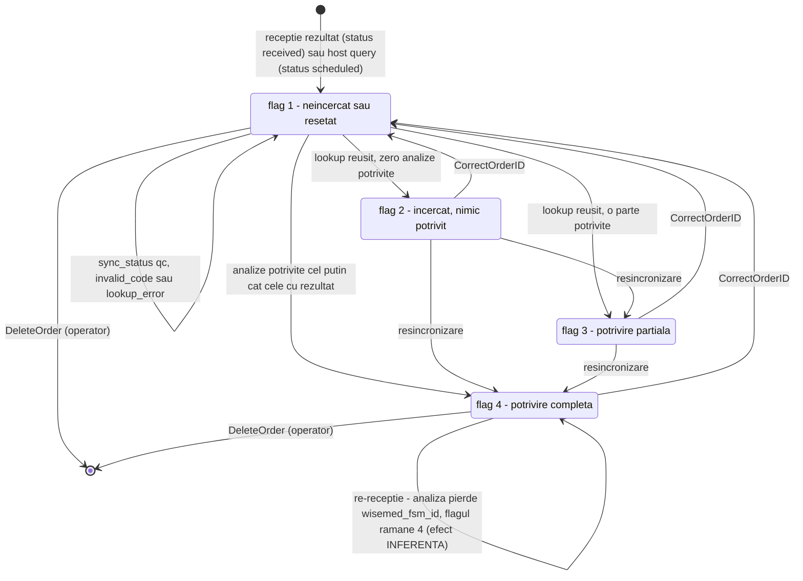
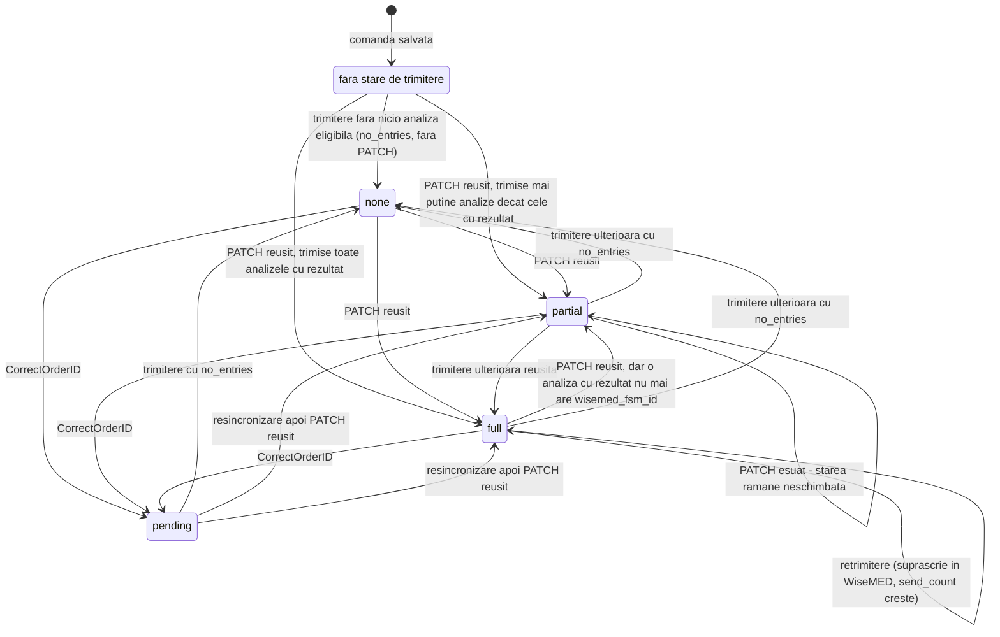
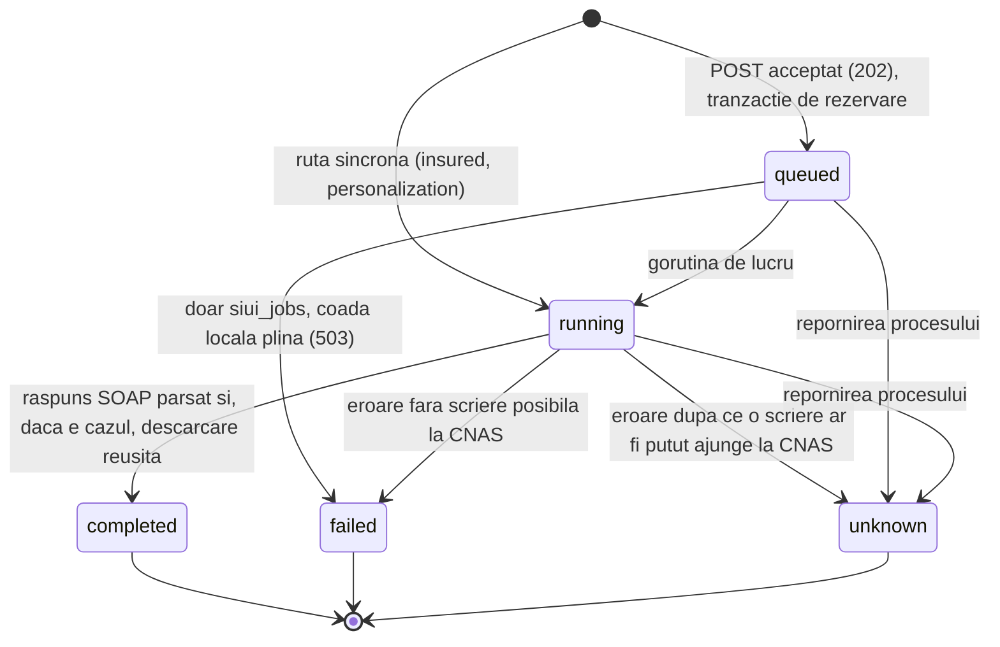
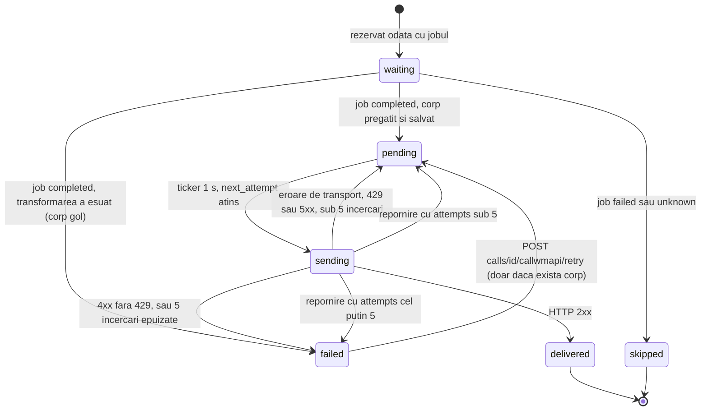
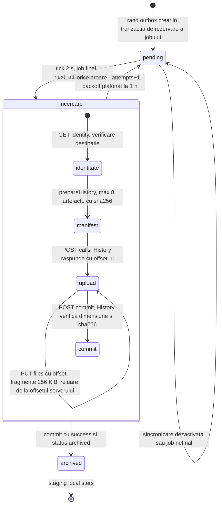
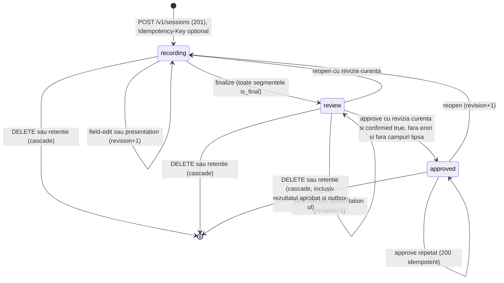
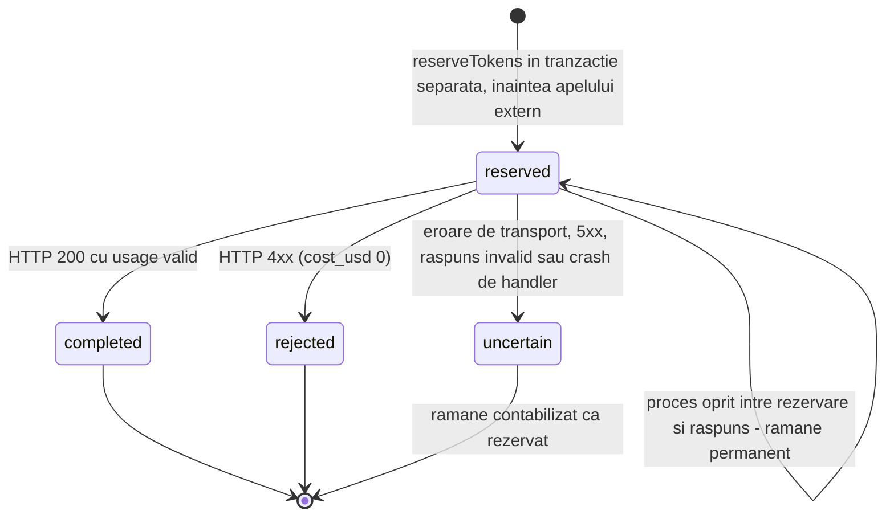
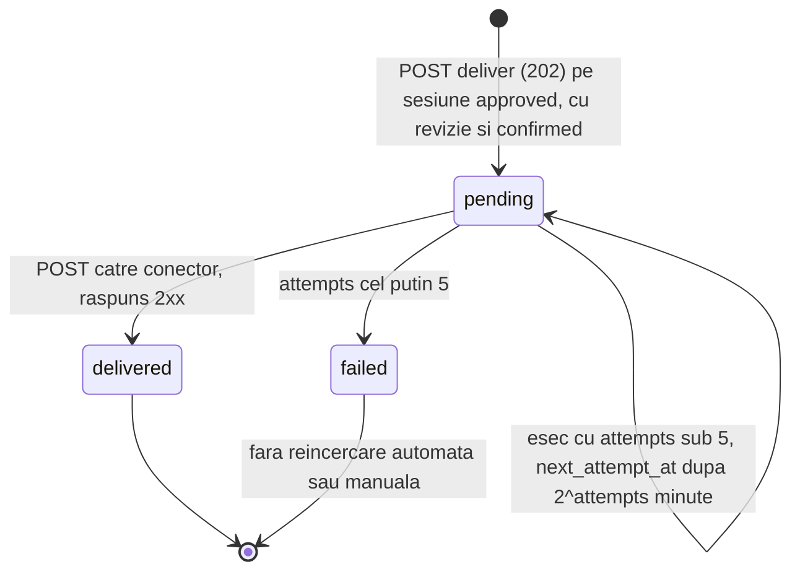
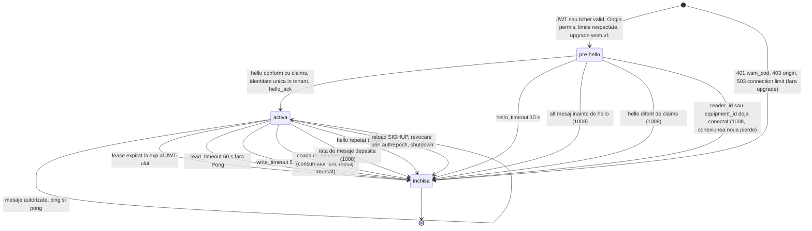
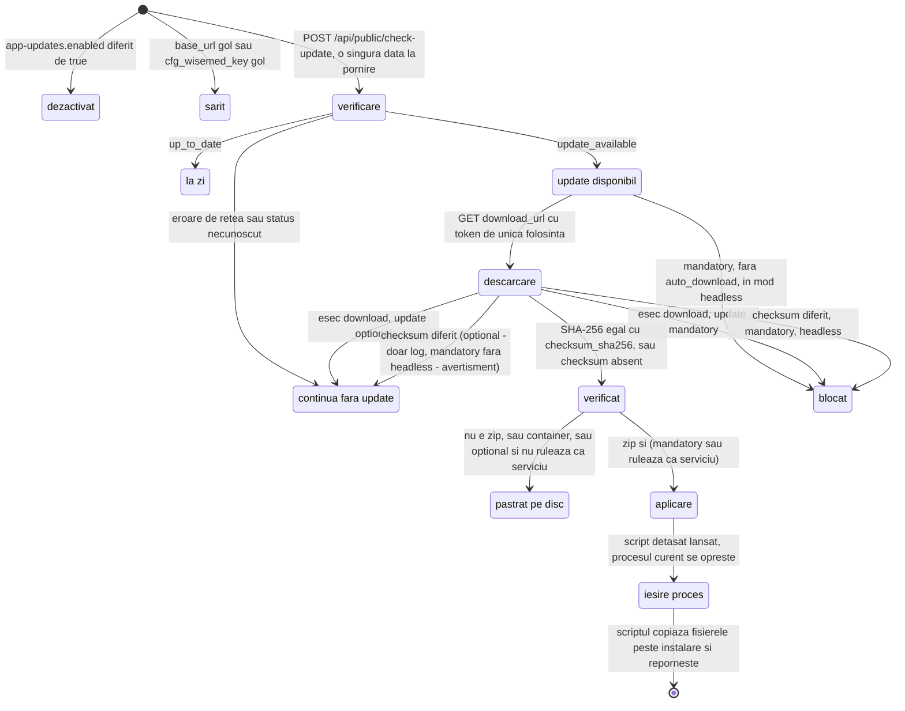

# Date și mașini de stări

| | |
|---|---|
| **Scop** | Descrie, per aplicație / familie de aplicații, starea EXISTENTĂ a persistenței (baze de date, ownership, migrări, tranzacții, unicitate), a concurenței (gorutine, workeri, mutexuri, canale, backpressure), a consistenței DB ↔ evenimente ↔ sisteme externe, a recuperării după restart și a retenției. Conține mașinile de stări ale fluxurilor principale. Nu conține propuneri. |
| **Data** | 2026-11-14 (checkout local `main`, HEAD `d53088e`, cu modificările locale din `git status`) |
| **Surse** | Rapoartele de investigație [`_reports/03-laboratory.md`](_reports/03-laboratory.md), [`_reports/04-cnas-siui.md`](_reports/04-cnas-siui.md), [`_reports/05-utilities-ai.md`](_reports/05-utilities-ai.md), [`_reports/06-qa-build-ops.md`](_reports/06-qa-build-ops.md), [`_reports/01-runtime-and-apps.md`](_reports/01-runtime-and-apps.md) §6, [`_reports/02-wsm-security.md`](_reports/02-wsm-security.md) §2, §3, §6, §12–13; verificările orchestratorului prin lectură directă; câteva recitiri punctuale ale codului făcute la redactare (marcate „recitit la redactare”). |
| **Limite** | Rapoartele 01–05 **nu au rulat nimic**: afirmațiile lor sunt lectură de cod. Numai raportul 06 a executat verificări (vezi [`verification-matrix.md`](verification-matrix.md)). Niciun test simulat nu confirmă hardware, CNAS real, backendul WiseMED real sau instalarea pe Windows/Linux. Configurațiile runtime reale (`output/*/deployments/config.yaml`) și bazele de date reale nu au fost citite. Numerele de linie corespund HEAD-ului de mai sus. |

**Etichete** (aceleași ca în rapoarte): **[COD]** = `CONFIRMAT DIN COD` · **[TEST]** = `CONFIRMAT PRIN TEST LOCAL` (numai ce a rulat raportul 06) · **[DOC]** = `DOCUMENTAT, NEVERIFICAT` · **[INF]** = `INFERENȚĂ` · **[NEC]** = `NECUNOSCUT`.

**Prescurtări de cale**: `R/` = `readersv3/` · `W/` = `wsm-server/internal/server/` · `WC/` = `wsm-server/internal/config/`.

**Documente înrudite**: [`application-catalog.md`](application-catalog.md) · [`runtime-and-modules.md`](runtime-and-modules.md) · [`communication-map.md`](communication-map.md) · [`end-to-end-flows.md`](end-to-end-flows.md) · [`api-catalog.md`](api-catalog.md) · [`security-and-identity.md`](security-and-identity.md) · [`build-deploy-update.md`](build-deploy-update.md) · [`gaps-and-contradictions.md`](gaps-and-contradictions.md) · [`agent-context.md`](agent-context.md) · [`verification-matrix.md`](verification-matrix.md).

---

## 1. Harta persistenței

| Aplicație / familie | Stocare | Proprietarul tabelelor | Migrări | Retenție automată | Dovadă |
|---|---|---|---|---|---|
| 22 de readere de analizoare | SQLite (driver pur Go), fișier `modules.storage-sqlite.path` (implicit `reader-v3.db`), `journal_mode=WAL`, `synchronous=NORMAL`, `busy_timeout=5000`; fișiere `inbox/processed/failed`; `config.yaml` | modulul `storage-sqlite` (`*Store`, serviciul `storage`); celelalte module scriu numai prin el | fără tabel de versiuni; `create table if not exists` + `alter table … add column` la fiecare pornire | **niciuna** | `R/modules/storage/sqlite/module.go:94,144-147,148-326,343-460` [COD] |
| `siui-bridge` | SQLite `modules.siui.database` (implicit `./siui-jobs.db`, 0600), `SetMaxOpenConns(1)`, `busy_timeout=5000`, fără WAL setat; fișiere `siui-downloads/`, `siui-history-outbox/`, `siui-token-pins.json(.key)`, `<db>.wm-callback.key`, `<db>.lock` | modulul `siui` (toate tabelele `siui_*` din acest fișier) | schemă idempotentă la pornire, fără versiuni | **niciuna** pentru rânduri; fișierele descărcate doar la cerere | `R/modules/siui/jobs.go:33-60`, `R/modules/siui/module.go:116,143-161` [COD] |
| `siui-bridge-history` | MySQL (index: `siui_history_calls`, `siui_history_details`, `siui_history_storage`) + obiecte `local` sau `s3` | modulul `siui-history` | `CREATE TABLE IF NOT EXISTS` la prima conexiune, fără versiuni | neidentificată [NEC] | `R/modules/siuihistory/module.go:214,219,224`, `R/modules/siuihistory/storage.go` [COD] |
| `wisemed-siui-data` | PostgreSQL (`siui_data_*`, `siui_client_*`) | modulul `siui-data` | liniare, versiunea 5, într-o tranzacție sub `pg_advisory_xact_lock(1936288117,0)`; schemă mai nouă decât aplicația este refuzată | ștergere manuală a importurilor inactive | `R/modules/siuidata/postgres.go:126,145-179`, `R/modules/siuidata/query.go:80-93` [COD] |
| `wisemed-ai` | PostgreSQL (`wai_*`), fișier-cheie AES local, fișiere audio/model pe disc | modulul `wisemed-ai` | `migrations/001…017`, o tranzacție sub `pg_advisory_xact_lock(7741921103)`, evidență `wai_schema_migrations` | **da**: `retention_days` (implicit 30) | `R/modules/wisemedai/store.go:18-51,97-108` [COD] |
| WSM Server | **nicio bază de date**; hub exclusiv în memorie; `security.device_keys_file` (YAML scriibil), loguri zilnice | procesul `wsm-server` | — | fără rotație de loguri | `W/hub.go:43-49`, `WC/devices.go:216-259`, `wsm-server/internal/logstore/store.go:52` [COD] |
| `update-server` | SQLite `app-update-server.db` (WAL, o conexiune): `applications`, `app_versions`; artefacte în `files_dir/<app_id>/<version>/` | modulul `app-update-server` | — [NEC dacă există migrări] | neidentificată | `R/modules/appupdateserver/module.go:866-940` [COD] |
| `barcodeprinter` | SQLite `barcodeprinter-log.db`, tabel `barcode_print_jobs` | modulul `barcode-printer` | — | neidentificată | `R/modules/barcodeprinter/module.go:519-548` [COD] |
| `esignature-server`, `signing-pad-utility` | SQLite istoric `signature_jobs` (fără imagine, fără pacient); PNG în `storage_dir` doar pe ruta `signing-pad/capture` | modulul `signing-pad` | — | neidentificată | `R/modules/signingpad/history.go:26` [COD] |
| `html-print-formatter` | niciuna (doar memorie) | — | — | — | raport 05 §2 [COD] |
| `anaf-docsmart` | doar fișiere (`inbox/work/outbox/processed/failed`) | modulul `protocol-anaf-docsmart` | — | niciuna | `R/modules/protocols/anafdocsmart/module.go:58-189` [COD] |
| Infrastructura comună a runner-ului | `config.yaml` (rescris de UI, bootstrap, `bindguard`), log zilnic `<reader>-YYYYMMDD.log`, arhive ZIP săptămânale, fișier `.pid` în mod headless | `R/apps/runner`, `R/core/config` | `config.Ensure` adaugă numai cheile lipsă din `config.install.yaml` | arhivele ZIP nu se șterg | `R/core/config/install.go:19-69,152-170`, `R/apps/runner/logging.go:18-56,82-199` [COD] |

---

## 2. Identificatori: ce sunt, cine îi generează, unde persistă, ce deduplică

Regula de bază: **WSM nu deduplică nimic** — nu ține niciun registru de `request_id` văzute, nu are coadă persistentă, replay sau livrare garantată (`W/hub.go:43-49,56`; absența oricărei scrieri pe disc în `W/hub.go`, `W/server.go`) [COD]. Deduplicarea, acolo unde există, este exclusiv a aplicației de destinație.

| Identificator | Scop | Cine îl generează | Unde este persistat | Ce deduplică | Dovadă |
|---|---|---|---|---|---|
| `request_id` (plic WSM) | potrivește un `reply` cu o `command` pe un socket | expeditorul comenzii: clientul WSS (`nextRequestID`), SDK-ul JS, sau wrapperul HTTP al WSM (= ID-ul conexiunii temporare, 128 biți aleatori) | **nicăieri**; doar în mapa `pending` din memoria expeditorului; ≤128 caractere | **nimic** | `R/modules/ws/module.go:69,569-570,671`, `W/http_commands.go:147-156`, `W/server.go:392-417` [COD] |
| `correlation_id` (plic WSM) | copia `request_id`-ului comenzii, pusă pe `reply` | destinatarul comenzii (`correlation_id = request_id`) | nicăieri | nimic; reply-urile nu sunt validate de WSM față de comenzi în așteptare | `R/modules/ws/module.go:550,605`, raport 02 §3 [COD] |
| `connection_id` (WSM) | identifică un socket; ținta reply-urilor | serverul WSM, 16 octeți aleatori hex | memorie; se schimbă la fiecare reconectare | nimic; un reply către un `connection_id` dispărut = `recipients:0`, rezultat pierdut | `W/hub.go:50-56`, `R/modules/ws/module.go:489-495,604-616` [COD] |
| `operation_id` (SIUI) | cheia de idempotency a unei operații CNAS | **clientul** (tipar `^[A-Za-z0-9][A-Za-z0-9_.:-]{0,127}$`); pe rutele sincrone bridge-ul pune `operation_id = id` | `siui_calls` / `siui_jobs`, `UNIQUE(owner, operation_id)`; copiat în manifestul History | **repetarea aceleiași operații de același `owner`**: același digest → 200 `duplicate:true`; alt digest → 409 | `R/modules/siui/jobs.go:17`, `R/modules/siui/service_jobs.go:48,261-274`, `R/modules/siui/history_sync.go:547` [COD] |
| `owner` (SIUI) | granița de izolare a joburilor | bridge-ul, din identitatea atestată: `local:<subject>`, `owner` semnat în JWT-ul local, sau `wsm:"<tenant>":"<subject>"` | coloana `owner` | face `operation_id` unic doar în interiorul aceluiași proprietar | `R/modules/siui/module.go:249-277` [COD] |
| `digest` (SIUI) | detectează refolosirea unui `operation_id` cu alt conținut | bridge-ul: `sha256(JSON{Operation, Parameters, Config})`; cu callback: `sha256(JSON{Request, Callback, Destination})` | coloana `digest` (doar hash-ul) | — (este instrumentul deduplicării, nu o cheie) | `R/modules/siui/service_jobs.go:261-274` [COD] |
| ID job SIUI (`call.id`, `call_id`) | polling, fișiere, arhivă, callback | bridge-ul: 16 octeți aleatori hex | PK în `siui_calls`/`siui_jobs`; `call_id` în `siui_history_outbox`, `siui_wm_callbacks`, `siui_operation_events`, `siui_operation_sources`; PK `(tenant, bridge, call_id)` în History | în History: `INSERT IGNORE` + digest (manifest repetat) | `R/modules/siui/service_jobs.go:302-307`, `R/modules/siuihistory/calls.go:72-112` [COD] |
| `Idempotency-Key: siui-<call id>` | deduplicarea livrării callbackului la WiseMED | bridge-ul, stabil per job | derivat din `call_id` | dublarea livrării — **numai dacă** API-ul WiseMED îl respectă [NEC] | `R/modules/wisemedapi/callback.go:30-74` [COD] |
| `session_id` WiseMED AI (`wai_sessions.id`) | identitatea sesiunii clinice | serverul: UUID aleator; cu `Idempotency-Key` la creare: UUIDv5 determinist din `tenant:user:cheie` | PK `wai_sessions`; FK în segmente, revizii, aprobări, rezultate | crearea repetată a sesiunii cu aceeași cheie: 200 (replay) sau 409 `idempotency_conflict` dacă diferă `template_version`/`patient_ref`/`work_context` | `R/modules/wisemedai/sessions.go:543-569` [COD, recitit la redactare] |
| `revision` de sesiune AI | versiunea draftului; concurență optimistă la `field-edit`, `reopen`, `approve`, `deliver` | serverul (incrementare la fiecare mutație) | `wai_sessions.revision`; `wai_session_revisions UNIQUE(session, revision)`; `wai_approvals`/`wai_clinical_results UNIQUE(session, revision)` | aprobarea dublă a aceleiași revizii (200 idempotent) | `R/modules/wisemedai/sessions.go:72-94,434-487` [COD] |
| `id` + `revision` de segment AI | identitatea și versiunea unui segment de transcript | **clientul** (`id` UUID, `revision ≥ 1`, `sequence` 1..10000) | `wai_session_chunks` PK `(session, id)`, `UNIQUE(session, sequence)`, `digest` | retrimiterea segmentului: aceeași revizie + același conținut → `duplicate:true`; aceeași revizie + alt conținut → 409; revizie mai mică → `stale_revision` | `R/modules/wisemedai/sessions.go:231-343` [COD] |
| ID livrare conector AI (`wai_outbox_delivery.id`) | o livrare per (rezultat aprobat, conector); trimis ca `Idempotency-Key` | serverul | `wai_outbox_delivery`, `UNIQUE(result_id, connector_id)` | a doua cerere `deliver` pentru aceeași pereche (`ON CONFLICT DO NOTHING`) | `R/modules/wisemedai/connectors.go:36-79,80-133` [COD] |
| `session_id` eSignature | identifică o sesiune de captură pe pad prin WSM | **clientul** (16–128 caractere) | doar memorie (gorutină per sesiune, max 32) | nimic durabil | `R/modules/signingpad/remote.go:29-81` [COD] |
| `panel_id` (laborator, LAURA) | grupează rezultatele unui panou | readerul, aleator, per recepție | `order_analysis_results.flags_json` | nimic — un panou retransmis primește `panel_id` nou | `R/modules/storage/sqlite/panels.go:16-101` [COD] |
| `id_revision` (laborator) | concurență optimistă la corectarea ID-ului probei | readerul (incrementat la fiecare corecție) | `orders.meta_json` | respinge copii învechite ale comenzii (409) | `R/modules/storage/sqlite/order_identity.go:40-43,155-160` [COD] |
| Rezultate de laborator către WiseMED | — | — | — | **nu există** identificator de cerere sau `Idempotency-Key` la `PATCH /file/services/results/{f}`; reluarea e sigură doar dacă serverul suprascrie după `fsmid` [NEC în producție] | `R/modules/protocols/fileimportbase/module.go:634-669` [COD] |

Consecință directă [COD]: un `api.request` WSS repetat de apelant (de exemplu după un timeout `*_execution_unknown` al wrapperului HTTP) este executat din nou de reader. Singura protecție împotriva unei a doua execuții CNAS este `operation_id`-ul SIUI; pentru rutele locale care nu au cheie proprie de idempotency (laborator, imprimare) nu există niciuna.

---

## 3. Laborator (cele 22 de readere)

### 3.1 Tabele și ownership

Tabelele `rounds`, `analytes`, `orders`, `order_analyses`, `order_analysis_results`, `qc_targets`, `qc_records`, `qc_analyses`, `audit_logs`, `daily_detail_definitions`, `daily_detail_values`, `daily_analysis_send_filters` sunt create și deținute de `storage-sqlite` (`R/modules/storage/sqlite/module.go:148-326`). Scriitori: modulele de protocol, `result-sync`, `local-http` (acțiuni operator), host query. Nu există chei străine și nici `on delete cascade`; integritatea este menținută de cod (`DeleteOrder`, `DeleteOrderAnalysis`, `DeleteQCRecord`). [COD]

| Tabelă | Unicitate declarată | Observație |
|---|---|---|
| `rounds` | `unique(order_date, round_no)` | |
| `analytes` | `tag unique` | auto-creare din orice protocol |
| **`orders`** | **niciuna** — doar indexul neunic `idx_orders_date_round` | cheia logică `(order_date, round_no, sample_id)` este aplicată numai de cod, prin `select` urmat de `insert/update` fără tranzacție (`UpsertOrder`, `:883-949`) |
| `order_analyses` | niciuna (index pe `order_id`) | potrivirea este `select … where order_id=? and analyte_tag=? limit 1` (`:1080-1081`) |
| `order_analysis_results` | niciuna | append-only |
| `qc_targets` | `unique(analyte_tag, control_level, lot_no)` | |
| `qc_records` | niciuna în SQL; deduplicare aplicativă pe `run_date+label+level+lot` (`:1479`) | |
| `daily_detail_values` | `unique(definition_key, scope_date, round_no, analyte_tag)` | |

Toate: [COD], raport 03 §3.1.

**Lipsa unicității pe `orders(order_date, round_no, sample_id)`** — [COD] pentru absența constrângerii și pentru `UpsertOrder` netranzacțional. Posibilitatea de a obține două comenzi pentru aceeași probă când două gorutine inserează simultan (serverele TCP ASTM, LD-560, LAURA, Zonci pornesc o gorutină per conexiune) este [INF]; nu a fost reprodusă.

### 3.2 Migrări și compatibilitate

- La fiecare pornire: `create table if not exists`, apoi `alter table … add column` cu ignorarea erorii `duplicate column name`, apoi backfill-uri QC (`R/modules/storage/sqlite/module.go:343-460`). Nu există downgrade și nici verificare de versiune. [COD]
- `update qc_analyses set control_level = '' where control_level <> ''` rulează la **fiecare** pornire (`:417`); nivelul de control efectiv se citește din `qc_targets`/`qc_records` prin `coalesce` (`:1781`). [COD]
- Sidecar `<db>.ui.json` importat o singură dată și redenumit `.migrated` (`:464-500`). [COD]
- Erorile de deschidere (read-only, I/O pe WAL/SHM) produc un mesaj explicit care interzice ștergerea WAL-ului (`:110-136`). [COD]

### 3.3 Tranzacții

| Operație | Tranzacțională | Dovadă |
|---|---|---|
| `RecordImportedPanel` (LAURA) | da — comandă + analize + rezultate | `R/modules/storage/sqlite/panels.go:16-101` [COD] |
| `CorrectOrderID` | da — `orders` + toate `order_analyses` + `audit_logs` | `R/modules/storage/sqlite/order_identity.go:26-142` [COD] |
| `DeleteOrder`, `DeleteOrderAnalysis`, `DeleteQCRecord`, compactarea rundelor, `SetDefaultResult` în mod `grouped` | da | `R/modules/storage/sqlite/module.go:994-1028,1105-1143,1180-1205,1311-1334,1615-1632` [COD] |
| **`RecordImportedResult`** (ASTM, Pentra, miniVIDAS, LD-560, toate importurile de fișiere) | **nu** — trei scrieri independente: `UpsertOrder` → `SaveOrderAnalysis` → `UpsertOrderResultForAnalysis` | `R/modules/storage/sqlite/module.go:1380-1419` [COD, recitit la redactare] |
| Un fișier întreg / un lot ASTM întreg | nu — fiecare rezultat este o serie separată de scrieri | `R/modules/protocols/fileimportbase/module.go:290-307`, `R/modules/protocols/astm/module.go:750-844` [COD] |

Consecința (import parțial rămas în bază după o eroare la mijlocul lotului; fișierul mutat în `failed/` cu rândurile deja scrise) este [COD] pentru mecanism (`fileimportbase/module.go:248-251`) și [INF] pentru efectul observabil.

### 3.4 Identitatea probei, data și runda

| Subiect | Regulă existentă | Dovadă |
|---|---|---|
| Cheie logică | `(order_date, round_no, sample_id)`; căutare secundară după `meta_json.$.id_correction.original_sample_id`, astfel încât rezultatele noi ale unui ID corectat ajung la aceeași comandă | `R/modules/storage/sqlite/module.go:903-912`, `panels.go:48-61` [COD] |
| ID probă | extras per protocol (căi configurabile la ASTM, `ci` la miniVIDAS, linia `ID:` la LAURA etc.); importurile de fișiere îl normalizează la recepție (`NormalizeImportedRecord`), punând codul de probă / eșantion în `patient_id` / `patient_name` | raport 03 §2.1; `R/modules/protocols/fileimportbase/module.go:1173-1265` [COD] |
| Data | din mesaj, altfel ziua curentă a mașinii; Pentra folosește **mereu** ziua curentă la rezultate | `R/modules/protocols/horibaabxpentra400/module.go:531` [COD] |
| Runda | importul scrie mereu în `max(round_no)` al zilei (`CurrentRoundNo`, `:832-845`); runde noi doar din UI (`CreateNextRound`); ștergerea unei runde goale renumerotează rundele și `daily_detail_values` (`:1180-1205`) | [COD] |
| Defect condiționat (Pentra) | `stringValue(nil)` întoarce `"<nil>"`, deci un răspuns WiseMED fără `o_file_date`/`o_file_id` ar salva `order_date="<nil>"`; dacă backendul omite vreodată câmpurile: [NEC] | `R/modules/protocols/horibaabxpentra400/module.go:374-384,629-631` [COD] |

### 3.5 Maparea TAG-urilor

- `NormalizeAnalyteTag`: `TrimSpace`, spațiu → `_`, majuscule; **punctuația se păstrează** (`NEU#` ≠ `NEU%`, `P-LCR`, `RDW-CV`) — `R/modules/core/model/analyte_tag.go:10-17` [COD]. Pachetele `modules/core/model`, `protocols/astm`, `resultsync`, care conțin testele de identitate a TAG-ului, sunt printre cele 33 de pachete trecute la rularea 3 din [`verification-matrix.md`](verification-matrix.md) [TEST la nivel de pachet].
- Îl folosesc: ASTM, miniVIDAS, Seegene, CFX96, Analytik Jena, Anatolia, Biosan, Shimadzu Generic. **Nu** îl folosesc: Pentra (TAG brut), Zonci (cod brut), LD-560 (`mapAnalyte`), LAURA (`ToUpper` pe listă fixă), TriCarb/BEOSL (TAG-uri fixe). [COD]
- Excepție care contrazice regula generală: GammaVision elimină `#` și spațiile din numele nuclidului (`R/modules/protocols/gammavision/module.go:156-162`). [COD]
- Mapări explicite: `protocol-astm.analyte_mappings` (`R/modules/protocols/astm/module.go:756,1555`), `analyte_mappings` la LD-560. Atenție: șablonul LD-560 pune setările sub cheia `protocol-labnovation-ld-560` (`R/apps/labnovation-ld-560/deployments/config.install.yaml:79`), iar modulul citește `protocol-labnovation-ld560` (`R/modules/protocols/labnovationld560/module.go:73`) — verificat de orchestrator; setările din șablon nu ajung la modul [COD]. Vezi [`gaps-and-contradictions.md`](gaps-and-contradictions.md).
- Potrivirea cu WiseMED: `ToUpper(TrimSpace(tag)) == ToUpper(t_tag)` (`R/modules/resultsync/module.go:749-790`). [COD]

### 3.6 Rezultate repetate

- Fiecare recepție **adaugă** un rând în `order_analysis_results` (fără deduplicare) și devine automat rezultatul implicit (`UpsertOrderResultForAnalysis` → `SetDefaultResult(…,"individual")`, `R/modules/storage/sqlite/module.go:1241-1255`). O retransmitere a analizorului sau reimportul unui fișier rămas în `inbox` produce deci rânduri noi. [COD]
- `modules.local-http.repeat_mode` (`individual` peste tot, `grouped` doar la LAURA) afectează **numai selecția manuală** a rezultatului implicit (`PUT /api/results/default`), nu recepția (`:1257-1335`). [COD]
- `source_*` păstrează valoarea analizorului; `result_value`/`raw_value`/`interpreted_value` pot fi rescrise de `transform_rules_json` la `ReapplyOrderTransformations` (`R/modules/storage/sqlite/transformations.go:75-162`). [COD]

### 3.7 Efectul re-recepției asupra `wisemed_sm_id` / `wisemed_fsm_id` și comenzile cu `wisemed_match_flag=4`

Lanțul are patru verigi. Fiecare verigă este citită în cod; efectul cap-coadă **nu a fost reprodus prin rulare**.

| # | Verigă | Statut | Dovadă |
|---|---|---|---|
| 1 | `RecordImportedResult` construiește `OrderAnalysis` **fără** `WiseMEDSMID`/`WiseMEDFSMID` și cu `Flags` = flagurile noii recepții | **CONFIRMAT DIN COD** | `R/modules/storage/sqlite/module.go:1399-1413` (recitit la redactare) |
| 2 | `SaveOrderAnalysis`, pentru o analiză existentă (aceeași comandă + același TAG), face `update … wisemed_sm_id=?, wisemed_fsm_id=?, …, flags_json=?` cu valorile primite → ID-urile WiseMED și starea de trimitere din flaguri sunt suprascrise cu gol | **CONFIRMAT DIN COD** | `:1080-1090` (recitit la redactare) |
| 3 | `UpsertOrder` îmbină meta (`mergeMeta(existingMeta, item.Meta)`), deci `wisemed_match_flag=4` al comenzii **rămâne**; `file_id`, `patient_id`, `patient_name` sunt suprascrise cu valorile analizorului, cu excepția comenzilor cu `id_revision>0` | **CONFIRMAT DIN COD** | `:925-936` (recitit la redactare) |
| 4 | Sincronizarea sare orice comandă cu potrivire completă (`orderHasCompleteWiseMEDMatch` → `skipped_complete`); trimiterea include doar analizele cu `wisemed_fsm_id` nevid | **CONFIRMAT DIN COD** | `R/modules/resultsync/module.go:267-270,351-354,891-893`; `R/modules/protocols/fileimportbase/module.go:637-640,656-667` |
| → | **Efect cap-coadă**: după re-recepția unui rezultat pentru o comandă deja potrivită complet, analiza re-recepționată nu mai poate fi nici resincronizată, nici trimisă (`no_entries` sau trimitere parțială), până la corecția ID-ului (resetează flagul la 1) sau ștergerea comenzii | **INFERENȚĂ** (compunerea verigilor 1–4; neverificată prin test sau rulare) | raport 03 §3.4, §6.5 |

Neafectate [COD]: Zonci (salvează structura existentă, `R/modules/protocols/zoncixl1000i/module.go:383-390`) și LAURA (`RecordImportedPanel` nu atinge coloanele WiseMED, `panels.go:96`). Afectate: ASTM, Pentra, miniVIDAS, LD-560 și toate importurile de fișiere.

Rezoluție de contradicție: `R/docs/audit-trimitere-automata-buletin-2026-09-16.md` afirmă că o nouă recepție „poate retransmite rezultate existente”; lectura codului arată opusul pentru analizele re-recepționate ale unei comenzi cu flag 4 (se retrimit doar analizele neatinse ale aceleiași comenzi). Vezi [`gaps-and-contradictions.md`](gaps-and-contradictions.md).

### 3.8 Mașina de stări: cerere / rezultat de laborator

Potrivirea („Synchro Match”) trăiește în `orders.meta_json.wisemed_match_flag`; trimiterea în `meta.wisemed_send_status` și în `flags.wisemed_send_status` per analiză. Nu există stare „în curs”, „eșuat” sau „necunoscut” la trimitere: un PATCH eșuat lasă starea anterioară neschimbată (`R/modules/protocols/fileimportbase/module.go:669-677,706-758`). [COD]

Tranziții: `processOrder` (`R/modules/resultsync/module.go:373-443`), `deriveMatchFlag` (`:878-889`), resetarea în `CorrectOrderID` (`R/modules/storage/sqlite/order_identity.go:68-78,107-113`) [COD]. Valoarea flagului pentru comenzile create de host query direct cu `wisemed_sm_id/fsm_id` nu a fost urmărită [NEC].

`persistWiseMEDSendStates` (`R/modules/protocols/fileimportbase/module.go:706-758`, recitit la redactare) [COD]:

- este apelat în două locuri: cu `success=true` după un PATCH reușit (`:679`) și cu `success=false` pe ramura `no_entries` (`:658`). La **eșecul PATCH-ului** nu este apelat deloc (`:669-677`) — starea anterioară rămâne;
- per analiză: cele trimise devin `sent` (+ `wisemed_sent_at`, `wisemed_send_count+1`); **orice altă analiză cu rezultat devine `pending`**, inclusiv una marcată anterior `sent`;
- per comandă: `none` dacă nu s-a trimis nimic, `partial` dacă `sentCount < totalSendable`, altfel `full`; `totalSendable` numără analizele cu rezultat, indiferent dacă au `wisemed_fsm_id`;
- `pending` la nivel de comandă este scris numai de `CorrectOrderID`.

Precizare față de raportul 03 (§6.3: „un eșec lasă starea anterioară neschimbată”): afirmația este exactă pentru eșecul PATCH-ului, dar ramura `no_entries` **rescrie** starea la `none`/`pending`. Combinat cu §3.7, o comandă `full` poate coborî la `partial` sau `none` după o re-recepție — tranzițiile `full → partial` și `full → none` din diagramă sunt [INF] (compunere de verigi [COD], nereprodusă).

### 3.9 Sincronizare și confirmare

| Aspect | Stare existentă | Dovadă |
|---|---|---|
| Buclă periodică | `Ticker` la `interval_minutes` (implicit 5); **numai comenzile zilei curente**; **nu trimite rezultate**, doar potrivește | `R/modules/resultsync/module.go:90-114,202-288` [COD] |
| Exclusivitate | `mu` + flag `running`: a doua rulare primește eroare `result sync already running`, nu așteaptă; trimiterea automată se abandonează ca „warning”, fără reluare | `:209-213,307-311`; `fileimportbase/module.go:341-344` [COD] |
| Trimitere automată | `AutoSaveResultsToWiseMED` dacă `results.auto_confirm_wisemed`; numai protocoalele bazate pe `fileimportbase`, `cary60uvvis`, `shimatzutocl`, `labnovationld560`. Singurul șablon cu `auto_confirm_wisemed: true` este `beosl-reader` | `fileimportbase/module.go:498-535`; raport 03 §2.2, §6.6 [COD] |
| Trimitere manuală | `POST /api/orders/send-to-bulletin` (alias `/send-to-wisemed`): sincronizare, apoi un PATCH per comandă cu **toate** analizele eligibile; valoarea trimisă este `raw_value` cu fallback `result_value` | `R/modules/localhttp/module.go:1802-1941`; `fileimportbase/module.go:634-669` [COD] |
| Doar manual | ASTM (5 aplicații), Pentra, miniVIDAS, LAURA, Zonci | raport 03 §6.6 [COD] |
| Eroare la PATCH | funcția se oprește la prima eroare; comenzile anterioare rămân `sent`; dacă serverul a aplicat totuși modificarea, starea locală rămâne „netrimis” | `fileimportbase/module.go:669-677` [COD]; divergența [INF] |
| Retry / coadă persistentă | **nu există** | [COD — absență] |
| Retragere din WiseMED | nu există niciun apel de anulare/ștergere; corecția ID-ului, ștergerea locală sau schimbarea rezultatului implicit nu modifică ce s-a trimis | absența oricărei metode `DELETE` în `R/modules/wisemedapi` [COD] |

### 3.10 QC și Westgard

- Clasificarea ca QC se face în protocol, la recepție → `qc_records` + `qc_analyses`; lista `result-sync.qc_prefixes` este independentă și servește doar la a nu căuta în WiseMED. Cadrul QC `4` de la Zonci este doar logat, nu stocat (`R/modules/protocols/zoncixl1000i/module.go:231`). [COD]
- Ținte `qc_targets`; importurile creează automat ținte cu medie/SD 0 (`R/modules/protocols/fileimportbase/module.go:1036-1047`). Rundele QC sunt dezactivate: `ListQCRoundNumbers` întoarce mereu `[1]` (`R/modules/storage/sqlite/module.go:1634-1640`). [COD]
- Reguli implementate în `classifyWestgard` (`:2313-2378`): `1_2s`, `1_3s`, `2_2s`, `R_4s`, `4_1s`, `10x`, `7T`, pe z = (valoare − `target_mean`) / `target_sd`, pe ultimele 500 de puncte ale unei serii. [COD]
- Limitări [COD]: o singură serie (nu între niveluri de control); `R_4s` compară puncte consecutive; `target_sd <= 0` → nimic evaluat; fără distincție avertizare/respingere (`validateWestgardDataset`, `:2380-2397`); join cu ținta pe `analyte_tag + lot_no`, fără nivel (`:1784`); `robust_mean` identic cu media (`:1856-1859`).
- Rezultatul este **doar informativ**: nu blochează recepția, sincronizarea sau trimiterea rezultatelor pacienților. [COD]
- Nu există teste pentru `classifyWestgard` (raport 03 §7.2); pachetul `modules/qc` nu are niciun test (raport 06 B.3) [TEST pentru lista de pachete].

### 3.11 Auditul corectării ID-ului

| Aspect | Stare existentă | Dovadă |
|---|---|---|
| Atomicitate | un singur `tx`: `orders` (ID nou, `file_id=new_id`, pacient golit, `status='received'`), toate `order_analyses` (`wisemed_sm_id/fsm_id=''`, flaguri `wisemed_*` șterse), `audit_logs` cu `event_type='order-id-change'` | `R/modules/storage/sqlite/order_identity.go:26-141` [COD] |
| Actor | din sesiunea de pe server (`auditActor`), nu din corpul cererii | `R/modules/localhttp/module.go:2637-2644` [COD] |
| Confirmare | `confirmation == "deacord"` exact; `reason` ≤1000; `new_id` ≤200 fără caractere de control | `order_identity.go:19-23` [COD] |
| Concurență optimistă | `sample_id` curent și `meta.id_revision` trebuie să corespundă → altfel 409 | `:40-43` [COD] |
| Coliziune | verificată numai în aceeași `order_date` **și** aceeași `round_no`; alte runde ale zilei nu se verifică | `:44-50` [COD] |
| Istoric | `orders.meta_json.id_correction_history` (toate corecțiile) + rândul din `audit_logs`; rezultatele și istoricul lor rămân neatinse | `:68-78,107-113` [COD] |
| Excludere reciprocă | `identityMu` (RWMutex): corecția ia `Lock`; sincronizarea și trimiterea țin `RLock` pe toată durata, inclusiv pe durata apelurilor HTTP către WiseMED | `:13-16,24-25`; `R/modules/resultsync/module.go:203-207,301-305`; `fileimportbase/module.go:592-595` [COD]. Blocarea cititorilor noi cât timp o corecție așteaptă: [INF] (semantica `sync.RWMutex`) |
| Ce nu face | nu retrage nimic din WiseMED | [COD — absență] |

Pachetele `storage/sqlite`, `localhttp`, `resultsync`, `fileimportbase` (care conțin `TestIDChangeIsAtomicAndRejectsCollision`, `TestIDChangeUsesAuthenticatedActor`, `TestManualFileIDBypassesAnalyzerNormalization`, `TestSendUsesCorrectedFileID`) au trecut la rularea 3 din matricea de verificare [TEST la nivel de pachet; testele individuale nu au fost izolate].

### 3.12 Concurență și backpressure

| Componentă | Gorutine | Sincronizare | Backpressure | Dovadă |
|---|---|---|---|---|
| Runtime | una per modul `Starter`; **prima care iese din `Start` oprește tot procesul** | `WaitGroup`, `errCh` | — | `R/core/runtime/runtime.go:124-148` [COD] |
| Import fișiere | o gorutină cu ticker (`poll_seconds`, implicit 2 s); importul manual pe gorutina HTTP | `mu` + `map running` per cale | scanare secvențială; fără verificare de fișier stabil | `fileimportbase/module.go:188-256,992-1006` [COD] |
| ASTM | `Start` + una per conexiune + una per host query | `mu`; canal `queryReplyCh` (buffer 8) per conexiune | conexiuni nelimitate; ACK trimis **înaintea** persistenței | `R/modules/protocols/astm/module.go:601-604,648-651` [COD] |
| LD-560 | `Start` + una per conexiune; `restartCh` (buffer 1) | `mu` | `readSimpleMessage` acumulează fără limită | `R/modules/protocols/labnovationld560/parser.go:216-230` [COD] |
| Zonci | una per conexiune | `m.mu` serializează toate cadrele, inclusiv lookup-ul WiseMED | — | `zoncixl1000i/module.go:193-197` [COD] |
| Pentra, miniVIDAS | o singură gorutină serială | Pentra: `RWMutex` de status | lookup WiseMED sincron în bucla de citire (până la 20 s WS + 20 s HTTP) | `horibaabxpentra400/module.go:156-163,201-216` [COD] |
| `result-sync` | buclă cu ticker | `mu` + flag `running` | a doua rulare este refuzată | `resultsync/module.go:209-213` [COD] |
| Storage | pool `database/sql` implicit pe SQLite WAL | `identityMu` numai pentru identitatea comenzii | `SQLITE_BUSY` după 5 s la scriitori concurenți [INF] | `storage/sqlite/module.go:94,144-147` [COD] |

Nu există „event bus”: UI-ul face polling HTTP (`/api/logs`, `/api/status`, `/api/dashboard`); jurnalul afișat este un `UNION` calculat la citire peste `order_analysis_results`, `qc_analyses`, `audit_logs` (`R/modules/events/module.go:17-20`, `R/modules/storage/sqlite/module.go:1720-1770`). [COD]

### 3.13 Recuperare după restart și retenție

| Situație | Comportament | Etichetă |
|---|---|---|
| Fișier în `inbox` neprocesat sau procesat parțial | reimportat integral la pornire → rânduri noi în `order_analysis_results`, analize suprascrise (cu efectul din §3.7) | [COD] mecanism; [INF] duplicate |
| Lot ASTM / pachet serial în memorie | pierdut — analizorul a primit deja ACK; nu există jurnal de recepție pe disc | [COD] |
| Rezultate salvate dar netrimise | rămân în SQLite; nu sunt reluate automat | [COD] |
| Sesiuni operator | cookie semnat stateless; la readere cheia HMAC este derivată din `ReaderID` (`R/modules/localhttp/module.go:2660-2665`, verificat de orchestrator), deci cookie-urile rămân valide după restart; `login_token`-ul sesiunii este în memorie, după restart se folosește cel din `config.yaml` | [COD]; efectul [INF] |
| SQLite | WAL + `synchronous=NORMAL`: tranzacții comise pot fi pierdute la pană de curent, fără corupere | [INF] |
| Retenție | **nu există** pentru `orders`, rezultate, QC, `audit_logs` (niciun `delete` programat, niciun `vacuum`); `processed/`, `failed/`, `.tmp-imports/`, imaginile LD-560 și arhivele ZIP de log se păstrează nelimitat | [COD] |
| Ștergere | numai la cererea operatorului: `/api/orders/delete` (auditat), `/api/qc-records/delete`, analite, ținte, filtre | [COD] |
| Date personale locale | nume/ID pacient în `orders`; răspunsul WiseMED complet în `meta_json.sync_lookup`; SQLite necriptat | `resultsync/module.go:422` [COD] |

---

## 4. SIUI: `siui-bridge`, `siui-bridge-history`, `wisemed-siui-data`

### 4.1 Tabele (SQLite `siui-jobs.db`) și ownership

| Tabel | Rol | Unicitate | DDL |
|---|---|---|---|
| `siui_calls` | execuțiile din catalog + apelurile sincrone | `id` PK; **`UNIQUE(owner, operation_id)`** | `R/modules/siui/service_jobs.go:48` |
| `siui_jobs` | validările vechi (`/validations`) | `id` PK; `UNIQUE(owner, operation_id)` | `R/modules/siui/jobs.go:47` |
| `siui_history_outbox` | coada de arhivare + **parametrii compleți ai cererii** | `call_id` PK | `R/modules/siui/history_sync.go:50` |
| `siui_wm_callbacks` | livrarea către WiseMED | `call_id` PK | `R/modules/siui/callback.go:63-68` |
| `siui_operation_events` | jurnal de tranziții, scris de triggere `<tabel>_audit_insert/update` în aceeași tranzacție | `seq` autoincrement | `R/modules/siui/operations_history.go:23-24,29-32` |
| `siui_operation_sources` | sursa atestată (transport, subiect, IP, conexiune, tenant) | `call_id` PK | `R/modules/siui/operations_history.go:25` |

Toate [COD]. Nu există chei străine (legătura este `call_id`). O singură instanță per bază: `flock` exclusiv pe `<database>.lock` (`R/modules/siui/module.go:143-161`). [COD]

### 4.2 Rezervarea operației și digestul legat de configurație

Secvența din `serviceHTTP` (`R/modules/siui/service_jobs.go:164-348`), sub `m.mu` de la linia 257 [COD]:

1. validare parametri, `operation_id`, `callwmapi` (→ 400);
2. `digest = sha256(JSON{Operation, Parameters, Config})`, unde `Config` este **întreaga structură de setări** (utilizator, licență, thumbprint, origini, profiluri, calea bazei); cu callback intră și `Callback` și `Destination` (`:261-274`);
3. `SELECT id,digest … WHERE owner=? AND operation_id=?`: același digest → **200** `{duplicate:true, call}`; alt digest → **409**. Căutarea are loc **înaintea** verificării de configurare/ocupare;
4. lipsă configurare → 409; `m.checking` sau canal plin (20) → 409 `CNAS token or queue busy` — nimic rezervat;
5. o tranzacție: `INSERT siui_calls(status='queued')` + sursa + `INSERT siui_history_outbox(parameters, source_ip)` + opțional `INSERT siui_wm_callbacks` → `COMMIT`;
6. `m.pending++`, trimitere pe canalul `m.calls`, răspuns **202**.

**202 înseamnă**: validat local, rezervat durabil în SQLite, pus în coada din memorie. Nu s-a trimis nimic către CNAS. [COD]

Consecință a digestului legat de configurație [INF din cod]: după orice schimbare a setărilor CNAS, repetarea aceluiași `operation_id` cu aceiași parametri dă 409, nu 200; JSON `null` și șirul vid produc digesturi diferite. Validările vechi folosesc `digest = sha256(xml)`, fără configurație (`R/modules/siui/jobs.go:70-117`). [COD]

### 4.3 Serializarea accesului la token

Nu există un mutex dedicat tokenului. Serializarea rezultă din [COD]:

1. **O singură gorutină de lucru** — bucla `select` din `Module.Start` (`R/modules/siui/module.go:176-220`) execută pe rând: livrarea callbackurilor (ticker 1 s, `:180-181`), `m.calls` (catalog) și `m.queue` (validări vechi). **Callbackurile către WiseMED rulează în aceeași gorutină** cu execuțiile CNAS; o instanță WiseMED lentă întârzie joburile CNAS cu până la 30 s per tick [INF].
2. **Contoare sub `m.mu`**: `m.pending` și `m.checking`. Rutele sincrone (`insured`, `personalization`, OCSP) refuză cu 409 dacă `pending > 0` și setează `checking`; rutele asincrone refuză cu 409 dacă `checking`; schimbarea setărilor, a PIN-ului și reîncărcarea certificatelor refuză dacă `pending > 0` (`R/modules/siui/passive.go:19-38`, `service_jobs.go:298`, `module.go:384,473`, `token_pin_http.go:39`, `certificates_refresh.go:15`).
3. **Blocaje punctuale**: `ocspSession.mu` ținut pe toată autentificarea CNAS (`R/modules/siui/client.go:127-128`), `p11Modules` (mutex global PKCS#11, `token_pkcs11_linux.go:56`), `pinVault.mu`.

Arhivarea este singura activitate pe altă gorutină (`historyWorker`, tick 2 s, `R/modules/siui/history_sync.go:237-248`); ea nu folosește tokenul. Backpressure: `m.calls` (20) și `m.queue` (20); pline → 409 (catalog) sau 503 + job `failed` (validări vechi); fără limitare per apelant (`R/modules/siui/module.go:122,129`). [COD]

### 4.4 Mașina de stări a jobului SIUI

| Tranziție | Dovadă |
|---|---|
| → `queued` | `R/modules/siui/service_jobs.go:314`, `jobs.go:87` [COD] |
| `queued → running` | `service_jobs.go:352`, `module.go:188` [COD] |
| `running → completed/failed/unknown`, într-o tranzacție cu `completed_at` din outbox și starea callbackului | `service_jobs.go:390-438` [COD] |
| regula: `status = "failed"; if submitted { status = "unknown" }`, cu `submitted = op.Mutating` după `backend.Do`, resetat doar pentru eșec `dial` dovedit și pentru respingerea de business DocMED | `service_jobs.go:390-395` [COD, linia 394 recitită la redactare] |
| `queued/running → unknown` la **deschiderea bazei**: `UPDATE siui_calls SET status='unknown', error='Process stopped; reconcile with CNAS before submitting again' WHERE status IN ('queued','running')` | `service_jobs.go:48`, `jobs.go:49` [COD, recitit la redactare] |

- Stările terminale nu au tranziții; **nu există cod care să scoată un job din `unknown`** și nici reconciliere automată cu CNAS. Repetarea aceluiași `operation_id` întoarce jobul `unknown` existent, fără retrimitere. [COD]
- `completed` nu înseamnă acceptare medicală/administrativă: la operațiile clasice eroarea de business CNAS rămâne în `result.values`, neinterpretată (raport 04 §5.5, §6.5). [COD]
- Nu există rută de anulare a unui job. [COD]
- **Rezoluție `unknown` vs `execution_unknown`** (verificată de orchestrator): starea jobului SIUI este exclusiv `unknown`. Șirul `execution_unknown` apare numai în `wsm-server/internal/server/http_commands.go`, `wsm-server/examples/php/WSMHttpClient.php`, `wsm-server/docs/http-commands.md`, ca sufix al codurilor de eroare ale wrapperului HTTP de comenzi (`timeout_execution_unknown`, `client_disconnected_execution_unknown`, `request_interrupted_execution_unknown`) — adică „WSM nu știe dacă readerul a executat comanda”, nu o stare de job.
- Particularitate Windows: pe drumul WinHTTP erorile nu sunt `*net.OpError`, deci un eșec de conectare la o scriere ajunge `unknown`, nu `failed` — [INF] din `R/modules/siui/native_windows.go:41-43` și `client.go:259-262`.
- Puncte fragile [INF]: eșecul `UPDATE … 'running'` lasă jobul `queued` până la repornire (`service_jobs.go:352-354`); eșecul tranzacției finale lasă jobul `running` până la repornire, când devine `unknown` chiar dacă CNAS a răspuns (`:439-441`).

### 4.5 Mașina de stări a callbackului `callwmapi`

- Corpul este calculat **o singură dată**, la finalul jobului, și salvat în `siui_wm_callbacks.body` în aceeași tranzacție cu rezultatul (`R/modules/siui/service_jobs.go:410-434`). Destinația WiseMED este fixată la acceptare; dacă se schimbă, livrarea eșuează cu „destination changed” (`R/modules/wisemedapi/callback.go:32-35`). [COD]
- Backoff `30 s × 2^attempts`, maximum 5 încercări automate, timeout 30 s (`R/modules/siui/callback.go:314,326-331`). Specificația care conține `lt` este stocată criptat (`sealed-v1:`, `:338-366`). [COD]
- **Retry-ul callbackului nu reapelează CNAS** [COD]: `deliverCallback` citește numai `siui_wm_callbacks` și trimite corpul salvat, fără a atinge `m.calls`, `client` sau `backend` (`callback.go:288-335`); ruta de retry face un singur `UPDATE` (`service_jobs.go:129-139`).
- Riscul rămas este dublarea livrării către WiseMED (răspuns pierdut, repornire în `sending`); protecția este `Idempotency-Key: siui-<call id>`, a cărui respectare de către WiseMED este [NEC].

### 4.6 Mașina de stări a arhivării History (outbox → upload → commit)

- Partea bridge-ului: `syncHistory` (`R/modules/siui/history_sync.go:249-309`), `prepareHistory` (`:324-454`), `uploadHistory` (`:467-515`), `historyFailure` (`:310-323`). Nu există stare terminală de eșec; `POST siui-history-sync/retry` golește `next_attempt`. Arhivarea este considerată confirmată **numai** dacă răspunsul la commit are `success` și `status == "archived"` (`:508-513`). [COD]
- Partea History: `POST calls` face `INSERT IGNORE`, digest diferit → 409; `PUT …/files/{name}?offset=` respinge un offset diferit de dimensiunea curentă (409); `commit` verifică dimensiune + SHA-256 per artefact, mută din staging în depozit, indexează, scrie `manifest.json`, marchează `archived` (`R/modules/siuihistory/calls.go:72-112,282-336,358-394`). Stare în MySQL: `pending → archived`. [COD]
- **Retry-ul arhivării nu reapelează CNAS** [COD]: `syncHistory` citește doar SQLite și fișiere locale și vorbește doar cu History.
- Ștergerea copiei locale a unui fișier descărcat este permisă numai dacă arhivarea este `archived`, apelul este final, nu există callback nelivrat și SHA-256 coincide cu manifestul (`R/modules/siui/download_storage.go:48-64,128-143`). [COD]

### 4.7 Recuperare după restart și retenție (bridge)

La `openJobs` (`R/modules/siui/jobs.go:33-60`) [COD]: joburile `queued`/`running` → `unknown`; `completed_at` completat în outbox pentru apelurile finale; callback `sending` → `pending` (sau `failed` la `attempts >= 5`), `waiting` → `skipped` pentru apeluri `failed`/`unknown`; canalele din memorie se pierd; **nimic nu este reexecutat**.

Se pierd la restart: sesiunea OCSP CNAS (memorie, ≤150 s), PIN-ul manual temporar (150 s), cheia JWT locală (32 octeți aleatori per proces → toate JWT-urile locale emise devin invalide), cookie-urile de sesiune (cheie per proces la utilitarele `siui*`). [COD: `R/modules/siui/module.go:118-121`, `R/modules/localhttp/module.go:202-203`]

Retenție [COD]: nu există `DELETE FROM` în modulul `siui` — rândurile (apeluri, **parametrii cererii inclusiv XML și CNP** în `siui_history_outbox.parameters`, rezultate, evenimente) rămân pe termen nedefinit. Fișierele din `siui-downloads/` se șterg doar manual (`POST downloads/storage {confirm:true}`), cu condițiile din §4.6.

Testele `TestServiceRestartNeverReplaysPendingCalls`, `TestNoRetryAfterAmbiguousWrite`, `TestJobIdempotencyAndRestart`, `TestWMCallbackQueueAndIdempotency`, `TestWMDeliveryRestartAndStableID`, `TestHistoryOutageRestartAndResumption` există în pachetul `modules/siui`, care a trecut la rularea 3 din matricea de verificare [TEST la nivel de pachet, cu backend-uri simulate; testele individuale nu au fost izolate; nu confirmă CNAS real].

### 4.8 `siui-bridge-history` și `wisemed-siui-data`

| Aspect | `siui-bridge-history` | `wisemed-siui-data` |
|---|---|---|
| Unicitate | PK `(tenant, bridge, call_id)` pe toate cele trei tabele | `siui_data_active.catalogue_type` PK (o versiune activă per tip); `siui_data_records` PK `(import_id, ordinal)`; `siui_client_snapshots UNIQUE(cui, category, provider_code, effective_at)` |
| Stări | `pending → archived` | import: `queued` sau `downloading` → `parsing` → `ready` \| `failed` \| `unchanged`; activarea este în aceeași tranzacție cu `ready` |
| Concurență | — [NEC detalii] | `pg_try_advisory_lock(1936288117, cheie)` per tip; maximum 2 lucrări simultane (→ 409); pool `pgx` 4…500, `statement_timeout = 30 s` |
| Restart | staging-ul și offseturile sunt pe disc; bridge-ul reia de la offsetul raportat | importurile rămase `queued/parsing/downloading` devin `failed` doar dacă blocajul consultativ poate fi obținut (instanța proprietară a murit) |
| Date sensibile | `siui_history_details` indexează CNP/CID în clar | personalizări per CUI în tabele separate `siui_client_*` |
| Dovadă | `R/modules/siuihistory/module.go:214-224`, `details.go:19-35` [COD] | `R/modules/siuidata/postgres.go:88-117`, `upload.go:296,428-431`, `bridge_sync.go:147-151,415-418` [COD] |

Achiziția de nomenclatoare prin bridge folosește `operation_id = "siui-data-<importId>"`, stabil per import, cu polling la 1 s și verificarea strictă a continuității offseturilor (`R/modules/siuidata/bridge_sync.go:280-413`). [COD]

---

## 5. WiseMED AI

### 5.1 Izolare organizație / utilizator

- Fiecare interogare clinică filtrează `tenant_id` **și** `user_id` (`loadSession`, `R/modules/wisemedai/sessions.go:30`). Un `admin` de organizație nu poate citi sau modifica sesiunile altui medic prin `/v1/sessions`; are doar istoric read-only prin `/v1/admin/sessions`, auditat (`admin_sessions.go:118-151`). `instance_admin` vede acolo toate organizațiile. [COD]
- Scope-ul WSM `api:admin` nu acordă drepturi clinice: `Principal.Admin` nu este citit nicăieri în `R/modules/wisemedai` (raport 05 §1.2). Rolul vine exclusiv din `wai_memberships.role` și `wai_users.instance_admin`. [COD]
- Constrângeri: `wai_memberships UNIQUE(tenant, user)` și `UNIQUE(tenant, external_subject)`; FK compuse `(tenant, user)` pe sesiuni. Criptare la nivel de câmp AES-256-GCM cu AAD = `tenant:session[:chunk]` (`crypto.go:46-79`); pierderea fișierului-cheie face datele clinice irecuperabile [INF]. [COD]
- Pachetul `modules/wisemedai` a trecut la rularea 3, dar **25 de teste ale lui au fost sărite** pentru că cer PostgreSQL — printre ele testele de integrare pe bază reală; izolarea pe tenant nu este deci confirmată prin execuție. Vezi [`verification-matrix.md`](verification-matrix.md).

### 5.2 Sesiune, segmente, „draft”, aprobare

**„Draft”** nu este un tabel: este `wai_sessions.result` (bytea criptat) **plus** istoricul din `wai_session_revisions` (`UNIQUE(session, revision)`). Fiecare mutație scrie `wai_sessions.result`, un rând `wai_session_revisions` și unul `wai_extracted_facts` (`saveResult`, `R/modules/wisemedai/sessions.go:72-94`). [COD]

| Regulă | Dovadă |
|---|---|
| `status` are CHECK `recording`/`review`/`approved` | `R/modules/wisemedai/migrations/001_core.sql` [COD] |
| Orice acțiune pe `/v1/sessions/{id}/…` deschide o tranzacție și ia `SELECT … FOR UPDATE` pe sesiune | `sessions.go:30,130-136` [COD] |
| Reviziile segmentelor: aceeași revizie + același conținut → 200 `duplicate:true`; aceeași revizie + alt conținut → 409 `chunk_revision_conflict`; revizie mai mică → 200 `accepted:false, stale_revision`; revizie mai mare → UPSERT `ON CONFLICT(session_id,id)` | `sessions.go:231-343` [COD] |
| `sequence` imuabil (409 `sequence_immutable`) și unic (409 `sequence_conflict`); limite: ≤500 segmente, ≤100000 octeți; sesiune ne-`recording` → 409 `session_locked` | idem [COD] |
| Aprobare într-o singură tranzacție: INSERT `wai_clinical_results`, INSERT `wai_approvals`, UPDATE sesiune, audit `result.approve`; cere `confirmed:true`, `revision == s.Revision`, status `review`, zero erori de validare, zero câmpuri obligatorii lipsă | `sessions.go:434-487` [COD] |
| `wai_audit_events` se scrie în aceeași tranzacție cu mutația | `store.go:93` [COD] |

### 5.3 Apelul AI în tranzacție sub advisory lock per organizație

- Apelul OpenAI se face **în interiorul** tranzacției de sesiune (cu rândul sesiunii ținut `FOR UPDATE`), sub `pg_advisory_xact_lock(hashtext(tenant))` — `R/modules/wisemedai/extract.go:202` [COD, recitit la redactare]. Efect: toate apelurile AI ale unei organizații sunt serializate pe durata apelului extern (timeout client 45 s, `module.go:49`; context de cerere 55 s). [COD]; impactul asupra latenței sub încărcare [INF].
- Contabilitatea de consum folosește o **conexiune separată** (`pgx.ConnectConfig`, `extract.go:228`) și tranzacție proprie (`reserveTokens`, `entitlements.go:236-305`), astfel încât un rollback clinic să nu șteargă consumul. Fiecare apel AI consumă deci o conexiune în afara poolului (`MaxConns = 10`, `module.go:58`). [COD]
- Nu există retry către OpenAI (`extract.go:262-275`). [COD]
- Alte advisory lock-uri: per cheie de idempotency la crearea sesiunii (`sessions.go:550`), per utilizator la facturare. [COD]

### 5.4 Mașina de stări a consumului / bugetului

- `wai_usage_records.status` are CHECK `reserved`/`completed`/`uncertain`/`rejected`. [COD]
- Două plafoane independente: buget lunar USD per organizație (`monthly_budget_exceeded`, `extract.go:205-221`) și alocare de tokeni per utilizator/plan/perioadă (`entitlements.go:259-298`). Rezervarea este estimată în **octeți de cerere** (`int64(len(body)+4096)`, `extract.go:245`), nu în tokeni. [COD]
- Nu a fost găsit un job de reconciliere pentru rânduri `reserved` vechi [COD pentru absența din `Start`/`retain`; căutare neexhaustivă în fișierele de billing]; efectul (buget rămas consumat) [INF].

### 5.5 Mașina de stări a outbox-ului de conectori

- `deliver`: INSERT `ON CONFLICT(result_id, connector_id) DO NOTHING` (`R/modules/wisemedai/connectors.go:36-79`). `dispatchOutbox`: la fiecare tick de 10 s, **un singur rând** (`FOR UPDATE OF o SKIP LOCKED LIMIT 1`); `Idempotency-Key` = ID-ul livrării (`:80-133`). [COD]
- `wai_outbox_delivery.status` este `text` **fără CHECK**. Nu există endpoint de retrimitere pentru `failed` (`outbox.go` are doar GET). [COD]
- Lista `connector_allowed_hosts` este goală implicit → nicio livrare posibilă până la configurare (`connectors.go:16-35`). [COD]

### 5.6 Evenimente

- **SSE** `GET /v1/sessions/{id}/events`: polling în DB la 1 s; conexiunea este tăiată de timeoutul de 55 s; fără date clinice; prin WSS → 400 (`sessions.go:596-626`). [COD]
- **Eveniment WSM** `wisemed-ai.{start|progress|result}`: `R/modules/wisemedai/events.go:28` apelează `PublishEventToConnection` (`R/modules/ws/events.go:12`), care trimite un plic `event` cu `mode:"connection"`. `wisemed-ai` se conectează la WSM cu rolul `reader` (`R/modules/ws/module.go:707-712`), iar WSM respinge pentru rolul `reader` orice `event` care nu este pe topicul `results:<reader_id>` / `logs:<reader_id>` (`W/server.go:475`). **Confirmat din cod pe ambele părți (orchestrator); neverificat la runtime.** Rezoluție: raportul 05 descria evenimentul ca livrat inițiatorului; raportul 02 semnala respingerea ca inferență; lectura încrucișată arată că, pe codul actual, evenimentul este refuzat de WSM. Eroarea întoarsă de `PublishEventToConnection` reflectă doar coada locală de trimitere, deci refuzul serverului nu ajunge în logul „delivery unavailable” [INF].

### 5.7 Workeri, restart, retenție

| Element | Stare existentă | Dovadă |
|---|---|---|
| Buclă `Start` | ticker 10 s: `go modelMirrorWorker` (sub `modelWorkMu.TryLock`), `subscriptionWorker` (≥1 min), `dispatchOutbox`, `retain` când minutul curent este 0 | `R/modules/wisemedai/module.go:111-136` [COD] |
| `retain` | șterge sesiunile cu `updated_at` mai vechi de `retention_days` **indiferent de status** — inclusiv rezultatele aprobate și livrările aferente (cascade); golește prompturile/răspunsurile criptate din `wai_usage_records` | `store.go:97-108` [COD] |
| Joburi model vocal | `queued → running → ready/failed`; `running` mai vechi de 35 min reintră în coadă | `speech_models.go:657-700` [COD] |
| Restart | sesiunile de login (`wai_auth_sessions`), grant-urile, outbox-ul și joburile sunt în DB și supraviețuiesc; se pierd contorul de rate limit la login și cache-ul `compiled` | raport 05 §1.8 [COD] |
| Dublu `InitModules` | `R/apps/runner/runner.go:143` și `:264` (verificat de orchestrator) — modulele sunt inițializate de două ori pe darwin/linux; efectul real (migrări rulate de două ori, handle-uri scurse) este [NEC] | [COD] pentru apeluri |

---

## 6. WSM Server

### 6.1 Hub exclusiv în memorie

`Hub` conține doar `connections map` și `stats map` (`W/hub.go:43-49`); singurul buffer este `Connection.send chan Envelope` (`W/hub.go:56`). Nu există coadă persistentă, replay, deduplicare sau livrare garantată; destinatar offline ⇒ `recipients:0`, mesajul este pierdut. [COD]

`command_ack` confirmă numai că `c.send <- msg` a reușit pentru `n` conexiuni (`W/server.go:561-563`, `W/hub.go:195-217`) — nu scrierea pe socket, nu recepția, nu execuția. [COD]

### 6.2 Mașina de stări a conexiunii

| Element | Dovadă |
|---|---|
| Autentificare + Origin + limite **înainte** de upgrade; socketurile pre-hello intră în limitele de conexiuni | `W/server.go:197-238`; raport 02 §2, §3 [COD] |
| `hello` în `hello_timeout_ms` (implicit 10 s); Pong-urile dinainte de hello nu prelungesc termenul | `W/server.go:271-280` [COD] |
| Unicitate per `(tenant, reader_id)` și `(tenant, equipment_id)`; conexiunea **nouă** pierde | `W/server.go:331-335`, `W/hub.go:64-68` [COD] |
| **Lease la `exp`**: serverul închide socketul la expirarea JWT-ului | `W/server.go:265` (verificat de orchestrator) [COD] |
| `read_timeout` prelungit doar de Pong, nu de mesajele JSON | `W/server.go:274-280` [COD] |
| Trimitere neblocantă (`select … default`): buffer plin ⇒ mesaj aruncat, `TotalDropped++`, conexiunea lentă închisă; fără backpressure către expeditor | `W/hub.go:195-217` [COD] |
| `presence disconnected` nu se emite la ieșirea prin `authEpoch`/expirare detectată la mesaj și la închiderea pentru rată | `W/server.go:311-313` [COD] |

**Ciclul de reconectare al readerelor.** În `auth_mode: device_key`, readerul își semnează singur un JWT cu `exp = now + 5 min` (`R/modules/ws/module.go:754`, verificat de orchestrator) și nu îl reînnoiește pe conexiunea existentă; pauza de reconectare este fixă, 30 s (`R/modules/ws/module.go:319`). Cele două fapte sunt [COD]; concluzia că fiecare reader este deconectat la ~5 min și offline ~30 s este **[INF]** — neobservată la runtime. Testul de integrare (rularea 10 din matricea de verificare) a exercitat o reconectare reală după ~30 s pe loopback, nu ciclul de 5 min.

### 6.3 Concurență

- Per conexiune WSS: gorutina handlerului (citire, `W/server.go:283`) + `writePump` (`:567-586`) + timer de expirare. Hubul nu are gorutină proprie; rutarea rulează în gorutina expeditorului. [COD]
- Mutexuri: `Server.gate` (RWMutex: `cfg`, `authEpoch`), `Server.activeMu`, `Server.ticketMu`, `adminState.mu`, `Hub.mu` (RWMutex), `logstore.Store.mu`. [COD]
- Comenzile proxy WiseMED blochează bucla de citire a conexiunii respective până la 20 s (`W/server.go:358-373`). [COD]
- Clientul din readere: o singură gorutină worker per sesiune, **serială**, coadă `commands` de 16 (plină ⇒ sesiunea este închisă); coadă de trimitere 128 (plină ⇒ reply pierdut) (`R/modules/ws/module.go:428-455,627-645`). [COD]

### 6.4 Ce se pierde și ce persistă la restart

| Se pierde la restart / reload | Persistă |
|---|---|
| toate conexiunile, abonamentele (`Topics`), prezența | configurația principală (YAML, tratată read-only de proces) |
| statisticile `HubStats`, contoarele de conexiuni | **`security.device_keys_file`** — registru YAML scriibil (`devices`, `browsers`, `tenant_settings`, `tenant_origins`), scriere atomică temp `0600` + `fsync` + `rename` + `fsync` director; regula „persist înainte de publicare” (`WC/devices.go:216-259`, `W/admin.go:455-459`) |
| tichetele de control (≤1 min, unice) | **logurile** zilnice `wsm-YYYY-MM-DD.log` (UTC, `0600`), fără rotație sau ștergere automată (`wsm-server/internal/logstore/store.go:52`) |
| sesiunile admin (`sha256` în `map` în memorie), ferestrele de rate limit | |
| orice mesaj aflat în cozile `Connection.send` | |

Raport 02 §12 [COD]. După restart clienții trebuie să se reconecteze, să retrimită `hello` și să refacă abonamentele; readerul **nu retrimite nimic** (`failPending()` eșuează cererile proprii în așteptare; comenzile primite și neexecutate din coada de 16 se pierd — `R/modules/ws/module.go:328,617-626`). SIGHUP închide toate conexiunile [DOC — `wsm-server/docs/operations.md`; testul de reload nu a fost izolat].

Istoricul comenzilor din consola admin stă în `localStorage` al browserului, nu pe server (`W/adminui/app.js:96`). [COD]

---

## 7. Runtime, runner și update

### 7.1 Concurență și restart la nivel de runner

| Primitivă | Rol | Dovadă |
|---|---|---|
| `App.mu` (RWMutex) | protejează `menu` și `services`; `modules` este scris doar în `InitModules` și citit fără lock | `R/core/runtime/runtime.go:22,168` [COD] |
| gorutină per `Starter` + `WaitGroup` + `errCh` | lifecycle paralel; fără timeout la `Wait` | `runtime.go:127-139` [COD] |
| `restartCh` (buffer 1) | cerere de restart complet în proces; non-blocantă, înlocuiește o cerere în așteptare | `R/apps/runner/runner.go:231-248` [COD] |

- **Restart complet în proces** (`runAppLoop`): reîncarcă `config.yaml`, construiește registry + `App` + mux noi, reinițializează toate modulele; starea în memorie (sesiuni HTTP, nonce WS, cozi) se pierde; persistă doar ce este în baze/fișiere. [COD]
- **Restart de proces**: fără supervizor intern; depinde de OS (systemd `Restart=on-failure`, launchd `KeepAlive`, SCM). Unit-ul systemd generat de `-installservice` **nu** folosește `-headless` (`R/apps/runner/service_linux.go:20-36`), în timp ce unitățile împachetate din `R/apps/*/build/linux/*.service` și plist-urile `build/macos` folosesc `-headless` — verificat de orchestrator [COD]; efectul (serviciul împachetat nu rămâne pornit sub systemd / repornire la nesfârșit sub launchd) este [INF], neverificat pe Linux/macOS. Detalii în [`build-deploy-update.md`](build-deploy-update.md).

### 7.2 Mașina de stări a update-ului (client `app-updates`)

| Aspect | Stare existentă | Dovadă |
|---|---|---|
| Integritate | SHA-256 comparat **numai dacă** serverul a trimis `checksum_sha256` | `R/apps/runner/updates.go:142-153` [COD, recitit la redactare] |
| Semnătură a artefactului | **nu există**; checksumul vine pe același canal ca fișierul. HMAC-ul din `R/shared/appupdates/appupdates.go:242-261` semnează/verifică JWT-ul HS256 de autentificare, nu artefactul | [COD, recitit la redactare] |
| Aplicare automată | `WISEMED_CONTAINER != "1"` și arhivă `.zip` și (`mandatory` sau rulează ca serviciu) | `updates.go:157` [COD] |
| Rollback | **inexistent**: fără backup al binarului vechi, fără verificare post-update | `R/apps/runner/update_apply.go:138-146,171` [COD] |
| Păstrarea datelor | payloadul exclude `config.yaml`, `.db`, loguri, `updates/`, `inbox/outbox/processed/failed`; `config.Ensure` adaugă doar chei lipsă | `R/tools/releasectl/main.go:1413-1446`, `R/core/config/install.go:19-69` [COD] |
| Script Unix | așteaptă fix 1 s, copiază, repornește cu `nohup` chiar dacă aplicația rulează ca serviciu | `update_apply.go:162-181` [COD]; instanță dublă sub systemd/launchd [INF] |

Rezoluție: raportul 06 (B.3) numește „verificarea semnăturii HMAC” în `shared/appupdates`; raportul 05 (§7) afirmă că nu există semnătură a artefactului. Ambele sunt corecte: HMAC-ul este al JWT-ului.

### 7.3 `update-server`

- SQLite (WAL, o conexiune): `applications` (`app_id UNIQUE`), `app_versions`; artefacte în `files_dir`. [COD]
- **Doar în memorie** (se pierd la restart): sesiunile admin și tokenurile de download de unică folosință (15 min). O descărcare întreruptă nu poate fi reluată cu același token. `R/modules/appupdateserver/module.go` [COD]
- `update-server` nu folosește `runner` → nu se auto-actualizează. [COD]

Updaterele Docker (`R/docker/update.sh`, `wsm-server/update-wsm.sh`) au rollback de container, dar **nu restaurează datele și migrările de schemă** (`R/docker/update.sh:170`) [COD]. Vezi [`build-deploy-update.md`](build-deploy-update.md).

---

## 8. Utilitare fără stare durabilă semnificativă

| Aplicație | Concurență / backpressure | Restart | Dovadă |
|---|---|---|---|
| `html-print-formatter` | semafor `sem` (`max_concurrent_renders`, implicit 2); așteptarea în coadă consumă din timeoutul cererii; un proces Chromium persistent, fără repornire automată la cădere | fără stare | `R/modules/htmlprintformatter/renderer.go:40-87` [COD] |
| `barcodeprinter` | copii trimise secvențial, sincron în handler; fără coadă, fără retry; eșec la copia k → copiile anterioare rămân tipărite | jurnalul `barcode_print_jobs` persistă | raport 05 §3 [COD] |
| `esignature-server` / `signing-pad-utility` | un singur pad: `deviceMu.TryLock()`; sesiune pe thread OS blocat; sesiuni remote: gorutină per `session_id`, canal nebufferizat, maximum 32 | **nimic nu supraviețuiește** (sesiuni în memorie) | `R/modules/signingpad/session.go:36` [COD] |
| `anaf-docsmart` | o singură gorutină, strict secvențial, polling 5 s | fișierele rămase în `inbox` sunt reluate; fără stare „în lucru” → un crash la mijloc produce PDF duplicat cu sufix [INF] | `R/modules/protocols/anafdocsmart/module.go:58-189` [COD] |

---

## 9. Consistența DB ↔ evenimente ↔ sisteme externe (sinteză)

| Flux | Scriere locală | Efect extern | Garanția existentă | Fereastra de inconsistență |
|---|---|---|---|---|
| Recepție analizor → SQLite | netranzacțională (`RecordImportedResult`) | ACK către analizor **înaintea** persistenței (ASTM, Pentra, miniVIDAS) | niciuna | eroare DB după ACK → rezultat pierdut [INF]; lot parțial [INF] |
| Rezultate → WiseMED (`PATCH results`) | flaguri `wisemed_send_*` după răspuns | suprascriere după `fsmid` [NEC în producție] | fără cheie de idempotency, fără retry, fără outbox | PATCH aplicat de server dar timeout local → local „netrimis” [INF] |
| Operație CNAS | rezervare tranzacțională înainte de apel; rezultat tranzacțional după | scriere la CNAS | `UNIQUE(owner, operation_id)` + digest; ambiguitatea devine `unknown`; nimic nu se reexecută | reconcilierea `unknown` este manuală [COD] |
| Callback WiseMED | corp salvat în tranzacția rezultatului | `POST/PUT` cu `Idempotency-Key` | at-least-once cu cheie stabilă | dublare dacă WiseMED ignoră cheia [NEC] |
| Arhivare History | outbox în tranzacția de rezervare | manifest + fragmente + commit | reluabil de la offset; `INSERT IGNORE` + digest; confirmare doar la `archived` | eventual consistent; fără stare terminală de eșec |
| Aprobare AI | o tranzacție (rezultat + aprobare + sesiune + audit) | — | atomic | — |
| Apel OpenAI | rezervare pe conexiune separată; rezultat clinic în tranzacția sesiunii | cost la furnizor | `reserved → completed/rejected/uncertain` | rollback clinic cu consum păstrat (intenționat); `reserved` orfan la kill |
| Livrare conector AI | `wai_outbox_delivery` | POST cu `Idempotency-Key` | at-least-once, max 5 | `failed` fără retrimitere |
| Mesaj WSM | nimic | livrare în coada din memorie | niciuna; ACK = pus în coadă | orice restart/reconectare pierde mesajele |
| Evenimente UI laborator | `audit_logs` | — | polling; nu există bus | — |

---

## 10. Rezoluții ale contradicțiilor dintre rapoarte

| # | Subiect | Rapoarte | Rezoluție | Metodă |
|---|---|---|---|---|
| 1 | `unknown` vs `execution_unknown` | 04 (nu a găsit șirul în zona SIUI) vs 02 (coduri `*_execution_unknown`) | ambele corecte: stare de job SIUI = `unknown`; `execution_unknown` = sufix de cod de eroare în wrapperul HTTP al WSM | orchestrator + `grep` la redactare |
| 2 | Evenimentele WSM ale WiseMED AI | 05 (descrise ca livrate) vs 02 (respingere, inferență) | respinse de WSM pentru rolul `reader`; confirmat din cod pe ambele părți, neverificat la runtime | orchestrator |
| 3 | „Semnătura HMAC” a update-ului | 06 B.3 vs 05 §7 | HMAC = JWT HS256; artefactul nu este semnat | recitit `R/shared/appupdates/appupdates.go:236-262` |
| 4 | Numărul de teste sărite din `wisemedai` | 06 B.1 rândul 3 spune „60 sărite: 31 + 26 + 2 + 2” (= 61) și B.3 spune „57 PostgreSQL” | din outputul salvat al rulării: `siuidata` 31, `wisemedai` **25**, `siuihistory` 2, `siui` 2 = **60**; PostgreSQL = **56** | citirea fișierului `r3-test.json` produs de raportul 06 (fără rerulare) |
| 5 | Recuperarea stării de business după restart | 01 §6 o lasă [NEC] | acoperită de 03 §10.2, 04 §6.8, 05 §1.8 (secțiunile 3.13, 4.7, 5.7 de mai sus) | unificare |
| 6 | Starea de trimitere la eșec (laborator) | 03 §6.3 („un eșec lasă starea neschimbată”) | adevărat doar pentru eșecul PATCH-ului; ramura `no_entries` rescrie starea la `none`/`pending` (§3.8) | recitit `R/modules/protocols/fileimportbase/module.go:655-679,706-758` |
| 7 | Valabilitatea cookie-ului local după restart | 03 (stateless, rămâne valid) vs 04 (cheie aleatorie per proces) | nu este contradicție: readerele derivă cheia din `ReaderID`; utilitarele `siui*` folosesc cheie per proces | orchestrator + `R/modules/localhttp/module.go:202-203,2660-2665` |

Lista completă a contradicțiilor cod ↔ documentație este în [`gaps-and-contradictions.md`](gaps-and-contradictions.md).

---

## 11. Necunoscute relevante pentru acest document

- Efectul cap-coadă al re-recepției asupra comenzilor cu `wisemed_match_flag=4` (§3.7) nu a fost reprodus. [INF]
- Dublarea comenzilor prin `UpsertOrder` concurent (§3.1) nu a fost reprodusă. [INF]
- Comportamentul backendului WiseMED la `PATCH` repetat și la `Idempotency-Key` (laborator, callback SIUI). [NEC]
- Dacă CNAS deduplică scrieri repetate; semantica reală a sesiunii `OSCP_RESPONSE`. [NEC]
- Efectul real al dublului `InitModules` asupra bazelor de date. [NEC]
- Reconcilierea rândurilor `wai_usage_records` rămase `reserved`; regulile complete de facturare (`plans.go`, `subscriptions.go` necitite integral). [NEC]
- Migrări, retenție și concurență în `siui-bridge-history` dincolo de DDL; schema și eventualele migrări ale `update-server`, `barcodeprinter`, `signingpad`. [NEC]
- Ciclul de reconectare WSM de ~5 min în `device_key` nu a fost observat la runtime. [INF]
- Conținutul bazelor de date și al configurațiilor reale din instalări. [NEC — necitite deliberat]
