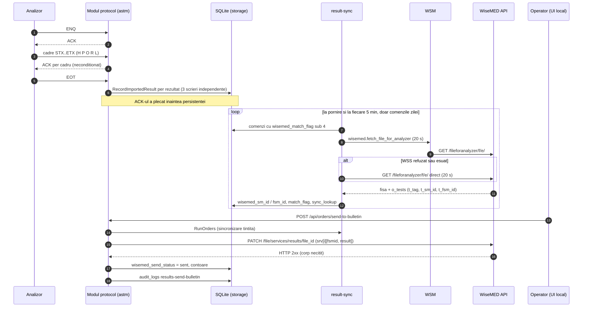
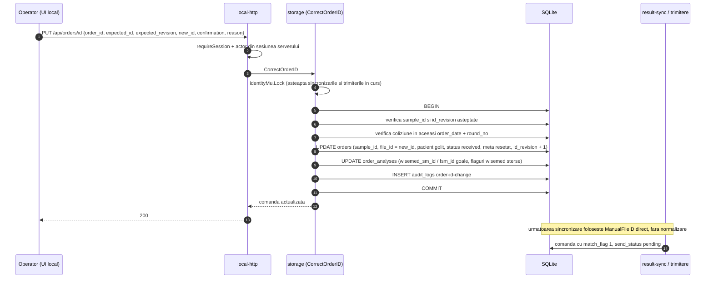
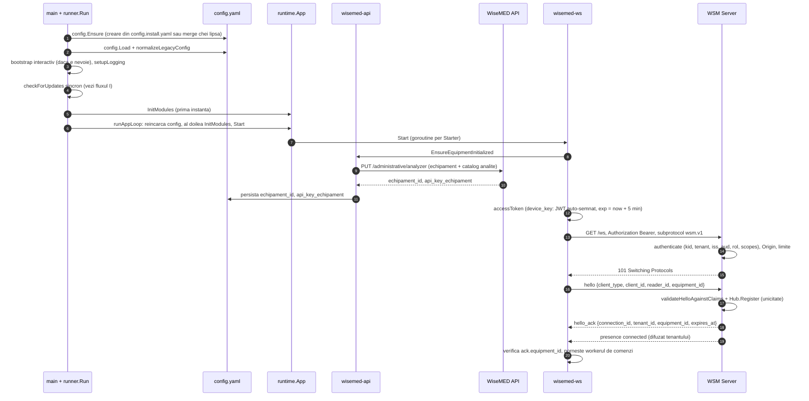
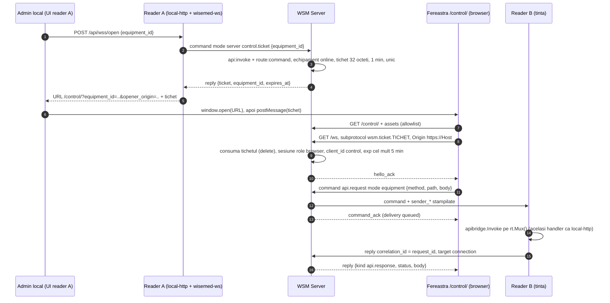
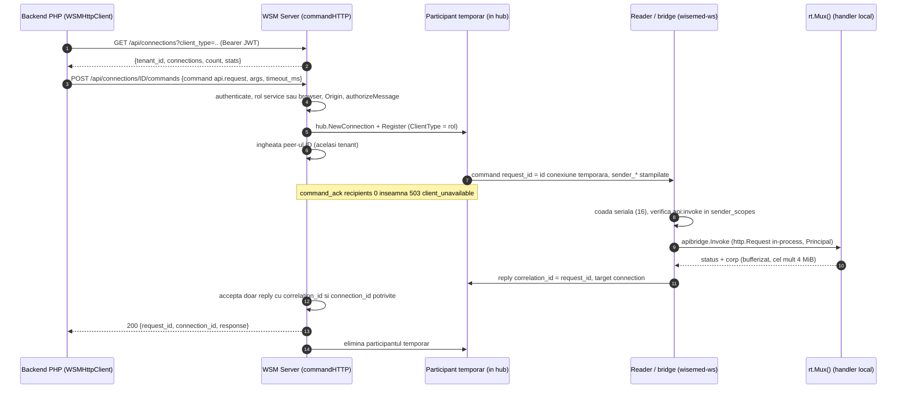
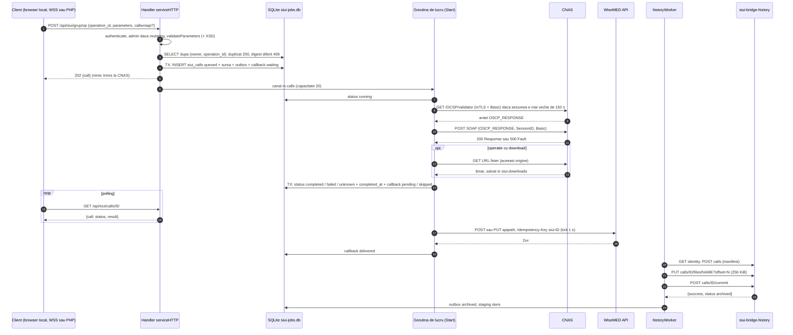
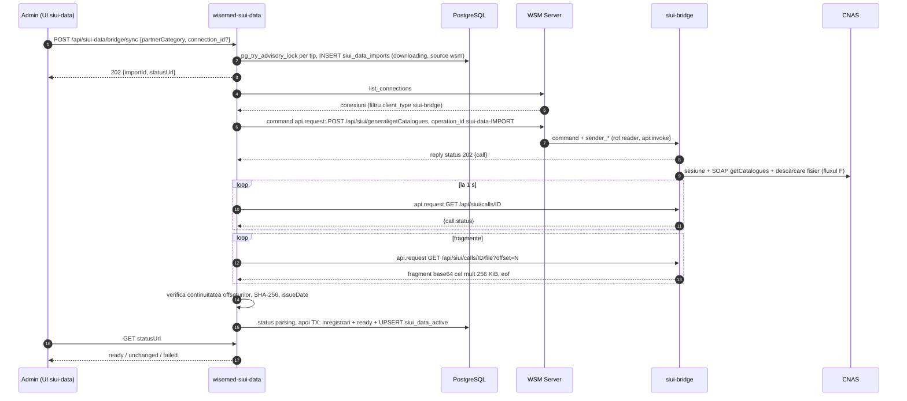
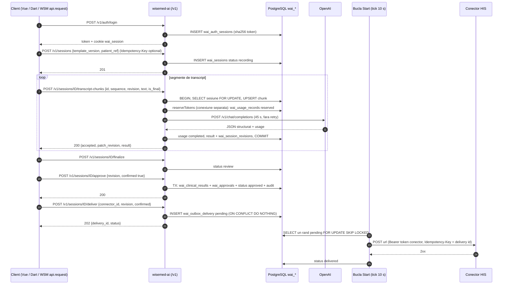
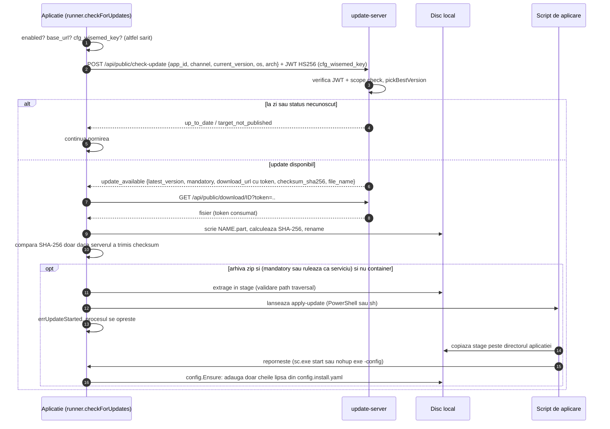

# Fluxuri cap-coadă

| | |
|---|---|
| **Scop** | Fluxurile principale ale sistemului, urmărite de la declanșator până la efectul persistent sau extern, fiecare cu diagramă de secvență, pași numerotați cu dovezi `fișier:linie` și comportamentul la eroare / timeout / restart. Descrie starea **existentă** în cod. |
| **Data** | 2026-11-14 (checkout `main`, HEAD `d53088e`) |
| **Surse** | `_reports/01-runtime-and-apps.md` … `_reports/06-qa-build-ops.md`, plus verificări punctuale în cod (doar citire) marcate „verificat aici”. |
| **Limite** | Niciun flux nu a fost executat cap-coadă pentru acest document. Backendul WiseMED, CNAS, OpenAI, conectorii HIS și aplicația Flutter sunt externe; pașii care îi privesc sunt descriși doar din perspectiva codului din repo. `[TEST]` înseamnă că pachetul care conține pasul a trecut în `_reports/06 §B.1` cu **backend-uri simulate**. Nu sunt reproduse secrete sau date reale. |

Documente înrudite: [communication-map.md](communication-map.md) (matricea legăturilor; nepotrivirile **N1–N12** citate aici sunt definite acolo, §14) · [data-and-state-machines.md](data-and-state-machines.md) · [api-catalog.md](api-catalog.md) · [security-and-identity.md](security-and-identity.md) · [runtime-and-modules.md](runtime-and-modules.md) · [build-deploy-update.md](build-deploy-update.md) · [verification-matrix.md](verification-matrix.md) · [gaps-and-contradictions.md](gaps-and-contradictions.md) · [application-catalog.md](application-catalog.md) · [agent-context.md](agent-context.md)

**Etichete**: `[COD]` = `CONFIRMAT DIN COD` · `[TEST]` = `CONFIRMAT PRIN TEST LOCAL` · `[DOC]` = `DOCUMENTAT, NEVERIFICAT` · `[INF]` = `INFERENȚĂ` · `[NEC]` = `NECUNOSCUT`.

**Prefixe de cale**: `R/` = `readersv3/` · `W/` = `wsm-server/internal/server/` · `WC/` = `wsm-server/internal/config/` · `S/` = `readersv3/modules/siui/` · `H/` = `readersv3/modules/siuihistory/` · `D/` = `readersv3/modules/siuidata/` · `AI/` = `readersv3/modules/wisemedai/` · `SQ/` = `readersv3/modules/storage/sqlite/` · `LH/` = `readersv3/modules/localhttp/` · `FB/` = `readersv3/modules/protocols/fileimportbase/module.go` · `RS/` = `readersv3/modules/resultsync/module.go` · `WA/` = `readersv3/modules/wisemedapi/module.go` · `WS/` = `readersv3/modules/ws/module.go`.

| Flux | Efect final | Secțiune |
|---|---|---|
| (a) Rezultat de la analizor → buletin WiseMED | `PATCH /file/services/results/{file_id}` aplicat; flaguri `wisemed_send_*` | §A |
| (b) Corectarea ID-ului probei | `orders.sample_id` nou + asociere WiseMED resetată + audit | §B |
| (c) Pornirea unui reader | `hello_ack` primit, reader vizibil în tenant | §C |
| (d) Control remote din browser prin tichet | apel `/api/…` executat pe mux-ul readerului | §D |
| (e) PHP → `POST /api/connections/{id}/commands` | handler local executat, `reply` întors ca HTTP 200 | §E |
| (f) Operație SIUI | răspuns CNAS în `siui_calls`, callback WiseMED, arhivă History | §F |
| (g) Sincronizare nomenclatoare SIUI Data | versiune nouă activă în PostgreSQL | §G |
| (h) Sesiune WiseMED AI | rezultat clinic aprobat + livrare către conector | §H |
| (i) Verificare și aplicare update | binar înlocuit, proces repornit | §I |

---

## A. Rezultat de la analizor → SQLite → potrivire (`result-sync`) → trimitere în buletin WiseMED

Există **două trasee**: automat (protocoalele pe fișiere + LD-560) și doar manual (ASTM, Pentra, miniVIDAS, LAURA, Zonci). `[COD]` `_reports/03-laboratory.md §6.6`. Diagrama arată traseul ASTM cu trimitere manuală; diferențele traseului automat sunt la pasul 9.

**Pași**

1. Analizorul deschide sesiunea (`ENQ`); readerul răspunde `ACK` dacă `send_ack` (implicit true). `[COD]` `R/modules/protocols/astm/module.go:630-637`
2. Fiecare cadru `STX…ETX/ETB` (+ checksum + CRLF) este confirmat cu `ACK` **necondiționat**; checksumul e calculat doar pentru trace; readerul nu emite niciodată `NAK`. `[COD]` `astm/module.go:593-628,1297-1320`
3. La `EOT` cadrele sunt concatenate; fără `Q` se apelează `processBatch`. Un lot fără `EOT` e procesat după ≤100 ms de liniște. `[COD]` `astm/module.go:572-581,643-654`
4. Pentru fiecare rezultat: ID-ul probei din `sample_id_paths`, TAG din `result_id_paths` → `analyte_mappings` → `NormalizeAnalyteTag`; prefix QC → `qc_records` în loc de comenzi. `[COD]` `astm/module.go:750-844,881-928`; `R/modules/core/model/analyte_tag.go:10-17`
5. `RecordImportedResult` face trei scrieri **netranzacționale**: `UpsertOrder` (cheie logică `(order_date, round_no, sample_id)`, runda = `max(round_no)` a zilei), `SaveOrderAnalysis`, `UpsertOrderResultForAnalysis` (append în `order_analysis_results`; ultimul rezultat devine implicit). `[COD]` `SQ/module.go:832-845,883-949,1241-1255,1380-1419`
6. Pentru ASTM/Pentra/miniVIDAS/LAURA/Zonci recepția se termină aici (salvare + transformări). `[COD]` `astm/module.go:845-857`
7. `result-sync` rulează o dată la pornire, apoi la `interval_minutes` (5): `runOnce` ia **doar comenzile zilei curente** cu `wisemed_match_flag < 4`, sub `RLock` pe `identityMu`. `[COD]` `RS:90-114,202-288`
8. Per comandă (`processOrder`): `postprocessSampleCode` (prefix QC → `qc`; prefix/sufix; separator → fișă/probă/eșantion; ID corectat manual ocolește tot) → `FetchFileForAnalyzer`: întâi WSS `wisemed.fetch_file_for_analyzer`, apoi HTTP direct → potrivire pe `ToUpper(TrimSpace(tag)) == ToUpper(t_tag)` → scrie `wisemed_sm_id`/`wisemed_fsm_id`, datele pacientului și răspunsul complet în `orders.meta_json.sync_lookup`; `wisemed_match_flag` ∈ {2 nicio potrivire, 3 parțial, 4 complet}. `[COD]` `RS:373-443,526-621,720-790,878-893`; `WA:402-423,525-541`. Cu scope-urile implicite ale readerului, ramura WSS e refuzată de WSM (lipsă `wisemed:proxy`) — **N3**.
9. **Trimitere manuală**: `POST /api/orders/send-to-bulletin` (alias `/send-to-wisemed`) → sincronizare țintită `RunOrders` → `saveOrderBundlesToWiseMED` cu `login_token` al operatorului. `[COD]` `LH/module.go:1802-1941`. **Trimitere automată** (fișiere, LD-560): `AutoSaveResultsToWiseMED` (sincronizare → reîncărcare → PATCH) imediat după import, doar dacă `results.auto_confirm_wisemed`. `[COD]` `FB:329-344,498-535`
10. Per comandă: ID fișă = `ManualFileID()` → `orders.file_id` → `meta.file_id` (lipsă → `skipped/missing_file_id`); intră doar analizele cu `wisemed_fsm_id` nevid și valoare; valoarea = `raw_value` (fallback `result_value`); `interpretation`/`conclusion` goale; **un PATCH per comandă cu toate analizele eligibile**, indiferent dacă au mai fost trimise. `[COD]` `FB:590-669`
11. `PATCH /file/services/results/{file_id}?XDEBUG_TRIGGER=debug`, form-urlencoded, JWT (+`lt`), timeout 20 s, fără `Idempotency-Key`. `[COD]` `WA:565-599`
12. Orice HTTP 2xx ⇒ `persistWiseMEDSendStates`: analiză `wisemed_send_status=sent`, `wisemed_sent_at`, `wisemed_send_count`; comandă `none`/`partial`/`full`. Corpul răspunsului nu e inspectat — **N7**. `[COD]` `FB:669-758`
13. Rezultatul (succes sau eșec) ajunge în `audit_logs` cu `event_type=results-send-bulletin`. `[COD]` `LH/module.go:1874-1940`

Parserele de protocol, `storage/sqlite`, `resultsync`, `fileimportbase` au suite care au trecut cu fixture-uri și `httptest`: `[TEST]` `_reports/06 §B.1` rând 3. Niciun analizor real și niciun backend WiseMED real.

**Eroare / timeout / restart**

| Situație | Comportament | Dovadă |
|---|---|---|
| Eroare DB în `processBatch` | analizorul a primit deja ACK → rezultatul se pierde; fără jurnal de recepție pe disc | `astm/module.go:601-604` vs `:649-651` `[COD]`; pierderea `[INF]` |
| Eroare la mijlocul unui lot / fișier | import parțial; rândurile scrise rămân (fără tranzacție pe lot) | `FB:290-307`, `astm/module.go:750-844` `[COD]` |
| Fișier încă în scriere de către analizor | parsat așa cum e (fără verificare „fișier stabil”), apoi mutat | `FB:229-347` `[COD]`; importul parțial `[INF]` |
| Lookup WiseMED eșuat | `sync_status=lookup_error` în meta, **fără eroare Go**; analizele fără `fsm_id` sunt omise tăcut la trimitere | `RS:415-421`, `FB:519-521` `[COD]` |
| `result-sync` deja în curs | a doua rulare primește eroare (nu așteaptă); trimiterea automată se abandonează ca „warning”, **fără reluare** | `RS:209-213,307-311`, `FB:341-344` `[COD]` |
| Timeout / eroare la PATCH | oprire la prima eroare; comenzile anterioare rămân `sent`, restul nemarcate; dacă serverul a aplicat totuși, starea locală rămâne „netrimis”; UI primește 502 | `FB:669-677` `[COD]`; divergența `[INF]` |
| Retry automat al trimiterii | **nu există**; bucla periodică doar potrivește, nu face PATCH | `RS:202-288` `[COD]` |
| Restart reader | lotul ASTM din memorie se pierde; fișierele din inbox se reimportă integral (rânduri duplicate în `order_analysis_results`); trimiterile neterminate nu se reiau; sincronizarea în curs nu e anulată la oprire (`context.Background()`) | `_reports/03 §10.2`; `RS:103,109` `[COD]` |
| Comenzi din alte zile | neatinse de bucla periodică; doar manual, cu `order_date` explicit | `RS:236` `[COD]` |
| **Re-recepția unui rezultat pentru o comandă deja potrivită complet** | `SaveOrderAnalysis` rescrie `wisemed_sm_id/fsm_id` cu gol; comanda păstrează `wisemed_match_flag=4` → toate sincronizările o sar → analiza nu mai e trimisă. Ieșire: corecția ID-ului sau ștergerea comenzii. Neafectate: Zonci, LAURA | `SQ/module.go:1089-1090,1399-1413` → `RS:267-270,351-354` → `FB:637-640,656-667` `[COD]` pe fiecare verigă; efectul cap-coadă `[INF]` |
| Retragere din WiseMED | nu există niciun apel de anulare/ștergere; o valoare nouă ajunge în buletin doar printr-o nouă trimitere care suprascrie | `_reports/03 §6.7` `[COD]` |

---

## B. Corectarea ID-ului probei

**Pași**

1. `PUT /api/orders/id`, înfășurat cu `requireSession` + verificare explicită a sesiunii; corp ≤8192 octeți. `[COD]` `LH/module.go:251`, `LH/order_identity.go:15-51`
2. Payload `{order_id, expected_id, expected_revision, new_id, confirmation, reason}`. `[COD]` `R/modules/core/model/order_identity.go:8-15`
3. Actorul vine din sesiunea de pe server (nume complet → username → e-mail), nu din corp. `[COD]` `LH/module.go:2637-2644`
4. Validare: `new_id` nevid, ≤200, fără caractere de control, ≠ `expected_id`; `reason` ≤1000; `confirmation == "deacord"` exact; actor nevid → altfel 400. `[COD]` `SQ/order_identity.go:19-23`
5. `identityMu.Lock()` — corecția așteaptă sincronizările și trimiterile în curs (care țin `RLock` prin `BeginOrderIdentityUse`). `[COD]` `SQ/order_identity.go:13-16,24-25`; `RS:203-207,301-305`; `FB:592-595`
6. Concurență optimistă: `sample_id` curent și `meta.id_revision` trebuie să corespundă valorilor așteptate → altfel 409. `[COD]` `SQ/order_identity.go:40-43`
7. Coliziune: altă comandă cu `sample_id == new_id` sau `id_correction.original_sample_id == new_id` în **aceeași `order_date` și același `round_no`** → 409. Alte runde ale aceleiași zile nu se verifică. `[COD]` `SQ/order_identity.go:44-50`
8. Un singur `tx`: `orders` (ID nou, `file_id = new_id`, pacient golit, `status='received'`; din meta se șterg cheile `sync_*`, `sample_code_*`, `wisemed_*`, `file_id`; `wisemed_match_flag=1`, `wisemed_send_status="pending"`, `id_revision+1`, `id_correction` + `id_correction_history`), toate `order_analyses` (`wisemed_sm_id/fsm_id=''`, flaguri `wisemed_*` șterse), `audit_logs` (`order-id-change`). Rezultatele și istoricul lor rămân neatinse. `[COD]` `SQ/order_identity.go:26-142`
9. Efecte ulterioare: `UpsertOrder` găsește comanda și după `id_correction.original_sample_id`, deci rezultatele noi cu ID-ul vechi ajung la aceeași comandă; `ManualFileID()` e folosit direct ca ID de fișă la sincronizare și trimitere; copiile învechite sunt respinse (`id_revision` diferit). `[COD]` `SQ/module.go:903-912,921-924`; `RS:376-378`; `FB:596-620`

`[TEST]` `_reports/06 §B.1` rând 3: pachetele `storage/sqlite`, `localhttp`, `resultsync`, `fileimportbase` au trecut (testele citate în `_reports/03 §4`: `TestIDChangeIsAtomicAndRejectsCollision`, `TestIDChangeUsesAuthenticatedActor`, `TestManualFileIDBypassesAnalyzerNormalization`, `TestSendUsesCorrectedFileID`).

**Eroare / timeout / restart**

| Situație | Comportament | Dovadă |
|---|---|---|
| Validare / stare învechită / coliziune | 400 / 409; nimic scris | `SQ/order_identity.go:19-50` `[COD]` |
| Eroare în tranzacție sau restart la mijloc | rollback integral (un singur `tx`) | `SQ/order_identity.go:26-141` `[COD]` |
| Sincronizare lungă în curs | corecția așteaptă; cât timp `Lock` e în așteptare, cititorii noi (alte sincronizări/trimiteri) sunt și ei blocați | semantica `sync.RWMutex` `[INF]` `_reports/03 §10.1` |
| Rezultate deja trimise sub ID-ul vechi | **nu se retrag** din WiseMED; nu există apel de anulare | absența oricărui apel în `SQ/order_identity.go` `[COD]` |
| ID nou nenumeric | acceptat local; respins de stratul PHP din repo (`intval()` → 0) — **N8** | `apis/wisemed-api/apiv2/implementation/analyzers.php:5-6` `[COD]` |
| Autorizare | orice utilizator autentificat poate corecta ID-uri (fără rol dedicat) | `_reports/03 §9.1` `[COD]` |

---

## C. Pornirea unui reader: config → înregistrare WiseMED → conexiune WSM → `hello_ack`

**Pași**

1. `main` construiește lista **hardcodată** de module și apelează `runner.Run`. `[COD]` `R/apps/generic-test-reader/main.go:12-28`
2. `config.Ensure` creează `config.yaml` din `config.install.yaml` sau adaugă doar cheile lipsă; `config.Load` + `normalizeLegacyConfig`. `[COD]` `R/apps/runner/runner.go:52-60,183`, `R/core/config/install.go:19`
3. Bootstrap interactiv dacă `!SkipBootstrap || Reconfigure` (eroarea e non-blocantă, cu excepția `siui-data`); wizardul poate apela `GET /administrative/medicalunits`, `/wmanalyzertypes` și `registerEquipment`. `[COD]` `runner.go:74-92`, `R/apps/runner/bootstrap.go:15,441`
4. `setupLogging`; opțional `-installservice`; verificare de update sincronă (fluxul I); `-headless` relansează un copil care repetă pașii 2–4. `[COD]` `runner.go:93-138`
5. Prima instanță runtime + `InitModules`, apoi `runAppLoop` reîncarcă config-ul, construiește a doua instanță și rulează **din nou** `InitModules` (dublu `Init` pe darwin/linux). `[COD]` `runner.go:139-145,247-282`; scurgerea de resurse `[INF]` `_reports/01 §1.2`
6. `App.Start` pornește toate `Starter`-ele în paralel; mux-ul e servit de `local-http`. `[COD]` `R/core/runtime/runtime.go:124-149`, `LH/module.go:299-332`
7. `wisemed-ws.Start`: se conectează doar dacă `enabled != "false"` și `url` nevid (altfel fază `disabled`). `[COD]` `WS:255-461`
8. `EnsureEquipmentInitialized()` → `PUT /administrative/analyzer` o dată per proces (`initializeMu`), cu tot catalogul de analite; răspunsul trebuie să aibă `echipament_id > 0`, altfel configul nu e suprascris. Aplicațiile login-only (`html-print-formatter`, `wisemed-ai`) sar peste înregistrare. `[COD]` `WA:172-180,332-400`
9. Se cere `echipament_id` nevid și ≠ `"0"`. `[COD]` `WS:356-359`
10. `accessToken` după `auth_mode`: `device_key` (implicit) — JWT HS256 auto-semnat cu `device_secret` → `secret_file` → `api_key_echipament` (≥32 octeți), `exp = now+5min`, `role` = `reader` (sau `service` pentru `siui`/`siui-history`), scope-uri implicite fără `api:invoke`/`wisemed:proxy`; `token_file`; `token_endpoint` (vezi **N1**). `[COD]` `WS:717-761`
11. Dial WSS: `Authorization: Bearer`, TLS ≥1.2 (CA opțional `ca_file`), `HandshakeTimeout` 10 s, read limit 8 MiB. `[COD]` `WS:368-396`
12. WSM `authenticate`: doar `HS256`; `kid` → cheie activă → tenant; `exp`, `iat` obligatorii; `aud`; `tenant_id == Key.TenantID`; `iss == Tenant.Issuer`; durată ≤ `max_token_ttl_seconds`; `role ∈ Key.Roles`; `scopes ⊆ Key.Scopes`; legături `Subject`/`ReaderID`/`EquipmentID`; apoi Origin și limitele de conexiuni, toate **înainte** de upgrade. `[COD]` `W/auth.go:65-163`, `W/server.go:197-238`
13. Readerul trimite `hello`; WSM îl validează față de claims și înregistrează conexiunea (unicitate `(tenant, reader_id)` și `(tenant, equipment_id)`). `[COD]` `W/auth.go:168-173`, `W/hub.go:64-68`, `W/server.go:317-335`
14. `hello_ack` + `presence connected`; WSM armează `time.AfterFunc(time.Until(exp), conn.Close)`. `[COD]` `W/server.go:265,339-340`
15. Readerul așteaptă `hello_ack` 10 s și verifică `ack.equipment_id == echipament_id` local; pornește workerul serial de comenzi (coadă 16) și Ping la 15 s. `[COD]` `WS:394-410,428-463`

`[TEST]` `_reports/06 §B.1` rând 10: integrarea `wsm-server/integration` (server WSM cu TLS pe loopback + modulul reader real) a trecut, inclusiv reconectarea după ~30 s; rând 7: autentificarea și rutarea în `W/`. Fără WiseMED real.

**Eroare / timeout / restart**

| Situație | Comportament | Dovadă |
|---|---|---|
| Eroare la `Init` al unui modul | `InitModules` se oprește la primul eșec; `Run` întoarce eroarea → `log.Fatal` | `_reports/01 §1.3` `[COD]` |
| Un `Starter` iese (inclusiv cu `nil`) | `cancel()` pentru toate modulele → procesul se oprește | `runtime.go:141-148` `[COD]` |
| Înregistrarea WiseMED eșuează | doar log; `initialized` rămâne false; **WSS nu se conectează**; reîncercare la următoarea sesiune WSS (30 s), la login sau la import | `WA:332-355`; `_reports/02 §6` `[COD]` |
| JWT respins | 401 `{error:"wsm_<cod>"}`; pauză 30 s; reîncercare | `W/auth.go:42-51`, `WS:319` `[COD]` |
| `hello` nevalid / identitate duplicată | close 1008; **conexiunea nouă pierde**, cea veche rămâne | `W/server.go:324-335` `[COD]` |
| Timeout `hello` / `hello_ack` | 10 s de fiecare parte; socket închis; pauză 30 s | `W/server.go:271-293`, `WS:394-410` `[COD]` |
| Expirarea tokenului (`device_key`) | socket închis la `exp` (~5 min) → `failPending()` → pauză fixă 30 s → token nou → `hello` nou; ciclul se repetă | `WS:754`, `W/server.go:265`, `WS:319` `[COD]`; ciclul `[INF]` |
| Restart WSM / `SIGHUP` / mutație admin (`authEpoch`) | toate conexiunile cad; readerul revine în ≤30 s cu `connection_id` nou; comenzile în curs se pierd | `_reports/02 §11–§12` `[COD]` |
| Restart reader | sesiunile locale cu cookie stateless rămân valide la readerele standard; starea în memorie se pierde | `_reports/03 §10.2` `[COD]`/`[INF]` |

---

## D. Control remote din browser prin tichet

Două puncte de pornire: (1) o pagină cu JWT de browser care cere tichetul prin SDK (`controlTicket`); (2) un administrator local al unui reader care apasă „Deschide” (`POST /api/wss/open`). Diagrama arată varianta (2); pașii 4–12 sunt identici.

**Pași**

1. `POST /api/wss/open` cere admin local (`UserType <= 0`), `Content-Type: application/json` și Origin same-host dacă e prezent. `[COD]` `LH/wss.go:41-44,52-64`
2. Readerul trimite `control.ticket` ca `command mode:"server"` cu JWT-ul propriu (timeout 25 s). `[COD]` `LH/wss.go:136-155`. Cu scope-urile implicite ale readerului lipsește `api:invoke` → `forbidden` — **N3**.
3. `issueControlTicket`: cere `api:invoke` + `route:command`; echipamentul trebuie să fie online; sesiunile de control nu pot delega; tichet de 32 octeți aleatori, valabil 1 min, max 1024 în așteptare. `[COD]` `W/control.go:24-70`, `W/server.go:423`
4. Răspunsul local conține URL-ul `/control/?equipment_id=…&opener_origin=…`; tichetul trece prin `postMessage`, **nu** prin URL. `[COD]` `LH/wss.go:136-155`, `LH/ui/wss-remote.js:96-132`
5. Interfața e servită central de WSM din `server.control_ui_dir` (6 fișiere în allowlist; orice altceva → `index.html`). `[COD]` `W/control.go:93-126`
6. Fereastra deschide `GET /ws` cu `wsm.ticket.<ticket>`; `Origin` trebuie să fie exact `https://<Host>`. `[COD]` `W/control.go:87-92`
7. Tichetul e consumat la citire (o singură utilizare) și respins dacă `authEpoch` s-a schimbat. Sesiunea: `role=browser`, `client_id="control"`, `ControlEquipmentID`, scope-uri `api:invoke`, `route:command` (+`api:admin` **doar dacă părintele îl are**), `exp = min(now+5min, exp părinte)`, tenantul părintelui. `[COD]` `W/control.go:47,75-79`
8. Sesiunea de control poate trimite doar `ping` și `command api.request` cu `mode:"equipment"` egal cu echipamentul tichetului. `[COD]` `W/server.go:389-391`
9. `wss-remote.js` interceptează `fetch` către `/api/…` și `/barcode/print` și le transformă în `api.request`. `[COD]` `LH/ui/wss-remote.js:77,125`
10. WSM rutează în tenant, suprascrie `sender_*` în payload și răspunde cu `command_ack {recipients, delivery:"queued"}` — confirmare de **coadă**, nu de execuție. `[COD]` `W/server.go:548-565`, `W/hub.go:121-217`
11. Readerul țintă verifică `api:invoke` în `sender_scopes`, construiește `Principal` și apelează `apibridge.Invoke` pe `rt.Mux()`; `currentSession` îl tratează ca sesiune autentificată (`UserType 0` cu `api:admin`, altfel `1`). `[COD]` `WS:512-533`; `R/shared/apibridge/bridge.go:51-162`; `LH/module.go:2566-2573`
12. `reply` cu `correlation_id = request_id` către `sender_connection_id`; fereastra primește `{kind:"api.response", status, …}`. `[COD]` `WS:536-551,627-645`

`[TEST]` `_reports/06 §B.1` rând 7 (`W/server_test.go:547` — restricțiile sesiunii de tichet) și rând 10 (integrare: tichet de control + apel API prin reader real pe loopback).

**Eroare / timeout / restart**

| Situație | Comportament | Dovadă |
|---|---|---|
| Echipament offline / scope lipsă | `error code=command_failed` sau `forbidden`; `/api/wss/open` → eroare | `W/server.go:358-373,423` `[COD]` |
| Tichet expirat, refolosit sau `authEpoch` schimbat | 401 „invalid control ticket” | `W/control.go:75-79` `[COD]` |
| Lease expirat (≤5 min) | socket închis; fereastra cere tichet nou prin opener la 30 s; **fără replay** al cererilor | `_reports/02 §14` rând 10 `[COD]` |
| Readerul țintă se deconectează în timpul apelului | contextul cererii interne e anulat; reply-ul nu mai poate fi trimis; SDK primește timeout (35 s) cu mesajul „execution may have occurred” | `WS:411-441`; `W/sdk/wsm.js:145` `[COD]` |
| Readerul țintă în `device_key` | deconectare ciclică la ~5 min → apelurile din acea fereastră se pierd | `[INF]` (vezi fluxul C) |
| Timeout intern adaptor (30 / 130 / 310 / 610 s) | contextul expiră; un handler sincron care ignoră contextul continuă | `bridge.go:95-126` `[COD]` |
| Răspuns > 4 MiB sau `text/html` | eroare de adaptor (`ok:false`) | `bridge.go:138-186` `[COD]` |
| Restart WSM | tichetele și sesiunile de control dispar | `_reports/02 §12` `[COD]` |

---

## E. PHP → `POST /api/connections/{id}/commands` → `api.request` → handler local → reply

**Pași**

1. Discovery: `GET /api/connections[?client_type=]` cu Bearer JWT, scope `connections:read`; clientul PHP reîncearcă doar acest GET (erori cURL 6/7/28/52/55/56). `[COD]` `W/server.go:174`; `wsm-server/examples/php/WSMHttpClient.php:128-168`
2. `POST /api/connections/{id}/commands` cu `{command, args, timeout_ms}`; câmpuri necunoscute → 400; corp > `max_message_bytes` → 413. `[COD]` `W/http_commands.go:17-62`
3. Autentificare JWT (ca la WSS), rol `service` sau `browser`, Origin, apoi `authorizeMessage` ca pentru un mesaj WSS (`route:command` + `api:invoke` pentru `api.request`). `[COD]` `W/http_commands.go:17-72`, `W/server.go:437-442`
4. Timeout: `timeout_ms` implicit 135 000, interval 1..300 000, plafonat la `exp` al JWT; write deadline HTTP `deadline+5s`. `[COD]` `W/http_commands.go:62-92`
5. Participant temporar: `hub.NewConnection(nil, tenant, queue)` cu `ClientType = claims.Role`, numărat în limitele de conexiuni, vizibil în listări pe durata apelului, fără `presence`. `[COD]` `W/http_commands.go:73-129`
6. Peer-ul `{id}` este capturat înainte de dispatch; inexistent sau din alt tenant → 404 `client_unavailable`. `[COD]` `W/http_commands.go:131-141`
7. Dispatch: `request_id` = ID-ul conexiunii temporare (128 biți aleatori); WSM ștampilează `sender_*`. ACK cu `recipients:0` → 503 `client_unavailable`. `[COD]` `W/http_commands.go:147-153`, `W/server.go:548-565`
8. Readerul pune comanda în coada serială (16); pentru `api.request` verifică `api:invoke` în `sender_scopes` și construiește `Principal{Subject, TenantID, ConnectionID, SourceIP, Admin}`. `[COD]` `WS:428-455,512-528`
9. `apibridge.Invoke`: validează calea (`/api/…` sau `/barcode/print`, cu excluderi), metoda, corpul (≤4 MiB); construiește `http.NewRequestWithContext` cu `RemoteAddr = "wss:<connection_id>"`, `Accept: application/json`; apelează `handler.ServeHTTP(recorder, req)` — **același mux**, fără rețea. `[COD]` `R/shared/apibridge/bridge.go:51-126`
10. Handlerul local rulează cu sesiunea sintetică (`ID="wss:<conn>"`, `Username=sub`, `UserType` 0/1). `[COD]` `LH/module.go:2566-2573`
11. Răspunsul e bufferizat integral: `{kind:"api.response", status, content_type, headers, body | body_base64}`. `[COD]` `bridge.go:138-161`
12. Readerul trimite `reply` cu `correlation_id = request_id`, `target = {mode:"connection", connection_id: sender_connection_id}`. `[COD]` `WS:536-551`
13. Wrapperul acceptă numai `type=="reply"` cu `correlation_id == request_id` **și** `connection_id == {id}`; restul e ignorat. `[COD]` `W/http_commands.go:147-156`
14. HTTP 200 `{request_id, connection_id, response:<payload reply>}`. **200 = a sosit reply-ul peer-ului**, nu succesul API-ului remote: `response.status` poate fi 4xx/5xx, `response.ok` poate fi `false`. `[COD]` `W/http_commands.go:157-172`. `WSMHttpClient::callAPI` nu aruncă pe status remote non-2xx; `response.ok===false` → excepție `command_failed`. `[COD]` `_reports/02 §9`

`[TEST]` `_reports/06 §B.1` rând 7: `W/http_commands_test.go:68`, `W/php_http_client_test.go:18` (pachetul `internal/server` a trecut, 0 teste sărite); rând 3 pentru `shared/apibridge`. Backendul PHP real este extern `[NEC]`.

**Eroare / timeout / restart**

| Situație | Rezultat pentru apelant | Dovadă |
|---|---|---|
| JWT invalid; reload/expirare între autentificare și admitere | 401 `wsm_*` / `credentials_expired_or_reloaded` | `W/http_commands.go:95` `[COD]` |
| Rol, Origin sau `authorizeMessage` | 403 `forbidden` | `_reports/02 §4` `[COD]` |
| Peer inexistent / alt tenant | 404 `client_unavailable` | `:131-141` `[COD]` |
| Coada peer-ului plină sau peer dispărut la dispatch | 503 `client_unavailable` | `:150-153` `[COD]` |
| Limită de conexiuni / înregistrare eșuată | 503 `connection_limit` / `registration_failed` | `:73-129` `[COD]` |
| Peer deconectat după rutare | **502 `client_disconnected_execution_unknown`** | `:173-182` `[COD]` |
| Timeout | **504 `timeout_execution_unknown`** | `:188` `[COD]` |
| Reload / `authEpoch` în timpul așteptării | **503 `request_interrupted_execution_unknown`** | `:159` `[COD]` |
| Apelantul HTTP închide cererea | handlerul iese fără răspuns și **fără a anula** execuția remote; reply-ul ajunge la o conexiune inexistentă | `:186-190` `[COD]` |
| Retry | POST **niciodată** retrimis de clientul PHP; fără dedup pe `request_id` la WSM; idempotența rămâne la handler (ex. `operation_id` la SIUI) | `WSMHttpClient.php:128-168` `[COD]` |
| Reconciliere după `*_execution_unknown` | **nu există cod**; clientul primește doar flagul `executionUnknown` și trebuie să verifice prin API-ul destinatarului | rezoluția orchestratorului `[COD]` |

`*_execution_unknown` (wrapper HTTP WSM) nu este starea `unknown` a unui job SIUI (fluxul F); un apel SIUI prin acest wrapper poate produce oricare dintre ele, independent.

---

## F. Operație SIUI: submit (202) → job → sesiune CNAS → SOAP → rezultat → callback WiseMED → arhivare History

**Pași**

1. `POST /api/siui/{general|clinice|facturare|docmed}/{op}`; aceeași cale prin `api.request` (limitat la 4 MiB). Catalogul are 63 de operații (41 + 22 DocMED). `[COD]` `S/service_jobs.go:164-169`, `S/operations.go:40-45`
2. `authenticate`: principal WSS → sesiune; `Bearer` (doar pe TLS) → `verifyJWT`; altfel cookie. `owner` = `local:<subject>` / `wsm:"tenant":"subject"`; operațiile `mutating` cer admin (prin WSS: scope `api:admin`). `[COD]` `S/auth.go:27-49`, `S/module.go:249-277`
3. Validare: `operation_id` (`^[A-Za-z0-9][A-Za-z0-9_.:-]{0,127}$`), set exact de parametri, limite, XML bine format, XSD pentru operațiile din `operationSchema` și pentru toate cererile DocMED; `callwmapi` validat și calea finală calculată. `[COD]` `S/operations.go:54-138,247-270`; `S/callback.go:104-202`
4. Sub `m.mu`: `digest = sha256(JSON{Operation, Parameters, Config})` (cu callback: include specificația și destinația); căutare `(owner, operation_id)`: același digest → **200** `{duplicate:true, call}`; alt digest → **409**. `[COD]` `S/service_jobs.go:257-274`
5. Lipsă configurare → 409; `m.checking` sau canal plin → 409 `CNAS token or queue busy` (nimic rezervat). `[COD]` `S/service_jobs.go:298`
6. Tranzacție de rezervare: `INSERT siui_calls(status='queued')` + sursa atestată + `siui_history_outbox(parameters, source_ip)` + opțional `siui_wm_callbacks(waiting)`; triggerele scriu `siui_operation_events`. `[COD]` `S/service_jobs.go:302-324`, `S/operations_history.go:29-32`
7. `m.pending++`, trimitere pe `m.calls`, răspuns **202**. **202 = validat, rezervat durabil, pus în coada din memorie; nimic trimis către CNAS.** `[COD]` `S/service_jobs.go:325-348`
8. Singura gorutină de lucru ia jobul: `queued → running`; buget 120 s. `[COD]` `S/module.go:176-220`, `S/service_jobs.go:352-356`
9. Sesiunea CNAS („OCSP”): reutilizată ≤150 s per configurație; altfel `GET {base_url}/OCSP/validator?username=…` cu mTLS (cheia rămâne pe token) + `Basic`; se cere HTTP 200 și antetul `OSCP_RESPONSE`. `[COD]` `S/client.go:108-206`, `S/ocsp_session.go:11-31`
10. Cererea SOAP: `operationEnvelope` (rpc/document) sau `docMedEnvelope`; `POST {origine}/svapntws/services/{Service}` sau `{docmed_base_url}/…/ws`; antete `OSCP_RESPONSE`, `SessionID`, `Basic`, `SOAPAction: ""`. `[COD]` `S/operations.go:139-173,304,358-372`; `S/docmed.go:60-68,172`
11. Răspuns: `operationValues` verifică plicul SOAP 1.1, tratează `Fault`, aplatizează în `result.values` (clasic — fără XSD, fără interpretare); DocMED: XSD de răspuns + `docMedRejection`. `[COD]` `S/operations.go:177-246`; `S/docmed.go:89-149`
12. Operațiile `download`: `GET` pe URL-ul întors de CNAS (doar `https`, aceeași gazdă, 1…64 MiB) → `siui-downloads/YYYY/MM/YYYY-MM-DD/<call id>`. `[COD]` `S/service_jobs.go:448-492`
13. Tranzacția finală: `status` (`completed` / `failed` / `unknown`), `result`, `completed_at` în outbox, starea callbackului (`pending` cu corpul calculat **o singură dată**, `failed` dacă transformarea a eșuat, `skipped` pentru job `failed`/`unknown`). `[COD]` `S/service_jobs.go:390-438`
14. Clientul interoghează `GET /api/siui/calls/{id}` (doar proprietarul) și, pentru fișiere, `GET …/file?offset=` în fragmente de 256 KiB. `[COD]` `S/service_jobs.go:142-162,493-588`. **`completed` nu înseamnă acceptare CNAS**: rezultatul de business e în `result.values`. `[COD]` `_reports/04 §6.5`
15. Callback WiseMED: ticker 1 s în **aceeași gorutină**; `POST|PUT {baza}{apipath}` cu JWT `wisemed-api` (+`lt`), `Idempotency-Key: siui-<call id>`, timeout 30 s; 2xx → `delivered`. `[COD]` `S/callback.go:288-335`; `R/modules/wisemedapi/callback.go:30-74`
16. Arhivare: `historyWorker` (gorutină separată, tick 2 s, un apel per tick, doar dacă `siui-history-sync.enabled`) selectează outbox `pending` cu job final; `GET identity` → manifest (`record-gzip`, `request-*`, `download`; ≤8 artefacte cu `size` + `sha256`) → `POST calls` → `PUT …/files/{name}?offset=` (256 KiB) → `POST …/commit`. `[COD]` `S/history_sync.go:237-309,324-515`
17. History verifică dimensiunea și SHA-256 per artefact, mută în depozit (local/S3), indexează în MySQL și răspunde `status:"archived"`; bridge-ul marchează outbox `archived` **doar** la `success` + `status == "archived"` și șterge stagingul. `[COD]` `H/calls.go:282-336`; `S/history_sync.go:306-308,508-513`

`[TEST]` `_reports/06 §B.1` rând 3: pachetul `modules/siui` a trecut cu CNAS, WiseMED și History simulate (testele citate în `_reports/04`: `TestJobIdempotencyAndRestart`, `TestServiceRestartNeverReplaysPendingCalls`, `TestNoRetryAfterAmbiguousWrite`, `TestWMCallbackQueueAndIdempotency`, `TestWMDeliveryRestartAndStableID`, `TestHistoryOutageRestartAndResumption`). Sărite: 2 teste `siui` (token conectat, TLS CNAS) și 2 `siuihistory` (MySQL). Nimic despre CNAS real.

**Eroare / timeout / restart**

| Situație | Comportament | Dovadă |
|---|---|---|
| Validare locală / XSD / eșec sesiune / `dial` dovedit | job `failed` (nimic trimis) | `S/operations.go:285-288`; `S/client.go:259-262` `[COD]` |
| Eroare de transport după începerea cererii, HTTP ≠ 200/500, SOAP Fault, răspuns neparsabil, descărcare eșuată | scriere → **`unknown`**; citire → `failed` | `S/service_jobs.go:390-395`; `S/operations.go:305-319` `[COD]` |
| Eroare de business în XML clasic | **`completed`**; apelantul trebuie să citească `values` | `_reports/04 §5.5` `[COD]` |
| Eroare de business DocMED | `failed`, cu `result.docmed.messages` și fișierul XML păstrat | `S/docmed.go:246-248` `[COD]` |
| Timeout 120 s | conexiunea locală e închisă; asta **nu oprește** procesarea la CNAS → scrierile ajung `unknown` | clasificarea `[COD]`; comportamentul CNAS `[INF]` |
| Anulare | **nu există** rută de anulare a unui job; abandonarea așteptării în client nu atinge jobul | `_reports/04 §6.7` `[COD]` |
| **Restart bridge** | `queued`/`running` → `unknown` la deschiderea bazei (inclusiv joburi care nu plecaseră și citiri); coada din memorie se pierde; **nimic nu e reexecutat** | `S/service_jobs.go:48`, `S/jobs.go:49` `[COD]` |
| Job `unknown` | **fără reconciliere automată** (niciun cod nu interoghează CNAS); același `operation_id` întoarce jobul existent (200 `duplicate`); o nouă încercare cere `operation_id` nou, ales conștient | `_reports/04 §6.6` `[COD]` |
| Resubmit după schimbarea setărilor CNAS | digestul include configurația → 409 în loc de 200 | `S/service_jobs.go:261-274` `[INF]` |
| Callback: eroare de transport, 429, 5xx | `sending → pending`, backoff `30 s × 2^attempts`, max 5 | `S/callback.go:326-331` `[COD]` |
| Callback: 4xx (fără 429) sau 5 încercări | `failed`; retry manual `POST calls/{id}/callwmapi/retry` (doar cu corp salvat) | `S/service_jobs.go:123-141` `[COD]` |
| Restart în `sending` | `sending → pending` (sau `failed` la ≥5); livrarea poate fi **dublată** către WiseMED; singura protecție e `Idempotency-Key` — **N5** | `_reports/04 §6.8, §7.4` `[COD]` |
| Retry callback / arhivare | **nu reapelează CNAS** (citesc doar SQLite și fișiere locale) | `S/callback.go:288-335`; `S/history_sync.go:249-309` `[COD]` |
| History indisponibil | outbox rămâne `pending` cu `error`; backoff `retry_seconds × 2^min(attempts,7)` ≤1 h, nelimitat; reluare de la offsetul raportat | `S/history_sync.go:310-323` `[COD]` |
| WiseMED lent | callbackul (30 s) rulează în gorutina de lucru → întârzie joburile CNAS | `S/module.go:180-181` `[INF]` |
| Apel prin wrapperul HTTP WSM (fluxul E) | un 504/502 `*_execution_unknown` nu spune nimic despre starea jobului; se verifică prin `GET calls/{id}` sau resubmit cu același `operation_id` | `[INF]` din §E și pasul 4 |
| Drum Windows (WinHTTP) | eșecul de conectare nu e recunoscut ca „înainte de trimitere” → scriere `unknown` | `S/native_windows.go:41-43` `[INF]` |

---

## G. Sincronizare nomenclatoare SIUI Data prin bridge

**Pași**

1. `POST /api/siui-data/bridge/sync` (admin) → 202 `{importId, statusUrl}`; maximum 2 lucrări simultane în proces (altfel 409). `[COD]` `D/bridge_sync.go:65-222,147-151`
2. Blocaj consultativ `pg_try_advisory_lock(1936288117, cheie)` per tip (`CLIN`=1, `PARA`=2, `PHM`=3, `PHYS`=4); import creat în starea `downloading` cu `source_kind = wsm`. `[COD]` `_reports/04 §9.3`
3. Descoperirea bridge-ului: plic `list_connections`, filtrare `client_type == "siui-bridge"` (sau `connection_id` explicit). `[COD]` `D/bridge_sync.go:44-63`
4. Submit prin `command api.request` cu `mode:"connection"`: `POST /api/siui/general/getCatalogues {partnerCategory, start}`; pentru `PHYS`: `POST /api/siui/general/getPhysicianCatalogues {}`; `operation_id = "siui-data-<importId>"`. `[COD]` `D/bridge_sync.go:224-247,283-288`
5. WSM autorizează expeditorul cu rol `reader`: `api.request` 1:1 cu `api:invoke` + `route:command`. Scope-urile aplicației sunt fixate la setup și includ `api:invoke`. `[COD]` `W/server.go:443-453`; `R/apps/runner/siui_data_setup.go:16`
6. Bridge-ul execută jobul ca în fluxul F cu `owner = wsm:"tenant":"subject"`; ambele operații sunt citiri cu `download` (nu cer `api:admin`). `[COD]` `_reports/04 §1.3` rândurile 1 și 11
7. Polling `GET /api/siui/calls/{id}` la 1 s până la stare terminală; orice altceva decât `completed` → eroare. `[COD]` `D/bridge_sync.go:280-413`
8. Descărcare `GET /api/siui/calls/{id}/file?offset=N`: verificare strictă a continuității offseturilor și a `eof`; SHA-256 calculat local. `[COD]` `D/bridge_sync.go:280-413`
9. Decizia „mai nou” se ia din `issueDate` al XML-ului sau din numele fișierului (nu din `start`); fără noutate → `unchanged`. `[COD]` `D/bridge_sync.go:371-418`
10. Import: `parsing` → într-o singură tranzacție `ready` + `INSERT INTO siui_data_active … ON CONFLICT(catalogue_type) DO UPDATE` — importul reușit devine **automat** versiunea activă. `[COD]` `D/upload.go:296,428-431`

Fiecare schimb WSS are timeout 35 s; lucrarea totală `import_timeout_minutes` (implicit 120). `[COD]` `D/bridge_sync.go:224-247`. Testele `siuidata` care cer PostgreSQL (31) au fost **sărite** în `_reports/06 §B.1` rând 3 — fluxul nu este `[TEST]` cap-coadă.

**Eroare / timeout / restart**

| Situație | Comportament | Dovadă |
|---|---|---|
| Niciun bridge online / WSS deconectat | import `failed` | `D/bridge_sync.go:44-63` `[COD]` |
| Bridge-ul răspunde non-2xx (ex. 409 token ocupat) | `bridge HTTP <n>` → import `failed` | `D/bridge_sync.go:243-245` `[COD]` (verificat aici) |
| Job bridge `failed` / `unknown` | import `failed`; jobul rămâne în `siui_calls` pe bridge | `D/bridge_sync.go:280-413` `[COD]` |
| Deconectarea ciclică a `siui-data` (rol `reader`, mod `device_key`) în timpul polling-ului/descărcării | `failPending()` → schimbul eșuează → import `failed`; jobul de pe bridge continuă independent | `WS:617-626` `[COD]`; scenariul `[INF]` |
| Reluare după eșec | import nou = `importId` nou = `operation_id` nou = **apel CNAS nou** (nu există reluarea aceluiași import) | `D/bridge_sync.go:283-288` `[INF]` |
| Restart `siui-data` | importurile rămase `queued`/`parsing`/`downloading` devin `failed` doar dacă blocajul consultativ poate fi obținut (instanța proprietară a murit) | `D/postgres.go:88-117` `[COD]` |
| Restart bridge în timpul jobului | job `unknown` (fluxul F) → import `failed` | `[COD]` + `[INF]` |
| Personalizări (`siui_client_*`) | **nu** trec prin acest flux; upload manual multipart | `D/clients_http.go:56,73-250` `[COD]` |

---

## H. Sesiune WiseMED AI: înregistrare → review → aprobare → outbox conector

**Pași**

1. Autentificare: `POST /v1/auth/login` (email + parolă bcrypt, sau `{"wisemed":true}` → `wisemedapi.Login` + mapare `wisemed:<UserID>`); token opac de 64 hex stocat doar ca SHA-256, TTL 8 h; cookie `wai_session`. Prin WSM: principal → `wai_memberships.external_subject` (doar cu `wsm_identity_enabled`; `api:admin` ignorat). `[COD]` `AI/auth.go:50-53,66-160`
2. `POST /v1/sessions` cu `template_version`, `patient_ref ≤128`, opțional `work_context` și `Idempotency-Key ≤128` → 201 (nou) / 200 (replay) / 409 `idempotency_conflict`. Starea inițială `recording`. UI-ul Vue **nu** trimite `Idempotency-Key`; clientul Dart da. `[COD]` `AI/sessions.go:550-576`; `_reports/05 §1.10` rând 9
3. `POST …/transcript-chunks` (alias `…/audio-transcript-chunks`): validare (`id` UUID, `sequence` 1..10000, `revision ≥ 1`, text ≤16000 octeți); limite ≤500 segmente / ≤100000 octeți; idempotency pe `(id, revision)`: identic → `duplicate`, conținut diferit → 409 `chunk_revision_conflict`, revizie mai mică → `stale_revision`, mai mare → înlocuire. `[COD]` `AI/sessions.go:231-343`
4. Fiecare acțiune pe sesiune deschide o tranzacție cu `SELECT … FOR UPDATE`; filtrare `tenant_id` **și** `user_id`. `[COD]` `AI/sessions.go:30,130-136`
5. Extragerea: `provider=mock` (implicit) → `mockExtract` local; `openai` → sub `pg_advisory_xact_lock(hashtext(tenant))`, în interiorul tranzacției sesiunii: verificare buget lunar + `reserveTokens` pe **conexiune și tranzacție separate** (`reserved`), apoi `POST /v1/chat/completions` (`store:false`, `json_schema strict`, timeout 45 s, fără retry). `[COD]` `AI/extract.go:64-146,202-275`; `AI/entitlements.go:236-305`
6. La succes: usage `completed`; `saveResult` scrie `wai_sessions.result`, un rând `wai_session_revisions` și `wai_extracted_facts`; `revision+1`. `[COD]` `AI/sessions.go:72-94`
7. Notificări: SSE `GET …/events` (polling DB la 1 s, tăiat la 55 s, fără date clinice) — indisponibil prin WSS (400). Evenimentul WSM `wisemed-ai.{start,progress,result}` e trimis cu `mode:"connection"` și, aplicația rulând cu rol `reader`, **este refuzat de WSM** — **N4**. `[COD]` `AI/sessions.go:596-626`; `AI/events.go:12-31`; `R/modules/ws/events.go:12`; `WS:707-712`; `W/server.go:475` (pe fiecare parte; cap-coadă neverificat la runtime)
8. `POST …/finalize`: cere transcript și toate segmentele `is_final` → status `review`. `[COD]` `AI/sessions.go:344`
9. În `review`: `field-edit` / `presentation` produc revizii noi; `reopen {revision}` readuce în `recording`. `[COD]` `AI/sessions.go:408`; `_reports/05 §1.4`
10. `POST …/approve {revision, confirmed:true}`: `revision == s.Revision`, status `review`, fără `validation_errors` și fără `missing_fields`; într-o singură tranzacție: `wai_clinical_results`, `wai_approvals`, status `approved`, audit `result.approve`. Repetat → 200 idempotent. `[COD]` `AI/sessions.go:434-487`
11. `POST …/deliver {connector_id, revision, confirmed}` → 202; conector valid = `https`, host în `connector_allowed_hosts` (gol implicit), token nevid; `INSERT … ON CONFLICT(result_id, connector_id) DO NOTHING` → o singură livrare per (rezultat aprobat, conector). `[COD]` `AI/connectors.go:16-79`
12. `dispatchOutbox` la fiecare tick de 10 s ia **un singur rând** (`FOR UPDATE … SKIP LOCKED LIMIT 1`) și face `POST` către `payload.url` cu `Authorization: Bearer <token conector>` și `Idempotency-Key: <delivery id>`; corp = `Result` complet sau `{session_id, schema_version, template_version, approved_revision, mapped_data}`; 2xx → `delivered`. `[COD]` `AI/connectors.go:80-133`; `AI/mappings.go:9-40`; `AI/module.go:111-136`

Testele Go `wisemedai` care cer PostgreSQL (26) au fost **sărite** (`_reports/06 §B.1` rând 3); `[TEST]` doar frontendul cu `fetch` simulat (rând 14) și typecheck (rând 15). Fluxul cap-coadă cu OpenAI real, conector real sau aplicația Flutter (externă) este `[NEC]`.

**Eroare / timeout / restart**

| Situație | Comportament | Dovadă |
|---|---|---|
| Fără `database_url` | orice `/v1/*` → 503 `database_not_configured` | `AI/auth.go:174` `[COD]` |
| Buget / alocare depășite, abonament suspendat | `monthly_budget_exceeded`, `ai_token_allowance_exceeded`, 402 | `AI/extract.go:205-221`; `AI/auth.go:231-241` `[COD]` |
| OpenAI: 4xx | usage `rejected` (cost 0); 502 către client; tranzacția clinică face rollback | `AI/extract.go:262-275` `[COD]` |
| OpenAI: eroare de transport / 5xx / răspuns invalid | usage `uncertain` (rămâne contabilizat); 502 | `_reports/05 §1.5` `[COD]` |
| Proces oprit între rezervare și răspuns | rândul rămâne `reserved` permanent; nu s-a găsit job de reconciliere | `[COD]` (absență) / `[INF]` (bugetul rămâne consumat) |
| Apel prin WSS mai lung de 30 s | adaptorul expiră înaintea apelului OpenAI (45 s) → eșec doar pe transportul WSS — **N10** | `[INF]` din constante |
| Segment retrimis după eroare de rețea | sigur: idempotent pe `(id, revision)` | `AI/sessions.go:231-343` `[COD]` |
| Sesiune ne-`recording` la primirea unui segment | 409 `session_locked` | `[COD]` |
| Aprobare cu revizie veche / fără `finalize` / cu erori | 409 `explicit_current_revision_required` / 409 `finalize_required` / 422 | `AI/sessions.go:434-487` `[COD]` |
| Conector: eșec | `attempts+1`, `next_attempt_at = now + 2^attempts` min; la ≥5 → `failed`; **fără re-trimitere** automată sau manuală pentru `failed` | `AI/connectors.go:80-133`; `outbox.go` are doar GET `[COD]` |
| Restart aplicație | sesiunile de login, sesiunile clinice, outbox-ul sunt în DB; rândurile `pending` sunt reluate la următorul tick; se pierd contorul de rate limit și cache-ul | `_reports/05 §1.8` `[COD]` |
| Retenție | `retain` șterge sesiunile cu `updated_at` mai vechi de `retention_days` **indiferent de status** — inclusiv rezultatele aprobate și livrările lor (cascade) | `AI/store.go:97-108` `[COD]` |
| Pierderea fișierului cheie de criptare | date clinice irecuperabile | `AI/crypto.go:46-79` `[INF]` |

---

## I. Verificare și aplicare update

**Pași**

1. Declanșare: o singură dată, la pornire — sincron în `runner.Run`, sau în fundal prin modulul `runner-startup-updates` (`wisemed-ai`, `wisemed-siui-data`). Cu `-headless` rulează de două ori (părinte + copil). `[COD]` `R/apps/runner/runner.go:116-124`; `R/apps/runner/background_updates.go:41-44`; `_reports/01 §1.2`
2. Precondiții: `modules.app-updates.enabled == true`; `base_url` și `wisemed-api.cfg_wisemed_key` nevide — altfel verificarea e sărită (doar mesaj de consolă). `[COD]` `R/apps/runner/updates.go:22-45`
3. Identificare: `app_id` = `modules.app-updates.app_id` sau `reader.id`; `channel`; `current_version` = `appmeta.CurrentVersion()`; `os`/`arch` = `runtime.GOOS/GOARCH`. `[COD]` `updates.go:39-45`
4. `POST /api/public/check-update` cu JWT HS256 semnat cu `cfg_wisemed_key`, claims `app_id`, `scopes:["check","download"]`, `exp +10 min`. `[COD]` `R/shared/appupdates/appupdates.go:84-89`
5. Serverul verifică semnătura și scope-ul `check`; `app_id` din JWT **nu** e comparat cu cel din corp; `pickBestVersion` alege cea mai mare versiune activă pe canal/OS/arch (gol sau `*`/`any`/`all` = wildcard). `[COD]` `R/modules/appupdateserver/module.go:706,2120-2141,2232-2250`
6. Răspuns `CheckResponse` (nu există fișier manifest separat). `up_to_date`/`latest`/`ok` → continuă; orice alt status ≠ `update_available` (inclusiv `target_not_published`) → continuă. `[COD]` `updates.go:52-57`; `appupdates.go:38-51`; `appupdateserver/module.go:726-760` (verificat aici)
7. `update_available` cu `auto_download = false` → doar raportare; dacă e `mandatory` în mod headless → eroare. `[COD]` `_reports/05 §7`
8. Descărcare: `GET download_url` cu token de unică folosință (15 min, ținut în memoria serverului; JWT-ul nu e verificat aici); scriere în `download_dir/<nume>.part` apoi rename; SHA-256 calculat în flux; timeout client 30 min. `[COD]` `appupdates.go:130-197`
9. Integritate: comparație SHA-256 **numai dacă** serverul a trimis `checksum_sha256`; **nu există semnătură criptografică** a artefactului (checksumul vine pe același canal ca fișierul). `[COD]` `updates.go:142`. (HMAC-ul din `shared/appupdates` semnează tokenul JWT, nu artefactul — verificat aici: `appupdates.go:259-262,334`.)
10. Aplicare automată doar dacă fișierul e `.zip` **și** (`mandatory` sau procesul rulează ca serviciu) **și** `WISEMED_CONTAINER != 1`; altfel fișierul rămâne doar descărcat. `[COD]` `updates.go:157`
11. Extragere ZIP cu validare de path traversal; conținut: binarul + `deployments/` (include `config.install.yaml`; exclude `config.yaml`, `.db`, loguri, `updates/`, directoarele de lucru). `[COD]` `R/apps/runner/update_apply.go:61-64`; `R/tools/releasectl/main.go:1211-1262,1413-1446`
12. Windows: script PowerShell așteaptă ieșirea PID-ului curent, `Copy-Item -Recurse -Force`, apoi `sc.exe start <serviciu>` sau relansare directă. Unix: `sleep 1; cp -R stage/* app/; chmod +x; nohup exe -config …`. `[COD]` `update_apply.go:96-181`
13. Procesul curent se oprește: `checkForUpdates` întoarce `errUpdateStarted` → `Run` iese (sincron) sau `Start` al modulului de fundal întoarce `nil` → runtime-ul se oprește. `[COD]` `runner.go:117-120`; `background_updates.go:41-44`; `R/core/runtime/runtime.go:141-148`
14. La pornirea noii versiuni, `config.Ensure` adaugă în `config.yaml` doar cheile **lipsă** din noul `config.install.yaml`; valorile existente nu sunt suprascrise. `[COD]` `R/core/config/install.go:19-69,152-170`

Publicarea versiunii pe server (în amonte de acest flux): `POST /apps/{id}/make-release` (build pe server cu `go run ./tools/releasectl release`), upload manual multipart sau versiune cu `download_url` extern; `releasectl release` singur nu încarcă nimic. `[COD]` `_reports/05 §7`; detalii în [build-deploy-update.md](build-deploy-update.md).

Clientul `shared/appupdates` și `update_apply.go` **nu au teste Go** (`_reports/06 §B.3`); testul updaterului Docker `readersv3/docker/test-update.py` a **eșuat** pe hostul de test (E2, cauză de mediu + fragilitate în script). Fluxul nu este `[TEST]`.

**Eroare / timeout / restart**

| Situație | Comportament | Dovadă |
|---|---|---|
| Server indisponibil / status necunoscut | pornirea continuă (non-blocant) | `updates.go:52-57` `[COD]` |
| Lipsă `cfg_wisemed_key` (ex. WiseMED AI standalone) | verificarea e sărită în tăcere → instalarea nu primește update-uri | `_reports/05 §7` `[COD]` |
| Eșec la descărcare | opțional → continuă; `mandatory` → pornire blocată | `_reports/05 §7` (diagrama de stări) `[COD]` |
| Descărcare întreruptă | **nereluabilă**: tokenul a fost consumat; următoarea încercare e la următoarea pornire | `_reports/05 §7` obs. 2 `[COD]` |
| Checksum diferit | doar log; pornirea continuă cu versiunea veche | `updates.go:142` `[COD]` |
| Restart update-server | tokenurile de download și sesiunile admin (în memorie) se pierd | `_reports/05 §6` `[COD]` |
| Eșec în scriptul de aplicare sau versiune nouă defectă | **fără rollback**: niciun backup al binarului vechi, nicio verificare post-update | `[COD]` (absență) |
| Unix sub systemd/launchd | scriptul așteaptă fix 1 s (nu ieșirea procesului) și relansează cu `nohup` chiar dacă aplicația e serviciu → posibilă instanță dublă | `update_apply.go:162-181` `[COD]`; efectul `[INF]` |
| Update opțional pe instalare care nu e serviciu | doar descărcat, niciodată aplicat automat | `updates.go:157` `[COD]` |
| Container (`WISEMED_CONTAINER=1`) | niciodată aplicare in-place; actualizarea se face prin imagini (vezi [build-deploy-update.md](build-deploy-update.md)) | `updates.go:157` `[COD]` |
| Verificări ulterioare în timpul rulării | `GET /api/app-update/status` (neautentificat, cache 30 s) doar raportează; fiecare verificare cu `update_available` emite un token nou pe server | `LH/module.go:243,2796-2893` `[COD]` |
| Aplicații fără acest flux | `update-server` (nu folosește `runner`); `signing-pad-utility` (fără `app-updates` în șablon) | `_reports/05 §7` `[COD]` |

---

## Observații transversale

| Temă | Constatare | Fluxuri |
|---|---|---|
| Confirmare ≠ execuție | ACK ASTM (înaintea persistenței), `command_ack` (coadă), HTTP 200 al wrapperului (reply sosit), HTTP 202 SIUI (rezervat), `completed` SIUI (transport reușit) — niciuna nu confirmă efectul de business | A, D, E, F |
| Fără retry automat pe scrieri externe | PATCH rezultate, SOAP CNAS, `api.request`, OpenAI — toate o singură încercare. Retry cu backoff există doar pentru livrări deja pregătite: callback WiseMED (5×), History (nelimitat), conector AI (5×) | A, E, F, H |
| Chei de idempotency | `operation_id` (SIUI, deduplicare locală), `Idempotency-Key: siui-<id>` (callback), `Idempotency-Key: <delivery id>` (conector AI), `Idempotency-Key` la sesiunea AI, `(id, revision)` la segmente. **Lipsesc** la PATCH rezultate și la orice mesaj WSM (`request_id` nu e deduplicat) | A, E, F, H |
| Stări „nu se știe” | job SIUI `unknown`; coduri `*_execution_unknown` ale wrapperului HTTP WSM; usage AI `uncertain`/`reserved`. Niciuna nu are reconciliere automată | E, F, H |
| Restart | se pierde tot ce e în memorie: loturi ASTM, cozi de comenzi WSS, coada de joburi SIUI (→ `unknown`), tichete și conexiuni WSM, tokenuri de download. Persistă și se reiau: callbackuri SIUI, outbox History, outbox AI. Nu se reiau: trimiterile în buletin | A, C, D, F, H, I |
| Ciclul `device_key` | deconectare la ~5 min + ~30 s offline afectează orice flux care traversează WSM către un reader în acest mod | C, D, E, G `[INF]` |

## Lacune

- Niciun flux nu a fost executat cap-coadă cu sistemele externe reale (analizoare, WiseMED, CNAS, OpenAI, conectori HIS, token-uri, imprimante). `[NEC]`
- Fluxurile G și H nu au nicio confirmare `[TEST]` pe partea de bază de date (testele PostgreSQL au fost sărite); fluxul I nu are teste Go pe client.
- Efectele marcate `[INF]` care merită reproduse prin test: pierderea `wisemed_fsm_id` la re-recepție (A), ciclul `device_key` (C), refuzul evenimentelor `wisemed-ai` de către WSM (H, **N4**), refuzul `control.ticket` / `wisemed.*` cu scope-urile implicite (D, A, **N3**), instanța dublă după update pe Unix (I).
- Pașii din interiorul sistemelor externe (ce face WiseMED cu `PATCH`, cu `Idempotency-Key`, cu `callwmapi`; ce face CNAS cu o scriere întreruptă) nu pot fi descriși din acest repo.
- Fluxuri neacoperite aici, descrise doar în matrice: tipărire coduri de bare, semnătură pe pad, `html-print-formatter`, ANAF DocSMART, consola admin WSM — vezi [communication-map.md](communication-map.md) §13 și `_reports/05-utilities-ai.md`.
