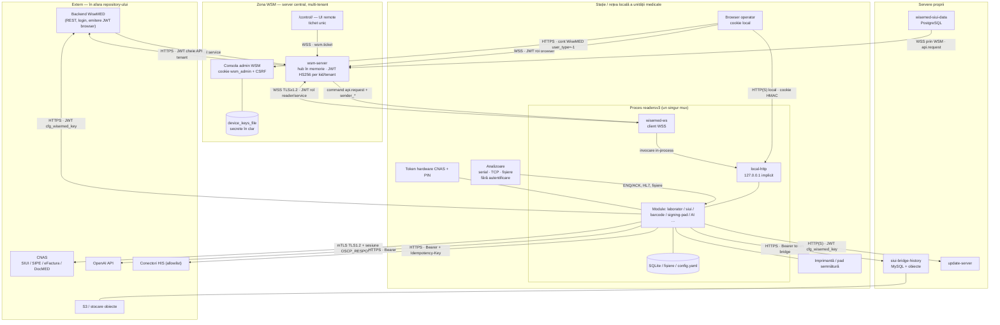

# Securitate și identitate

| | |
|---|---|
| **Scop** | Identități, autentificare, autorizare și limite de încredere pentru toate aplicațiile din repository; tipurile de credențiale și de ce nu sunt interschimbabile; constatările de securitate ale stării existente. |
| **Data** | 2026-11-14 (checkout local `main`, HEAD `d53088e`) |
| **Surse** | `_reports/02-wsm-security.md`, `_reports/03-laboratory.md`, `_reports/04-cnas-siui.md`, `_reports/05-utilities-ai.md`, `_reports/01-runtime-and-apps.md` (§2–§3), `_reports/06-qa-build-ops.md` (§A.4, §B — fișiere urmărite în git și rezultate de test); rezoluțiile orchestratorului și verificări punctuale, doar citire, în cod (marcate „verificat la redactare”). |
| **Limite** | Descrie **starea existentă**; nu este un audit de penetrare și nu a rulat nimic. Constatările nu sunt însoțite de remedieri — acestea apar numai în secțiunea finală „Propuneri (neimplementate)”. Backendul WiseMED, CNAS, endpointul de token WSM din WiseMED și aplicația Flutter sunt externe. Configurațiile runtime reale, registrul de device-uri, bazele de date și fișierele de chei **nu** au fost deschise; nicio valoare secretă nu este reprodusă. |

**Etichete**: `[COD]` = CONFIRMAT DIN COD · `[TEST]` = CONFIRMAT PRIN TEST LOCAL (numai ce a rulat raportul 06 §B.1) · `[DOC]` = DOCUMENTAT, NEVERIFICAT · `[INF]` = INFERENȚĂ · `[NEC]` = NECUNOSCUT.

**Prescurtări de cale**: `R/` = `readersv3/` · `LH` = `readersv3/modules/localhttp/module.go` · `WS` = `readersv3/modules/ws/module.go` · `AB` = `readersv3/shared/apibridge/bridge.go` · `S/` = `wsm-server/internal/server/` · `C/` = `wsm-server/internal/config/` · `SI/` = `readersv3/modules/siui/` · `H/` = `readersv3/modules/siuihistory/` · `D/` = `readersv3/modules/siuidata/` · `AI/` = `readersv3/modules/wisemedai/`.

**Documente înrudite**: [api-catalog.md](api-catalog.md) (rute și autentificarea fiecăreia) · [communication-map.md](communication-map.md) · [end-to-end-flows.md](end-to-end-flows.md) · [data-and-state-machines.md](data-and-state-machines.md) · [runtime-and-modules.md](runtime-and-modules.md) · [application-catalog.md](application-catalog.md) · [build-deploy-update.md](build-deploy-update.md) · [verification-matrix.md](verification-matrix.md) · [gaps-and-contradictions.md](gaps-and-contradictions.md) · [agent-context.md](agent-context.md).

---

## Cuprins

1. [Identificatori și rolul fiecăruia](#1-identificatori-și-rolul-fiecăruia)
2. [Roluri: patru sisteme distincte](#2-roluri-patru-sisteme-distincte)
3. [Tipuri de credențiale](#3-tipuri-de-credențiale)
4. [`api.request`: invocare internă și maparea scope-urilor](#4-apirequest-invocare-internă-și-maparea-scope-urilor)
5. [Izolarea per tenant](#5-izolarea-per-tenant)
6. [Ordinea „înregistrare WiseMED → conexiune WSM”](#6-ordinea-înregistrare-wisemed--conexiune-wsm)
7. [Limite de încredere](#7-limite-de-încredere)
8. [Constatări de securitate (stare existentă)](#8-constatări-de-securitate-stare-existentă)
9. [Necunoscute](#9-necunoscute)
10. [Propuneri (neimplementate)](#10-propuneri-neimplementate)

---

## 1. Identificatori și rolul fiecăruia

Șase identificatori apar în plicurile WSM și în claim-uri. Au roluri diferite și nu se pot substitui unul altuia. `[COD]` (`S/auth.go:65-163`, `S/hub.go:50-68`, `S/server.go:246`)

| Identificator | Cine îl stabilește | De unde provine (autentificare verificată) | Rol | Ce **nu** este |
|---|---|---|---|---|
| `tenant_id` | emitentul JWT | claim; WSM îl forțează egal cu `Key.TenantID` al cheii selectate prin `kid` (`S/auth.go:117`); fixat pe `Connection.TenantID`, imuabil | granița de izolare; cheia de partiționare a hubului | nu este ales de client la rutare și nu poate fi furnizat în `hello` |
| `sub` | emitentul JWT (poate fi fixat de cheie, `S/auth.go:135-143`) | claim validat `ValidID` | identitatea principalului; ștampilat ca `sender_subject`; `Username` al sesiunii sintetice în reader (`LH:2572`); cheia de revocare a device-urilor | nu este rol și nu poartă drepturi |
| `client_id` | emitentul JWT; `hello.client_id` trebuie să coincidă | claim | etichetă de sesiune/aplicație; **neunic** (mai multe sesiuni cu același `client_id`) | nu identifică o conexiune și nu este țintă de rutare |
| `equipment_id` | emitentul JWT | claim; pentru readere = `echipament_id` primit de la WiseMED la înregistrare | țintă de rutare `mode:"equipment"`; unic per `(tenant, equipment_id)` la `Register` (`S/hub.go:66`) | nu este identitatea locală a aplicației |
| `reader_id` | emitentul JWT | claim; identitatea locală a aplicației (`ReaderID`) | țintă `mode:"reader"`; unic per `(tenant, reader_id)`; prefixul topicurilor permise readerului | nu este secret (apare neautentificat în `GET /api/session`, `LH:652,2724`) |
| `connection_id` | **serverul WSM** | 16 bytes aleatori hex la fiecare conexiune (`S/hub.go:50-56`) | identifică socketul; ținta reply-urilor; se schimbă la fiecare reconectare | nu este stabil; nu poate fi folosit ca identitate persistentă |

Reguli asociate `[COD]`:

- Rolurile `reader` și `service`-cu-`reader_id` cer `equipment_id` și `reader_id` valide; alte roluri nu pot purta `reader_id` (`S/auth.go:144-153`).
- La `dispatch`, WSM **suprascrie** în payload `sender_connection_id`, `sender_ip`, `sender_client_type`, `sender_client_id`, `sender_reader_id`, `sender_tenant_id`, `sender_subject`, `sender_scopes` (`S/server.go:548-565`); valorile trimise de client sunt înlocuite. Test în suita trecută: `S/server_test.go:570` `[TEST]` (06 §B.1 r.7).
- `request_id` / `correlation_id` sunt identificatori de corelare pe socket, nu de identitate și nu de idempotency (nu sunt persistați nicăieri — 04 §6.2).

Identificatori derivați, în afara WSM:

| Identificator | Unde | Formare | Referință |
|---|---|---|---|
| `owner` (SIUI bridge) | `siui_calls`, `siui_jobs` | `"local:"+subject` (cookie); valoare semnată în JWT local; `wsm:"<tenant>":"<subject>"` (principal WSS) | `SI/module.go:249-277` `[COD]` |
| `(tenant, bridge)` (History) | index MySQL, chei de obiecte | fixat de tokenul Bearer al bridge-ului; bridge-ul nu își poate alege identitatea | `H/module.go:127-143` `[COD]` |
| `external_subject` (WiseMED AI) | `wai_memberships` | mapare explicită: `"wisemed:<UserID>"` sau `sub` WSM; `UNIQUE(tenant, external_subject)` | `AI/auth.go:50-53,108-127` `[COD]` |
| `cui` (SIUI Data) | `client_jwt_secrets[cui]`, claim `cui`, antet `kid` | cheie per furnizor | `D/clients_auth.go:51-79` `[COD]` |
| `kid` | antet JWT WSM / formatter / SIUI Data | selectează secretul; în WSM leagă cheia de un singur tenant | `S/auth.go:90-100` `[COD]` |

---

## 2. Roluri: patru sisteme distincte

Rolurile de mai jos trăiesc în sisteme diferite și **nu se traduc automat** unul în altul, cu o singură excepție documentată la §4 (`api:admin` → admin local).

| Sistem | Valori | Unde este stabilit | Unde este verificat | Ce controlează |
|---|---|---|---|---|
| **`role`** (claim JWT WSM) | `browser`, `reader`, `service` | emitentul JWT; trebuie să fie în `Key.Roles` (`S/auth.go:129`, `C/config.go:257-261`) | `authorizeMessage` (`S/server.go:387-528`), `commandHTTP` (rol `service`/`browser`) | ce tipuri de mesaje și ținte poate folosi conexiunea |
| **`client_type`** (din `hello`) | `browser`, `reader`, `service`, `siui-bridge`, `siui-bridge-history` | clientul, în `hello` | trebuie să fie egal cu `role`, sau `siui-bridge`/`siui-bridge-history` pentru `service` (`S/auth.go:168-173`) | etichetă de discovery (`?client_type=`); **nu este claim** și nu acordă drepturi |
| **Scope-uri WSM** (claim `scopes`) | `route:command`, `route:reply`, `route:event`, `route:broadcast`, `topics:subscribe`, `connections:read`, `server:status`, `wisemed:proxy`, `devices:debug`, `api:invoke`, `api:admin` (`C/config.go:90-96`) | emitentul JWT; ⊆ `Key.Scopes` (un scope în plus respinge tot tokenul, `S/auth.go:132,154-160`) | WSM per mesaj; readerul verifică local doar `api:invoke` și derivă `Admin` din `api:admin` (`WS:517-528`) | capabilități de rutare și de invocare |
| **Roluri locale** (`UserType`) | întreg venit de la WiseMED la login; `<= 0` = admin | backendul WiseMED (extern), la `POST /api/session/login` | `requireSession` (orice sesiune) și verificări punctuale `UserType <= 0` (`R/modules/localhttp/debug_replay.go:21-34`, `R/modules/localhttp/wss.go:41-44`, `LH:563-566`) | accesul la UI/API local; în SIUI bridge, History, SIUI Data: `admin` |
| **Roluri clinice AI** | `wai_memberships.role` ∈ `admin`/`doctor`/`viewer`; `wai_users.instance_admin` | baza WiseMED AI (CHECK în `AI/migrations/001_core.sql`) | `AI/auth.go:231-245` și handlerii | accesul la date clinice, șabloane, administrare AI |
| `admin` (claim JWT local SIUI) | bool | `SI/auth.go:92-109`, moștenit din sesiunea emitentă | `SI/auth.go:58-91` | operații `mutating`, setări, PIN |
| `user_type == -1` (consola admin WSM) | — | răspunsul WiseMED la `PUT /administrative/login` | `S/admin.go:247-304` | login în consola admin WSM |
| `allowed_user_types` (update-server) | listă configurabilă (șablon „1,9,10”; implicit în cod `-1`) | config | `R/modules/appupdateserver/module.go:2110` | login în consola update-server |

Observații `[COD]`:

- Rolurile sunt **grosiere**: în `local-http` nu există permisiuni per rută în afara verificării de admin pentru debug și WSS — orice utilizator autentificat poate șterge comenzi, corecta ID-uri și trimite în buletin (03 §9.1).
- În interiorul unui tenant WSM **nu există ACL** per utilizator/pacient/echipament: orice principal cu `route:command`+`api:invoke` poate apela API-ul oricărui echipament din tenant (02 §11).
- Cheile generate din consola admin primesc roluri duble: device → `reader, service` (`C/devices.go:194`); browser → `browser, service` (`C/access.go:161`).
- Clientul din readere se anunță cu rol `service` doar pentru protocoalele `siui`/`siui-history`; toate celelalte aplicații — inclusiv `wisemed-siui-data` și `wisemed-ai` — folosesc `reader` (`WS:694-712`, verificat la redactare).

---

## 3. Tipuri de credențiale

### 3.1 Tabel

| # | Credențial | Emitent | Material de semnare / stocare | Verificat de | Durată | Protejează | De ce nu este interschimbabil |
|---|---|---|---|---|---|---|---|
| 1 | **JWT WSM** | backend WiseMED (extern) / readerul însuși în `auth_mode: device_key` / `wsmctl` | HS256; secret per `kid`, legat de un singur tenant; ≥ 32 bytes; două tenanturi nu pot împărți un secret (`C/config.go:241-287`) | `authenticate` (`S/auth.go:65-163`): `alg`, `kid`, `exp`, `iat`, `aud`, `iss`, `tenant_id`, `role`, `scopes`, restricții de cheie | `0 < exp-iat ≤ max_token_ttl_seconds` (900 implicit); readerul semnează 5 min | accesul la hubul WSM | `aud=wsm-server` (implicit), `iss` al tenantului și cheia `kid` există doar în config/registrul WSM; nu ajunge niciodată la reader ca atare — readerul vede doar `sender_*` |
| 2 | **Tichet de control** | WSM, la `control.ticket` | 32 bytes aleatori, în memorie; max 1024 | `S/control.go:24-92`; subprotocol `wsm.ticket.<ticket>`; Origin = `https://<Host>` | 1 min până la consum, **o singură utilizare**; sesiunea rezultată ≤ 5 min și ≤ `exp` al părintelui | o sesiune `browser` restrânsă la `ping` + `api.request` către **un** echipament | nu este JWT; nu poate delega; invalid după schimbarea `authEpoch`; `api:admin` doar dacă părintele îl are |
| 3 | **Cookie local reader** `wmr_local_session_<sha256(ReaderID)[:6]>` | readerul, după login la WiseMED | `payload.semnătură` HMAC-SHA256, validat **fără stare pe server** (`LH:2672-2710`); cheia: `"wisemed-local-session:" + ReaderID` (`LH:2660-2665`) | `currentSession` (`LH:2566-2593`) | 12 h | UI/API local al readerelor de laborator | numele cookie-ului și cheia depind de `ReaderID`; nu este acceptat de WSM sau de alt reader cu alt `ReaderID` |
| 4 | **Cookie / sesiune utilitare** (același nume și format ca #3) | utilitarul, după login la WiseMED | aceeași schemă HMAC, dar cheia este `utilitySessionKey` — 32 bytes aleatori **per proces** — pentru protocoalele `siui`, `siui-history`, `siui-data` și utilitarele login-only (`LH:202-203,2660-2664`) | idem | 12 h; invalidat de restartul procesului | UI/API local al SIUI bridge, History, SIUI Data, html-print-formatter, wisemed-ai (partea `local-http`) | cheie aleatorie în memoria procesului |
| 5 | **JWT local SIUI** | `POST /api/siui/auth/token` (doar cu cookie sau principal WSS; un JWT nu poate emite alt JWT) | HS256; `m.jwtKey` 32 bytes aleatori per proces (`SI/module.go:118-121`) | `verifyJWT` (`SI/auth.go:58-91`): `iss=siui-bridge`, `aud=siui-api`, `exp-iat ≤ 900`, ≤ 8192 octeți; refuzat fără TLS | ≤ 900 s; invalidat de restart | exclusiv `/api/siui/` și `/api/siui-history-sync/` | alt `iss`/`aud`/cheie decât WSM; fără scope-uri (doar `admin`, `owner`) |
| 6 | **Sesiunea „OCSP” CNAS** | CNAS, la `GET {base_url}/OCSP/validator` (mTLS + Basic) | valoarea antetului `OSCP_RESPONSE`; doar în memorie (`Module.ocspSession`) | serverele CNAS | reutilizată ≤ 150 s per configurație (`SI/ocsp_session.go:11,24`) | apelurile către CNAS | secret CNAS, nu al bridge-ului; nu autentifică nimic local; termenul „OCSP” nu înseamnă verificare de revocare (04 §4.4) |
| 7 | **Token Bearer History** | `POST /api/history/keys {bridge}` (admin) | 32 bytes aleatori hex, întorși o singură dată; în config doar `sha256(token)` + `(tenant, bridge)` | comparație în timp constant (`H/module.go:127-143`) | fără expirare | încărcarea și citirea arhivei de către un bridge | token opac, nu JWT; fixează `(tenant, bridge)`; nu conferă admin |
| 8 | **JWT SIUI Data** | `POST /api/siui-data/auth/token` (browser local admin) sau emitent extern cu cheia per CUI | HS256; cheie globală din env (`jwt_secret_env`, ≥ 32 octeți) sau aleatorie per proces; chei per client `client_jwt_secrets[cui]` selectate prin `kid` | `D/module.go:219-240`, `D/clients_auth.go:51-79`: `iss=wisemed-siui-data`, `aud=siui-data-api`, ≤ 15 min, doar HTTPS | ≤ 15 min | `/api/siui-data/*`; JWT de CUI: doar GET/HEAD pe serviciile țintite ale propriului CUI | `iss`/`aud` proprii; cheile client trebuie să difere de cea globală; refuzat pe rutele interne |
| 9 | **Sesiuni / tokenuri WiseMED AI** | `POST /v1/auth/login` | token opac 64 hex; în DB doar SHA-256 (`wai_auth_sessions`); cookie `wai_session` (HttpOnly, SameSite=Strict) **și** token în body | `AI/auth.go:66-160` | 8 h | `/v1/*` | token opac, legat de `(tenant, user)` din `wai_memberships`; tokenul WiseMED folosit la login **nu** devine bearer AI |
| 9a | Grant browser-speech (AI) | `POST /v1/browser-speech` | `Authorization: Browser <token>`; legat de sesiunea de login | `browserSpeechBridge` | 7200 s | doar `/v1/browser-speech/bridge` | schemă `Browser`, nu `Bearer` |
| 9b | Token de pairing (AI) | `POST …/pairing` | consum unic (`DELETE … RETURNING`) | `redeem` | 120 s | atașarea unui dispozitiv la o sesiune clinică | unic, de scurtă durată |
| 10 | **JWT API WiseMED** | fiecare reader, **per cerere** | HS256 cu `cfg_wisemed_key` — secret simetric **partajat** între instalări; claims `caller_id`, `caller_type`, opțional `lt`, `login_user_id` (`R/modules/wisemedapi/module.go:1465-1493`) | backendul WiseMED (extern) `[NEC]` | 5 min | apelurile REST către WiseMED | adresat API-ului WiseMED; fără `tenant_id`/`aud` WSM |
| 10a | `login_token` WiseMED (`lt`) | WiseMED, la `PUT /administrative/login` | persistat în `config.yaml` (`module.go:322-327,607`); pe sesiune doar în memorie (`sessionAuth`, `LH:2558-2561`) | backendul WiseMED | `[NEC]` | acțiuni în numele operatorului (trimitere în buletin) | credențial al utilizatorului WiseMED, nu al readerului |
| 11 | **JWT update-server** | orice aplicație bazată pe `runner` | HS256 cu **același** `cfg_wisemed_key`; claims `app_id`, `scopes:["check","download"]`, `exp` +10 min (`R/shared/appupdates/appupdates.go:84-89`) | `R/modules/appupdateserver/module.go:2120-2141` | 10 min | `POST /api/public/check-update` | vezi constatarea F-07: cheia este comună cu #10 |
| 11a | Token de download update | update-server, la `check-update` | în memorie, în query string | `handlePublicDownload` | 15 min, unică folosință | un artefact | nu este legat de JWT |
| 11b | Cookie admin update-server `wmr_update_server_session` | update-server, după login WiseMED | sesiune în memorie | modul | 12 h | `/api/update-server/*` | — |
| 12 | **Cookie admin WSM** `wsm_admin` | WSM, după login validat la WiseMED (`user_type == -1`) | token aleator 32 bytes; în memorie ca `sha256`; `Path=/admin; HttpOnly; SameSite=Strict; Secure` pe HTTPS (`S/admin.go:242-244,305-311`) | `S/admin.go` + `X-CSRF-Token` | `session_ttl_seconds` (900; 60..3600) | `/admin/api/*`, legat de **un** tenant | nu este acceptat pe `/ws` sau `/api/connections`; niciun scope WSM nu îl poate obține |
| 13 | JWT html-print-formatter | emitent extern sau `POST /api/html-print-formatter/token` (300 s) | HS256; `jwt_keys[kid]` ≥ 32 octeți | `R/modules/htmlprintformatter/auth.go:18-46`: `iss`=`aud`=`html-print-formatter` | emitentul decide; token local 300 s | `/render*`, `/pdf`, `/api/html-print-formatter/*` | `iss`/`aud` proprii |
| 14 | Certificat client CNAS + PIN | autoritate de certificare; token hardware | cheia privată rămâne pe token (magazin Windows, Keychain/CryptoTokenKit, PKCS#11); PIN criptat local (AES-256-GCM / DPAPI) | CNAS (mTLS) | durata certificatului | conexiunile către CNAS | nu este exportabil; nu există variantă „din fișier” (04 §4.1) |
| 15 | Token de conector HIS (AI), cheie OpenAI | administratorul AI | criptat în `wai_*` / fișier 0600 | sistemul extern | — | apeluri ieșite | secrete ale terților |

### 3.2 De ce nu sunt interschimbabile (sinteză)

`[COD]` pentru partea din repo:

1. **Chei diferite.** Fiecare credențial semnat are propria cheie: per `kid` în WSM; aleatorie per proces la JWT-ul local SIUI și la cookie-ul utilitarelor; din env sau per CUI la SIUI Data; `jwt_keys` la formatter. Un token semnat pentru un sistem eșuează la verificarea semnăturii în altul.
2. **`iss`/`aud` diferite** (`wsm-server` · `siui-bridge`/`siui-api` · `wisemed-siui-data`/`siui-data-api` · `html-print-formatter`). Un JWT WSM prezentat ca `Bearer` pe HTTPS-ul local al bridge-ului eșuează la `verifyJWT` (04 §3).
3. **JWT-ul WSM nu traversează hubul.** Readerul primește doar câmpuri `sender_*`; nu poate re-prezenta tokenul apelantului nicăieri.
4. **Tokenurile opace** (History, AI, tichet, admin WSM) sunt căutate într-un depozit propriu (hash în config / DB / map în memorie); nu au semnificație în afara lui.
5. **Legare de identitate locală.** Cookie-ul local depinde de `ReaderID`; tichetul de un echipament; tokenul History de `(tenant, bridge)`; JWT-ul de CUI de un singur furnizor.

Excepții — locuri unde aceeași cheie servește două scopuri (vezi §8): `cfg_wisemed_key` semnează atât JWT-ul API WiseMED, cât și JWT-ul update-server; în `auth_mode: device_key`, readerul poate semna JWT-ul WSM cu `api_key_echipament` primit de la WiseMED (`WS:717-761`).

---

## 4. `api.request`: invocare internă și maparea scope-urilor

### 4.1 Nu este proxy

`api.request` construiește un `http.Request` în memorie și apelează `handler.ServeHTTP` pe **același** `*http.ServeMux` pe care îl servește `local-http` (`AB:51-162`, `WS:512-533`, `R/core/runtime/runtime.go:77-95`). Nu se deschide nicio conexiune de rețea și niciun host din cerere nu este folosit. `[COD]`; cap-coadă `[TEST]` (06 §B.1 r.10).

Consecințe:

- Nu se transmit cookie-uri sau antete de la apelant; `RemoteAddr = "wss:<connection_id>"`.
- Rutele excluse sunt cele care ar permite escaladare sau recursivitate: `/api/wss/bridge*`, `/api/wss/open`, `/api/wss/debug`, `/api/session/login`, `/api/session/logout` (`AB:63-65`).
- Orice rută `/api/…` neprotejată local este neprotejată și prin WSS — dar ajunge acolo doar un apelant cu `api:invoke`.

### 4.2 Maparea scope → sesiune locală

`currentSession` (`LH:2566-2573`) tratează orice cerere cu principal ca **sesiune autentificată**: `ID="wss:<conn>"`, `Username=sub`. `[COD]`

| Scope al expeditorului | În reader | Acordă | **Nu** acordă |
|---|---|---|---|
| `route:command` (fără `api:invoke`) | — | comenzi de dispatcher (`reader.status`, `device.ping`, `ws.reconnect`, `barcode.*`, `esignature.*`) pentru roluri `browser`/`service` | `api.request` |
| `api:invoke` | `UserType = 1` (utilizator local autentificat, non-admin) | toate rutele `/api/…` cu `requireSession`; emiterea `control.ticket`; în SIUI: operațiile de citire, cu `owner = wsm:"tenant":"subject"` | rutele care cer admin local; login/logout; `/api/wss/{open,debug,bridge}` |
| `api:invoke` + `api:admin` | `UserType = 0` (admin local) | `/api/wss/settings`, `/api/wss/control`, `/api/debug/tests*`; în SIUI: operații `mutating`, `settings`, `token-pin`, `general/ocsp`; în History: administrare (dacă tenantul coincide) | vezi mai jos |

**Ce nu acordă `api:admin`** `[COD]`:

1. **Drepturi clinice în WiseMED AI.** `Principal.Admin` este populat din scope (`WS:528`), dar modulul `wisemedai` nu îl citește niciodată (grep `\.Admin\b` în `AI/*.go` → 0 rezultate; singurele utilizări `PrincipalFrom`: `AI/auth.go:50`, `AI/events.go:13`). Rolul vine exclusiv din `wai_memberships.role` și `wai_users.instance_admin`. Fără mapare `external_subject`, un principal WSM valid primește 401; iar identitatea WSM este acceptată doar cu `wsm_identity_enabled`. Testele de izolare (`AI/integration_test.go:262-290`) cer PostgreSQL și au fost **sărite** în rularea locală — nu sunt `[TEST]`.
2. **Login în consola admin WSM.** Aceea cere un cont WiseMED cu `user_type == -1`, validat la upstreamul tenantului, și produce cookie-ul `wsm_admin` (`S/admin.go:247-304`). Niciun scope nu duce acolo.
3. **Acces la alt tenant** sau modificarea configurației WSM.
4. **Tokenul de login WiseMED al unui operator.** Pe calea WSS `sessionAuth{}` este gol (`LH:2596-2599`); handlerii care au nevoie de `lt` nu îl au `[INF]`.
5. **Rutele interne SIUI Data** (`/siui-data-clients`, `/keys`, …): nici Bearer, nici principal WSS (`D/clients_auth.go:84-93`).
6. **Ocolirea JWT-ului la formatter nu depinde de `api:admin`**: orice principal WSS trece (`R/modules/htmlprintformatter/auth.go:19-21`).

### 4.3 Verificări pe care readerul nu le face

- Readerul **nu** compară `sender_tenant_id` cu propriul tenant; se bazează pe izolarea WSM (`WS:517-528`). Unele module o fac explicit: `H/module.go:148-162`. `[COD]`
- Readerul crede `sender_scopes` fără verificare proprie; încrederea se sprijină pe conexiunea TLS autentificată cu WSM. `[COD]`/`[INF]`

---

## 5. Izolarea per tenant

### 5.1 În WSM

| Punct | Mecanism | Referință |
|---|---|---|
| Autentificare | `claims.tenant_id == Key.TenantID`; secrete distincte între tenanturi | `S/auth.go:117`, `C/config.go:280-282` |
| Conexiune | `Connection.TenantID` fixat din claims, imuabil | `S/server.go:246` |
| Rutare | `hub.route` filtrează `c.TenantID == tenant` înaintea oricărui predicat | `S/hub.go:152-160` |
| Listări / prezență / statistici | `Snapshot(tenant)`, `Stats(tenant)`, `Broadcast(tenant, …)` | `S/hub.go:98-120` |
| Unicitate reader/echipament | comparată doar în același tenant | `S/hub.go:66` |
| Wrapper HTTP | `peer.TenantID != claims.TenantID` ⇒ 404 | `S/http_commands.go:131-141` |
| Tichete | moștenesc `TenantID` al părintelui | `S/control.go:47` |
| Upstream WiseMED | `cfg.Tenants[claims.TenantID]`; nu poate fi furnizat de client | `S/server.go:209,365`, `S/wisemed.go:55-71` |
| Consola admin | toate operațiile filtrează pe `sess.TenantID` | `S/admin.go`, `S/admin_access.go` |
| Loguri | filtrare pe `tenant=` | `wsm-server/internal/logstore/store.go:134-141` |
| Topicuri | abonații filtrați pe tenant ⇒ același nume de topic este izolat | `S/hub.go:144,156` |

Toate `[COD]`. Nu s-a găsit nicio cale de date/rutare între tenanturi; testele `TestHubTenantIsolationEveryRoute` (`S/hub_test.go:14`), `S/http_commands_test.go:68`, `S/server_test.go:168` fac parte din suita WSM trecută cu 0 teste sărite `[TEST]` (06 §B.1 r.7–8). Efectele laterale între tenanturi (disponibilitate, metadate) sunt la §8: F-05, F-06, F-12, F-15.

### 5.2 În aplicațiile din spatele WSM

| Aplicație | Mecanism | Referință | Etichetă |
|---|---|---|---|
| SIUI bridge | `owner = wsm:"<tenant>":"<subject>"`; `UNIQUE(owner, operation_id)`; citirile doar pentru proprietar (admin local vede tot în `operations*`/`dashboard`) | `SI/module.go:249-277` | `[COD]`; `TestWSMIssuedJWTRetainsTenantIsolation` în suita trecută `[TEST]` la nivel de suită |
| History | tokenul bridge-ului fixează `(tenant, bridge)`; PK `(tenant, bridge, call_id)`; principal WSS acceptat doar cu tenant identic | `H/module.go:127-162,214-224` | `[COD]` |
| SIUI Data | nomenclatoare publice vs tabele `siui_client_*` per CUI; JWT de CUI limitat la CUI-ul propriu | `D/clients_schema.go:3`, `D/clients_auth.go:51-79` | `[COD]` |
| WiseMED AI | fiecare interogare clinică filtrează `tenant_id` **și** `user_id` (`loadSession`, `AI/sessions.go:30`); `instance_admin` vede toate organizațiile în `/v1/admin/sessions` (`AI/admin_sessions.go:126`); criptare pe câmp cu AAD = `tenant:session[:chunk]` | `AI/crypto.go:46-79` | `[COD]`; testele PostgreSQL sărite |
| Readere de laborator | **un singur tenant per instalare** — fără noțiune de tenant în SQLite; orice principal admis de WSM în tenant are acces | 03 §3, 02 §11 | `[COD]` |
| html-print-formatter, barcodeprinter, signing-pad | fără verificare de tenant la nivel de modul | 05 §2–§4 | `[COD]` |

---

## 6. Ordinea „înregistrare WiseMED → conexiune WSM”

Regula (`Start`/`runSession`, `WS:255-461`) `[COD]`:

1. clientul WSS pornește doar dacă `enabled != "false"` și `url` este nevid; altfel fază `disabled`;
2. obține serviciul `wisemed-api` și apelează `EnsureEquipmentInitialized()` — adică `PUT /administrative/analyzer` la WiseMED (`R/modules/wisemedapi/module.go:332-355`); **eșec ⇒ nu se conectează**;
3. cere `echipament_id` nevid și ≠ `"0"` (`WS:356-359`);
4. abia apoi obține JWT-ul (`accessToken`, `WS:717-761`) și deschide socketul; după `hello_ack` verifică `ack.equipment_id == echipament_id` local (`WS:394-410`).

Nu există mod „standalone” fără WiseMED pentru WSS. `[COD]` De ce contează ordinea: `equipment_id` din claim este ID-ul emis de WiseMED la înregistrare, iar în `auth_mode: device_key` secretul de semnare poate fi chiar `api_key_echipament` primit atunci.

Sursa JWT-ului, pe `auth_mode`:

| Mod | Sursă | Observație |
|---|---|---|
| `device_key` (implicit) | readerul își semnează singur un JWT HS256 de 5 min cu `device_secret` → `secret_file` → `api_key_echipament` | WSM închide socketul la `exp` (`S/server.go:265`); vezi F-14 |
| `token_file` | conținutul fișierului, citit la fiecare încercare | emitentul este extern |
| `token_endpoint` | `POST <WiseMED>/<token_path>` autentificat cu JWT-ul API WiseMED | endpointul din WiseMED este **extern** `[NEC]`; PHP-ul local expune `GET /wsm/token` (metodă diferită) |

**Excepții** `[COD]`:

| Caz | Comportament | Referință |
|---|---|---|
| Aplicații „login-only” (`html-print-formatter`, `wisemed-ai`) | sar peste înregistrare (`registration_skipped`), dar tot au nevoie de un `echipament_id` în setări pentru WSS. Cum ajunge acel ID acolo: `[NEC]` (indiciu: `R/modules/localhttp/siui_session_test.go:39 TestHistoryUsesEquipmentSetup`) | `R/modules/wisemedapi/module.go:346-348` |
| `wisemed-ai` standalone | `wisemed_ws.enabled:false`, `wsm_identity_enabled:false` în șablon ⇒ fără WSM; singura dependență dură este PostgreSQL | 05 §1.6 |
| `wisemed-siui-data` | asistentul de configurare cere explicit identitatea de echipament WiseMED/WSM înainte de pornire | `R/apps/runner/siui_data_setup.go:27-43` |
| `update-server` | nu încarcă `wisemed-ws` deloc | `R/apps/update-server/main.go:57` |
| Sesiuni `browser` și `service` externe | nu trec prin înregistrare de echipament; JWT emis de backendul WiseMED (extern) | 02 §9 |
| Sesiuni de control | intră cu tichet, fără JWT propriu | `S/control.go` |
| `EnsureEquipmentInitialized` a eșuat la pornire | nu se reîncearcă până la următorul login/import; WSS reîncearcă la fiecare sesiune (30 s) | 03 §5.3, 02 §14 r.1 |

---

## 7. Limite de încredere

Limitele și ce le traversează:

| Limită | Ce o protejează | Ce se presupune de încredere dincolo de ea |
|---|---|---|
| Internet ↔ WSM | TLS ≥ 1.2, JWT per `kid`/tenant, Origin, limite de rată și conexiuni | emitentul JWT (backendul WiseMED) atribuie corect scope-urile `[NEC]` |
| WSM ↔ proces reader | conexiune WSS inițiată de reader, TLS cu verificare (CA opțional `ca_file`) | readerul crede `sender_*` și `sender_scopes` ștampilate de WSM |
| Browser local ↔ `local-http` | bind implicit pe loopback; cookie HMAC; CORS | **oricine ajunge la portul local** este în interiorul limitei pentru rutele fără sesiune și, la readerele de laborator, pentru toate (F-01) |
| Analizor ↔ reader | nimic (fără autentificare, TLS sau allow-list) | rețeaua locală și cablul serial |
| Reader ↔ WiseMED | HTTPS (sau HTTP „legacy”), JWT cu cheie partajată | backendul validează JWT-ul și autorizează fișa × echipament `[NEC]` |
| Bridge ↔ CNAS | mTLS cu cheie pe token hardware; validarea certificatului de server de către platformă | CNAS |
| Bridge ↔ History | HTTPS, token Bearer per bridge | History nu are încredere în identitatea declarată de bridge — o derivă din token |
| Aplicație ↔ update-server | JWT cu cheie partajată; checksum opțional | update-serverul și canalul de transport (F-08) |
| `bindguard` | **nu este o limită de securitate** — tratează doar „address already in use” și rescrie portul în `config.yaml` (`R/shared/bindguard/bindguard.go:14-77`) | — |

---

## 8. Constatări de securitate (stare existentă)

Fiecare constatare descrie ce face codul astăzi, cu dovadă și etichetă. Ordinea este tematică, nu de severitate. Nicio constatare nu a fost exploatată sau reprodusă prin rulare, dacă nu se precizează altfel.

### 8.1 Sesiuni și rute locale

**F-01 — Cheia HMAC a cookie-ului local este predictibilă la readerele de laborator.** `[COD]`
`sessionSecret()` (`LH:2660-2665`, verificat la redactare) întoarce `utilitySessionKey` (aleator, per proces) doar pentru protocoalele `siui`, `siui-history`, `siui-data` și utilitarele login-only; pentru toate celelalte aplicații întoarce `"wisemed-local-session:" + ReaderID`. Tokenul este `payload.semnătură` HMAC-SHA256 și este validat **fără stare pe server** (`LH:2672-2710`); `currentSession` acceptă orice token cu semnătură validă și `ExpiresAt` în viitor, fără a consulta `m.sessions` (`LH:2578-2580`). `ReaderID` apare neautentificat în `GET /api/session` (`LH:652,2724`).
Consecințe `[INF]`: oricine poate ajunge la portul local poate construi un cookie valid, inclusiv cu `UserType` de administrator; `logout` nu invalidează tokenul (șterge doar intrarea din map și cookie-ul din browser); sesiunile rămân valide după repornire. Testul `R/modules/localhttp/siui_session_test.go:26-34` numește cheia veche „predictable legacy signing key” și verifică respingerea ei doar pentru SIUI/formatter.

**F-02 — Cookie-ul local nu are atributul `Secure`; login-ul local nu are rate limiting.** `[COD]`
`Path=/; HttpOnly; SameSite=Lax`, fără `Secure` (`LH:1158-1165`). Nu s-a găsit limitare a încercărilor pe `POST /api/session/login` (`LH:1106-1170`).

**F-03 — Rute locale care modifică starea fără sesiune.** `[COD]`

| Rută | Efect | Referință |
|---|---|---|
| `PUT /api/wisemed/setup` | rescrie configurarea WiseMED; sesiunea se cere doar la utilitarele login-only deja configurate | `LH:239,1188-1194` |
| `PUT /api/settings/astm-specimens` | rescrie `config.yaml` (`protocol-astm.specimen_code_*`) | `R/modules/astmspecimen/module.go:24,33-63` |
| `PUT /api/protocol/labnovation-ld560/settings` | schimbă modul/host/port și repornește comunicația cu analizorul | `R/modules/protocols/labnovationld560/module.go:80,298` |
| toate rutele barcodeprinter, inclusiv `PUT /api/barcode/settings` și tipărirea | tipărire; rescrie `config.yaml`; poate schimba adresa/TLS listenerului | `R/modules/barcodeprinter/module.go:71-82` (doar `withCORS`); `auth_username`/`auth_password` există doar în formularul UI |
| `POST /api/signing-pad/capture` | pornește captura; PNG pe disc | CORS `*` implicit (05 §4) |
| `POST /api/esignature/command`, WS `/ws` | comandă pad-ul; verificare doar de `Origin` (Origin absent = permis) | `R/modules/signingpad/websocket.go:28-54` |

Rute locale de citire fără sesiune `[COD]`: `GET /api/docsmart/parsed-files` (metadate financiare + căi complete pe disc, `R/modules/protocols/anafdocsmart/module.go:51-54`); `GET /api/wisemed/bootstrap`; `GET /api/app-update/status` (declanșează și verificări la update-server, `LH:243`); `GET /api/protocol/astm/status` (host/port); `GET /api/protocol/horiba-abx-pentra400/query-status` (interogări per ID de probă); `GET /api/barcode/jobs` (jurnal cu nume de pacient); toate rutele `/meta`, `/api/menu`, `/api/modules`.

Pagini HTML fără middleware `[COD]`: `/history-sync-ui` (`SI/history_sync.go:61-64`), `/history-ui` (`H/module.go:80-83`). Conținutul lor nu a fost citit; presupunerea că sunt doar shell-uri UI este `[INF]`.

Context: bind-ul implicit este `127.0.0.1`, dar este configurabil; șabloanele pun `signing-pad-utility` pe `0.0.0.0:19110` și `update-server` pe `0.0.0.0:19090` (05 §0). Prin WSS aceste rute devin accesibile oricărui principal cu `api:invoke` din tenant.

**F-04 — CORS local cu credențiale și wildcard.** `[COD]`
Origini din `cors_allowed_origins` (implicit `https://ldse.wisemed.eu`); `*` este acceptat ca wildcard, cu `Access-Control-Allow-Credentials: true` și reflectarea antetelor cerute (`LH:213,464-523`).

### 8.2 WSM

**F-05 — `authEpoch` este global.** `[COD]`
`revokeTenantAccess` (`S/admin_access.go:347-363`) incrementează un singur contor (`S/server.go:26`) la orice schimbare de cheie browser, ștergere de origine sau setări de tenant. Efect asupra **altor** tenanturi: fiecare conexiune este închisă la următorul mesaj JSON pe care îl trimite (`S/server.go:311-314`, fără `presence`, cu pierderea acelui mesaj); apelurile `commandHTTP` în curs primesc 401/503; tichetele de control nefolosite devin invalide (`S/control.go:79`). Impact de disponibilitate, nu de confidențialitate.

**F-06 — `GET /admin/api/tenants` nu cere sesiune.** `[COD]`
Întoarce ID-urile tenanturilor cu upstream WiseMED configurat (`S/admin.go:125-138`); se aplică doar verificarea de Host/Origin a consolei.

**F-09 — Comenzile de dispatcher sunt protejate doar de `route:command`.** `[COD]`
Pentru expeditori `browser`/`service`, WSM nu filtrează numele comenzii (`S/server.go:437-442`), iar niciun handler din reader nu verifică scope-uri (`WS:506-551`). `api:invoke` protejează doar `api.request`. Deci `barcode.print`, `esignature.*`, `ws.reconnect`, `device.ping` sunt disponibile oricărui principal cu `route:command` din tenant.

**F-10 — Secrete în clar în `device_keys_file`.** `[COD]`
Registrul scriibil (`C/access.go:28-33`, `C/devices.go:216-259`) conține `devices[].secret`, `browsers[].secret` și `tenant_settings.api_key` în clar; fișier `0600`, scriere atomică. Consola admin le poate întoarce în clar prin `POST /admin/api/devices/key` și `POST /admin/api/browsers/key` (sesiune + CSRF).

**F-11 — Fără ACL în interiorul unui tenant; fără revocare individuală.** `[COD]`
Orice principal cu `route:command`+`api:invoke` poate apela API-ul oricărui echipament din tenant (02 §11). Nu există `jti` sau revocare per token (`S/auth.go`; `wsm-server/docs/protocol.md:76-77`); revocarea se face prin dezactivarea cheii + reload (care închide **toate** socketurile).

**F-12 — Linii de log fără marcaj de tenant, vizibile tuturor adminilor.** `[COD]`
`visible` (`wsm-server/internal/logstore/store.go:134-141`) arată unui admin liniile cu `tenant=X` propriu **și** toate liniile fără marcaj (ex. respingeri de autentificare cu `peer`/`origin`, `S/auth.go:48`). Fără rotație/ștergere automată a logurilor.

**F-13 — Readerul nu verifică `sender_tenant_id` și crede `sender_scopes`.** `[COD]`
`WS:517-528`. Izolarea se sprijină integral pe WSM și pe TLS; doar unele module verifică explicit (`H/module.go:157`).

**F-14 — Ciclul de 5 minute în `auth_mode: device_key`.** `[COD]` + `[INF]`
Readerul semnează JWT-uri de 5 min (`WS:717-761`); WSM închide socketul la `exp` (`S/server.go:265`); readerul nu reînnoiește tokenul pe conexiunea existentă și reîncearcă după o pauză fixă de 30 s (`WS:319`). Rezultă deconectări periodice și pierderea comenzilor în curs. Reconectarea reală după ~30 s a fost observată în testul de integrare `[TEST]` (06 §B.1 r.10); ponderea de indisponibilitate este `[INF]`.

**F-15 — Limite partajate și IP-ul din spatele proxy-ului.** `[COD]` / `[INF]`
`max_connections` global și rate limit-ul global de login admin sunt comune tuturor tenanturilor. Rate limit-ul per IP folosește `RemoteAddr`; în spatele unui proxy invers acesta este IP-ul proxy-ului `[INF]`.

**F-16 — Participant HTTP temporar și unicitatea echipamentului.** `[INF]`
Un apel `commandHTTP` făcut cu un JWT de device (rol `service`, cu `equipment_id`) ocupă pe durata lui „locul” acelui `equipment_id` la verificarea de unicitate (`S/hub.go:66`); o reconectare a readerului în acel interval ar fi respinsă.

### 8.3 Chei partajate și update

**F-07 — `cfg_wisemed_key` pre-completat în șabloane și prezent în `apis/mp-api/index.php`.** `[COD]`
Șabloanele `config.install.yaml` conțin o valoare pre-completată pentru `cfg_wisemed_key` (de ex. `R/apps/snibe-maglumi-x3/deployments/config.install.yaml`, secțiunea `wisemed-api`); aceeași valoare apare ca `_api_key` în `apis/mp-api/index.php:7,13`. **Valoarea nu este reprodusă aici.** Este un secret simetric HS256 partajat între instalări, fără rotație (`R/modules/wisemedapi/module.go:1465-1493`), și aceeași cheie semnează JWT-ul către update-server (`R/shared/appupdates/appupdates.go:84-89`). Consecință `[INF]`: oricine deține un pachet de instalare sau repository-ul poate semna JWT-uri acceptate de `check-update`; ce acceptă backendul WiseMED real cu această cheie este `[NEC]`.

**F-08 — Update fără semnătură și fără rollback; checksum opțional.** `[COD]`

| Aspect | Stare | Referință |
|---|---|---|
| Semnătura artefactului | inexistentă | `R/shared/appupdates/appupdates.go`, `R/apps/runner/update_apply.go` |
| Integritate | SHA-256 comparat **numai dacă** serverul trimite `checksum_sha256`; vine pe același canal ca fișierul | `R/apps/runner/updates.go:142` |
| Rollback | inexistent: fără backup al binarului vechi, fără verificare post-update | `update_apply.go:96-181` |
| Transport | `base_url` implicit în șabloane este `http://127.0.0.1:19090`; poate fi HTTP simplu | 05 §7 pct. 6 |
| `app_id` | cel din JWT nu este comparat cu cel din body | `R/modules/appupdateserver/module.go:706` |
| Descărcare | `handlePublicDownload` verifică doar tokenul din URL (unică folosință, 15 min), nu JWT-ul | 05 §7 pct. 2 |
| Aplicare Unix | așteaptă fix 1 s, copiază peste director și repornește cu `nohup`, inclusiv când aplicația rulează ca serviciu | `update_apply.go:162-181` |
| `make-release` | update-serverul rulează `go run ./tools/releasectl` pe sursele de pe disc | `appupdateserver/module.go:1322-1446` |

Extragerea ZIP validează path traversal (`update_apply.go:61-64`). Scriptul de test `R/docker/test-update.py` a eșuat pe hostul de verificare din motive de mediu, deci comportamentul updaterului Docker rămâne neverificat (06 §B.1 r.17).

### 8.4 Date personale și secrete la repaus

**F-17 — CNP/CID în clar în indexul MySQL History.** `[COD]`
`siui_history_details` are coloanele `pid`, `cid`, cu indexuri `(tenant, pid)` și `(tenant, cid)` (`H/module.go:219`), populate din `getInsured`/`getInsuredByCID` (`H/details.go:19-35`); sunt și criterii de filtrare în `GET /api/history/calls`.

**F-18 — XML-ul cererii păstrat în `siui_history_outbox.parameters`.** `[COD]`
Parametrii compleți ai fiecărei cereri (inclusiv XML și CNP) sunt scriși la rezervare (`SI/service_jobs.go:323-324`, `SI/jobs.go:96-97`) și serviți prin `GET operations/{id}/request` (`SI/operations_history.go:162-193`). Nu există niciun `DELETE FROM` în modulul `siui` — rândurile rămân pe termen nedefinit; SQLite-ul nu este criptat. Documentația afirmă contrariul (`R/apps/siui-bridge/docs/API.md:91`, `protocol.md:123`).

**F-19 — ZPL cu numele pacientului în log.** `[COD]`
`logPrintPayload` (`R/modules/barcodeprinter/module.go:509-517`) scrie ZPL-ul complet în clar și în base64. Jurnalul SQLite `barcode_print_jobs` păstrează și el `patient_name`, `file_id`, `client_ip`.

**F-20 — Date de pacient și tokenuri în fișiere locale necriptate (readere).** `[COD]`
`orders` (nume/ID pacient), răspunsul WiseMED complet în `orders.meta_json.sync_lookup` (nume, dată de naștere, sex — `R/modules/resultsync/module.go:422`), loguri la nivel 1 cu `sample_id`/`patient_id` și pachetul ASTM integral (`R/modules/protocols/astm/module.go:732,751`); la `verbose_level` 5, corpul răspunsurilor WiseMED și previzualizarea JWT (`R/modules/wisemedapi/module.go:675-709,1340-1396`). `login_token` și `login_user_id` sunt persistate în `config.yaml` (`:322-327,607`). Fără retenție automată.

**F-21 — Fișiere sensibile urmărite în git.** `[COD]` (`git ls-files`, 06 §A.4; numele verificate la redactare)
- `docs/signotec/WebSocketPadServer/serverkey.pem` (și `server.pem`) — un fișier de cheie privată al furnizorului este urmărit; **conținut neinspectat**.
- 15 fișiere `config.yaml` de runtime sunt urmărite (ex. `readersv3/output/*/deployments/config.yaml`, `wsm-server/output/deployments/config.yaml`, `output/wsm-browser-sdk/deployments/config.yaml`), deși `.gitignore` le exclude; conținut neinspectat pentru secrete `[NEC]`.
- Binare și backup-uri urmărite (`wsm-server/output/bin/WSM_Server*`), `readersv3/dist/**` inclusiv `.db` și `config.yaml`.

**F-22 — Tokenul sesiunii CNAS returnat în clar administratorului.** `[COD]`
`POST /api/siui/general/ocsp` include `token` în răspuns (`SI/service_jobs.go:114`); nu este persistat. În rest, licența și tokenul sunt redactate în erori și în `SOAPFault.xml` (`SI/operations.go:289-299`, `SI/docmed_fault.go`).

### 8.5 SIUI / CNAS

**F-23 — `POST /api/siui/certificates/refresh` nu cere administrator.** `[COD]` (`SI/module.go:338-343`), spre deosebire de `GET certificates`.

**F-24 — Verificarea de revocare a certificatului serverului CNAS depinde de platformă.** `[COD]`
WinHTTP și `SecTrust` (macOS) validează normal; pe transportul Go (`tokenHTTP` — Linux și Windows cu PIN salvat) nu se face verificare de revocare (`SI/token_transport.go:24-45`). Excepții configurabile: `allow_invalid_server_certificate_date` (doar expirarea) și `allow_revoked_server_certificate` (doar macOS). Suitele includ `TLS_RSA_WITH_AES_128/256_CBC_SHA` (`:47-52`).

**F-25 — Vechiul bridge C# ocolește validarea certificatului de server.** `[COD]`
`old-src/MedicalPAGES.SIUIBridge/MainForm.cs:118-143`. Nu este referit de niciun fișier Go/YAML; relevanță doar istorică.

### 8.6 Laborator

**F-26 — Listenerele de analizor nu au autentificare, TLS, allow-list sau limită de conexiuni.** `[COD]` (03 §1.4). Șablonul Zonci ascultă pe `0.0.0.0:3125`.

**F-27 — `?XDEBUG_TRIGGER=debug` este trimis în producție** pe `GET /fileforanalyzer/…` și pe cele două `PATCH` (`R/modules/wisemedapi/module.go:402-423,543-599`). `[COD]`

**F-28 — Transport „legacy” HTTP către WiseMED.** `[COD]`
Protocol `http` sau cale care conține `mp-api` ⇒ client fără keep-alive/compresie/proxy (`R/modules/wisemedapi/module.go:1138-1159`); JWT-ul și credențialele de login pot circula necriptat dacă `cfg_wisemed_protocol` este `http`.

### 8.7 Utilitare și WiseMED AI

**F-29 — html-print-formatter: orice principal WSS trece fără JWT; `html_link` fără restricție pe adrese interne.** `[COD]`
`R/modules/htmlprintformatter/auth.go:19-21`; Chromium încarcă direct `html_link` (05 §2). Suprafața este limitată de JWT, respectiv de `api:invoke` `[INF]`.

**F-30 — WiseMED AI: retenția șterge și rezultatele aprobate; cheia de criptare este un fișier local.** `[COD]` / `[INF]`
`retain` șterge sesiunile mai vechi de `retention_days` indiferent de status, în cascadă (`AI/store.go:97-108`). Pierderea fișierului-cheie face datele clinice irecuperabile `[INF]` (`AI/crypto.go:46-79`). Rate limit-ul de login este în memorie (`AI/auth.go:71-91`). `sameOrigin` acceptă cereri fără `Origin` dacă `Sec-Fetch-Site ≠ cross-site` (`AI/auth.go:161-167`).

**F-31 — Evenimentele WSM ale WiseMED AI sunt refuzate conform codului.** `[COD]` / `[INF]`
Aplicația rulează cu rol `reader` (`WS:707-712`), iar WSM respinge `event` cu `mode:"connection"` de la acest rol (`S/server.go:475`); `AI/events.go:28` → `R/modules/ws/events.go:12`. Nu este o breșă, ci o funcție inoperantă; neverificat la runtime.

**F-32 — Script de update WSM cu efecte înainte de validare.** `[COD]` (06 §B.3 pct. 4)
`wsm-server/update-wsm.sh:13-24` pornește `ssh-agent`, face `ssh-add` și rulează `sudo chown/chmod` înainte de `set -Eeuo pipefail` și de validarea argumentelor; agentul nu este oprit. Testul asociat nu a fost rulat (considerat riscant).

### 8.8 Ce este solid (pentru echilibru)

`[COD]`, cu `[TEST]` unde suita WSM a rulat:

- Verificarea JWT în WSM este strictă (algoritm fix, `kid` obligatoriu, `exp`/`iat`/`aud`/`iss`, scope-uri ⊆ cheie, TTL plafonat) și izolarea per tenant este aplicată înaintea oricărui predicat de rutare — acoperită de teste trecute `[TEST]`.
- Tichetul de control este de unică folosință, de scurtă durată, restrâns la un echipament și la două tipuri de mesaje; trece prin `postMessage`, nu prin URL.
- Consola admin WSM: Host/Origin stricte, CSRF în timp constant, cookie `HttpOnly; SameSite=Strict`, parola nestocată, „persist înainte de publicare”.
- SIUI bridge: cheia privată nu părăsește tokenul; PIN-ul nu este returnat niciodată și este criptat la repaus; redactare a licenței/tokenului în erori; descărcările acceptă doar aceeași origine HTTPS; parser XML defensiv (fără DTD).
- History: tokenul bridge-ului este stocat doar ca hash; identitatea `(tenant, bridge)` derivă din token.
- WiseMED AI: token de sesiune stocat doar ca hash; criptare pe câmp cu AAD; antetele HTTP nu pot falsifica identitatea; `api:admin` ignorat.
- `apibridge`: validare strictă a căii, excluderea rutelor de login/bridge, refuzul `text/html`, plafon de 4 MiB.

---

## 9. Necunoscute

- Ce scope-uri emite backendul WiseMED în producție și cui; dacă există endpointul de token WSS; cum validează JWT-ul semnat cu `cfg_wisemed_key`. `[NEC]`
- Configurația de producție a WSM (`allow_query_token`, `admin.enabled`, origini, `max_message_bytes`) și conținutul registrului de device-uri — necitite deliberat. `[NEC]`
- Dacă fișierele `config.yaml` și `serverkey.pem` urmărite în git conțin secrete reale — neinspectate. `[NEC]`
- Dacă valoarea pre-completată a `cfg_wisemed_key` este cea folosită în producție. `[NEC]`
- Proveniența `echipament_id` pentru utilitarele login-only. `[NEC]`
- Conținutul paginilor `/history-sync-ui` și `/history-ui`. `[NEC]`
- Drumul Windows al SIUI (DPAPI, `token_pin_windows.go`) și validarea `SecTrust` pe macOS — citite parțial. `[DOC]`
- Autorizarea fiecărui handler `local-http` în parte și respectarea `r.Context()` la anulare — neinventariate. `[NEC]`
- Izolarea WiseMED AI și SIUI Data nu este confirmată prin test local: testele care o acoperă cer PostgreSQL și au fost sărite (06 §B.1 r.3).
- Comportamentul sub proxy invers (`RemoteAddr`, `sender_ip`). `[INF]`

Vezi și [gaps-and-contradictions.md](gaps-and-contradictions.md) și [verification-matrix.md](verification-matrix.md).

---

## 10. Propuneri (neimplementate)

Listă scurtă, orientativă; nimic din ce urmează nu există în cod și nu a fost evaluat ca efort sau impact.

1. **F-01/F-02**: folosirea unei chei aleatorii persistate (sau per proces) pentru cookie-ul tuturor aplicațiilor și verificarea sesiunii în depozitul de pe server; atribut `Secure` pe TLS; limitare a încercărilor de login.
2. **F-03**: `requireSession` (și admin unde este cazul) pe rutele de scriere neprotejate și pe rutele modulelor barcodeprinter/anaf-docsmart/signing-pad; decizie explicită pentru paginile HTML fără middleware.
3. **F-05/F-06**: epoch de autentificare per tenant; sesiune pentru `GET /admin/api/tenants`.
4. **F-09**: allow-list de comenzi sau scope-uri dedicate pentru comenzile de dispatcher.
5. **F-07/F-08**: scoaterea cheii din șabloane și din `apis/mp-api/index.php`, rotație, cheie separată pentru update; semnarea artefactelor, checksum obligatoriu, backup + rollback, HTTPS obligatoriu.
6. **F-10**: referințe la fișiere de secret în locul valorilor în clar din registru.
7. **F-17–F-20**: politică de retenție și minimizare (hash/tokenizare pentru CNP/CID, expirarea `parameters`, eliminarea ZPL-ului din log, mascarea în loguri).
8. **F-21**: scoaterea din index a fișierelor de cheie, a `config.yaml` de runtime și a binarelor; rotația oricărui secret care a fost comis.
9. **F-14**: reînnoirea tokenului înainte de `exp` sau backoff cu jitter în `device_key`.
10. **Paritate**: sincronizarea SDK-ului SIUI cu ruta `report/package` și a documentației `protocol.md` cu handlerii existenți — vezi [api-catalog.md §18](api-catalog.md#18-paritate).
